# learn-codex-harness

**Agent = 模型 + Harness。** OpenAI 的 Codex 在 Web、CLI、IDE 扩展和桌面应用里，底层都由同一个 harness 驱动：智能体循环、会话的保存与恢复、工具执行与审批都在里面，并通过 App Server 协议对外开放。

这套教程带你用这个现成的执行引擎，**亲手做一个云端 Agent**：一个常驻在服务器上、随时可以连上去用的写作助手。**不自造 agent loop**，把精力放在业务上：每一章在 harness 外面给它加上一块，会话、角色与工具、数据、知识、权限、工作流，最后部署上云。7 个阶段、17 节机制课，每一步都是可以独立运行和测试的真实代码。

> 先读 [导论](stages/introduction.md)：Codex harness 是什么，App Server 怎么用，一个 Agent 要回答哪六个问题，其中哪些 Codex 已经替你回答了。

## 学习路线

```mermaid
flowchart LR
  intro["导论<br/>harness 与 App Server"] --> s00["s00 先体验<br/>Thread / Turn / Item"]
  s00 --> s01["s01 单轮问答<br/>接上模型 / JSON-RPC"]
  s01 --> s02["s02 多轮会话<br/>FIFO 输入 / 原生历史"]
  s02 --> s03["s03 服务化<br/>常驻服务端 / 终端客户端"]
  s03 --> s04["s04 事件与消息<br/>服务端排队 / SSE 推送"]
  s04 --> s07["s07 记忆<br/>Codex 提炼 / 服务端管控"]
  s07 --> s08["s08 数据层<br/>PG outbox / Redis 调度 / 资源版本"]
  s08 --> s09["s09 知识层<br/>可信门禁 / Wiki / RAG"]
  s09 --> s10["s10 Skill 与 Workflow<br/>Agent 包 / 确认点 / 提议"]
  s10 --> s11["s11 模型网关<br/>统一协议 / 多模型协调 / 用量与预算"]
  s11 --> app["app 完整项目<br/>Docker 部署 / Web 工作台"]
```



| 阶段 | 主题 | 解决的问题 | 机制课 |
|------|------|-----------|--------|
| [导论](stages/introduction.md) | Codex harness 是什么 | harness 里有什么；App Server 的协议与三个原语；六个问题里哪些交给 Codex、哪些由我们来做 | — |
| [s00-sdk-quickstart](stages/s00-sdk-quickstart/README.md) | 先体验 | 用 SDK 把一个真实任务交给 Codex：循环由谁来转，"修好了"凭什么信 | — |
| [s01-single-turn](stages/s01-single-turn/README.md) | 单轮问答 | 接上模型；不用 SDK，直接说 App Server 协议；怎样判断一轮真的结束了 | 2 |
| [s02-multi-turn](stages/s02-multi-turn/README.md) | 多轮会话 | Thread 与 Turn；连续输入不丢、不抢跑；恢复会话而不是重新拼历史 | 2 |
| [s03-service](stages/s03-service/README.md) | 服务化 | 服务端常驻、客户端随时来去；关掉客户端，交出去的一轮照样跑完 | 离线实验 3 节（暂未接入互动课程） |
| [s04-events-messages](stages/s04-events-messages/README.md) | 事件与消息 | 输入先写进任务记录、在服务端排队；状态经 SSE 推给客户端，断线重连不丢不重，重启不重发 | 离线实验 3 节（暂未接入互动课程） |
| [s07-memory](stages/s07-memory/README.md) | 记忆 | 记忆交给 Codex 提炼，开关和参与范围由服务端掌握；快照含完整 Agent 核心（角色、工具、Skill、工作区） | 5（互动课程第 3 章，源码暂取自本快照）+ 离线实验 1 节 |
| [s08-data-layer](stages/s08-data-layer/README.md) | 数据层 | 消息不丢、任务可恢复、产物可追溯到资料版本 | 3 |
| [s09-knowledge-layer](stages/s09-knowledge-layer/README.md) | 知识层 | 每次资源访问都经过可信门禁；Wiki 版本化，RAG 可选 | 5 |
| [s10-skill-workflow](stages/s10-skill-workflow/README.md) | Skill 与 Workflow | 新增一类任务只改配置；Workflow 管边界和终点，怎么做仍由模型决定；模型可以提议、不能自批 | 离线实验 6 节（暂未接入互动课程） |
| [s11-model-gateway](stages/s11-model-gateway/README.md) | 模型网关 | 线上不止一个模型：Codex 只连网关，统一协议、按用途和场景协调多个模型、记账并按预算停派 | 实验 6 节（5 节离线、1 节真实网关；暂未接入互动课程） |
| [app](app/README.md) | 完整项目 | 在 s11 之上持续开发：全部服务放进 Docker 部署到服务器（即规划中的 s12）、Web 工作台、互动课程 | — |

每章 README 先讲概念再动手，按「要回答的问题 → 核心概念 → 分工：Codex 做什么，我们做什么 → 跑起来看看 → 关键代码 → 小结 → 下一章」组织，配一张机制图，并标出对应导论里六个问题中的哪几个；关键代码逐行摘自该阶段源码（`npm test` 会校验）。更完整的设计取舍在各阶段的 `docs/design.md`，演进原因与约束见 [stages/README.md](stages/README.md)。

## 快速开始

需要 Node.js >= 24，以及 Codex 登录（`npx codex login`）或兼容 Responses API 的 API Key。所有阶段都锁定 `@openai/codex` 0.154.0，无需全局安装。

```bash
git clone https://github.com/pengcong2020520/learn-codex-harness.git
cd learn-codex-harness

# 1. 从 s00 开始：一次真实调用
cd stages/s00-sdk-quickstart
npm ci
npm run doctor   # 环境自检，不调用模型
npm run hello    # 第一次调用
npm run fix      # 让 Codex 修复 fixture/add.mjs 并通过测试
```

打开互动课程（课程本身不需要模型服务）：

```bash
cd app
npm ci
npm run web      # 课程 http://127.0.0.1:4320/course/  工作台 http://127.0.0.1:4320/
```

每节机制课都配有离线实验，在对应阶段目录运行，例如：

```bash
cd stages/s01-single-turn && npm ci
npm run lesson -- s01-transport
```

s08 及之后需要 PostgreSQL 与 Redis，各阶段目录提供 `compose.yaml`，步骤见 [数据层说明](app/docs/data-layer.md)。

## 互动课程目录

| 阶段 | 机制课 |
|------|--------|
| s01 单轮问答 | `s01-transport` 先建立通信，再派发任务 · `s01-lifecycle` 收到请求，不等于完成任务 |
| s02 多轮会话 | `s02-fifo` 连续输入如何不丢、不抢跑 · `s02-resume` 恢复会话，为何不是重新拼历史 |
| s03 可配置 Agent | `s05-agent-config` 配置是装配合同，不是临时提示词 · `s05-skills` Skill 给方法，权限仍要单独核验 · `s06-tool-registry` 工具名、参数合同和实现怎样接在一起 · `s06-mcp` MCP 是调用边界，不是一工具一服务 · `s06-workspace` 在工作区里，也不等于有权读写 |
| s08 数据层 | `s08-persistence` 消息收到了，为什么还需要一条 outbox？ · `s08-dispatch` Redis 丢了，哪条任务还能继续？ · `s08-versions` 原文改了一句，旧产物还能读吗？ |
| s09 知识层 | `s09-gate` 工具参数里的“我是管理员”为什么不算身份？ · `s09-mounts` 读得到 inputs，不等于读得到所有知识库 · `s09-wiki` 两次更新同时提交，谁能成为当前 Wiki？ · `s09-rag` 新索引失败，为什么旧索引指针不能先切？ · `s09-modes` 配置改成 RAG，为什么旧会话不能马上接着聊？ |

课程的源码摘录由 `npm run course:build` 直接从 `stages/` 取出并记录哈希，`npm run course:check` 会在源码变化后提示重建。

## 仓库结构

```text
learn-codex-harness/
├── stages/                     # 教学迭代：每个阶段一份独立、冻结的可运行快照
│   │                           #   每章含 README（章节）、images/（机制图）、docs/design.md（设计说明）、lessons/（离线实验）
│   ├── introduction.md         #   导论：Codex harness、App Server 与六个问题
│   ├── s00-sdk-quickstart/     #   s00：先体验，用 SDK 交一个任务（examples/01–05、fixture、doctor）
│   ├── s01-single-turn/        #   s01：单轮问答
│   ├── s02-multi-turn/         #   s02：多轮会话
│   ├── s03-service/            #   s03：常驻服务端 + 终端客户端
│   ├── s04-events-messages/    #   s04：服务端任务队列 + SSE 事件推送
│   ├── s07-memory/             #   s07：记忆（含完整 Agent 核心）
│   ├── s08-data-layer/         #   s08：PostgreSQL + Redis 数据层
│   ├── s09-knowledge-layer/    #   s09：知识层 + 通用门禁
│   ├── s10-skill-workflow/     #   s10：Agent 包、Skill 与 Workflow
│   ├── s11-model-gateway/      #   s11：模型网关（Bifrost、模型路由、用量与预算）
│   ├── tests/                  #   跨阶段集成测试
│   └── verify.mjs              #   阶段文档、结构与测试验证
├── app/                        # 完整项目（持续开发）
│   ├── server/                 #   Agent 服务：会话、任务、工具、门禁、知识、HTTP/SSE
│   ├── client/                 #   终端客户端
│   ├── web/                    #   Web 工作台 + 互动课程（public/course）
│   ├── agents/ config/         #   Agent 包（定义、角色、Skill）、工具目录
│   ├── examples/               #   可复制的场景（写作、客服）
│   ├── docs/                   #   设计与实现文档、验证记录
│   └── tests/ scripts/         #   测试与运维脚本
├── docs/reports/               # 项目分析报告与复现脚本
├── scripts/run-all.mjs         # 根目录统一安装 / 测试
└── .github/workflows/ci.yml    # 离线 CI
```

## 开发与验证

```bash
npm run setup   # 依次在每个阶段和 app 中执行 npm ci
npm test        # 全部离线测试 + 工作台测试 + 课程一致性 + 阶段文档检查
```

这些检查不调用真实模型，也不需要 PostgreSQL / Redis，CI 在每次推送和 PR 时运行同一组检查。需要真实服务的集成验证见 [stages/README.md](stages/README.md#验证) 与 [app/README.md](app/README.md)。

分支、提交和阶段快照的修改规则见 [CONTRIBUTING.md](CONTRIBUTING.md)。

## 文档

- [stages/README.md](stages/README.md)：演进路径、约束与验证方式
- [app/README.md](app/README.md)：完整项目的配置、运行与接口
- [app/docs/](app/docs/)：Agent 核心、数据层、知识层、多用户升级等设计文档
- [docs/reports/](docs/reports/)：项目分析报告（含可复现脚本）

## 致谢

- 课程「每节一个机制」的组织方式参考了 [shareAI-lab/learn-claude-code](https://github.com/shareAI-lab/learn-claude-code)，内容基于本项目重新编写。
- 执行内核来自 [openai/codex](https://github.com/openai/codex)。

## 许可证

[MIT](LICENSE)。`stages/` 下各阶段与 `app/` 都按同一协议发布，单独复制某个阶段时请一并保留 LICENSE。执行内核 [openai/codex](https://github.com/openai/codex)（Apache-2.0）作为 npm 依赖安装，不包含在本仓库中。
