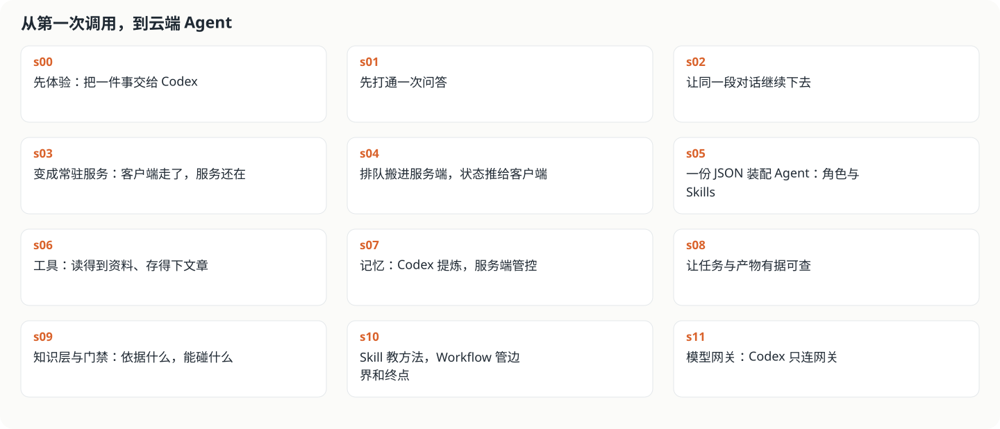

# learn-codex-harness — 用 Codex 的 harness，亲手做一个云端 Agent

## Agent = 模型 + Harness

模型负责理解和决策；harness 负责把它的决定落到地上：转动"想 → 调工具 → 看结果"的循环、保存会话、执行工具、守住审批边界。

OpenAI 的 Codex 在 Web、CLI、IDE 扩展和桌面应用里，底层都是同一个 harness，并通过 **App Server** 协议对外开放。所以我们**不自造 agent loop**，把这个现成的执行引擎拿来，把精力放在它外面真正属于业务的部分：会话怎么接续、Agent 是谁、能用哪些工具、数据和知识放哪、谁说了算。

这套教程带你一步步做出一个**云端 Agent**：常驻在服务器上、随时可以连上去用的写作助手。**每个阶段只多一个单元**，每一步都是可以独立运行、测试的真实代码。

```text
你的程序（我们来写）  ──JSON-RPC──▶  Codex App Server（现成的 harness）  ──▶  模型
  服务与客户端、排队与推送            agent loop、原生历史
  Agent 定义、工具与资料边界    ◀──工具回调──  Skills、工具调用、沙箱
  记忆开关、数据、知识、门禁
```

> 想先弄清 harness 里有什么、App Server 怎么用、一个 Agent 要回答哪六个问题，读 [导论](stages/introduction.md)。

---

## 快速开始

环境要求：**Node.js ≥ 24**。各阶段都锁定 `@openai/codex` 0.154.0，不用全局安装。

先克隆仓库，再登录 Codex；也可以准备一个兼容 Responses API 的 API Key：

```bash
git clone https://github.com/pengcong2020520/learn-codex-harness.git
cd learn-codex-harness
npx codex login   # 使用 API Key 时跳过登录
npm run setup:model
```

用 `npm run setup:model` 统一配置各阶段，不必逐章重复填写。登录、单个 API Key、模型网关的配置范围及自检方式见 [接入模型](stages/setup-models.md)；s00 直接使用本机登录或 `CODEX_API_KEY`，s11 与 app 按指南选择模型网关路线。

从 s00 的环境自检和第一次真实调用开始（在仓库根目录运行）：

```bash
npm --prefix stages/s00-sdk-quickstart ci
npm --prefix stages/s00-sdk-quickstart run doctor   # 环境自检，不调用模型
npm --prefix stages/s00-sdk-quickstart run hello    # 第一次把任务交给 Codex
```

之后每一章都在自己的目录里运行，例如从仓库根目录进入 s03：

```bash
cd stages/s03-service
npm ci
npm run server             # 终端 1：常驻服务
npm run chat               # 终端 2：进入同一阶段目录后运行客户端
npm run lesson -- list     # 本章的离线实验（不调用模型）
```

想边看边学，在仓库根目录打开互动课程（不需要模型服务）：

```bash
npm --prefix app ci
npm --prefix app run web
# 机制课程 http://127.0.0.1:4320/course/ · 章节长文 /course/handbook.html · 阶段演示 /course/changes.html
```

s08 及之后需要 PostgreSQL 与 Redis，各阶段目录提供 `compose.yaml`，步骤见 [数据层说明](app/docs/data-layer.md)。

服务器同时运行 s03–s11 的步骤见 [部署说明](app/deploy/README.md)。教学快照保持不变；部署入口在共享网络内通过 `127.0.0.1:4331` 转发到模型网关，端口与进程管理集中在 `app/deploy/`。

---

## 学习路线



**s00–s16 已上线，每个阶段只加一个单元，每个单元一句话。**

**阶段 1 · 跑起来**

> **[s00 先体验](stages/s00-sdk-quickstart/)** &nbsp; *"模型提出操作，harness 负责执行"* — 用官方 SDK 交给 Codex 一个真实任务，看 harness 替你做了什么
>
> **[s01 单轮问答](stages/s01-single-turn/)** &nbsp; *"收到回包，不等于任务完成"* — 自己接上模型、启动 App Server；一轮算不算完，只看 `turn/completed`
>
> **[s02 多轮会话](stages/s02-multi-turn/)** &nbsp; *"顺序交给队列，历史留给 Codex"* — 同一个 Thread 接着聊；不保存、不拼接、不重发历史

**阶段 2 · 变成服务**

> **[s03 服务化](stages/s03-service/)** &nbsp; *"客户端走了，服务还在"* — 服务端常驻持有 Codex；关掉客户端，交出去的一轮照样跑完
>
> **[s04 事件与消息](stages/s04-events-messages/)** &nbsp; *"先记下来，再一条条做"* — 输入先写进任务记录、服务端排队；状态经 SSE 推给客户端

**阶段 3 · 装配 Agent**

> **[s05 Agent 装配](stages/s05-agent-assembly/)** &nbsp; *"改配置就能换 Agent，但改了就得重新开始"* — 一份 JSON 决定角色、Skill 和执行策略
>
> **[s06 工具](stages/s06-tools/)** &nbsp; *"给它的工具，它才能用；给它的目录，它才能碰"* — 工具白名单、参数校验、按用途授权的资料目录，经 MCP 回调
>
> **[s07 记忆](stages/s07-memory/)** &nbsp; *"记忆交给 Codex 提炼，开不开、谁能参与由服务端说了算"* — 原生记忆默认关闭，三道开关都在服务端

**阶段 4 · 上生产**

> **[s08 数据层](stages/s08-data-layer/)** &nbsp; *"PostgreSQL 记事实，Redis 只负责叫醒"* — 任务和唤醒写在同一个事务里；不确定的事不猜，交给人决定
>
> **[s09 知识层](stages/s09-knowledge-layer/)** &nbsp; *"身份来自服务端签发的上下文，不来自工具参数"* — 所有资料访问共用一道门禁；Wiki 有版本，RAG 可选
>
> **[s10 Skill 与 Workflow](stages/s10-skill-workflow/)** &nbsp; *"可以提议，不能自批"* — Skill 教方法，Workflow 管边界和终点；权限留在模型之外
>
> **[s11 模型网关](stages/s11-model-gateway/)** &nbsp; *"Codex 只认一个地址"* — 网关统一协议、协调多个模型、记账并按预算停派

**阶段 5 · 走向生产**

> **[s12 上云部署](stages/s12-deploy/)** &nbsp; *"一台没人看着的服务器，也能自己起来、自己恢复"* — Compose 交付、健康与就绪、容量限制、备份与回滚；SSH 隧道进入
>
> **[s13 账号与认证](stages/s13-auth/README.md)**（已完成） &nbsp; *"每个用户登录自己的账号，会话和任务都有归属"*
>
> **[s14 用户隔离](stages/s14-isolation/README.md)**（已完成） &nbsp; *"每个用户一个独立的运行环境，互不可见"*
>
> **[s15 权限与资源 Hub](stages/s15-hub/README.md)**（已完成） &nbsp; *"角色、权益与资源范围：知识库、工具、Skill、Agent 谁能用、谁能改"*
>
>
> **[s16 协调面](stages/s16-coordination/README.md)**（已完成） &nbsp; *"节点是否存活变成租约是否过期"*
>
> **s17 分片与路由**（规划中） &nbsp; *"用户按分片落到节点，路由表变了大家同时知道"*
>
> **s18 副本与故障接管**（规划中） &nbsp; *"主节点坏了，从节点接手，丢多少说得清"*

完整项目 [app/](app/README.md) 在 s11 之上继续开发，已经包含 Docker 部署、Web 工作台和互动课程。

每章 README 都按「要回答的问题 → 核心概念 → 分工：Codex 做什么，我们做什么 → 跑起来看看 → 关键代码 → 小结 → 下一章」组织；关键代码逐行摘自该阶段源码（`npm test` 会校验）。

---

## 三种学法

| 方式 | 适合 | 入口 |
|------|------|------|
| 读章节 + 跑代码 | 想亲手做出来 | 各阶段 `stages/sNN-*/README.md`，配 `npm run lesson` 离线实验 |
| 机制课程 | 想把一个机制吃透：问题、源码、正常与异常推演、测验 | `/course/`（s01–s16 已上线） |
| 阶段演示 | 想快速看懂每个阶段多了什么 | `/course/changes.html`：总架构图 + 泳道动画 + 逐行注释源码 |

工作台支持 s00–s16 十七个阶段和当前开发项目（s11 内核）；机制课程已发布 s01–s16 共 45 节。s00 保持缺课空态；s12、s13、s14、s15、s16 仅提供课程与独立部署说明，通过 SSH 隧道连接，不登记为工作台实时目标。

---

## 仓库结构

```text
learn-codex-harness/
├── stages/                 # s00–s11：每个阶段一份独立、可运行的代码快照
│   ├── introduction.md     #   导论：Codex harness、App Server 与六个问题
│   ├── sNN-*/              #   README（章节）、docs/design.md、images/、lessons/（离线实验）、tests/
│   └── verify.mjs          #   阶段文档、结构与测试的统一检查
├── app/                    # 完整项目：Agent 服务、终端客户端、Web 工作台与互动课程（app/web）
├── docs/                   # 路线图等图片、分析报告
└── scripts/run-all.mjs     # 根目录统一安装与测试
```

## 开发与验证

```bash
npm run setup   # 在每个阶段和 app 中执行 npm ci
npm test        # 全部离线测试、课程一致性与阶段文档检查（不调用模型，不需要数据库）
```

CI 在每次推送和 PR 时运行同一组检查。需要真实服务的集成验证见 [stages/README.md](stages/README.md#验证) 与 [app/README.md](app/README.md)；提交规则见 [CONTRIBUTING.md](CONTRIBUTING.md)。

## 致谢与许可

- 「每节一个机制」的组织方式参考了 [shareAI-lab/learn-claude-code](https://github.com/shareAI-lab/learn-claude-code)，内容基于本项目重新编写。
- 执行内核来自 [openai/codex](https://github.com/openai/codex)（Apache-2.0，作为 npm 依赖安装，不包含在本仓库中）。
- 本仓库以 [MIT](LICENSE) 发布；单独复制某个阶段时请一并保留 LICENSE。
