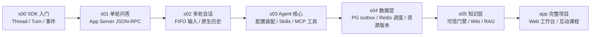

# learn-codex-harness

从一次 SDK 调用开始，逐层搭出一个**配置驱动、可持久化、带知识层与权限门禁**的 Codex Agent 服务。6 个阶段、17 节机制课，每一步都是可以独立运行和测试的真实代码。

> 模型负责推理，Harness 负责执行。
> 本仓库**不自造 agent loop**：模型与工具的执行循环始终交给 Codex 原生 App Server，我们只在它外面一层层加上会话、配置、数据、知识和权限。

## 学习路线



| 阶段 | 主题 | 解决的问题 | 机制课 |
|------|------|-----------|--------|
| [s00-sdk-quickstart](stages/s00-sdk-quickstart/README.md) | SDK 入门 | 怎样让 Codex 在本机完成一个任务、修复代码并通过测试 | — |
| [s01-single-turn](stages/s01-single-turn/README.md) | 单轮问答 | 不用 SDK，直接说 App Server 协议；怎样判断一轮真的结束了 | 2 |
| [s02-multi-turn](stages/s02-multi-turn/README.md) | 多轮会话 | 连续输入不丢、不抢跑；恢复会话而不是重新拼历史 | 2 |
| [s03-agent-core](stages/s03-agent-core/README.md) | 可配置 Agent | 角色、Skills、工具、工作区由一份 JSON 装配，权限与能力一起生效 | 5 |
| [s04-data-layer](stages/s04-data-layer/README.md) | 数据层 | 消息不丢、任务可恢复、产物可追溯到资料版本 | 3 |
| [s05-knowledge-layer](stages/s05-knowledge-layer/README.md) | 知识层 | 每次资源访问都经过可信门禁；Wiki 版本化，RAG 可选 | 5 |
| [app](app/README.md) | 完整项目 | 在 s05 之上持续开发：配置选择、会话升级、Web 工作台、互动课程 | — |

每个阶段的 README 都按「设计原理 → 架构改进 → 技术实现流程 → 核心代码」组织；演进原因与约束见 [stages/README.md](stages/README.md)。

## 快速开始

需要 Node.js >= 24，以及 Codex 登录（`npx codex login`）或兼容 Responses API 的 API Key。所有阶段都锁定 `@openai/codex` 0.154.0，无需全局安装。

```bash
git clone https://github.com/pengcong2020520/learn-codex-harness.git
cd learn-codex-harness

# 1. 从 s00 开始：一次真实调用
cd stages/s00-sdk-quickstart
npm ci
npm run doctor   # 环境自检，不调用模型
npm run hello    # 第一次调用
npm run fix      # 让 Codex 修复 fixture/add.mjs 并通过测试
```

打开互动课程（课程本身不需要模型服务）：

```bash
cd app
npm ci
npm run web      # 课程 http://127.0.0.1:4320/course/  工作台 http://127.0.0.1:4320/
```

每节机制课都配有离线实验，在对应阶段目录运行，例如：

```bash
cd stages/s01-single-turn && npm ci
npm run lesson -- d1-transport
```

s04 及之后需要 PostgreSQL 与 Redis，各阶段目录提供 `compose.yaml`，步骤见 [数据层说明](app/docs/data-layer.md)。

## 互动课程目录

| 阶段 | 机制课 |
|------|--------|
| s01 单轮问答 | `d1-transport` 先建立通信，再派发任务 · `d1-lifecycle` 收到请求，不等于完成任务 |
| s02 多轮会话 | `d2-fifo` 连续输入如何不丢、不抢跑 · `d2-resume` 恢复会话，为何不是重新拼历史 |
| s03 可配置 Agent | `d3-agent-config` 配置是装配合同，不是临时提示词 · `d3-skills` Skill 给方法，权限仍要单独核验 · `d3-tool-registry` 工具名、参数合同和实现怎样接在一起 · `d3-mcp` MCP 是调用边界，不是一工具一服务 · `d3-workspace` 在工作区里，也不等于有权读写 |
| s04 数据层 | `d4-persistence` 消息收到了，为什么还需要一条 outbox？ · `d4-dispatch` Redis 丢了，哪条任务还能继续？ · `d4-versions` 原文改了一句，旧产物还能读吗？ |
| s05 知识层 | `d5-gate` 工具参数里的“我是管理员”为什么不算身份？ · `d5-mounts` 读得到 inputs，不等于读得到所有知识库 · `d5-wiki` 两次更新同时提交，谁能成为当前 Wiki？ · `d5-rag` 新索引失败，为什么旧索引指针不能先切？ · `d5-modes` 配置改成 RAG，为什么旧会话不能马上接着聊？ |

课程的源码摘录由 `npm run course:build` 直接从 `stages/` 取出并记录哈希，`npm run course:check` 会在源码变化后提示重建。

## 仓库结构

```text
learn-codex-harness/
├── stages/                     # 教学迭代：每个阶段一份独立、冻结的可运行快照
│   ├── s00-sdk-quickstart/     #   SDK 入门（examples/01–05、fixture、doctor）
│   ├── s01-single-turn/        #   Demo 1：单轮问答
│   ├── s02-multi-turn/         #   Demo 2：多轮会话
│   ├── s03-agent-core/         #   Demo 3：配置驱动 Agent 核心
│   ├── s04-data-layer/         #   Demo 4：PostgreSQL + Redis 数据层
│   ├── s05-knowledge-layer/    #   Demo 5：知识层 + 通用门禁
│   ├── tests/                  #   跨阶段集成测试
│   └── verify.mjs              #   阶段文档、结构与测试验证
├── app/                        # 完整项目（持续开发）
│   ├── server/                 #   Agent 服务：会话、任务、工具、门禁、知识、HTTP/SSE
│   ├── client/                 #   终端客户端
│   ├── web/                    #   Web 工作台 + 互动课程（public/course）
│   ├── agents/ config/ skills/ #   Agent 定义、工具目录、原生 Skill
│   ├── examples/               #   可复制的场景（写作、客服）
│   ├── docs/                   #   设计与实现文档、验证记录
│   └── tests/ scripts/         #   测试与运维脚本
├── docs/reports/               # 项目分析报告与复现脚本
├── scripts/run-all.mjs         # 根目录统一安装 / 测试
└── .github/workflows/ci.yml    # 离线 CI
```

## 开发与验证

```bash
npm run setup   # 依次在每个阶段和 app 中执行 npm ci
npm test        # 全部离线测试 + 工作台测试 + 课程一致性 + 阶段文档检查
```

这些检查不调用真实模型，也不需要 PostgreSQL / Redis，CI 在每次推送和 PR 时运行同一组检查。需要真实服务的集成验证见 [stages/README.md](stages/README.md#验证) 与 [app/README.md](app/README.md)。

分支、提交和阶段快照的修改规则见 [CONTRIBUTING.md](CONTRIBUTING.md)。

## 文档

- [stages/README.md](stages/README.md)：演进路径、约束与验证方式
- [app/README.md](app/README.md)：完整项目的配置、运行与接口
- [app/docs/](app/docs/)：Agent 核心、数据层、知识层、多用户升级等设计文档
- [docs/reports/](docs/reports/)：项目分析报告（含可复现脚本）

## 致谢

- 课程「每节一个机制」的组织方式参考了 [shareAI-lab/learn-claude-code](https://github.com/shareAI-lab/learn-claude-code)，内容基于本项目重新编写。
- 执行内核来自 [openai/codex](https://github.com/openai/codex)。
