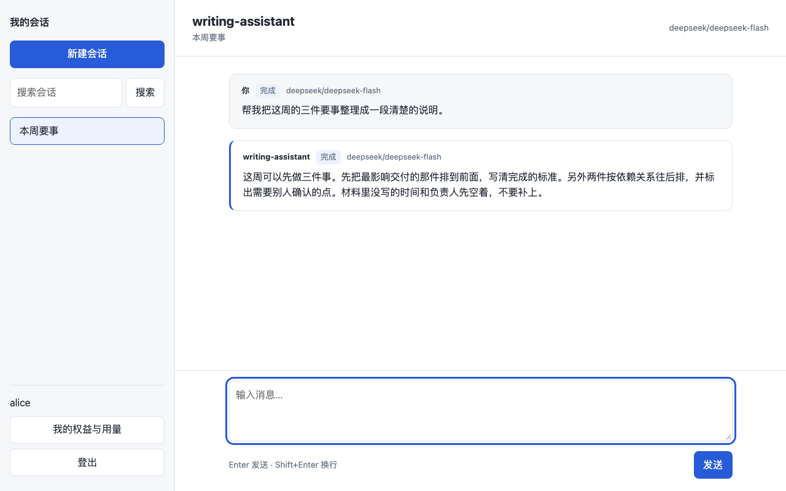
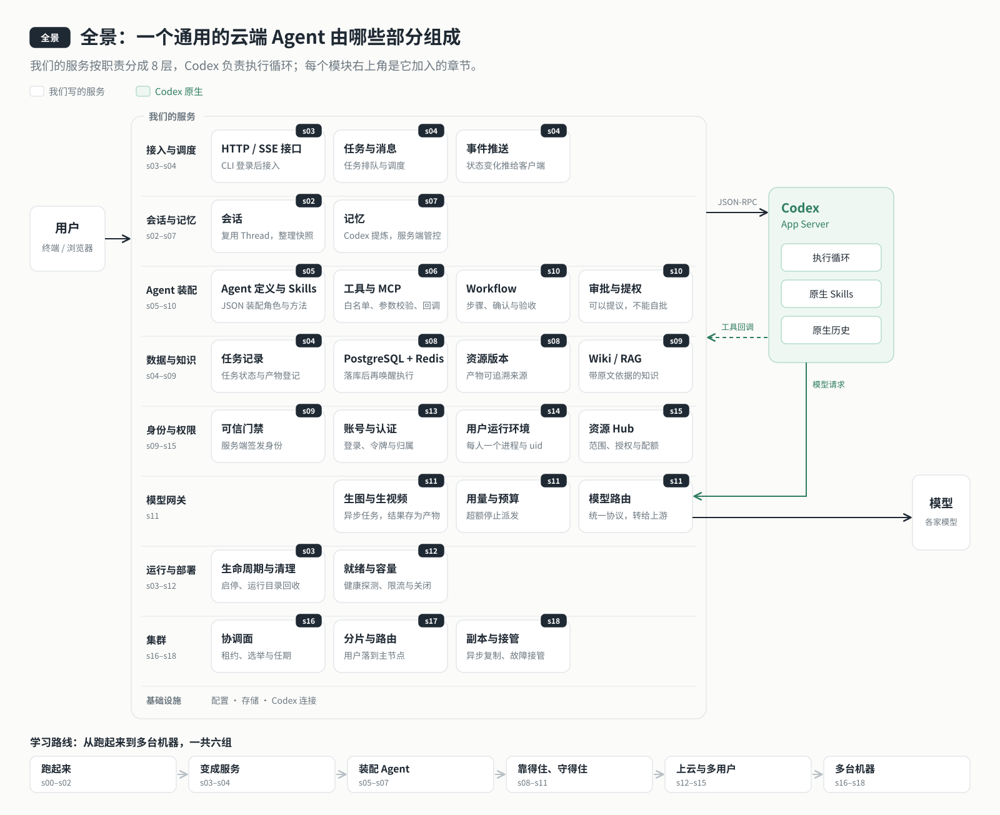

# Codex Agent 脚手架

以教程 s18 为内核、默认单节点的通用云端 Agent：换一份配置，就能部署自己的助手。

- 常驻服务器，客户端断开后，已经提交的任务仍由服务端处理。
- 多用户各有会话、工作区、Codex 进程与系统 uid，资源访问由服务端认定身份。
- 网页聊天和命令行共用同一套服务。
- 用 Agent 配置装配角色、Skill、工具、Workflow 和知识库。
- 模型经网关统一接入，按配置选择模型与管理用量。
- 需要副本与故障接管时打开集群。

## 快速开始

需要 **Node.js ≥ 24**、已启动的 **Docker 与 Docker Compose**。克隆仓库后，在仓库根目录运行：

```bash
cd app
npm ci
npm run setup
```

按提示选择模型、填写对应服务商 API Key、设置管理员账号与至少 12 位密码；域名可留空。首次模型默认选 `deepseek/deepseek-flash`。向导生成权限为 `0600` 的 `.env`、构建镜像、准备数据、启动服务并初始化管理员，等 `/ready` 就绪后，打开 <http://127.0.0.1:4317/>，用刚设置的账号登录。



[查看网页登录界面](docs/images/web-login.png)。网页右侧“产物”面板可浏览个人工作区文件；文本按原文显示，HTML 在隔离预览中运行，图片可直接查看。任务结束会刷新列表，预览可手动刷新或在新窗口打开，窄屏下可收起。命令行用 `/files` 查看产物、`/open <路径>` 获取预览地址。

后文命令都在 `app/` 下运行。命令行使用同一账号登录：

```bash
npm run login
npm run chat
```

Compose 模式下，CLI 凭据保存在 `app/.cli/credentials.json`（相对于仓库根目录，权限 `0600`），目录权限为 `0700`；不要分享或提交此文件。CLI 默认连接本机 `4317`，改端口或连接域名时，在终端设置 `AGENT_SERVER_URL` 后重新登录；CLI 不读取 `.env`。

已有 `.env` 时，普通 `setup` 只提示已配置，不覆盖也不启动；启动用 `npm run up`。更换模型或补填 Key 用 `npm run setup -- --reconfigure-model`，保留账号及其余配置并重新构建、启动。Key 留空不保证服务就绪。

| setup 参数 | 行为 |
| --- | --- |
| `--non-interactive` | 从调用进程环境读取 `CODEX_MODEL`、对应服务商 Key、`SETUP_ADMIN_USER`（默认 `admin`）、`SETUP_ADMIN_PASSWORD` 和可选的 `SETUP_DOMAIN`；首次配置仍要求合法密码 |
| `--no-start` | 只生成配置，不检查 Docker、不启动、不创建管理员；随后运行 `npm run up`，尚无账号时会在交互终端引导创建管理员，再等待就绪；非交互终端会立即退出并提示初始化方式 |
| `--reconfigure-model` | 要求已有 `.env`；更新模型与相应服务商 Key，不重新初始化账号 |
| `--quiet` | 隐藏构建、启动的子进程输出；失败时显示脱敏后的末尾日志，保留步骤提示 |

参数放在 `npm run setup --` 后。`--non-interactive` 时，模型从 `CODEX_MODEL` 读取，服务商 Key 从该模型在 `config/models.json` 里对应的环境变量读取（`keyEnv`，例如 `DEEPSEEK_API_KEY`），管理员用户名与密码分别从 `SETUP_ADMIN_USER`、`SETUP_ADMIN_PASSWORD` 读取。交互模式下，服务商 Key 和管理员密码都隐藏输入。两种方式都不会把密码或 Key 放进命令行参数。

## 做你自己的 Agent

```bash
npm run agent:new -- my-agent
```

名称为 2–32 位小写字母、数字或连字符，已有目录不会覆盖。命令生成并校验 `agents/my-agent/agent.json`、`role.md`、`skills/task-guide/SKILL.md` 和 `workflows/README.md`。在 `.env` 设置 `AGENT_DEFINITION=agents/my-agent/agent.json`，再运行 `npm run up`，新建会话使用它。

### agent.json 字段

`agent` 声明能力与边界，`bindings` 把声明绑定到实际资源。可对照 [写作助手示例](agents/writing/agent.json) 和 [配置校验规则](server/modules/agents/schema.mjs)。

| 字段 | 写什么、如何使用 |
| --- | --- |
| `schemaVersion` | 新包使用 `1.2`，支持包内 Skill 与 Workflow |
| `agent.id` / `name` / `version` | 标识、可选名称、版本标签；权限兼容性还会核对有效配置的指纹 |
| `agent.instructions` | 角色文件，相对 `agent.json`，生成值为 `role.md` |
| `agent.skills[]` | Skill 的 `id`、是否 `required`；可选 `scope` 当前仅支持 `system` |
| `agent.tools.allow[]` | 可以调用的已实现工具名；角色文字不能增加工具权限 |
| `agent.dataBindings[]` | 用 `sourceRef` 引用资料源，声明 `actions`（`read` / `create`）、`methods`（`files`）及是否必需 |
| `agent.executionRef` | 引用 `bindings.executions` 中的执行策略 |
| `agent.memory` | `use`、`contribute` 控制使用和贡献原生记忆，还受服务端总开关限制；生成值均为 `false` |
| `agent.outputs` | 产物 `directory`、允许的 `formats`、`writeMode`（仅 `create-only`）、`requiredChecks`（文件存在、格式） |
| `agent.knowledge[]` | 可选知识库挂载：`kbId`、`mode`（`wiki` / `rag`）、`actions`（`read` / `update` / `index`），必须含 `read` |
| `agent.workflows[]` | 可选工作流：`id`、标签、Skill、参数、授权、验收及步骤；步骤可收窄写入范围、要求确认、选择模型 |
| `bindings.workspaceDir` | 相对 `agent.json` 的工作区根目录，生成值为 `../../workspace`；多用户运行时再划分各自目录 |
| `bindings.sources` | 以资料源名为键，填写 `type: files`、工作区内的 `root`，可选 `readOnly`、`revision`；只读源不能授予 `create` |
| `bindings.skills` | 以 Skill id 为键，填写包内 `SKILL.md` 的相对 `path`；声明 `requires` 的脚本、写文件或资产依赖当前不支持 |
| `bindings.executions` | 执行策略固定为 `sandbox: read-only`、`approvalPolicy: never`、`nativeShell: false`、`nativeFileWrite: false`；业务写入走受控工具 |
| `bindings.knowledgeBases` | 以 `kbId` 为键绑定工作区内的原始资料 `sourceRoot` 和 Wiki `wikiRoot` |

### 角色：写清服务对象与交付要求

编辑 `agents/my-agent/role.md`，写它为谁做什么、依据哪些资料、输出什么、遇到缺失事实怎样处理。由 `agent.instructions` 加载。角色与 Skill 放在 Agent 包内，不能放到模型可写的工作区。装配原理见 [s05 Agent 装配](../stages/s05-agent-assembly/README.md)。

### Skill：写任务方法

在 `agents/my-agent/skills/<技能名>/SKILL.md` 中写名称、描述和工作步骤，再同时登记 `agent.skills` 与 `bindings.skills`。启动用户运行环境时同步到该用户的 `CODEX_HOME`；可用 `$task-guide` 显式选择生成的 Skill，也可由 Workflow 指定。支持 `references/` 下的 `.md`、`.txt` 参考资料，不支持把可执行脚本混进 Skill。方法与权限的分工见 [s10 Skill 与 Workflow](../stages/s10-skill-workflow/README.md)。

### 工具：声明能力和资料范围

把已有工具加入 `agent.tools.allow`；文件访问还需 `dataBindings`、`bindings.sources` 和 `outputs` 授权。生成包只读 `inputs/`，新建产物写入 `outputs/`，不覆盖已有文件。这里的路径属于当前用户工作区，Compose 宿主对应 `nodes/<节点>/workspace/users/<用户ID>/`；由服务端按用户分配，不能把资料混放成所有用户共用。新工具需在 [工具模块](server/modules/tools/) 中实现并注册，再通过参数与权限校验；仅写一个名称不会产生能力。见 [s06 工具](../stages/s06-tools/README.md)。

### Workflow：写确认点与验收条件

编辑 `agent.json` 的 `agent.workflows`。生成的 `solve-task` 先澄清目标，步骤完成后等待用户确认，再交付到 `outputs/` 并检查文件存在与格式。模型通过 `propose_task` 提议，用户确认后才执行；`writes` 只能收窄已有可写范围。`workflows/README.md` 只是说明文件，不会自动加载。见 [s10 的设计说明](../stages/s10-skill-workflow/docs/skill-workflow-design.md)。

确认点支持继续到下一步、按意见修改当前步、结束任务；同一步最多重做 10 次，修改时保留已确认部分，产物使用新文件名。网页在等待确认时显示“继续”“修改”“结束”，点击“修改”填写意见，并可查看本步已重做次数；命令行使用 `/confirm [补充说明]`、`/revise <意见>`、`/reject`。

`outputs.formats` 支持 `md`、`txt`、`html`、`png`、`jpeg`、`webp`、`mp4`；HTML 沿用文本大小上限与只能新建规则，格式检查要求可解析并包含 `html` 或 `body` 元素。

### 知识库：绑定原始资料与 Wiki

新生成的 Agent 不预挂载知识库。需要时在 `agent.knowledge` 声明库、模式与动作，在 `bindings.knowledgeBases` 绑定该用户工作区内的原始资料和 Wiki 目录，并按业务加入 `kb_list`、`kb_read`、`kb_search` 等工具。可参考写作助手的 `general` 库：`inputs/general` 存原始资料，`research/general/wiki` 存 Wiki。资源仍需通过 Hub 归属与授权，填写路径不等于获得其他用户的知识。Wiki 修订走提议、确认与提交；RAG 还需检索服务和索引配置，不能只改 `mode` 就启用。见 [s09 知识层](../stages/s09-knowledge-layer/README.md) 与 [知识实现说明](../stages/s09-knowledge-layer/docs/knowledge-implementation.md)。挂载知识库时保持 `AGENT_MEMORY_ENABLED=false`。

修改定义、角色或 Skill 后，运行 `npm run up` 重建并重启，新建会话。运行期间检测到这些配置变化，会停止后续调用；已有会话不会自动接受不兼容的权限变化。

## 日常运维

| 命令 | 用途 |
| --- | --- |
| `npm run up` | 构建镜像、准备配置和数据、按当前拓扑启动并等待就绪；可加 `-- --quiet` |
| `npm run down` | 停止 Compose 服务，保留容器与数据 |
| `npm run logs` | 持续查看最近 100 行及后续日志；指定服务用 `npm run logs -- node-a` |
| `npm run status` | 查看容器、版本和 `/ready` 状态 |
| `npm run auth:init` | 尚无账号时交互创建首个管理员；正常 `setup` 已代为执行 |
| `npm run user:add -- alice` | 创建普通用户；加 `--admin` 创建管理员 |
| `npm run user:passwd -- alice` | 交互重设密码 |
| `npm run user:disable -- alice` | 禁用账号 |
| `npm run user:list` | 列出账号 |

账号维护在临时容器中执行；密码隐藏输入并二次确认，不传命令行参数。`npm run login` 用于 CLI 登录，Compose 凭据位于 `app/.cli/credentials.json`；浏览器单独登录。

### 备份与恢复

在装有 `flock` 等部署工具的 Linux 部署主机上运行：

```bash
npm run backup
npm run restore -- <备份目录名>
```

备份短暂停止 Agent 节点，按节点写入 `backups/<节点>/<UTC时间>/`，包含数据库、workspace 和原生历史，结束时尝试恢复服务。恢复目录名形如 `2026-11-13T12-00-00-000Z`，使用实际备份名。恢复会覆盖数据库及文件，并要求输入 `RESTORE`；无人值守时仅在确认备份后加 `--yes`。取消或失败时节点保持停止，核对结果后再决定后续操作。密钥配置 `.env` 应另行安全保管。备份、恢复与下载互斥。

### 升级

先备份，再在同一部署目录更新源码并运行 `npm ci`、`npm run up`。脚本重建并使用 `codex-agent:current` 镜像，数据库按迁移脚本更新；数据保存在原有卷及节点目录中，不随容器替换而清空。保留 `.env`、`nodes/`、`.data/`、`.runs/`、`workspace/`、`backups/`、`.cli/` 和数据卷，保持 `CONTAINER_APP_DIR` 不变。服务器升级用下节的 `deploy`；它保留上一版代码与镜像，`rollback` 不回滚数据库。

## 部署到服务器

单节点建议 **2 GB 内存**。远端需 Linux、Docker Compose、systemd、rsync、flock、tar、gzip、sha256sum，并使用脚本支持的 root SSH 管理账号；本机需 Node.js 24、Docker、ssh、rsync。先完成本地配置；只准备远端部署时可用 `npm run setup -- --no-start`。

以下 SSH 目标为占位符，替换成自己的服务器：

```bash
npm run deploy -- --host 'root@<服务器地址>'
npm run deploy -- --host 'root@<服务器地址>' auth-init
npm run deploy -- --host 'root@<服务器地址>' tunnel
```

无子命令时，先检查服务器，再在远端没有 `.env` 时生成独立凭据、同步代码并部署；已有配置保留。部署默认目录为 `/opt/codex-agent`，可用调用进程的 `APP_DIR` 指定无空格绝对路径，部署后不要移动。首次部署按提示执行 `auth-init`；它单独交互创建远端管理员，本地管理员账号不会复制过去。隧道保持运行时，从本机打开 `http://127.0.0.1:4317/`。如果本机服务已占用该端口，先停止本机服务。CLI 在另一个终端运行 `npm run login`、`npm run chat`，凭据仍在本机 `app/.cli/credentials.json`。

其他子命令沿用同一前缀：`check` 检查条件，`status` 查看就绪状态，`user -- add alice` 添加远端用户，`backup` 备份，`backup-download` 下载备份，`rollback` 回滚上一版代码和镜像。部署中断或状态不明时先核对，不重复提交部署。

### 域名与 HTTPS

将 `agent.example.com` 指向服务器，在服务器部署目录的 `.env` 中设置：

```dotenv
AGENT_ALLOWED_ORIGINS=https://agent.example.com
```

多个入口用逗号分隔完整 origin，不带路径或末尾 `/`；需要本机或隧道网页登录时，也保留对应的 `http://127.0.0.1:4317`、`http://localhost:4317`。`setup` 中填写域名只会添加白名单，不配置 DNS、证书或公网代理。

在宿主安装并配置 Caddy，使用 [deploy/Caddyfile.example](deploy/Caddyfile.example) 的示例：

```caddyfile
agent.example.com {
  reverse_proxy 127.0.0.1:4317 {
    header_up Host {http.request.host}
    flush_interval -1
  }
}
```

域名与证书签发条件由部署者准备，公网入口交给宿主 Caddy；Compose 端口保持发布到回环地址。修改 `.env` 后在服务器部署目录运行 `npm run up`（需 Node.js 24 和依赖），让全部节点加载同一白名单。域名 CLI 在终端设置 `export AGENT_SERVER_URL=https://agent.example.com`，再运行 `npm run login`；登录凭据仍写本机 `app/.cli/credentials.json`。

## 打开集群

在当前部署目录、服务可用时执行：

```bash
npm run cluster:enable
npm run cluster -- status
```

默认扩展为 `node-a,node-b,node-c`；只扩展到两节点用 `npm run cluster:enable -- --nodes node-a,node-b`。`--yes` 跳过扩容确认，`--quiet` 收起构建输出，两者都不跳过管理员鉴权；`cluster -- status` 也需管理员登录。脚本保留现有凭据，为新增节点生成配置，重建启动并等待副本追平，最长 10 分钟。失败或超时标为待核对，用 `status` 与 `cluster -- status` 检查，不重复发起扩容。

也可以手动配置：在 `.env` 同时设置 `AGENT_CLUSTER_NODES=node-a,node-b,node-c` 和 `COMPOSE_PROFILES=cluster`，补齐新节点的凭据后运行 `npm run up`；推荐用 `cluster:enable`，它会生成凭据并等待副本追平。

节点集只能从 `node-a` 逐步增加到两节点、三节点，不能减少。首次分片放置要等配置中的节点全部在线；已有分片扩容补副本，不自动搬迁主节点。单节点显示 `replication: "off"`。同机多容器用于体验集群机制；两台服务器的拓扑、隧道与操作边界见 [s18 设计说明：两台服务器的部署步骤](../stages/s18-replication/docs/design.md#两台服务器的部署步骤)，按脚手架实际部署目录与端口调整，不直接照搬教程目录。

## 配置项参考

以下为通过 `setup` 首次生成的配置；手工复制模板时，`CODEX_MODEL` 示例值为 `kimi/kimi-k2.7-code`，与向导默认不同。完整模板见 [.env.example](.env.example)。内部生成的数据库、节点、网关凭据不需手工填写，不在此列出。修改后运行 `npm run up`。

| 名称 | 默认值 | 什么时候改 |
| --- | --- | --- |
| `AGENT_PORT` | `4317` | 调整宿主回环入口端口；同步 origin 和 CLI 的 `AGENT_SERVER_URL` |
| `AGENT_ALLOWED_ORIGINS` | 本机 `127.0.0.1`、`localhost` 的 `4317` origin；填写域名时追加 HTTPS origin | 网页使用域名或不同端口 |
| `AGENT_DEFINITION` | `agents/writing/agent.json` | 切换自己的 Agent 包 |
| `CODEX_MODEL` | `deepseek/deepseek-flash` | 选用模型目录中用途含 `chat` 的模型；优先用 `npm run setup -- --reconfigure-model` |
| `CODEX_MODEL_CATALOG_ENABLED` | `true` | 使用网关模型目录时保持开启 |
| 对应服务商 Key，如 `DEEPSEEK_API_KEY`、`KIMI_API_KEY` | 未填写者为空 | 开通或轮换服务商访问；可用 Key 名见 [config/models.json](config/models.json)，只在配置中保存 |
| `AGENT_WEB_SEARCH` | `auto` | 设为 `off` 关闭原生联网搜索；`auto` 仍受模型能力和用户权限限制 |
| `AGENT_MAX_CONCURRENT_TURNS` | `2` | 控制同时执行的轮次，按资源与预算调整 |
| `AGENT_MAX_QUEUED` | `200` | 调整排队上限 |
| `AGENT_RATE_LIMIT_PER_MINUTE` | `120` | 调整请求限流 |
| `AGENT_MAX_SSE` | `20` | 调整事件连接上限 |
| `AGENT_RUNTIME_LIMIT` | `4` | 降低活跃用户运行环境数量；允许 `1–4` |
| `AGENT_MEMORY_ENABLED` | `false` | 评估原生记忆时再开启；挂知识库时保持关闭 |
| `AGENT_MEMORY_USE` / `AGENT_MEMORY_GENERATE` | `true` / `true` | 总开关开启后控制使用与生成，还受 Agent 声明约束 |
| `AGENT_BUDGET_DAILY_TOKENS` / `AGENT_BUDGET_MONTHLY_TOKENS` | 空 | 设置每日 / 每月 token 预算 |
| `AGENT_BUDGET_DAILY_COST` / `AGENT_BUDGET_MONTHLY_COST` | 空 | 设置每日 / 每月费用预算，计价依据模型目录 |
| `AGENT_CLUSTER_NODES` / `COMPOSE_PROFILES` | `node-a` / 空 | 用 `cluster:enable` 扩容时由脚本更新 |
| `POSTGRES_MEMORY_LIMIT` / `REDIS_MEMORY_LIMIT` | `256m` / `128m` | 调整基础服务内存上限 |
| `GATEWAY_MEMORY_LIMIT` / `AGENT_MEMORY_LIMIT` | `256m` / `768m` | 调整网关 / 每个 Agent 节点的内存上限 |
| `NPM_REGISTRY` / `APT_MIRROR` | npm 官方源 / 空 | 构建环境需要镜像源时设置 |
| `CONTAINER_APP_DIR` | 首次配置时的部署绝对路径 | 由脚本生成，部署后保持不变，避免破坏挂载与原生历史路径 |

## 架构



Codex App Server 负责原生执行循环；脚手架在外层提供常驻服务、会话与队列（s01–s04）、Agent 装配、工具与记忆（s05–s07）、数据层、知识层与门禁、Skill 与 Workflow、模型网关（s08–s11），再接上部署、账号、用户隔离、资源 Hub（s12–s15）、协调、分片、副本接管（s16–s18）。各章独立源码见 [教程导览](../stages/README.md)，互动课程在 [course/](../course/README.md)。

## 限制

- 角色评测的在线执行器尚未适配当前多用户与集群运行方式，不能把已有评测命令当作脚手架上线验收。
- 管理员网页尚未实现；账号维护使用上述命令。
- 当前按用户隔离进程、uid 与文件目录；按用户的容器级隔离属于生产加固工作。

## 上传 PRD 与参考图

网页输入框旁的「上传」按钮会把文件保存到当前用户工作区的 `inputs/uploads/`，并加入待发送附件。附件标签上的「×」只从下一条消息中移除附件，已上传文件仍保留。每条消息最多 4 个附件；发送时仍需填写文字要求。上传成功后，可在产物面板的 `inputs/` 下查看文件和预览图片。

命令行先上传，再加入下一条消息：

```text
/upload ./需求.md
/attach inputs/uploads/需求.md
/upload ./参考.png 参考-v1.png
/attach inputs/uploads/参考-v1.png
请根据 PRD 和参考图设计页面
```

本地路径包含空格时用双引号括起来。`/upload <本地路径> [保存名]` 只上传；`/attach <inputs/uploads/路径>` 加入下一条普通消息、追加消息或 Workflow 任务。发送成功后清空待发送附件，`/help` 可查看用法。

| 类型 | Content-Type | 单文件上限 | 校验 |
|---|---|---|---|
| `md` | `text/markdown` | 256 KiB | 合法 UTF-8 |
| `txt` | `text/plain` | 256 KiB | 合法 UTF-8 |
| `png` | `image/png` | 5 MiB | PNG 文件头 |
| `jpeg`、`jpg` | `image/jpeg` | 5 MiB | JPEG 文件头 |
| `webp` | `image/webp` | 5 MiB | RIFF / WEBP 文件头 |

文件名长度为 1–100 个字符，只允许字母、数字、中文、`-`、`_`、`.`，不能以 `.` 开头。文件只能新建；同名返回 409，请换名。文件按用户隔离，上传不会开放模型对只读 `inputs` 资料的写权限。

接口为 `PUT /workspace/files?path=inputs/uploads/<文件名>`，使用原始字节作为请求体，`Content-Type` 与扩展名一致，返回 `{ path, size, sha256 }`。`POST /messages` 的可选字段 `attachments` 为路径数组，路径必须指向当前用户上传目录中已存在的白名单文件；非法项返回 400 并指出序号。附件路径随任务持久化，部署升级需运行 `npm --prefix app run data:migrate`。

文本附件只在模型输入中追加「用户上传了文件：inputs/uploads/xxx.md（可用 read_file 读取）」，正文由模型按需读取。图片由服务端读取并作为 Codex `image` 输入发送；Workflow 第一步同样携带附件，后续步骤沿用会话历史。

## 模型看图

`config/models.json` 的模型条目可填写 `"inputs": ["text"]` 或 `"inputs": ["text","image"]`，缺省为 `["text"]`。`inputs` 决定是否允许图片附件；已有的 `inputModalities` 不自动赋予看图许可。本仓库没有为任何模型标注图片输入，需经负责人允许并实测后再配置。

**实测会产生费用，默认不运行。** 负责人允许后，在仓库根目录对指定模型执行：

```sh
npm --prefix app run gateway:check -- --model <服务商/模型名> --image
```

命令经模型网关发送一张内置 8×8 纯红色 PNG，询问「这张图片是什么颜色」，以回答包含「红」判定通过；同时保留普通对话连通检查并汇总用量。实测不要求预先声明 `inputs`，也不会自动修改模型清单。通过后由负责人在对应模型条目中添加 `"inputs": ["text","image"]`，并按正常配置更新流程重启服务。

任务含图片时，会按步骤指定、任务指定和默认路由的优先级确定本轮模型，再检查 `inputs`。不支持时在调用模型前明确拒绝，提示配置支持图片的模型或换用这样的模型；不会静默丢弃图片。在途追加沿用当前轮次模型。
