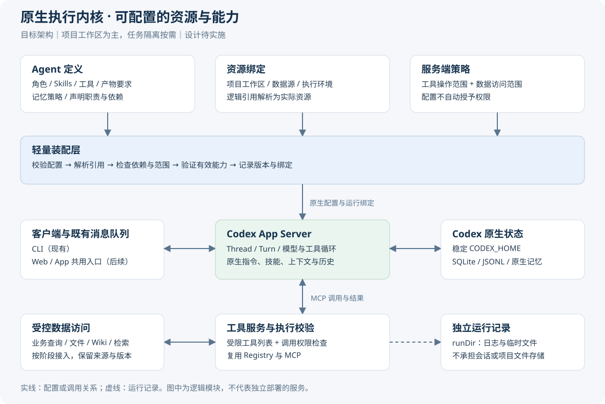

# 基于 Codex App Server 的 Agent 脚手架设计方案

**文档日期：** 2026-09-29  
**设计版本：** v1.0  
**原生依赖锁定：** `@openai/codex` 0.154.0，Node ≥ 24  
**状态：** 设计基线，保留升级前现状和分阶段目标。配置驱动 Agent 首版已实施，实际行为、兼容限制与验证结果见[项目说明](../README.md)及[新 demo3](../../stages/s03-agent-core/README.md)。本文验收表仍为目标清单，不代表全部通过。

> **范围说明：** 本文档描述面向单机、单用户、每服务加载一个 Agent 定义与项目工作区、多原生 Thread 的轻量级 Agent 脚手架设计。多用户、多账户、跨主机演进、Skill/Tool 市场化、强制向量数据库及托管基础设施均**不在本版范围内**。Web/App 端客户端为远期愿景，当前 CLI 保持不变，本版本不承诺新 UI 客户端。工作目录体系详细规范以 [workspace-design.md](workspace-design.md) 为权威，本文仅汇总关键约束，不重新定义。早期[多用户升级方案](multi-user-upgrade-plan.md)为后置参考，非本版交付计划，不纳入本版路线图。

> **知识层补充设计**：[知识层架构方案](knowledge-layer-design.md) v1.2 以 Codex 原生执行与 Wiki Skills 为核心，新增通用权限门禁，将授权与资源版本管理分开，按需接入 Chroma + BM25。知识层后续目标以该方案为准，当前实现仍以 README 为准。

---

## 1 目标与边界

### 1.1 核心目标

将当前固定的写作辅助工具（writing assistant）演进为**以项目工作区为中心、可配置的 Agent 脚手架**，使同一运行时可通过不同的 Agent 定义覆盖写作、研究、客服支持、数据分析等使用场景，同时保持：

- 单一本地服务实例，不新增独立运行时或规划队列；
- 原生 Codex App Server 作为模型/工具执行权威，脚手架负责资源管理与访问验证；
- 复用现有连接、工具注册、会话与消息模块；保留已验证的会话和调度行为；
- 凭证仅通过服务端引用传递，绝不以明文出现于示例配置、提示词或日志。

### 1.2 明确不做的事

| 排除项 | 说明 |
|---|---|
| 多用户 / 账户 / 权限分层 | 本版仅单一部署配置，不实现多租户隔离 |
| 多 Agent 引擎并发 / 编排平台 | Agent 定义描述用例行为，不等于多个引擎实例 |
| 全量 Skill / Tool 市场化 | Tool 目录文件保持独立可复用定义，不构建市场 |
| 强制向量数据库或托管基础设施 | 数据后端可按工作负载选型，本版无静默新增 DB 要求 |
| 任务隔离（Task Isolation）自动提供 | M1 后按需扩展；Worktree 不是 OS 沙箱，不作为首阶段前提 |
| 新 Web / App / CLI 客户端 | 现有 CLI 维持不变，新客户端为远期计划 |

### 1.3 首个交付闭环

加载一份 Agent 配置 → 绑定项目工作区与允许资料 → 启用可用 Skill 和工具 → 由 Codex 执行任务 → 生成可检查的产物。

先用写作场景验证这条链路，再按场景增加结构化查询、Wiki 与检索。数据层已在 Demo 4 实施；Demo 5 的知识层实现范围见 [知识层实现说明](knowledge-implementation.md)。

---

## 2 现状与能力归属

### 2.1 现有服务端结构

[server/main.mjs](../server/main.mjs) 启动单一服务，包含以下核心模块：

| 模块 | 职责 |
|---|---|
| [`ToolManager`](../server/modules/tools/index.mjs) | 工具注册与执行 |
| [`CodexConnection`](../server/modules/codex/connection.mjs) | 原生 Codex 进程连接与协议通信 |
| [`SessionService`](../server/modules/sessions/index.mjs) | 会话生命周期，使用 `baseInstructions` |
| [`MessageService`](../server/modules/messages/index.mjs) | 消息路由，维护外部产品 FIFO/steer 队列 |
| [`MemoryService`](../server/modules/memory/index.mjs) | 记忆配置验证、摘要读取、Thread 贡献控制 |

本地 Bearer HTTP/SSE + CLI 访问；**不新增另一个运行时、规划器或队列**。

### 2.2 角色定义现状（待重构）

[server/modules/role/index.mjs](../server/modules/role/index.mjs) 当前**嵌入**项目/工作区目录约定，含：

- 身份描述与工作流程
- 工具限制
- 项目/工作区路径约定（当前硬编码于角色源文件中，而非通过配置参数化）

该角色源文件被以下两处消费：

1. [server/modules/sessions/index.mjs](../server/modules/sessions/index.mjs)：通过 `baseInstructions` 注入会话；
2. [server/modules/config/index.mjs](../server/modules/config/index.mjs)：通过 `AGENT_INSTRUCTIONS` 导入，作为模型目录（model-catalog）的 `instructions_template` 字段。

**角色源与两处消费方需同步重构**，防止会话指令与模型目录模板不一致。`codex/config.mjs` 负责生成原生配置，并不消费上述角色模板。

> **待验证：** 所提议的角色加载器对原生 harness 行为的兼容性；`baseInstructions` vs `developerInstructions` 参数兼容性须在锁定版本下核实，不可假定参数替换是琐碎操作。

### 2.3 运行时工作区现状

[server/modules/codex/runtime.mjs](../server/modules/codex/runtime.mjs) 中 `prepareRun` 创建随机 `.runs/app-server-*` 目录作为 `runtime.workspace`（即 `runDir` 的实际路径，非整个 `.runs`）；连接 spawn `cwd`、日志及会话启动 `cwd` 均使用该目录。[server/modules/tools/files.mjs](../server/modules/tools/files.mjs) 和 [server/modules/tools/loader.mjs](../server/modules/tools/loader.mjs) 独立推导根目录/工作区。

当前二者不同：Codex 的 `cwd` 是启动目录，文件工具使用 `serviceRoot/workspace`。目标是统一到配置的 `workspaceDir`；`cwd` 本身不构成安全边界。

文件工具约束（现状）：
- 仅处理 `.md` / `.txt`，单文件上限 256 KiB
- `inputs` 目录只读；`research` / `drafts` / `outputs` 为默认写作模板目录；首阶段路径变更时保留现有限制
- 禁止覆盖、软链接和文件硬链接；当前检查固定四目录，目标再叠加每个 Agent 的来源范围

[server/modules/sessions/history.mjs](../server/modules/sessions/history.mjs) 枚举 `.runs` 并有遗留导入；[server/modules/maintenance/index.mjs](../server/modules/maintenance/index.mjs) 保留索引和活动路径。

**工作区语义变更方向已确认，实施待 M1 完成**；M1 将当前混用的 `runtime.workspace` 拆成 `workspaceDir` 与 `runDir`。详见 [workspace-design.md](workspace-design.md)。工作区布局不是框架的强制要求。

### 2.4 工具加载与能力范围

[server/modules/tools/loader.mjs](../server/modules/tools/loader.mjs)：Ajv schema 验证、受信模块、带 `execute` 的注册表；[server/modules/tools/index.mjs](../server/modules/tools/index.mjs)：版本化快照与全局空闲边界重载；[server/modules/tools/mcp-server.mjs](../server/modules/tools/mcp-server.mjs) 按版本 URL，共享单一 Token。

**当前无可配置 Agent 作用域**：`tools/list` 返回完整注册表；`registry.call` 在执行时对调用者无 Agent 特定作用域验证。目标状态下，`tools/list` 过滤和 `registry.call` 执行层均拒绝超出 Agent 允许范围的调用，包括绕过 `tools/list` 的直接伪造调用。

现有 MCP 已有文件路径约束，但尚无基于 Agent 身份的数据作用域验证；MCP 请求当前不携带可信 Thread 身份，不可用 `modelAgentId` / `threadId` 作为授权依据。

> 来源加载根目录 ≠ 目标状态下的数据工作目录。

### 2.5 配置与沙箱

[server/modules/codex/config.mjs](../server/modules/codex/config.mjs)：`.data/codex` 为稳定 `CODEX_HOME`；原生 SQLite/JSONL 状态**非手工可编辑的业务 DB**，是独立于脚手架元数据（D1）的原生运行时状态。原生配置文件由该模块生成；[server/modules/config/index.mjs](../server/modules/config/index.mjs) 构建启动参数，当前禁用：shell、`apply_patch`、agents、apps、`view_image`；session sandbox 为只读，`approvalPolicy` 为 `never`。

原生 `enabled_tools` 字段适用于命名的 MCP server，不自动覆盖所有原生工具；shell 和 `apply_patch` 通过独立配置项控制，应继续分别验证其有效开关。目标的单 Agent 首阶段中，所有 Thread 共享同一有效策略；策略通过受信服务端凭证/路由绑定，描述符不可变。

> **重要：** 原生沙箱**不自动**约束自定义 MCP server 的文件系统/DB/网络操作，需在服务层实施资源执行约束。现有限制在明确实施独立变更前予以保留。

### 2.6 记忆服务现状

[server/modules/memory/index.mjs](../server/modules/memory/index.mjs)：配置验证 / 摘要读取 / Thread 贡献控制。

当前以 `use_memories` 控制读取、`generate_memories` 控制后台生成；`thread/memoryMode/set` 单独控制 Thread 是否参与未来记忆贡献。**关闭贡献（`contribute: false`）不禁用读取、不删除已有记忆、不取消已提交的异步生成任务**——正在进行的后台生成仍可能写入。贡献 API 仅控制未来的资格，不保证拒绝所有已排队的异步写入。读取可通过 `use_memories=false` 关闭；这不会抹除已经进入会话上下文的信息。

记忆**生成**（background pipeline）是独立的服务侧标志，与贡献标志分开；示例以 `use: false, contribute: false` 为 Agent 默认值，服务侧同时关闭生成。以后启用生成须先解决当前合并受阻的问题，并验证实际行为。

生成最终摘要受阻（无原生写工具）；提取、整合、注入为独立步骤。当前无跨 Thread 独立的 Agent 记忆隔离保证。Wiki 持久化领域知识与 Codex 跨会话记忆是不同概念。

[tests/codex-memory.integration.mjs](../tests/codex-memory.integration.mjs)：有 fake-provider + 真实二进制的覆盖，这是**代码中的现有证据**，不证明真实模型质量或端到端生成可用。

---

## 3 总体结构与装配流程

### 3.1 逻辑架构



*图注：上图为逻辑分层，不代表独立部署服务。Codex App Server 执行模型与工具循环；产品脚手架负责资源管理与访问验证。*

### 3.2 装配流程

```
1. 验证 Agent 定义 JSON（schemaVersion、必填字段、引用合法性）
2. 解析受信引用与路径（workspaceDir、sourceRef 定位器、executionRef）
3. 取 Agent 作用域 ∩ 服务端策略 ∩ 环境能力 → 有效能力集
4. 生成原生 Codex 配置 + 限定作用域的工具/数据处理器
5. 探测原生有效能力（skills/list、mcpServerStatus/list，结合实际调用测试）
6. 记录运行时描述符（定义摘要值 + 角色/技能/工具版本 + 有效工具列表 + 工作区 + 来源绑定及修订策略 + 策略摘要值）
7. 创建或恢复 Thread → 执行事件与产物交付
```

**约束：**
- 不拼接所有文档或自动安装依赖/提升权限
- 启动时不暴露作用域外工具
- 错误须明确报告，不以"配置成功"掩盖未就绪状态
- 模型参数不可伪造作用域或 Agent ID

原生 `threadId` 定位会话，`turnId` 定位执行轮次；产品消息任务保留自己的 `jobId` 并记录两者的映射。`runDir` 是服务启动目录，不是任务执行 ID。

### 3.3 目录结构参考（示意）

工作区布局不是框架强制要求；以下为写作场景的参考示例。Agent 定义可以是单一 JSON 文件（如 `agents/writing-agent.json`），角色指令位于配置目录下的 `roles/writing-assistant.md`，路径均相对于配置目录解析，无需强制 `definitions/` 与 `bindings/` 拆分。工作区内可选放置 `AGENTS.md` 和 `.agents/skills` 作为原生发现的输入。

```
serviceRoot/
├── agents/
│   ├── writing-agent.json      # Agent 定义（含绑定）
│   └── roles/
│       └── writing-assistant.md # 相对配置目录解析的角色指令
├── workspace/                  # workspaceDir（稳定绝对路径，可外部挂载）
│   ├── AGENTS.md               # 可选，原生发现输入
│   ├── .agents/skills/         # 可选，原生 Skill 发现路径
│   ├── inputs/                 # 只读源文档（当前写作模板，首阶段保留）
│   ├── research/
│   ├── drafts/
│   └── outputs/
├── .runs/app-server-*/         # runDir（实际路径形如此，非整个 .runs）
└── .data/codex/                # codexHome：原生 SQLite/JSONL，不手工编辑
```

---

## 4 工作区与状态存储

### 4.1 工作区约定（方向确认，M1 实施）

依据 [workspace-design.md](workspace-design.md)，关键约束摘要：

| 属性 | 值 |
|---|---|
| `serviceRoot` | 服务部署根目录 |
| `workspaceDir` | 稳定配置绝对真实路径，默认 `serviceRoot/workspace`，可外部配置 |
| Codex `cwd` + 文件工具 | 使用同一有效工作区，不产生分歧；`cwd` 本身不是安全边界 |
| `runDir` | 实际路径形如 `.runs/app-server-*`，服务启动级日志/临时，非 task run ID |
| `codexHome` | `.data/codex`，原生存储 |
| 新 Thread | 共享项目文件，对话独立持久化，无需每次聊天 `mkdir` |
| 并发工作 | 不做全局 `process.chdir`，不破坏并发工作 |

**M1 实施：** 在 [runtime.mjs](../server/modules/codex/runtime.mjs) 分离工作区与启动目录。会话恢复使用原会话工作区，路径缺失则报错。同步调整 [history.mjs](../server/modules/sessions/history.mjs) 的历史定位与 [maintenance](../server/modules/maintenance/index.mjs) 的清理规则，保留遗留 Thread ID 和历史；迁移验证通过前不移除兼容逻辑。

**明确不做（M1）：** Worktree/任务目录不由 `thread/start` 自动提供，不作为 OS 沙箱，任务隔离为 M1 后可选扩展。

> 原生 `AGENTS.md` / `.agents/skills` 的父级发现与项目配置须纳入有效配置检查；分离 `CODEX_HOME` 不能自行消除 `~/.agents/skills` 发现路径。

### 4.2 状态存储层级

| 层 | 载体 | 可编辑性 |
|---|---|---|
| 脚手架元数据（Agent 定义、绑定、版本、访问规则）（D1） | 受信 JSON 配置 | 仅运维人员，模型/客户端不可编辑 |
| 原生 Codex 状态（独立于 D1） | SQLite/JSONL（[server/modules/codex/config.mjs](../server/modules/codex/config.mjs) 管理路径） | 不手工编辑 |
| 业务运行元数据（消息/会话索引 JSON） | 现有 JSON | 受控迁移；无需引入 PostgreSQL 仅为配置 Agent |
| 工作区文件产物 | 工作区目录文件系统 | 受工具策略约束 |

---

## 5 数据层与访问方式

### 5.1 五类数据逻辑归属

| 编号 | 类型 | 示例 | 所有权 |
|---|---|---|---|
| D1 | 脚手架元数据 | Agent 定义、绑定、来源配置、访问规则（仅脚手架所有） | 服务运维 |
| D2 | 外部结构化业务数据 | 订单、产品、指标 | 外部系统，通过受信连接器/动作查询 |
| D3 | 原始源文档（含媒体） | 合同、研究文献、产品说明 | 原始资料权威版本，只读保留 |
| D4 | 派生知识 | 解析文本、Wiki 页面、摘要、实体 | 生成产物，须保留溯源 |
| D5 | 索引 | FTS / 分块 / 向量 | 可重建，不作为主权威 |

原生 Codex 状态（SQLite/JSONL）是独立于 D1 的原生运行时状态，不是 D1 子集。现有消息/会话索引 JSON 是**业务运行元数据**，不是业务配置。Markdown 文件可以是源（D3）也可以是派生（D4），由溯源而非格式决定所有权。

### 5.2 访问模式与最小访问合约

同一场景下，结构化查询、直接文件访问、Wiki 导航、检索可按需组合：

- **结构化查询：** 通过受信连接器动作；查询输入含服务端校验的 `sourceRef`、查询条件和允许过滤器；输出为带 `sourceId`、读取时间 `asOf` 与可用版本信息的类型化行。后端声明支持的方法；不支持的必需方法须提前报错，不作无声降级。不要求向量，不允许 Agent 自主选择原始 DB 连接。
- **直接文件：** 工作区路径范围内，受文件工具策略约束（D3/D4）；`read_file` 仅产出来源内容；`list_files` 同样受允许范围过滤；Skill 资产读取为独立的受信授权，与知识读取分开。
- **Wiki 导航：** 组织维护页 + 原始只读 + 治理；人工编辑保留版本/作者/证据；非全量可丢弃缓存（D4）。
- **检索适配器：** RAG 不强制要求向量；查询时检索可指向原始或 Wiki 页（D5→D3/D4）。
- **LLM Wiki 与 RAG** 是互补的知识组织/使用策略，不是独立存储类型。

文件、Wiki 与检索返回统一的来源信息：`content`、`sourceId`、`revision`、`locator`，附可用状态与更新时间。SQL 行级查询、检索候选筛选及按文档 ID 获取详情都须执行范围校验，不能通过切换访问入口绕过。

### 5.3 数据完整性约束

- **保留原始版本：** 生成内容标明机器生成及核实状态；原始资料也不自动等于已核实事实
- **溯源链接：** 来源版本、定位器、陈旧标记及重新编译/重建索引
- **删除/撤销：** 立即阻止后续检索并异步清理派生物；无法抹除已有聊天上下文中的数据可见性
- **人工编辑：** 进入 Wiki 的人工修改须保留版本/作者/证据，不将所有 Wiki 视为可丢弃缓存
- **受限合并摘要：** 须满足所有贡献来源的权限许可，或分别重新推导；禁止跨允许组 Wiki 泄漏
- **禁止将生成输出无审查提升为源真相**
- **凭证以服务端引用传递**，不出现于提示词或配置示例

### 5.4 轻量来源合约字段

```json
{
  "id": "product-notes",
  "type": "files",
  "locator": "inputs/product",
  "capabilities": ["read"],
  "revision": "2026-09-01",
  "freshness": "2026-09-29T00:00:00Z",
  "status": "ready"
}
```

元数据不含密钥；授权在服务端处理；`sourceRef` 解析为受信定位器。摄取/解析/索引任务状态：`ready` / `stale` / `failed` / `unsupported`；所需能力未就绪 → 显式报错，可选明确降级。结构化数据须区分最新读取与历史快照读取；`asOf` 记录数据时间，不代表所有连接器都支持历史查询。必需的快照能力不受支持时应报错。

数据库/向量产品选型延后，首阶段使用受信 JSON 配置与现有元数据持久化 + 本地文件。文件适配器在 M2 实施；数据来源合约在 M2 确定，**不推迟到 M3**；M3 独立门控的结构化读连接器、Wiki、检索适配器，公共合约夹具可独立验证，但不证明实际后端集成。重量级解析/索引任务为可选独立作业，不为所有适配器新增大型队列。

---

## 6 Agent 定义与资源绑定

### 6.1 八个配置维度

Agent 定义描述角色与能力要求，部署绑定将资源引用解析到实际路径和连接。八个维度如下，`id` 与 `version` 另作身份元数据。定义与绑定可存入同一 JSON，均由服务端受信配置管理。

| 维度 | 字段 | 语义 |
|---|---|---|
| 角色 | `agent.instructions` | 角色 .md 文件路径（相对配置目录） |
| 技能 | `agent.skills` | 能力实现方式（受信 ID + `required` 标志） |
| 工具 | `agent.tools` | 允许工具列表，仅用现有确切名称 |
| 数据绑定 | `agent.dataBindings` | 数据源绑定（sourceRef + 动作 + 方法） |
| 执行策略引用 | `agent.executionRef` | 受信执行策略的引用 |
| 工作区 | `bindings.workspaceDir` | 本次部署绑定的项目目录；首阶段每服务一个 |
| 记忆 | `agent.memory` | `use` / `contribute` 标志 |
| 产物 | `agent.outputs` | 产物目录、格式、写入模式、所需检查 |

**设计原则：** 每个维度不强制新配置文件；可同居一份 JSON 条目。技能目录缺少必需条目时报错；已知但未支持的可选技能标记为降级；未知字段报错。记忆生成（background pipeline）是独立的服务侧配置，不作为 Agent 定义的必填字段。

### 6.2 配置示例（提案，待实施）

以下示例为**自定义脚手架合约提案**，尚待实施，**非当前 Codex 可直接使用的配置**。下列 Skill ID 仅作示例，不代表已安装；装配时须与受信目录和原生发现匹配，必需项不满足则报错。角色指令路径相对配置目录；来源/产物路径相对工作区；沙箱只读适用原生层，MCP 受控写入仅允许通过工具策略的输出创建，两者不矛盾。`outputs.writeMode` 仅声明创建权限，不附带读取授权；`read_file` 只可读取允许来源；`read` 动作包含该来源内的受限目录浏览，`list_files` 须过滤范围外条目。

```json
{
  "schemaVersion": "1.0",
  "agent": {
    "id": "writing-assistant-v1",
    "version": "0.1.0",
    "instructions": "roles/writing-assistant.md",
    "skills": [
      { "id": "research-outline", "required": true },
      { "id": "citation-formatter", "required": false }
    ],
    "tools": {
      "allow": [
        "list_files",
        "read_file",
        "write_file"
      ]
    },
    "dataBindings": [
      {
        "sourceRef": "product-notes",
        "actions": ["read"],
        "methods": ["files"],
        "required": true
      }
    ],
    "executionRef": "restricted-local",
    "memory": {
      "use": false,
      "contribute": false
    },
    "outputs": {
      "directory": "outputs",
      "formats": ["md", "txt"],
      "writeMode": "create-only",
      "requiredChecks": ["file-exists", "format"]
    }
  },
  "bindings": {
    "workspaceDir": "/srv/projects/article",
    "sources": {
      "product-notes": {
        "type": "files",
        "root": "inputs/product"
      }
    },
    "executions": {
      "restricted-local": {
        "sandbox": "read-only",
        "approvalPolicy": "never",
        "nativeShell": false,
        "nativeFileWrite": false
      }
    }
  }
}
```

**字段说明补充：**
- `tools.allow` 中仅列出现有确切工具名；可选扩展（`search_web`、`read_webpage`）如需可添加
- `requiredChecks` 的 `format` 检查文件扩展名/格式合规性，不检查语义真实性；引用（`references`）可作为可选的手工审查扩展
- `required: false` 的可选技能在语法已知时支持降级；未知字段或声明启用但不支持的操作须被拒绝
- `memory.contribute: false` 仅关闭未来贡献资格，不停止已排队的异步生成，不禁用读取

---

## 7 能力范围与执行约束

### 7.1 Skill 生命周期

**不自行实现 SKILL.md 解析器或循环**；原生引擎为权威。脚手架注册表将受信 ID 映射到路径/版本；实际发现须与 `enabled` 集合匹配；变更须重新验证。

原生 `turn/start` 输入项中 Skill 输入的正确语法为 `{"type": "skill", "name": "…", "path": "…"}`。`skills/list`、`skills/config/write` 及 Skill 输入项已在锁定版本生成的协议中确认。`enabled_tools` / `disabled_tools` 属于 MCP 原生配置，需验证在该版本下的实际效果。协议字段存在不等于本项目已经接通。

原生发现范围：`repo` / `user` / `admin` / `system`；分离 `CODEX_HOME` 不能自行消除 `~/.agents/skills` 全局路径。**新全局/父级发现的 Skill 不可自动启用**；须验证显式禁用名称/路径 + 发现范围；关闭隐式调用不等于禁止显式调用。必需 Skill 依赖 shell 但 shell 不可用时 → Agent 阻塞，不得为此 Skill 宽泛启用 shell；未来作用域化运行时兼容方案须经验证后才可授权。

Skill 目录允许控制**启用与调用**，不等于无法以文本模拟工作流；文件保密性为独立关注点。

### 7.2 工具执行约束

目标中，`tools/list` 仅暴露允许工具，`tools/call` / Registry 再校验执行权限。即使伪造工具名直接调用，也必须拒绝。现有文件约束继续保留，并叠加 Agent 数据作用域。

| 约束项 | 当前状态 | 目标状态 |
|---|---|---|
| 工具列表可见性 | 完整注册表可见 | 仅 Agent 允许工具集可见，直接调用同样拒绝 |
| MCP 凭证路由 | 共享单一 Token | 服务端绑定，运行时策略描述符不可变 |
| native shell | 禁用 | 明确实施独立变更前保留禁用 |
| `apply_patch` | 禁用 | 保留 |
| MCP 文件系统约束 | 已有路径限制，无 Agent 数据作用域 | 服务层增加 Agent 数据作用域约束（M2） |
| 来源/根目录范围 | 限定固定四目录，尚未支持配置来源 | 保留现有限制，并叠加 Agent 允许来源 |

**工作区内的来源/根目录限制仍然有效**；路径遍历在工作区边界内同样被拦截，不只是防止逃逸到工作区外。

产物写入为独立授权；Skill 资产读取与知识读取权限分开；不做大范围根目录读取授权。

### 7.3 版本与策略生命周期

**首阶段方案（待实施）：** 整体 Agent 策略/配置变更在受控服务重启或空闲边界应用，立即撤销生效（新调用立即拒绝），不支持每条消息热切换。现有工具热重载适配到同一整体策略门控，不可独立于授权变更注册表。

| 场景 | 处理方式 |
|---|---|
| Thread 恢复时配置不兼容 | 显式兼容迁移或新建会话，不静默授权旧权限 |
| 锁定版本实现不可用 | 不可伪装重放旧版本 |
| 安全撤销 | 立即拒绝新的不允许调用；尽可能取消进行中请求并报告状态 |
| 旧数据可见性 | 无法取消已有上下文的数据可见；强隔离须新建干净上下文 |

有效元数据状态：`configured` / `available` / `blocked` / `unverified`；声明功能 ≠ 可用。配置 API 当前未经完整运行时验证；现有注册表重载适配到同一策略门控。

---

## 8 会话、配置版本与产物

### 8.1 运行时描述符

描述符记录最小解析定义摘要，包含：

- Agent 定义摘要值、角色内容版本与 Skill 版本
- 工具版本 + 有效工具列表（解析后）
- 工作区绑定路径
- 数据源绑定 ID + 修订策略
- 策略摘要值及有效设置（沙箱模式、写入模式）

**描述符不包含：** 重复的聊天历史、全量冻结的业务数据快照。

### 8.2 会话恢复

- 恢复时对比当前描述符与存储描述符；
- 发现不兼容变更 → 显式报错并提示新建会话；
- 兼容迁移须明确定义迁移路径；
- 不静默提升权限；版本不匹配时不伪装重放旧版本。

### 8.3 产物管理

- 写入模式 `create-only`：不覆盖，不软链接
- 格式检查：文件扩展名/格式合规性（非语义真实性核查）
- 任务产物须可验证存在并符合格式要求（验收 A15，M2 必需）
- 引用限制：可选扩展，手工审查，不阻塞核心交付

---

## 9 现有模块调整与实施顺序

### 9.1 调整范围

| 模块 | 调整内容 | 阶段 |
|---|---|---|
| [role/index.mjs](../server/modules/role/index.mjs) | 角色源从嵌入式改为外部加载器（读取相对路径的 .md 或 JSON）；同步更新 SessionService `baseInstructions` 消费与模型目录 `instructions_template` 消费，三处一致 | M2 重构 |
| [codex/runtime.mjs](../server/modules/codex/runtime.mjs) | 分离稳定 `workspaceDir` 与临时 `runDir`，分别传递给调用方 | M1 |
| [sessions/index.mjs](../server/modules/sessions/index.mjs) + [sessions/history.mjs](../server/modules/sessions/history.mjs) | Thread/Turn ID 不变；统一 cwd、历史索引与恢复逻辑，并记录装配版本绑定 | M1/M2 |
| [maintenance/index.mjs](../server/modules/maintenance/index.mjs) | runDir 清理与历史兼容性验证，无历史丢失 | M1 |
| [config/index.mjs](../server/modules/config/index.mjs) | 按 Agent 定义筛选有效工具暴露；同步更新模型目录 `instructions_template` 引用 | M2 新增 |
| [tools/loader.mjs](../server/modules/tools/loader.mjs) + [tools/index.mjs](../server/modules/tools/index.mjs) | 注册表按有效工具集装配；热重载与整体策略同步；[mcp-server.mjs](../server/modules/tools/mcp-server.mjs) 在列表和调用入口执行校验 | M2 调整 |
| [tools/files.mjs](../server/modules/tools/files.mjs) | M1 注入独立工作区；M2 接入来源合约和 Agent 范围 | M1/M2 |
| [codex/config.mjs](../server/modules/codex/config.mjs) | 生成有效 MCP、Skill 与记忆配置；保持原生状态目录稳定 | M2/M4 |
| [memory/index.mjs](../server/modules/memory/index.mjs) | 记忆管道实际端到端验证（真实模型） | M4 |
| [codex/connection.mjs](../server/modules/codex/connection.mjs) | 连接 cwd 指向 workspaceDir；协议日志和启动记录继续写入 runDir | M1 |

新增最小的 `agents` 装配模块与 `data` 适配接口，由 `server/main.mjs` 接线；其余复用现有模块。消息模块保留 FIFO/steer 和任务—轮次映射，不增加第二套模型执行循环。

### 9.2 实施里程碑

| 里程碑 | 交付内容 | 能力状态 |
|---|---|---|
| **M1** | 分离临时 runDir 与稳定工作区；遗留 ID/历史兼容；共享 cwd 与多 Thread 独立历史；重启无历史丢失；缺失路径显式报错 | 工作区路径稳定；遗留 ID/历史保留 |
| **M2** | Agent 定义加载 + 角色外化（源与两处消费方一致）+ 原生 Skill 依赖验证 + 工具作用域双重拦截 + 文件数据适配器 → 单一可验证写作参考闭环 | 角色可配置；工具作用域限定；单一来源适配；数据合约确立 |
| **M3** | 数据源合约可扩展性 + 真实结构化读连接器 + Wiki 版本/溯源 + 检索适配器（独立门控，夹具独立验证） | 按实际场景独立接入；每种后端需真实端到端验收，夹具结果不代替集成结果 |
| **M4** | 记忆管道端到端实际验证（真实模型）；任务隔离为可选扩展，非前提 | 记忆实际验证；任务隔离可选 |

---

## 10 验收标准

以下各项均标注阶段标签；所有验收项为**待验证（pending）**状态；各里程碑表中的能力描述均为交付目标，不继承历史测试声明。标注 `(ext)` 为扩展项。

| ID | 验收条件 | 阶段 |
|---|---|---|
| A01 | 共享 cwd、多 Thread 独立历史、重启无历史丢失；遗留 Thread ID 可寻址；恢复原会话 cwd；缺失路径显式报错；runDir 清理不删除项目文件或历史 | M1 |
| A02 | Agent 定义中必需引用（Skill、来源、`executionRef`）缺失时启动报错；可选引用缺失时降级不中断 | M2 |
| A03 | 角色指令变更后原生 harness 行为验证；`baseInstructions` 与 `developerInstructions` 兼容性经锁定版本核实 | M2 |
| A04 | 允许的 Skill 可通过显式加载（受信目录 + 原生发现匹配）及启用时的隐式路径激活；脚手架注册表与 `enabled` 集合一致 | M2 |
| A05 | 显式禁用的 Skill 不可调用；全局父级新发现 Skill 不可自动启用 | M2 |
| A06 | 所需依赖不可用时不提升权限，不假装就绪，显式阻塞报错 | M2 |
| A07 | Agent 允许范围外的工具对模型不可见；直接伪造调用同样被 registry 执行层拒绝 | M2 |
| A08 | 路径遍历、软链接、超出 `workspaceDir` 及工作区内超出允许来源的读/列操作均被拦截（含工作区内错误来源的窄化数据允许列表测试） | M2 |
| A09 | 允许来源的实际文件可读；产物读取仅在另行授权时可用；`outputs` 创建写入实际落盘 | M2 |
| A10 | 结构化查询遵守来源作用域限制；最新读取与历史快照能力可区分，结果记录数据时间，不支持的必需查询明确拒绝 | M3 |
| A11 | Wiki 页面保留版本/溯源/来源定位器；陈旧标记触发重新编译；删除/撤销阻止后续检索并清理派生物；不发生跨允许组 Wiki 泄漏 | M3 |
| A12 | RAG 检索结果包含来源版本/索引修订引用；索引刷新后结果可验证更新 | M3 `(ext)` |
| A13 | Thread 恢复时配置不兼容显式报错；不静默授权；合法兼容迁移路径明确定义 | M2 |
| A14 | 记忆提取/整合/召回端到端实际验证（真实模型，非 fake provider）；`use: false` 与 `contribute: false` 分别独立可控且语义正确（关闭贡献不禁读取不删旧记忆）；生成管道为独立服务侧控制 | M4 |
| A15 | 任务产物文件存在且格式合规；格式通过不等于语义或引用真实，引用质量另行评估 | M2 |
| A16 | Skill 资产读取与调用路径须经证明可用（完整 Skill 注入不足以证明引用资产可访问） | M2 |

---

## 11 依据与待验证事项

### 11.1 设计依据来源

| 来源 | 类型 | 备注 |
|---|---|---|
| [server/main.mjs](../server/main.mjs) 等本地模块 | 现有代码 | 能力归属的直接证据 |
| [workspace-design.md](workspace-design.md) | 已有设计文档 | 工作区权威规范 |
| [package.json](../package.json) | 现有配置 | 锁定 `@openai/codex` 0.154.0 |
| [Codex App Server 文档](https://learn.chatgpt.com/docs/app-server) | 官方文档 | 原生协议参考 |
| [Build Skills 文档](https://learn.chatgpt.com/docs/build-skills) | 官方文档 | Skill 生命周期参考 |
| [MCP 扩展文档](https://learn.chatgpt.com/docs/extend/mcp) | 官方文档 | MCP 集成参考 |
| [Memories 定制文档](https://learn.chatgpt.com/docs/customization/memories) | 官方文档 | 记忆能力参考 |
| [LLM Wiki 概念（Karpathy）](https://gist.github.com/karpathy/442a6bf555914893e9891c11519de94f) | 外部参考 | Wiki 知识组织思路参考 |
| [检索适配器思路（LangChain）](https://docs.langchain.com/oss/python/deepagents/retrieval) | 外部参考 | 检索设计参考；不代表采用 LangChain 运行时 |

### 11.2 待验证事项清单

以下事项在本文档中描述为**确认方向**，但具体行为尚待锁定版本下实际验证：

| 事项 | 状态 |
|---|---|
| 原生 `baseInstructions` vs `developerInstructions` 兼容性（锁定版本 0.154.0） | 待验证 |
| `enabled_tools` / `disabled_tools` 在锁定版本下的实际行为（有文档，行为须编译适配器核实） | 待验证 |
| `turn/start` skill `{"type":"skill","name":"…","path":"…"}` 在锁定版本下的资源引用可访问性 | 待验证 |
| `skills/list`、`mcpServerStatus/list` 的接口存在性已由锁定 schema 确认；装配后的有效列表与调用行为 | 待验证 |
| `skills/config/write` 在锁定版本下的有效配置边界 | 待验证 |
| 全局及父级 Skill 的禁用能否在发现、显式调用、隐式调用三处生效 | 待验证 |
| 记忆生成管道解除阻塞的具体条件（当前仅 fake-provider 证据） | 待验证 |
| 记忆提取/整合/召回在真实模型下的实际质量 | 待验证 |
| 结构化数据连接器（`live` / `asOf`）后端实现选型 | 选型延后，不阻塞本文档 |
| 向量/FTS 索引后端选型 | 选型延后，工作负载驱动决策 |
| Wiki 页面治理工具链 | M3 阶段选型 |
| 任务隔离（Worktree/独立目录）及其与 OS 沙箱的边界 | M1 后可选扩展，方案待定 |

---

*本文档为设计交付物，不包含实施步骤执行或测试运行。实施与测试结果将在后续文档或变更记录中体现。*
