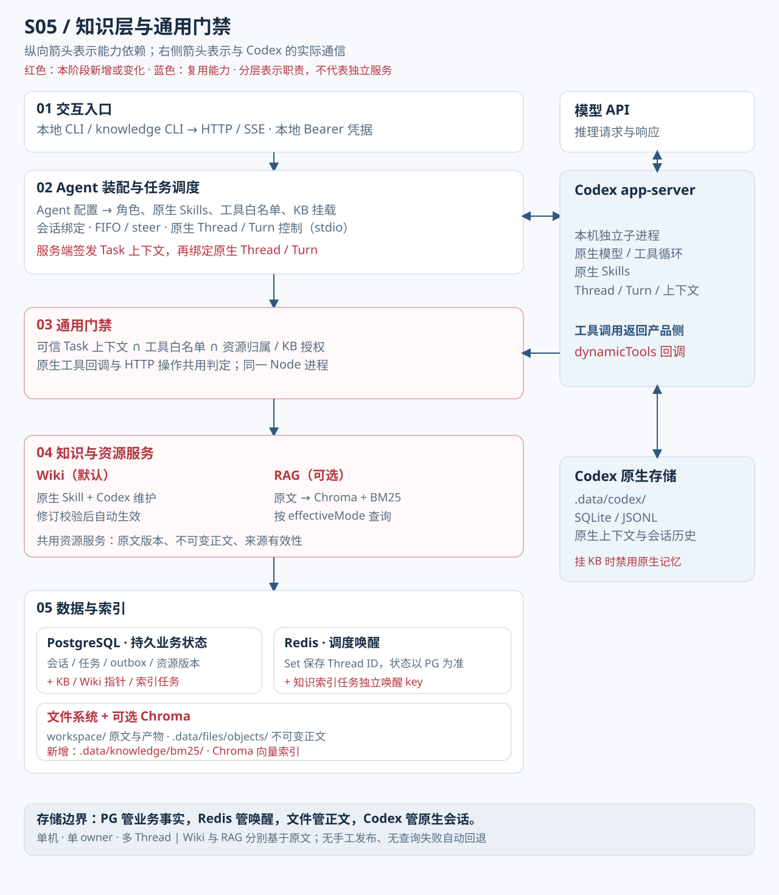

# 知识层实现详解（s05 / app 当前实现）

本文档是 s05 及 `app/` 当前知识层的权威说明，记录已实现状态与已知局限。

> **注意**：[知识层设计基线](knowledge-layer-design.md)是早期目标设计文档，可能包含尚未实现的 rerank、缓存共享、自动 Wiki 更新等规划项。两份文档共存时，以本文件为准。

## 总体架构



s05 / app 总体架构：01 交互入口 → 02 Agent 装配与任务调度 → 03 通用门禁 → 04 知识与资源服务 → 05 数据与索引。

逐层说明与运行示例见 [s05 设计说明](../../stages/s05-knowledge-layer/docs/design.md)；下文保留实现约束和接口细节。

## 整体结构

知识层由三个部分组成：

1. **原始资料（sources）**：存放于 `inputs/<kbId>/`，只读，`.md` / `.txt`，256 KiB 上限。由用户复制到工作区，或通过本地 Web 工作台受控导入。导入只创建、不覆盖，校验 KB 挂载、update 权限与真实目录，并登记资源版本；模型的 write_file 仍不能写 inputs。
2. **Wiki（结构化知识）**：模型阅读原文后通过 `kb_submit_revision` 写入；正文以 immutable blob 存入 `.data/files/objects/`，PG 维护当前版本指针。
3. **索引（可选 RAG）**：手动触发 `knowledge -- index`；BM25 持久于 `.data/knowledge/bm25/`；Chroma 可选语义索引。

三者互相独立：原始资料不自动触发 Wiki 更新，Wiki 不自动触发索引重建。

## 数据库表

由 `server/modules/data/migrations/002-knowledge.sql` 新增，顺序迁移并验证 v1 checksum：

| 表 | 关键字段 | 说明 |
|----|---------|------|
| `knowledge_bases` | `instance_id`, `id`, `owner_id`, `source_root`, `wiki_root`, `index_revision` | KB 归属、路径与生效索引 |
| `knowledge_mounts` | `instance_id`, `agent_id`, `kb_id`, `desired_mode`, `effective_mode` | Agent 的期望与生效模式；actions 仍由 Agent 配置声明 |
| `wiki_pages` | `kb_id`, `slug`, `current_version` | 每页当前版本指针（PG 事务切换） |
| `wiki_versions` | `instance_id`, `id`, `kb_id`, `slug`, `revision`, `blob`, `sources`, `created_at` | 不可变版本记录 |
| `knowledge_indexes` | `instance_id`, `kb_id`, `revision`, `state`, `manifest` | 索引版本元数据 |
| `knowledge_jobs` | `instance_id`, `id`, `kb_id`, `state`, `error`, `created_at` | 仅索引构建任务；maintain 使用普通 tasks 表 |

`tasks.knowledge` 字段：`{ kbId, operation }` 记录知识任务类型。

## Wiki 写入机制

### 工具：kb_submit_revision

校验项目（任一失败不切换生效指针；前置写入的未引用 blob 可能保留）：

1. 门禁检查：当前 Task 上下文有 `update` action 授权。
2. `source_versions` 数量：至少 1 个，至多 50 个；所有来源必须属于本 KB 当前有效原文版本（与 resources.current_version 比对）——来源失效返回 `SOURCE_STALE`。
3. Markdown 标题校验：正文必须包含合法 Markdown 标题结构（具体规则由实现决定）。
4. `expectedVersion` 乐观锁：
   - 新建页面传 `null`；
   - 更新传 `kb_read` 返回的 `versionId`；
   - 与当前 `current_version` 不匹配返回 `VERSION_CONFLICT`。
5. 写 immutable blob → PG 事务 insert `wiki_versions` + update `wiki_pages.current_version`。

成功后无需人工 publish，自动生效。

**不实现**：Wiki 引用 Wiki（只引用原文来源）；来源失效不等价于权限撤销（权限判定与内容有效性分开）；跨实例共享。

### 路径隔离

- `research/<kbId>/wiki` 路径上的 `read_file / write_file` 被门禁拒绝，必须使用 `kb_*` 工具。
- `inputs/<kbId>` 路径受挂载规则限制；未挂载的 KB 不可见。

## 搜索实现

### kb_search（effectiveMode = wiki）

- 有界文本包含搜索，最多扫描 200 个 Wiki 页面；limit 1–20。
- **不调用 embedding，不做 RAG 回退**。

### BM25（可选，索引模式）

- 切片：800 字符，重叠 120；`Intl.Segmenter` zh 分词，ICU 版本写入 manifest。
- 持久于 `.data/knowledge/bm25/` 的独立 revision 文件；与 Chroma 共用 chunkId、sourceVersion 和 pipeline。
- 仅索引原始 `.md` / `.txt`，最多 200 个文件 / 200 个目录 / 20,000 个 chunk。

### Chroma（可选，rag 模式）

- 需额外配置 `CHROMA_URL / EMBEDDING_BASE_URL / EMBEDDING_API_KEY / EMBEDDING_MODEL / EMBEDDING_DIMENSIONS`；不复用 Codex 聊天模型为嵌入。
- 每次 revision 独立 collection，staging 构建完成后 PG 切换 `index_revision`。
- 语义质量尚未人工验收。

### 融合

BM25 + Chroma 以 RRF（常数 60）融合；无 rerank 实现；无自动混合 Wiki 索引。

## 模式状态机

Agent knowledge[].mode 声明期望模式，持久为 desired_mode；运行中 `effective_mode` 固定（不运行中切换）。

| desired | 索引状态 | effective_mode | 说明 |
|---------|---------|---------------|------|
| wiki | — | wiki | 仅文本搜索 |
| rag | ready | rag | 语义+BM25 |
| 首次准备 rag | 未就绪 | wiki（pending 显示） | 索引完成后重启才激活 |
| 已生效 rag | 重启发现索引或配置不兼容 | 拒绝启动 | 恢复配置，或显式切回 wiki 后重建 |

`rag` 查询失效或 embedding 依赖故障时**直接报错**，不回退 wiki；embedding / model / dim / pipeline 不兼容拒绝并要求重建索引。原始来源变更后旧版本的 read / search 拒绝；Wiki 需更新正文，RAG 需重建索引。

新索引默认手动触发 `npm run knowledge -- index <kbId>`；不存在后台自动重建。

## 权限门禁与知识工具

`server/modules/permissions/index.mjs` 统一同进程判定（见 [s05 设计说明](../../stages/s05-knowledge-layer/docs/design.md) 中的「03 通用门禁」一节）：

- 工具名在 allow 列表 **AND** 资源所有权/KB 挂载合法 **AND** `actions` 包含当前操作。
- 整库授权（不是页面级 ACL）；默认私有，未挂载不可见。
- 任务范围：`kb_submit_revision` 需要任务上下文中有 `update` action；普通对话默认不能提交修订。
- Skill 是方法说明，不是身份；原生 shell / apply_patch / subagent 禁用；挂 KB 时要求 AGENT_MEMORY_ENABLED=false，原生记忆整体禁用。
- 权限收窄需要新 Thread；已进入历史的内容无法追回。门禁会检查数据库中全部已登记的 KB，即使某个 KB 未写入当前 Agent 配置，也不能借宽泛的 inputs 文件权限绕过挂载限制。

## knowledge:init

```bash
npm run knowledge:init
```

- 创建工作区目录结构。
- 将 `skills/knowledge/SKILL.md`（原生 instructions-only Skill）复制到 `workspace/.agents/skills/knowledge/SKILL.md`。
- 已有不同文件时不覆盖。
- 不导入样例事实，不自动写 Wiki；只建目录和部署可信 Skill。

默认 Agent 可选绑定 knowledge Skill，缺失时服务启动会输出警告。

## knowledge CLI 命令

| 命令 | 说明 |
|------|------|
| `npm run knowledge -- list` | 列出 KB、模式、权限和索引版本 |
| `npm run knowledge -- search <kbId> <关键词>` | 按 effectiveMode 执行 Wiki 或 RAG 查询 |
| `npm run knowledge -- read <kbId> <slug>` | 读取 Wiki 页面 |
| `npm run knowledge -- index <kbId>` | 手动触发索引构建 |
| `npm run knowledge -- job <jobId>` | 查看知识 job 状态 |
| `npm run knowledge -- maintain <kbId> "任务说明"` | 创建独立 Thread 提交 knowledge:{kbId,operation:'update'} 持久任务，返回任务/Thread ID，异步执行 |

`maintain` 命令由服务端自动显式注入可用 knowledge skill；返回任务/Thread ID 后异步执行，可用聊天 `/resume` 或 GET /state?threadId= 查看进度；knowledge job 只查询索引任务。

## HTTP 接口（本机客户端使用）

Agent API 需现有本机 Bearer 认证。Web 工作台通过本地同源接入层调用，令牌保留在 Node 服务端；浏览器使用 HttpOnly 会话 Cookie。仍未实现账号登录或公网多用户认证。

| 接口 | 说明 |
|------|------|
| `GET /knowledge` | 列出 KB |
| `GET /knowledge/pages?kbId=` | 列出最多 200 个生效页面版本；正文读取仍复查来源 |
| `POST /knowledge/source` | 操作者导入 md/txt 原文，单文件 ≤256 KiB，只创建不覆盖 |
| `GET /knowledge/read?kbId=&slug=` | 读取 Wiki 页面 |
| `POST /knowledge/search` | 搜索 |
| `POST /knowledge/index` | 触发索引构建 |
| `GET /knowledge/job?id=` | 查看 job 状态 |

`POST /messages` 额外 knowledge 请求只能 `update`；`append` 不能扩大维护权限。

## 已知局限与预留项

| 项目 | 当前状态 |
|------|---------|
| 多账户 / 登录 Session | 未实现 |
| 共享 KB（跨实例） | 未实现 |
| rerank | 未实现（仅 RRF 融合） |
| 自动 Wiki 更新 | 未实现（手动 `maintain`） |
| 自动 GC 孤儿 blob | 未实现（需运维核对） |
| 全格式解析（PDF 等） | 未实现（仅 .md / .txt） |
| Wiki 嵌套引用 | 设计不支持（只引用原文来源） |
| 语义质量验收 | 尚未完成 |
| 旧 Thread 权限收窄 | 需新建，历史内容无法追回 |

## 验证状态

实际测试结果见仓库根目录 [`../../stages/verification.json`](../../stages/verification.json)。文档不预填通过数量。已知：真实 PG/Redis 测试含真实 Codex 动态工具 Wiki 闭环和任务范围落库（模型为本地模拟 Responses，未验证真实 LLM 知识质量）；真实 Chroma 1.5.0 集成也已验证，embedding 使用本地固定 3 维测试向量，不证明语义质量。运行 npm run test:rag（需 Chroma CLI，或 CHROMA_TEST_BIN），或在演进目录运行 node verify.mjs --integration --rag 生成统一记录。test:data 不带 Chroma 时跳过该项。
