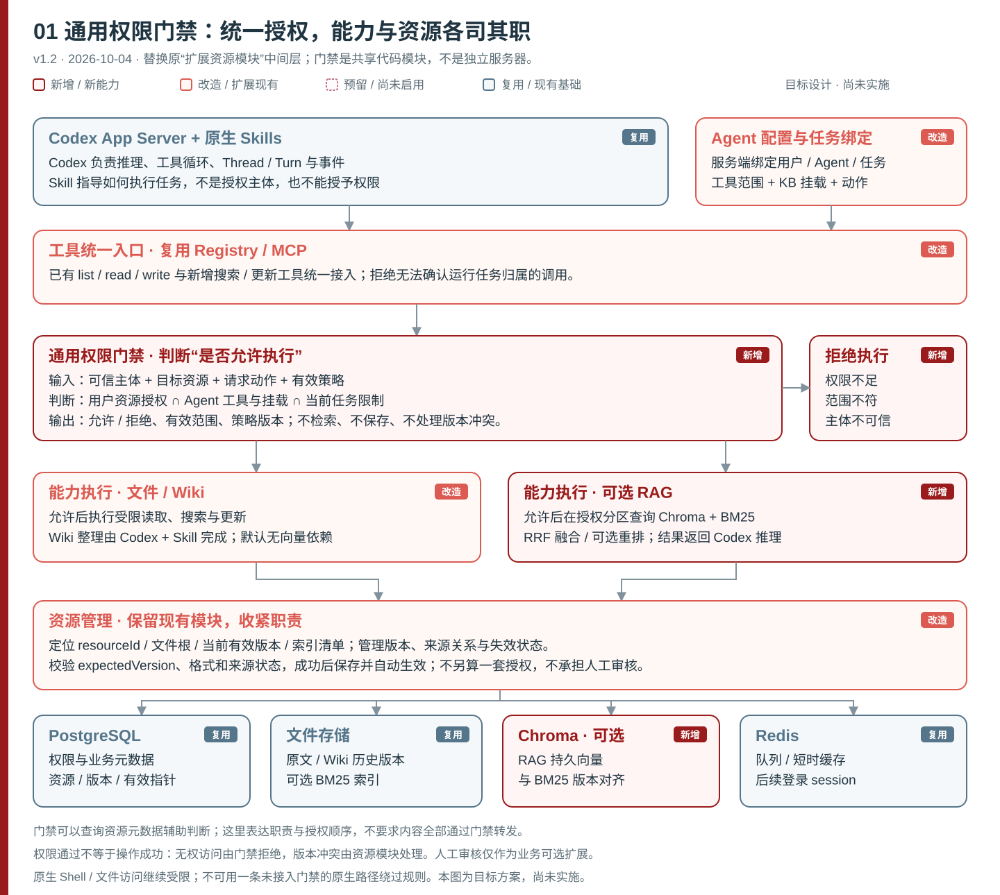
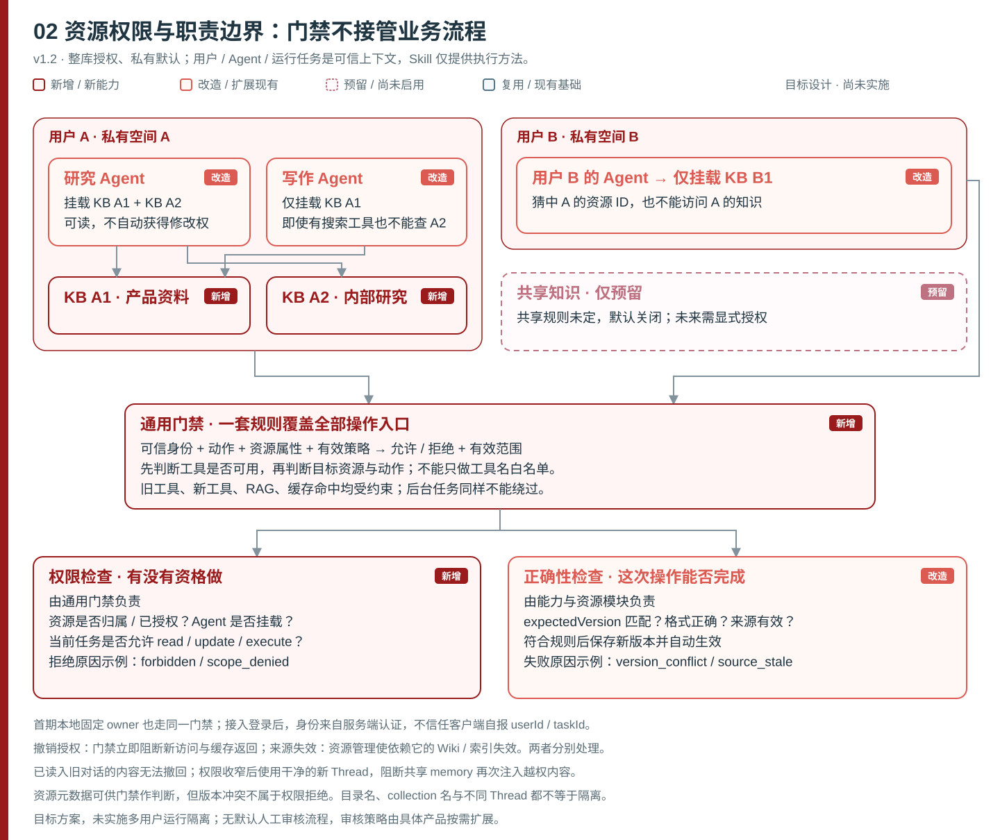
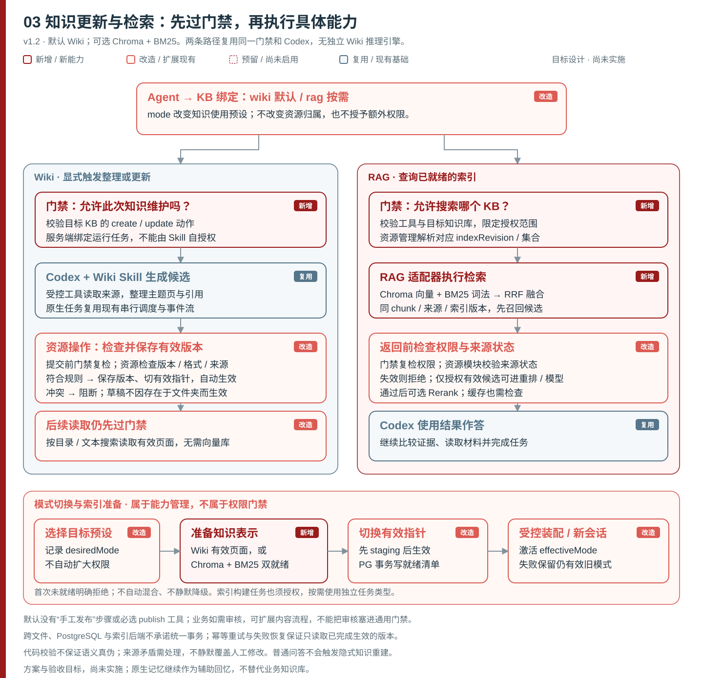

# 知识层架构设计 v1.2

**文档编号** `knowledge-layer-design.md` · **日期** 2026-10-04 · **状态** 设计基线；s05 首版已实施

> s05 当前代码、协议选择及验收边界见 [知识层实现说明](knowledge-implementation.md)。下文仍包含后续设计目标，不是实现清单。

> 本文是知识层的**设计合约**。现有运行时为单用户/单 Agent 设计，多用户权限模型本轮仅设计字段与接口，不声称已实施或已测试。当前 `database.mjs` 仍使用固定 `instanceId/ownerId`；按用户解析的作用域需另行实施。

---

## 设计立场

**复用 Codex 原生能力，缩小自建层。**

现有基础：PostgreSQL 持久层、Redis 队列、`resources` 版本追踪、受控路径访问（`data/index.mjs`、`resources.mjs`、`schema.sql`）、Codex 原生 Skills 加载与工具调用循环（参见 [App Server 文档](https://learn.chatgpt.com/docs/app-server)、[Skills 文档](https://learn.chatgpt.com/docs/build-skills)）。本轮**在明确边界处叠加知识层，不重写现有逻辑**。

推理、Skills 加载、工具调用循环、Thread/Turn/事件由 Codex 原生处理。**不自建** Wiki LLM 执行循环、独立 planner、独立 wiki-engine、默认独立 Knowledge 微服务。Wiki 整理是普通 Codex 任务 + 原生 Skill + 受控读写工具；批量维护调度仅在需要时轻量扩展，禁止提前内建推理循环。

**授权统一经通用权限门禁（`server/modules/permissions/index.mjs`，s05 已实现首版）处理。** 门禁是同进程共享模块，非独立认证网关，覆盖知识库/文件/工具/数据源等所有资源类型，不是知识专用服务。`resources.mjs` 退回本职：ID 定位、文件根、版本管理、来源血缘、有效状态；不再自主计算一套授权。

Wiki 是**组织方式**（结构化主题目录与页面），RAG 是**检索方式**（向量+词法双索引），两者非天然互斥，本设计仅提供两种预设，同一 Agent→KB 绑定不自动混合。

---

## 整体架构



> 色彩说明：深红 = 计划新增；珊瑚红 = 改造；浅红虚线 = 预留待定；蓝灰 = 复用现有。

**职责分工（同进程模块，不要求独立部署）**

| 职责 | 内容 | 自建程度 |
|---|---|---|
| **Codex 原生运行层** | 推理、Skills 注入、工具调用循环、Thread/Turn/事件 | 复用引擎；需接入、配置与任务关联 |
| **通用权限门禁** | 统一 authorize 接口；覆盖全部资源与动作；同进程共享，不另部署 | 新增模块，改造现有工具入口 |
| **Wiki Skills 与搜索** | 摄入→候选页→校验→自动生效；受限全文搜索；workspace 目录约定 | 新增 Skill 定义与搜索工具 |
| **资源管理** | ID 与位置解析、版本、来源关系、操作一致性和有效状态 | 复用现有资源模块，抽出通用授权判断 |
| **可选 RAG 构建器** | 用户显式启用；Chroma 向量 + BM25 词法双索引；RRF 融合；Codex 负责推理 | 新增构建任务类型与检索调用，按需启动 |

**主调用链**

```
Codex 按 Skills 调用工具
  → 工具统一入口 / 通用权限门禁（permissions/index.mjs）
  → 对应能力执行（文件 / Wiki / RAG）
  → 资源解析与版本操作（resources.mjs）
  → 存储
```

底层模块可共用资源元数据读取；不要求原始数据全部经门禁转发；门禁不需独立部署。

---

## 通用权限门禁



### 接口定义（提议，未实现）

```
authorize(principal, run, resource, action)
  → { decision: allow | deny, scope?, reason?, policyVersion }
```

- **principal**：服务端认定的用户与 Agent，由服务端绑定，模型输入不能决定。
- **run**：当前绑定的任务上下文，服务端解析 Thread/Turn，不信任模型自报 taskId。
- **resource**：资源属性引用（类型、归属、挂载关系等，由资源元数据接口读取）；门禁不自行解析正文、不做 RAG、不校验 expectedVersion、不保存/发布内容。
- **action**：read / search / create / update / delete / execute / rebuild / manage 等。
- **输出**：allow/deny、可访问范围、拒绝原因、策略版本。

Skill 不是独立主体，只指导 Codex 调用工具；Skill 文件内不写授权规则，不自授权。资源的具体 locator / currentVersion / indexManifest 仍由 `resources.mjs` 负责；数据层路径遍历/链接等物理安全校验保留，不算重复授权。

### 授权逻辑

有效权限 = **用户资源授权 ∩ Agent 工具/KB 挂载动作 ∩ 任务范围收窄**，三层均须通过。

- 允许使用 `kb_search` 工具，不代表能查任意 KB；门禁按 resource 与 action 双重判断。
- 统一在工具执行前拒绝未挂载 KB，再于后端限定授权分区；结果/缓存返回前复查权限有效性。
- 所有 list / read / write / search 现有与新增入口均适用。
- Skill 启用范围由装配阶段用同一策略校验。
- 版本冲突、格式错误、来源有效性是能力或资源操作的正确性检查，不是权限错误；授权通过不等于操作成功。

### 可信主体与任务绑定

**第一期即须实现任务 scope 到工具调用的可信绑定**：在现有串行执行边界内，服务端把工具连接与当前运行任务关联，按其 Thread/Turn 解析授权；无法确定调用归属时拒绝。

- 不能假设 MCP 自动提供可信 Thread/Turn；须由脚手架建立并核验调用归属，晚到调用不能绑定到下一任务。
- 原生 Shell / file / nativeMemory 可绕过入口，当前继续禁用越权入口/共享回忆，可靠隔离验证后才开放。
- 不默认多 Agent 并发，不全局随意切策略。

### 私有空间与 KB 粒度

每用户一个默认 privateSpace，可包含多个 KB；同一用户多 Agent 可挂载不同 KB。共享规则未定，默认关闭。KB 授权粒度为整个 KB，首版不支持库内 scopeFilter。`spaceId` 是权限安全域，与文件路径无关；`(space_id, locator)` 作为唯一键，字符串前缀不等于隔离。

Agent 默认仅获已挂载 KB 的 `read / search`；`ingest / update / rebuild` 须单独授予。用户管理权限（挂载管理、删除 KB、授权撤销）不自动传给 Agent。任务不能提权，默认 read/search，修改/创建/rebuild 须显式配置。

### 权限撤销与来源失效

撤销某主体的授权后，PG 中权限状态与策略版本立即更新，门禁据此拒绝其新调用和缓存结果；后端索引清理可异步进行。权限收窄不应把其他仍有权用户使用的知识全局标成失效。

资料本身被撤销或来源版本失效，则由资源管理标记依赖它的 Wiki / 索引不可用，阻断过期内容读取。已进入旧上下文的内容无法收回；权限收窄后使用干净的新 Thread，并阻断共享 memory 越权再注入。

---

## 两种知识访问模式



### Wiki（默认）

原始资料 → Codex 原生 Skill 生成候选页/主题目录/链接 → 服务端校验格式、来源引用、版本冲突 → 保存不可变版本并原子切有效指针，自动生效。

**无需人工发布步骤**：门禁通过 update/create 后，资源模块负责 expectedVersion 校验、格式校验、来源状态与冲突检测，通过则原子切有效指针自动生效；冲突阻断不静默覆盖，并发权限/版本需重检。权限收窄后门禁先拒新调用，缓存失效，索引异步清理。

- 不设必经人工发布、默认 `kb_publish` 按钮/工具或强制单独 publish 权限。
- 普通草稿（`write_file` 创建的文件）不自动成为有效 Wiki；有效版本指针由资源操作的生效校验维护。
- 人工审核是业务可选扩展，不塞进通用门禁。
- 代码不保证语义真伪；来源矛盾需待处理，不静默生效。
- 读取通过主题目录/链接定位，默认无 Embedding、无 Chroma、无 BM25。
- 读知识不触发重建；对话结论不自动入库。

Wiki 构建（摄入/更新）与读取是**两个独立流程**，权限也独立判断。首期由用户显式触发整理任务；批量自动维护按需后置。

### RAG（用户显式启用）

规范化原文 → 解析分块 → 向量写入 Chroma + BM25 词法索引同批建立。查询时 RRF 融合两路结果，可选独立重排；仅授权候选进入 rerank/模型。RAG 是**检索方式**，回答仍由 Codex 推理。

首版只索引规范化原文；未来索引 Wiki 整理内容须显式配置，不默认混合。BM25 是独立词法排序算法（参考 [rank_bm25](https://github.com/dorianbrown/rank_bm25)），不等于 Chroma 原生 `contains` 过滤（见 [Chroma query 文档](https://docs.trychroma.com/docs/querying-collections/query-and-get)）。中文分词在构建与查询侧保持一致；记录 embedding 模型/维度/pipeline 版本，模型变更须重建新版本索引。双索引（Chroma + BM25）均就绪方为 `ready`，任一缺失返回明确错误，不静默降级。

### 模式切换语义

`desiredMode` 由用户设置，`effectiveMode` 由服务端维护。构建完成前保持旧模式有效（旧模式仍授权、来源仍有效）；切换须新 Thread 或受控重新装配。首次启用无旧模式时，构建未就绪明确拒绝，不静默回落。同一 Agent→KB 绑定不自动混合两种模式。

---

## 受控工具边界

当前 `launch.mjs` 主动禁用原生 Shell / patch / 子 agent，维持当前边界，可靠隔离验证后再评估。以下为本期提议工具（提议名称，不声称当前已存在）：

| 提议工具名 | 能力描述 | 权限要求 |
|---|---|---|
| `kb_search` | 受限内容搜索，作用域在门禁解析后由能力层执行，不暴露 Chroma 路径或索引目录 | `read / search` |
| `kb_submit_revision` | 带 `expectedVersion` 提交修订；通过资源校验后保存并自动生效，不另调用发布工具 | 修改用 `update`，新建用 `create` |

`kb_publish` 作为独立工具**不再设为框架必需**；无冲突更新在门禁通过 update/create 权限后由资源模块自动校验并切有效指针。可扩展现有工具，不强制新工具名称。

---

## 现有模块与目标变更

相对路径均在 `server/modules/`（Skill 文件除外，在 Agent 配置显式绑定的技能目录）：

| 文件 / 模块 | 变更 | 职责 |
|---|---|---|
| `permissions/index.mjs` | **新增** | 通用权限门禁；同进程共享；authorize 接口；覆盖全部资源/工具/数据源；不另部署认证网关 |
| `data/resources.mjs` | **改造** | 退回本职：ID 定位/文件根/版本/来源血缘/有效状态/expectedVersion 校验/不可变版本保存与有效指针切换；调用门禁而非自主计算授权；补衍生版本→多来源版本血缘 |
| `data/schema.sql` | **改造** | 补 `resource_spaces / knowledge_bases / kb_bindings / kb_grants`（预留）/ `index_manifests / knowledge_jobs`；`locator` 改 `(space_id, locator)` 唯一键；`dependencies` 扩展多对多血缘 |
| `agents/schema.mjs` | **改造（规划）** | 扩展 `knowledgeBindings`（`kbId / mode`）；受控版本发布前不激活 |
| `knowledge/rag-pipeline.mjs` | **新增（按需，仅 RAG）** | 独立任务类型：解析→分块→嵌入→Chroma + BM25 双写；staging→PG 事务切指针；outbox 在 PG，Redis 仅唤醒 |
| `knowledge/search-service.mjs` | **新增（按需，仅 RAG）** | 接收已解析作用域→Chroma 密集 + BM25 词法→RRF 融合→可选重排；完整缓存键实现 |

`tools/mcp-server.mjs` + `messages/index.mjs` 改造：第一期完成可信工具任务绑定、维护动作范围与现有串行调度关联；多用户阶段再扩展身份解析与并发隔离。

**原生 memory** 辅助回忆后台更新（见 [Memories 文档](https://learn.chatgpt.com/docs/customization/memories?surface=app)），当前因禁写合并受阻（`generationBlocked`），是合并受阻，不是服务报错或不存在所有历史摘要；不能据此声称已自动整理业务知识库。辅助 memory 不等于 KB。

---

## 存储分工

| 后端 | 存储内容 |
|---|---|
| **PG** | space / KB / 绑定 / grants（预留）/ 资源版本 / 衍生血缘（多对多）/ 索引清单 / 知识任务 outbox / 发布指针 / 权限策略元数据 |
| **Redis** | 任务唤醒队列、短效缓存 TTL、后续登录 session；outbox 在 PG |
| **文件存储** | 原始内容、Wiki 页面与历史版本、BM25 索引文件；受控路径访问 |
| **Chroma（仅 RAG）** | 向量与最小元数据；按 `(space_id, kb_id, index_revision)` 命名集合；持久化，仅 RAG 激活时启动 |

**血缘关系**：衍生版本关联多个来源版本（非单字段），通过扩展 `dependencies` 表多对多存储。原始资料失效由 `resources.mjs` 传播到派生内容，这是内容有效性管理，与撤销某个用户的访问权限不同。

**搜索缓存键**：`(scopeHash, permissionVersion, effectiveMode, representationVersion, query)`；Wiki 的 `representationVersion` 对应 `publishedWikiRevision`，RAG 对应 `indexRevision`，按模式选一；命中缓存后仍校验权限有效性。撤销权限先阻断该主体的新调用与缓存返回；不要依赖索引物理删除完成后才拒绝。

**RAG 发布流程**（PG 与 Chroma 无跨系统事务）：staging 双就绪后 PG 事务切发布指针；失败重试幂等并清理孤儿版本；双后端共用 chunkId / sourceVersion / indexRevision；旧索引来源撤销后标 `stale`。索引任务按需独立 PG outbox + Redis 唤醒，不塞聊天 FIFO；首版 Wiki 用现有任务调度。

采用 Chroma + BM25，不采用 pgvector。默认 Wiki 不启动向量依赖；双索引本身并不天然更轻。

---

## Workspace 目录约定

目标目录约定，基于当前基础路径规则所允许区域，不声称目录已存在：

```
inputs/kb-id/            ← 原始来源文件（files.mjs 受控，md/txt，256 KiB）
research/kb-id/wiki/     ← Wiki 整理输出（md，目录/索引/主题页）
```

- 不使用当前代码未支持的顶级 `knowledge/` 目录冒充可用。
- 受控配置中的 `AGENTS.md` 才作为可信指令；用户上传同名文件仍是资料，不升级为指令。Wiki 子目录不承担自动指令发现。
- Skill 文件在 Agent 配置显式绑定的技能目录，路径不伪装现有模块路径；知识正文独立存页面文件；`research/kb-id/wiki/` 仅存 `index.md` 与主题页，不兼任权限规则入口。

---

## 分阶段落地

### 阶段一：通用门禁 + 受控 Wiki 闭环（当前优先）

- 新增 `permissions/index.mjs`，实现 authorize 接口，覆盖 Wiki / 文件工具入口；工具统一入口接入门禁。
- 扩展 KB、挂载与版本血缘，预设私有空间和作用域键；Agent schema 增加 `knowledgeBindings`，省略 mode 时为 wiki。当前本地可信 owner 即可运行，不前置完整多用户改造。
- `resources.mjs` 改造：退回本职，调用门禁，补 expectedVersion 校验、不可变版本保存与有效指针自动切换。
- 落实可信工具任务绑定、动作授权与串行调度，沿用现有任务记录，不要求独立 Wiki worker 或队列。
- 增加 Wiki 知识使用与整理 Skill，复用 `list_files / read_file`。以"显式触发整理 → 候选页 → 校验 → 有效指针自动切换 → 后续任务按需读取"验收。

### 阶段二：可选 RAG 适配器

- `rag-pipeline.mjs`：独立任务类型；解析→分块→嵌入→Chroma + BM25 双写；staging→PG 事务切指针；outbox 在 PG。
- `search-service.mjs`：RRF 融合、可选重排；缓存键完整实现。
- 模式切换逻辑：desiredMode / effectiveMode；双索引均就绪后方切换；首版只索引规范化原文。

### 阶段三：多用户完整运行隔离（另行实施）

`database.mjs` / `repository.mjs` 接入认证后可信用户作用域；完善多 Agent 并发隔离。共享知识规则单独确定，未实现前保持关闭；不影响先在本地单用户完成 Wiki 闭环。

---

## 关键验收场景

以下是待执行的验收目标，不代表已通过；跨用户场景在多用户阶段验证。

| 场景 | 预期行为 |
|---|---|
| 旧工具绕过门禁 | list/read/write/search 现有入口均接入门禁；无例外路径 |
| 工具可用但 KB 未挂载 | 门禁统一拒绝，返回明确原因，不到达能力层 |
| Skill 尝试提权 | Skill 不是独立主体；不自授权；不开放 shell；装配阶段策略校验 |
| 版本冲突 vs 权限错误 | expectedVersion 冲突是资源操作正确性问题，不是 403；错误码/消息区分 |
| 无人工发布正常更新生效 | 门禁通过 update 权限后，资源模块校验通过则有效指针自动切换；无 publish 步骤 |
| RAG 双索引半就绪 | 任一缺失 → not_ready，effectiveMode 不切换，返回明确错误 |
| 权限撤销后已有缓存 | 门禁拒绝该主体的新调用与缓存返回，不等待索引清理；不使其他仍有权限的用户资料全局失效 |
| 模型自报 taskId | 服务端不信任；从服务端绑定的运行任务解析授权，归属不明拒绝 |
| 迟到调用串到另一任务 | 当前串行调度边界内关联 Thread/Turn，迟到调用不匹配则拒绝 |
| 来源失效传播 | 资源模块使依赖该来源的 Wiki / 索引失效，过期版本不可读取；已进入上下文的旧内容不声称可撤回 |
| desiredMode=rag 构建失败 | effectiveMode 保持原值（旧模式仍授权且来源有效）；明确错误，不静默回落 |
| 首次启用 RAG 无旧模式 | 构建未就绪 → 明确拒绝 |
| generationBlocked 状态 | 报告合并受阻和已有摘要状态；不声称已整理 KB |
| 读知识不触发重建 | kb_search 与构建任务独立调用路径 |
| Shell / 原生文件读取 | launch.mjs 禁用路径保持；Skill 不自授权开放 shell |

---

## 本轮明确不含

SQL DDL 完整迁移脚本、多主机部署、完整认证实现（本轮仅设计字段与接口）、前端热切换 UI、多用户并发运行隔离（单独阶段）、PDF/OCR 输入解析扩展、自动混合模式与自动模式回退、KB 库内子集授权、人工审核作为框架必需流程。

---

*文档范围：知识层设计合约。[数据层现状](data-layer.md)与 [Agent 设计基线](agent-core-design.md) 继续有效；本文仅在知识层取得优先，不代表实施或测试已完成。现有实现以 README / 数据层文档为准。*
