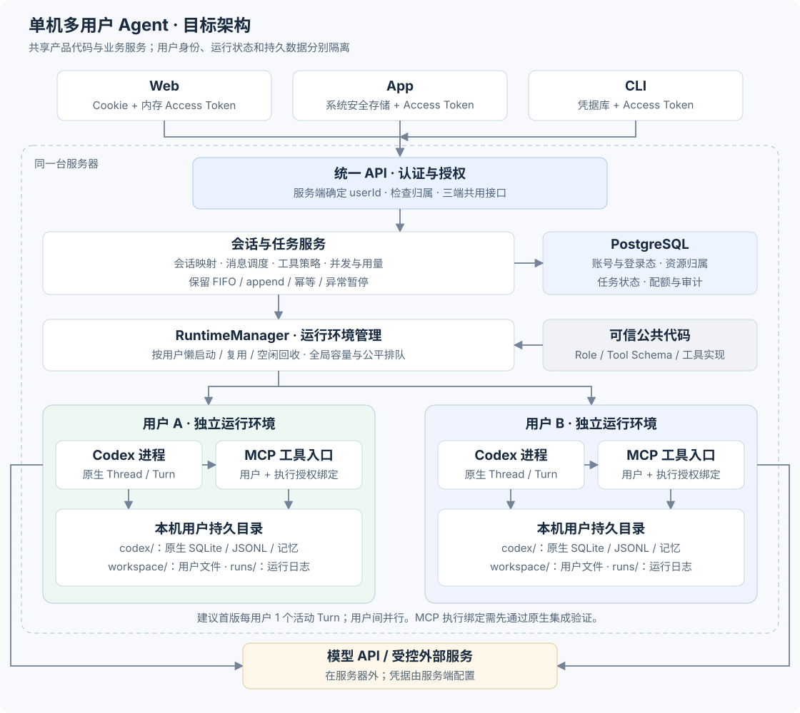

# 单机多用户升级方案（后置参考）

**历史核验时间**：2026-09-28。当时 `npm test`：127/127 通过，未包含多用户验收或原生集成脚本；不代表本次文档修订重跑了测试。

**状态**：2026-09-29 起后置，保留作历史调研参考，尚未实施多用户改造。当前设计以[Agent 脚手架设计方案](agent-core-design.md)为准，先完成工作区、可配置 Agent、轻量装配与数据访问。

**历史范围**：下文 P0—P4、架构图及“首版”均指原单机多用户方案，不是当前版本的实施承诺。文中现状与外部参考保留原核验日期，重新启动本方案前需复核。

---

## 结论

本历史方案曾提出**在单机上服务多个真实账号**，覆盖单机、多用户、多会话场景。该方向已后置；当前阶段仍围绕本机单用户脚手架完善 Agent 核心能力。

原方案提出五项建设内容：

1. 建立账号与登录态（email + password + JWT + Refresh 轮换），Web/App/CLI 三端统一
2. 每位用户拥有独立的 Codex 本机进程、原生目录和 MCP 身份入口
3. 每次工具执行前绑定服务端不可伪造的 execution grant
4. 将资源归属、工具权限、用量与并发内置为不可绕过的逻辑层
5. 平稳迁移现有 JSON 文件数据，保留可回滚点

PostgreSQL 负责业务账号、归属、配额与共享调度；Codex 原生 SQLite/JSONL 继续管理原生上下文与历史，两者并存，不相互替代。API 职责与调度执行职责在同一 Node 服务内，接口清晰即可。会员分级、定价、支付由使用者自行扩展，内核只提供权限与用量扩展接口；不建设用户自定义多 Agent 管理平台。以上均为待实施目标。

---

## 一、现状诊断

### 1.1 进程与状态

[`server/main.mjs`](../server/main.mjs) 在服务启动时按顺序执行一次 `prepareRun`，生成全局单例：

- 一个 `ToolManager`（工具注册表，热加载）
- 一个 `CodexConnection`（stdio spawn 本机 Codex app-server）
- 一个 `SessionService`、`MessageService`、`MemoryService`

所有 HTTP 请求共享这些对象。没有用户概念，也没有会话归属。

### 1.2 认证

[`server/modules/http/index.mjs`](../server/modules/http/index.mjs) 用一个随机生成的 Bearer token 做全局鉴权，token 写入 `.data/connection.json`。所有带 `Origin` 头的请求直接拒绝——这是当前本机服务的来源限制，不能直接承载需要跨源访问的 Web 客户端。

### 1.3 SSE 与事件隔离

SSE 过滤条件是 `(!event.threadId || event.threadId === id)`：没有 `threadId` 的事件目前对所有监听者广播。多用户场景下，这会造成用户 A 的事件泄露给用户 B。

### 1.4 存储

[`server/modules/storage/index.mjs`](../server/modules/storage/index.mjs) 的 `JobStore` 把整个 `.data/messages.json` 整体读写，版本号 + 克隆提交，没有行级事务。[`server/modules/sessions/history.mjs`](../server/modules/sessions/history.mjs) 的会话索引是 `.data/session-index.json`，按 `.runs` 来源拼装，也是平面文件。当前有单服务锁、同步写入及线程调度锁，不能称为“没有保护”；但它们没有用户维度、数据库事务及跨业务记录的一致性约束，多用户改造需要重做存储接口。

### 1.5 Codex 进程与目录

[`server/modules/codex/config.mjs`](../server/modules/codex/config.mjs) 把 `root/.data/codex` 固定为 `CODEX_HOME` 和 `CODEX_SQLITE_HOME`。[`server/modules/codex/runtime.mjs`](../server/modules/codex/runtime.mjs) 每次启动在 `.runs/app-server-随机/` 创建一个实例目录，存 `run.json`、`models.json`、运行日志——这是运行时产物，不是业务 runId。[`server/modules/codex/connection.mjs`](../server/modules/codex/connection.mjs) 通过 stdio spawn 启动 Codex，`cwd` 是 `runtime.workspace`，当前启动配置继承进程环境；升级后若继续透传，就可能把新增的 DB 密码、JWT 密钥交给 Codex，因此必须改为白名单。

### 1.6 工具

[`server/modules/tools/loader.mjs`](../server/modules/tools/loader.mjs) 用同一个 `root` 路径既加载可信工具代码，又作为文件工具的工作区。`readOnlyHint` 只是元数据描述，不是安全控制。[`server/modules/tools/mcp-server.mjs`](../server/modules/tools/mcp-server.mjs) 提供回环 HTTP，Bearer secret，URL 按 `/<registry.version>` 路由，但 `registry.call` 只接受 `{signal}`——没有可信的 `userId/threadId/turnId/jobId`，接上 token 不等于拥有任务身份。

### 1.7 `accounts/index.mjs` 不存在

当前代码库没有账号模块。`package.json` 确认依赖中没有 DB 客户端、JWT 库、密码哈希库。这些全部需要新增。

---

## 二、目标架构

> **建议**（待实施）：以下为目标架构；复用现有 Node/Codex/工具机制，新增多用户边界尚未实施。



图示对应本版本的单机多用户部署。

核心原则：

- **首版一个 Node 服务**，内部区分 API 与执行职责，负责 HTTP/SSE、认证、调度、策略、用量
- **首版一个 PostgreSQL 实例**，管理共享业务状态；Codex 原生 SQLite/JSONL 管理原生运行状态与历史，存储和记忆的区别见 2.4 节
- **按用户管理的 Codex 进程**：执行任务或调用原生历史接口时按需创建，空闲回收；单个 Codex 子进程崩溃不连累其他用户
- **每用户独立的本机目录**：`AGENT_DATA_ROOT/users/<server-generated-uuid>/`
- **采用单体部署**，不要求 Redis、Kubernetes 或微服务

### 2.1 请求上下文

每个通过认证的请求携带一个不可变的 `RequestContext`：

```
{ userId, authSessionId, requestId }
```

下游所有模块——ownership 检查、policy 决策、quota 预留、任务调度——均从这个上下文取 `userId`，绝不信任客户端传来的 `userId` 字段。

### 2.2 用户 Codex 进程生命周期

| 状态 | 触发条件 | 说明 |
|------|----------|------|
| 未创建 | 尚无执行或原生读取需求 | 无该用户的常驻 Codex 进程 |
| 启动中 | 首次调度任务或需要原生历史读取 | RuntimeManager 分配目录、白名单环境变量、spawn |
| 活跃 | turn 运行中 | 持有独立 `CODEX_HOME`、独立 MCP 路由 |
| 空闲 | turn 结束 N 秒内 | 可复用，超时关闭 |
| 已销毁 | 超时/用户禁用/服务关闭 | 关闭进程；日志按保留策略清理，保留持久目录 |

原生历史读取也要经过 RuntimeManager 的容量控制，不能通过大量查询绕过进程上限。纯数据库的账号信息和会话列表查询不启动 Codex。

一个用户的 Codex 子进程崩溃，只影响该用户当前任务；共享 Node 服务本身仍是单点，进程异常与内存耗尽需要单独监控。

**建议的首版约束**：每用户同时最多 1 个活跃 turn，同用户多会话可排队，不同用户并行执行。这是本方案提出的首版限制，尚非用户已确认的产品要求；普通用户不能绕过该限制。未来允许同用户多 turn 并行不是改一个数字就够，需要重新设计 execution grant 的绑定逻辑。

### 2.3 目录布局

```
AGENT_DATA_ROOT/
  users/
    <server-generated-uuid>/          # 用户根，0700
      codex/                          # CODEX_HOME，原生 SQLite/rollout JSONL/记忆 md
      workspace/
        inputs/                       # 只读输入
        research/
        drafts/
        outputs/
      runs/                           # app-server-* 运行时产物（非业务数据）

codeRoot/                             # 只读，工具代码/role 定义，部署为只读
```

`codeRoot` 和用户数据目录严格分离：工具代码从 `codeRoot` 读，不能从用户目录覆盖；用户数据写入 `workspace`，不能读工具代码。文件元数据中的 `storageKey` 使用相对用户根的路径，不能接受客户端提供的绝对路径；文件本体留在磁盘。消息文本及可选对话查询副本仍可存入数据库。

> **隔离强度说明**：同 OS 账号下的进程和目录隔离属于应用层控制，不是针对恶意代码的硬隔离。若未来允许用户执行任意代码，需要额外的容器或 OS 身份边界，仅靠 PostgreSQL 或目录权限不能提供该保证。

### 2.4 原生存储与长期记忆

Codex app-server 的原生持久化包括：**SQLite**（存储线程元数据、内部状态、记忆参与设置等）和 **rollout JSONL**（存储会话执行记录）。这两者是 Codex 自身的存储机制，历史存盘不等于长期记忆生效——长期记忆还需提炼合并、生成 `.md` 产物并在后续 turn 中召回使用。**当前记忆合并因禁用 shell/patch 而被阻塞**（`generationBlocked = true`），两者不可混淆。

SQLite 本机适用性摘要（依据 [sqlite.org/whentouse](https://www.sqlite.org/whentouse.html) 与 [sqlite.org/wal](https://www.sqlite.org/wal.html)）：

| 特性 | 说明 |
|------|------|
| 嵌入式本地存储 | 无独立数据库服务进程，随进程启动，适合本机单节点应用 |
| 按用户分库 | 可为每个用户使用独立库文件，降低写锁争用 |
| WAL 模式读写并行 | 读写可并发，但仍单 writer；需同一主机共享内存 |
| 备份一致性 | Online Backup API（[sqlite.org/backup](https://www.sqlite.org/backup.html)）可生成单库一致性副本，完整快照还须协调 JSONL、工作区文件与 PostgreSQL 业务记录 |

用户独立库降低互相写锁争用，访问隔离仍由服务端权限检查保证；本机部署需定期执行一致性备份与恢复演练。

### 2.5 单机模块职责

首版在单机单 Node 服务内同时承载 API 与调度两类职责，以下三个核心模块均为**单机本地实现（待实施）**：

| 模块 | 单机职责 |
|------|---------|
| `RuntimeManager` | 按用户标识懒启动、复用、回收 Codex 本机进程；控制并发容量上限；通过接口提供运行、中止和状态查询，HTTP 层不直接持有子进程 |
| `UserStorage` | 以服务端用户标识定位专属本机目录；执行受控文件操作；管理快照格式与备份恢复演练；上层不拼绝对路径，路径由服务端确定 |
| `JobRepository` | PostgreSQL 单机事务保存消息与任务；保证任务幂等领取与状态迁移；配合单进程调度锁避免重复执行 |

**禁止客户端传入 userId 覆盖身份**，所有路径与归属由服务端根据已验证登录态确定。以上均为未实现状态，待逐步落地。

---

## 三、身份与认证

> **建议**（待实施）：以下为本方案设计，参考 [LibreChat 认证配置](https://www.librechat.ai/docs/configuration/authentication) 和 [LibreChat 认证特性](https://www.librechat.ai/docs/features/authentication) 的核心机制，具体安全设计属于本项目方案，不声称 LibreChat 自带三端实现。

### 3.1 账号模型

- **登录标识**：email + password（email 仅作登录名，无 SMTP，不发验证邮件）
- **密码哈希**：[Argon2id](https://cheatsheetseries.owasp.org/cheatsheets/Password_Storage_Cheat_Sheet.html)，参数参照 OWASP 建议
- **注册开关**：生产环境默认关闭，管理员用离线脚本创建用户；不抢第一注册者为 admin
- **技术角色**：`admin` / `user` 两种，admin 没有默认读取所有私有对话的权限
- **Role 的含义**：当前 `server/modules/role/index.mjs` 中的产品行为指令，不等于账号角色或会员档位，也不代替工具权限检查

默认不依赖邮件服务；忘记密码由可信管理命令重置，并吊销全部登录态，邮件找回后续扩展。email 未验证，不能作为已验证身份使用；规范化登录名后建立唯一约束。

登录失败响应使用统一文案，不区分"账号不存在"和"密码错误"。登录接口对账号 + IP 双维度限速。密码和 token 绝不写入日志。改密码立即吊销该账号的全部登录会话。

### 3.2 Token 设计

**Access Token**（JWT）：
```
sub=userId, sid=authSessionId, jti, iat, exp, iss, aud
```
- 有效期 15 分钟（建议可配）
- 签名算法在服务端硬编码校验，拒绝 `alg: none` 及其他算法
- 不在 payload 中嵌入套餐或权限，权限查 DB

**Refresh Token**：
- 有效期 7 天绝对到期，每次刷新继承原始会话的过期时间（不会因为刷新无限续期）
- DB 只存 hash，不存原始 token
- 每次刷新生成新 pair，旧 refresh token 立即失效

**`auth_sessions` 表**（逻辑结构）：

| 字段 | 说明 |
|------|------|
| `id` | authSessionId |
| `userId` | 归属用户 |
| `refreshTokenHash` | 只存 hash |
| `family` / `generation` | 检测 refresh 重放 |
| `absoluteExpiresAt` | 7 天绝对到期 |
| `revokedAt` | 吊销时间 |
| `clientHint` | 设备/端标识（非鉴权依据） |

重放检测：检测到旧 refresh token 被使用，立即吊销整个 family（该设备的全部 refresh），需要重新登录。

### 3.3 Access Token 生命周期校验

每个需要认证的请求：
1. 验证 access token 签名与过期
2. **查 DB**：用户账号是否启用、`authSessionId` 对应会话是否未吊销

用 DB 查询起步，不引入 Redis。logout 立即生效：吊销 DB 中的 session 记录，下一个请求的 DB 查询即返回失效。

### 3.4 并发刷新处理

同一登录会话的多标签刷新可能竞争；不同设备持有独立的 `authSessionId`，不共享 refresh token。建议：

- 客户端对同一登录会话做 singleflight；服务端用事务和旧 hash/代际比较实现一次性轮换，不向携带不同或已失效 token 的请求共享新凭据
- 客户端跨 Tab 通过 BroadcastChannel 协调，检测到其他 Tab 已刷新则直接使用新 token
- 竞争失败（旧 token 已被使用）可触发吊销本 family，需重新登录

> **注意**：跨 Tab 并发刷新的边界情况必须有专项测试，不做无限旧 token 宽限期。

### 3.5 三端适配

| 端 | Access Token 存储 | Refresh Token 存储 | 刷新方式 |
|---|---|---|---|
| Web | 内存（JS 变量） + `Authorization` header | HttpOnly Secure SameSite=Strict Cookie | Cookie 路由，校验 Origin/CSRF |
| 原生 App | 内存 | 系统安全存储（Keychain/Keystore） | HTTPS body |
| CLI | 内存 | OS 凭据库优先，0600 本地文件兜底 | HTTPS body |

Web 端：
- `localStorage` 禁止存 token
- Cookie 刷新/登出端点额外校验 `Origin` 和 CSRF token，防跨站请求
- API 端点维护受控 Origin allowlist，默认同域部署，禁止 `credentials: true` + 通配符 Origin

CLI 端：
- 密码通过 stdin 交互输入，禁止作为命令行参数传递
- [`client/modules/connection/index.mjs`](../client/modules/connection/index.mjs) 现在读 `.data/connection.json` 中的固定 token，目标改为：读服务 URL 配置 + 登录态凭据，设备登录凭据与服务发现文件隔离，不共享用户 refresh token

所有认证响应添加 `Cache-Control: no-store`，禁止日志输出 token 内容。浏览器端和非浏览器端使用不同的刷新端点，不因 `clientType` 免认证，非浏览器端同样执行认证和限速。

App 技术栈由实施时选定；用户未指定，不提前假设。仅提供 API 不算 App 端验收完成。

---

## 四、MCP 执行授权（技术门槛）

> 这是本方案最关键的技术挑战，也是 P0 阶段的验证闸门。以下为**待技术验证的方案**，不是已实现功能。

### 4.1 问题根源

[`server/modules/tools/mcp-server.mjs`](../server/modules/tools/mcp-server.mjs) 当前的 `registry.call` 只接受 `{signal}`，没有任何任务身份信息。用户 MCP token 只能证明"这是某用户"，不能证明"这是某用户的某次具体任务"。[`server/modules/tools/index.mjs`](../server/modules/tools/index.mjs) 的 verify 仅核对工具名称，不能证明调用上下文合法。

### 4.2 Execution Grant 设计（建议）

每次 turn 开始前，服务端生成一个不可变的 **execution grant**，包含：

```
{
  userId,
  businessSessionId,
  executionId,
  toolAllowlist,        // 本次 turn 允许调用的工具名集合
  resourceScope,        // 文件路径范围、连接凭据范围
  registryVersion,      // 工具注册表版本快照
  nonce,               // 服务端随机生成，防伪造
  expiry               // turn 超时时间
}
```

完整 Grant 保存在服务端，业务客户端和模型参数无法指定或改写它；Codex 只获得调用所需的本机入口和运行时凭据。进程重启使全部内存 Grant 失效，关联执行转入待核对流程。

MCP 路由建议使用 `/<registryVersion>/<serverNonce>`，在服务端映射到 executionId，认证仍需用户运行时 token。turn 开始前在边界锁内装配路由、执行现有配置写入和 MCP reload，并验证成功后才发起 `turn/start`；turn 完成或超时时吊销路由，等待已有调用结束再允许复用 runtime。工具发现（list）在无 grant 时可返回工具清单，但实际执行请求在无有效 grant 时拒绝。

### 4.3 技术验证闸门

在进入 P2 阶段之前，必须用锁定版本（`@openai/codex 0.154.0`）实际验证：

1. **resumed thread 的新 turn 确实使用新的 MCP 路由**，旧路由已吊销
2. **迟到的旧 turn 调用不能落到新 task 的 grant 上**
3. **路由切换时序可靠**：并发 append 属于同一 execution，不会因路由切换而落到错误 grant

如果上述验证无法可靠成立，需要回退到**会话级独立 runtime**方案（每个 businessSession 独占一个 Codex 进程），重新设计授权边界，不能用全局可变 `currentTask` 悄悄放行调用。

禁止的替代方案：按时间猜测当前 task；仅校验模型传来的参数中的 userId 或 jobId。

MCP 服务仍可由项目 Node 进程承载，一个用户的授权入口包含多个工具；不需要每注册一个工具就启动一个独立进程，Web/App/CLI 也不直接访问 MCP。会话级 runtime 的备选方案仍需验证独立原生状态目录、会话迁移与执行归因，不能让多个进程无约束共享同一 CODEX_HOME。

### 4.4 工具路径隔离

[`server/modules/tools/loader.mjs`](../server/modules/tools/loader.mjs) 目前用同一个 `root` 做两件事。目标拆分为五个明确的根路径：

| 根路径 | 用途 | 可写 |
|--------|------|------|
| `codeRoot` | 可信工具代码、role 定义 | 服务端只读 |
| `dataRoot` | 用户持久数据总根 | 仅服务端按归属写 |
| `workspaceRoot` | 文件工具工作区（四个子目录） | 工具受控写 |
| `codexHome` | Codex 原生持久化 | Codex 进程写 |
| `runRoot` | 启动实例临时产物 | 服务写/定期清理 |

不能简单把 `root` 替换成用户目录——那样要么加载不到可信工具代码，要么允许用户覆盖可信工具定义。

### 4.5 工具调用授权原则

- `readOnlyHint` 是元数据描述，不是安全控制
- 授权在调度前做一次（policy 检查），在实际工具调用前再做一次（grant 校验）
- 禁止用客户端或模型传入的 `userId`/`basePath` 执行授权判断
- 普通用户不能上传或执行自定义代码；自定义工具由服务器管理员安装信任

---

## 五、三项基础控制

### 5.1 资源归属（Ownership）

每个查询包含 `userId` 条件，子资源通过复合外键约束绑定归属；应用层鉴权和数据库约束同时存在。

```sql
-- 示例复合唯一约束（PostgreSQL）
UNIQUE (userId, nativeThreadId)        -- sessions 表
UNIQUE (userId, sessionId, clientMessageId)  -- jobs 表
```

参考：[PostgreSQL 复合约束文档](https://www.postgresql.org/docs/current/ddl-constraints.html)

越权资源一律返回 404（不返回 403，避免探测存在性）。列表、搜索、导出、SSE 推送均在数据层过滤归属，不依赖结果层裁剪。

### 5.2 策略控制（Policy）

工具调用的实际权限 = 服务器开关 ∩ 用户能力许可 ∩ 任务 execution grant ∩ 资源路径约束

**Deny wins**：任何一层否定即拒绝，不存在"某层允许覆盖其他层拒绝"。

策略检查两个时机：
1. **调度前**：用户有权限启动这个任务吗？服务端为该用户和本次任务允许的工具集合是什么？
2. **执行前**：当前 execution grant 与最新用户策略是否都允许调用这个工具和这个资源路径？排队任务真正启动前同样重新授权。

用户禁用/权限撤销在执行期有效：检测到用户被禁用时，阻止新工具调用，并向当前 turn 发送中止信号。用户退出登录或网络断开，不自动撤销已被授权接收的任务（包括已持久化接受的排队任务）；用户账号被禁用，才要求阻止新工具调用并中止。

提供 `policy.resolve()` 和 `policy.authorize()` 两个扩展契约，默认实现读取本地静态配置；会员/支付/营销逻辑只通过这两个接口注入，不写入 JWT 或认证核心。

保留现有文件工具的四目录、inputs 只读、md/txt、256 KiB、禁软硬链接和禁止覆盖规则；网络工具保留 SSRF/DNS/重定向检查，生产显式使用 `NODE_ENV=production`。Grant 中的文件范围、域名和连接凭据范围是分别校验的约束。

### 5.3 用量与并发控制（Quota）

控制维度：

| 维度 | 说明 |
|------|------|
| 全局活跃并发 | 活跃 turn 总数上限；另设 `maxActiveRuntimes` 限制含空闲在内的常驻 Codex 进程数 |
| 单用户活跃 turn | 首版固定为 1，同用户多会话排队 |
| 请求速率 | 按用户限制提交消息和工具调用速率，登录另按账号/IP 限流 |
| 单用户排队数 | 最大排队任务数（现有每线程上限 100，目标加用户全局限额） |
| Turn 超时 | 现有默认 600000ms，保持语义，加用户维度限额 |
| 存储配额 | 用户目录总大小限制 |
| 模型用量 | 依赖 provider 事件，中断有延迟，不承诺绝不超一个 token |

用量记账流程：

```
预留（reserve）-> 外部执行（不持有长事务）-> 幂等结算（settle）/ 释放（release）
```

并发槽位用数据库条件更新/锁在短事务内原子预留，不能用“先查余额再更新”的分离操作；token 用量取决于 provider 返回的事件，中断时的未知用量标记为 `unknown/reconcile` 状态，不当 0 免费处理。

并发 append（同一 turn 的多条消息）属于同一个 execution，不重复计量并发。重复请求（clientMessageId 幂等）不重复扣减用量。

提供 `quota.reserve()` / `quota.settle()` / `quota.release()` 扩展契约，默认实现使用本地静态配额配置和 PostgreSQL 持久用量记录。

存储统计覆盖 workspace、Codex 原生状态和日志，不能只累计 files 表。受控写入先预留空间，异常补偿释放并周期核账；原生进程写入仍需磁盘水位保护，应用层统计不能冒充文件系统硬配额。

---

## 六、API 设计

> **建议**（待实施）：以下为升级后的接口契约，部分路径沿用现有接口，但用户认证与归属语义需要重构。

### 6.1 认证端点

| 方法 | 路径 | 说明 |
|------|------|------|
| `POST` | `/auth/login` | email + password，返回 access token + refresh cookie |
| `POST` | `/auth/refresh` | 刷新，轮换 refresh token |
| `POST` | `/auth/logout` | 吊销当前 session |
| `GET` | `/auth/me` | 当前用户信息 |
| `GET` | `/auth/devices` | 已登录设备列表 |
| `DELETE` | `/auth/devices/:id` | 吊销指定设备会话（用户自己操作） |
| `POST` | `/auth/password` | 修改密码，吊销全部 session |

原生 App 和 CLI 使用 `/auth/native/login`、`/auth/native/refresh`、`/auth/native/logout`，HTTPS body 传递 refresh，响应体返回新 pair，不读写 Cookie；这些端点不开放浏览器跨源读取，也不能因 `clientType` 跳过凭据检查。设备撤销必须查询当前用户归属；修改密码要求当前密码或可信重置凭据。

### 6.2 会话与消息端点

| 方法 | 路径 | 说明 |
|------|------|------|
| `POST` | `/sessions` | 创建会话，返回 `sessionId` |
| `GET` | `/sessions` | 列出当前用户会话 |
| `POST` | `/sessions/:sessionId/messages` | 发送消息，body: `{clientMessageId, mode, content, targetTurnId?}`；append 必须校验目标 turn 属于当前会话，返回 202 + `{jobId, sessionId}` |
| `GET` | `/sessions/:sessionId/state` | 当前会话状态快照 |
| `GET` | `/sessions/:sessionId/events` | SSE 事件流，header 传 token，不在 URL 中 |
| `POST` | `/sessions/:sessionId/continue` | 恢复暂停队列（现有 `/queue/continue` 语义，加归属校验） |
| `POST` | `/sessions/:sessionId/interrupt` | 中断当前 turn |

接口中的 `sessionId` 即业务会话 ID，后文 `businessSessionId` 是同一字段的说明性称呼。资源定位以它为准；不把 `nativeThreadId` 作为授权依据。`nativeThreadId` 在服务端内部管理，不暴露到 URL 路径做授权。

文件接口建议为 `GET/POST /files`、`GET /files/:fileId/content`，服务端映射 storageKey；记忆接口保留 `/memory`、`/memory/summary`，以当前认证用户定位，参与开关按业务 sessionId 授权。新增 `/tools` 返回该用户允许的工具，不能暴露其他用户状态。

### 6.3 错误码语义

| 状态码 | 含义 |
|--------|------|
| `401` | token 无效、过期、session 已吊销 |
| `403` | 已拥有资源上的操作或工具能力不足 |
| `404` | 资源不存在或越权（统一 404，不区分） |
| `409` | 状态冲突（会话已暂停、任务已取消） |
| `429` | 超额，响应体包含可重试线索（`retryAfter`） |
| `503` | 数据库或必要运行服务不可用，不绕过鉴权或预留继续执行 |

### 6.4 SSE 安全

- Token 通过 `Authorization` header 传递，不放 URL query string
- 每个 SSE 连接绑定 `userId + businessSessionId`，服务端只推送该用户该会话的事件
- 无 `threadId` 的全局事件不再广播，需补充服务端 `userId`/`sessionId`/`channel` 标记
- 退出登录、撤销设备或禁用账号时主动关闭关联 SSE；心跳复查状态作为兜底，access token 过期时关闭连接，客户端刷新后重连
- 重连时服务端推送当前状态快照（非所有历史事件），不保证补齐全部过程事件，只保证最终状态
- 已接受的任务继续执行，重连后通过快照同步得知结果

---

## 七、数据模型

> **建议**（待实施）：以下为逻辑表设计，不包含完整 DDL，实施时按需补充字段和索引。

### 7.1 核心实体关系

```
users
  └── auth_sessions (userId)
  └── sessions (userId, nativeThreadId, title, pause状态, delete状态)
        └── jobs (userId, sessionId, clientMessageId, status, mode, content)
              └── job_execution_links (jobId, executionId)
        └── executions (userId, sessionId, nativeThreadId, nativeTurnId, status, usage)

quota_reservations (userId, executionId, dimension, amount, status)
usage_ledger (userId, executionId, dimension, amount, settled_at)

files (userId, storageKey, size, hash, mime, status)
audit_events (userId, eventType, 摘要, created_at)  -- 不默认留全文

-- 可选，延后实施：
transcript_items (userId, sessionId, nativeItemId, nativeTurnId, position, content, finalized)
```

### 7.2 重要约束

- `sessions(userId, nativeThreadId)` 唯一：一个用户不能有两个会话指向同一个 native thread
- `jobs(userId, sessionId, clientMessageId)` 唯一：clientMessageId 幂等去重
- `sessions` 增加 `UNIQUE(userId, id)`，jobs/executions 的 `(userId, sessionId)` 复合外键引用它；job_execution_links 的两端也必须保持同一用户/会话。files 首版归用户；若绑定会话，则同样使用复合引用
- 列表索引覆盖 `(userId, updatedAt, id)`，jobs 覆盖 `(userId, sessionId, status, createdAt)`；usage_ledger 对结算来源建立唯一约束，防重复入账。 schema migration 版本独立管理

### 7.3 关键 ID 语义

| ID | 含义 |
|----|------|
| `authSessionId` | 一次登录设备 |
| `businessSessionId` | 一个业务聊天会话，映射 `(userId, nativeThreadId)` |
| `jobId` | 一条已接受的用户输入 |
| `clientMessageId` | 客户端去重标识，限定在 `userId + sessionId` 范围内唯一 |
| `executionId` | 一次实际 turn 尝试的持久记录，关联多个 append jobs；在 native 启动确认前 turnId 可为空 |
| `nativeTurnId` | Codex 返回的一轮执行 ID；不是每条用户消息都有新的 turnId |
| `runId`（若沿用）| 可定义为 `executionId` 的别名，不另起第三实体 |

Agent 定义 ≠ 执行实例 ≠ 本机启动的 `.runs` 目录。

数据库查询会话正文有两种路径：首版可以先查业务归属，再从对应用户的 Codex 原生历史读取；如果需要直接从 DB 阅读或全文搜索，再启用 `transcript_items` 查询副本。副本按原生 item/turn 幂等更新、记录同步水位，崩溃后可补偿重建，不能拿副本替代原生 `thread/resume`。

### 7.4 存储迁移

[`server/modules/storage/index.mjs`](../server/modules/storage/index.mjs) 的 JobStore 同步整文件读写，目标改为异步 Repository + 行级事务，不是换一个连接串就能完成的，整个读写模式需要重写。

DB 连接池应小而有上限（具体上限结合单机容量压测确定），避免单机 PostgreSQL 连接耗尽。migration 工具和 app 使用不同的 DB 角色，migration 角色有 DDL 权限，app 角色仅有必要的表操作权限。首版以统一 Repository 归属校验为强制入口，RLS 可后续加作纵深防御；不引入外部权限引擎。

### 7.5 调度与跨系统一致性

保留同会话普通消息 FIFO；append 对活动 turn 执行 steer，已结束 turn 的追加进入续接队列并优先于普通消息。用户之间按公平队列轮转，避免一个用户持续追加占满整机；消息去重必须先于预留，相同 `clientMessageId` 携带不同内容返回 409。

DB、文件系统与 Codex RPC 之间没有共同事务：先持久化 `creating/queued/starting` 意图，再调用外部系统，最后写回确认的 `threadId/turnId`。RPC 超时可能已执行，必须转 `unconfirmed` 并核对原生状态，**不能自动重试产生第二次执行**。创建会话后 DB 写回失败的孤立原生线程进入补偿核对，不得由未经归属校验的 native 全量列表直接暴露。

**任务状态语义**：`queued` 表示确认未开始，在满足归属、权限与暂停恢复规则后可再次调度；`starting/running` 若遭遇崩溃或 RPC 结果不明，则转入 `unconfirmed` 核对，**不自动重放**——原生生成或工具调用可能已产生外部副作用，幂等账本仅防重复扣账，不能保证外部操作恰好一次。

服务重启时，无论执行不明还是遗留排队，均沿用现有暂停恢复规则，不自动重发。

**首版**保留单服务调度锁；`JobRepository` 以本地 PostgreSQL 单机事务实现，任务幂等领取与已确认状态的写回在短事务内完成，原生 RPC 核对在事务之外进行。

---

## 八、现有 JSON 数据迁移

### 8.1 迁移矩阵

| 现有文件 | 目标 | 注意事项 |
|----------|------|----------|
| `.data/messages.json` | `jobs` 表（状态/幂等映射）+ `paused` 状态 | 整体读写改行级事务 |
| `.data/session-index.json` | `sessions` 表历史归属 + native 定位索引 | 不混入会话正文，作为索引辅助 |
| `.data/connection.json` | **不迁移为用户表或登录态** | 改为 CLI 服务 URL 配置，设备登录凭据独立管理，不共享用户 token |
| `.data/codex/` | 迁至 `AGENT_DATA_ROOT/users/<uuid>/codex/`，保持原生格式 | 标记为 legacy owner，原生 Codex 不动格式 |
| `.runs/*/` | 运行时产物，不迁业务表 | 维护/清理逻辑需按用户分区 |
| 工具 JSON 配置与 Role 源码（当前为 `.mjs`） | 版本化代码配置，不进用户业务表 | 仍作为 codeRoot 内容 |
| 工具四目录数据 | 迁至同 owner 的用户 workspace | 新用户空白 |

**重要**：不自动收集开发者个人的 `~/.codex`；账号归属不能靠路径猜测。

### 8.2 迁移流程（建议）

迁移是一次性操作，必须严格按顺序执行：

1. **只读 dry-run**：生成迁移清单，检查文件完整性、JSON 格式、路径合法性，不修改源目录与业务数据库，只输出报告
2. **指定归属**：人工指定旧数据归属的唯一用户 UUID（不能自动猜测）
3. **停旧服务**：优雅关闭旧 Node 服务，等待 Codex 进程原生退出，暂停写入
4. **初始化 schema**：如 DB 不存在，先运行 schema migration
5. **一致性备份**：对 `.data/`、完整用户 `workspace/`、历史所依赖的 `.runs/` 和配置做一致性备份，记录代码/依赖版本，生成 manifest 校验文件
6. **幂等导入**：复制文件，写入 DB，不删除源文件，支持重跑
7. **原生验证**：用 Codex 0.154.0 实际恢复历史，验证旧 `cwd` 兼容性和隔离性，抽样对比 jobs/会话/文件记录
8. **切换服务**：启动新多用户服务，三端逐一验收
9. **旧 token 失效**：切换时移除旧 token 验证入口，并实测旧 Bearer 被拒绝；只写“作废”说明没有效果

**关于旧历史的 resume**：
旧会话的 `cwd` 可能指向旧 `.runs` 路径。迁移后必须验证：旧 cwd 可兼容或已隔离，禁止继续共享写入，不得直接批量修改原生 SQLite。若 cwd 依赖未解决，不能直接上线，可提供离线只读历史导出，用户选择在新会话中继续，明确不保证 resume 连续性。

**回滚边界**：上线前可安全退出副本切回旧服务；一旦产生新多用户写入，不能简单切回旧服务，需要停写保存新增数据，明确恢复点和可接受的数据损失范围，不承诺无损自动回滚。

### 8.3 历史 Import 机制

[`server/modules/sessions/history.mjs`](../server/modules/sessions/history.mjs) 现有跨 CODEX_HOME 的旧历史导入逻辑，通过复制 rollout 文件并保留 thread id 实现，不是无风险的 `mv` 操作。该机制只证明特定旧 rollout 导入逻辑存在，不能当成整个用户目录迁移的保证。先在备份副本演练，验证通过才允许 resume；未通过的会话仅可在用户接受降级方案后作为只读历史保留。

---

## 九、现有模块改动清单

> **建议**：以下列出需要修改的现有模块和需要新增的模块，不包含实现代码。

### 9.1 需要新增的模块

| 模块路径 | 职责 |
|----------|------|
| `server/modules/accounts/` | 用户表 CRUD、密码哈希、账号启用/禁用 |
| `server/modules/auth/` | JWT 生成/校验、refresh 轮换、session 管理、限速 |
| `server/modules/policy/` | `policy.resolve()` / `policy.authorize()`，逻辑交集，deny wins |
| `server/modules/quotas/` | `quota.reserve()` / `quota.settle()` / `quota.release()`，usage 记账 |
| `server/modules/runtime-manager/` | 按用户管理本机 Codex 的懒启动、复用、空闲回收与容量 |
| `server/modules/user-storage/` | 按服务端用户标识定位专属目录，统一受控文件操作、本机备份与恢复 |
| `server/modules/repositories/` | 业务实体异步 Repository；JobRepository 统一任务幂等、领取和状态迁移 |
| `server/modules/execution-grant/` | Execution grant 生成/校验/吊销，MCP 路由装配 |

### 9.2 需要改动的现有模块

| 模块路径 | 主要改动 |
|----------|----------|
| [`server/main.mjs`](../server/main.mjs) | 将全局 Codex/会话/记忆实例改为按用户管理；共享 HTTP、数据库池与调度器，接入 RuntimeManager |
| [`server/modules/http/index.mjs`](../server/modules/http/index.mjs) | 替换全局 Bearer 为 JWT 认证中间件，移除 Origin 全拒绝，实现 CORS allowlist，加 RequestContext |
| [`server/modules/sessions/index.mjs`](../server/modules/sessions/index.mjs) | 内存 thread/turn 加用户归属，接入 DB Repository |
| [`server/modules/sessions/history.mjs`](../server/modules/sessions/history.mjs) | 历史列表加 userId 过滤，跨 CODEX_HOME 导入加归属标记 |
| [`server/modules/messages/index.mjs`](../server/modules/messages/index.mjs) | 队列加用户归属，全局并发 + 单用户并发双重上限，接入 quota.reserve/settle |
| [`server/modules/storage/index.mjs`](../server/modules/storage/index.mjs) | JobStore 全面改为异步 Repository + PG，移除整文件同步读写 |
| [`server/modules/codex/config.mjs`](../server/modules/codex/config.mjs) | CODEX_HOME 改为按用户 UUID 路径生成 |
| [`server/modules/codex/connection.mjs`](../server/modules/codex/connection.mjs) | launch.env 改为白名单环境变量，禁止透传 DB 密码/JWT secret |
| [`server/modules/codex/runtime.mjs`](../server/modules/codex/runtime.mjs) | runRoot 改为用户 runs 目录，生命周期接入 RuntimeManager |
| [`server/modules/tools/loader.mjs`](../server/modules/tools/loader.mjs) | root 拆分为五个路径，工具代码从 codeRoot 加载，执行上下文隔离 |
| [`server/modules/tools/index.mjs`](../server/modules/tools/index.mjs) | 共享源码扫描，逐用户空闲边界切版本；验证工具 schema/版本及真实调用，接入 grant 校验 |
| [`server/modules/tools/mcp-server.mjs`](../server/modules/tools/mcp-server.mjs) | 接入 execution grant，以随机路由映射 executionId 并吊销 |
| [`server/modules/tools/files.mjs`](../server/modules/tools/files.mjs) | basePath 改为服务端从用户目录解析，禁止客户端传入 |
| [`server/modules/memory/index.mjs`](../server/modules/memory/index.mjs) | 记忆路径改为用户独立目录，记忆 API 加归属校验 |
| [`server/modules/maintenance/index.mjs`](../server/modules/maintenance/index.mjs) | 清理逻辑改为按用户分区，保护用户持久目录 |
| [`client/modules/connection/index.mjs`](../client/modules/connection/index.mjs) | 读服务 URL + 登录态凭据，不再读全局 Bearer token |

---

## 十、记忆与配置的特殊说明

### 10.1 记忆生成状态

[`server/modules/config/index.mjs`](../server/modules/config/index.mjs) 明确禁用 shell 和 apply_patch。[`server/modules/memory/index.mjs`](../server/modules/memory/index.mjs) 中 `generationBlocked` = 禁 shell 且禁 patch。因此，**当前记忆自动生成实际上是被阻塞的**，不能声称记忆生成功能可用，兼容性仍待真实模型验证。验收清单中必须包含：记忆生成仍正确显示 blocked，不误报 ready。禁止为修改记忆私自启用 shell。

记忆属于用户（不属于会话），多会话的记忆参与开关需要同时核对当前用户与目标会话归属。关闭参与开关不等于禁止读取已有记忆、删除已有记忆，或停止后台处理；这些是不同能力，必须分别定义。

### 10.2 协议日志

[`server/modules/codex/connection.mjs`](../server/modules/codex/connection.mjs) 产生 `protocol.jsonl` 日志，内容涉及对话原文，属于敏感内容。多用户环境下：
- 日志按用户目录分区存储
- 不暴露给普通用户；技术 admin 也不因此自动获得私有原文读取权，诊断默认使用脱敏数据
- 定期轮换，默认只留协议结构和必要摘要；若诊断必须暂存原文，需独立授权、访问审计和短期保留

### 10.3 维护与清理

[`server/modules/maintenance/index.mjs`](../server/modules/maintenance/index.mjs) 现有清理逻辑保留最新 5 个 / 近 7 天 / 活跃目录，先保存历史索引。多用户改造后，清理必须按用户分区，不能跨用户清理，持久化的用户 codex 目录必须受保护不被清理。

用户删除流程：停止该用户所有任务 → 吊销所有登录 session 和 runtime → 软删业务记录 → 异步删除持久文件内容 → 保留审计事件（去除个人内容）→ 备份过期后真正删除。

---

## 十一、实施阶段

各阶段为**建议**顺序，依赖关系明确，不承诺工时。

### P0：验证闸门（未通过不固化 Runtime 方案）

**目标**：确认核心技术可行性；P1 的账号与数据库工作可使用 fake runtime 独立推进。

- 用 `@openai/codex 0.154.0` 实际验证：resumed thread 新 turn 使用新 MCP 路由，旧路由已吊销
- 验证迟到旧调用不能落到新 task 的 grant
- 验证旧 `cwd` 兼容性和隔离性
- **若路由切换验证失败**：转向会话级独立 runtime 方案，重新评估 P2 设计

影响文件：[`server/modules/codex/connection.mjs`](../server/modules/codex/connection.mjs)、[`server/modules/tools/mcp-server.mjs`](../server/modules/tools/mcp-server.mjs)

### P1：DB、认证、三端客户端核心

**目标**：账号登录可用，三端可以认证通过，使用 fake runtime 跑通请求上下文流转。

- 新增：`accounts`、`auth`、`repositories` 模块
- 新增：PostgreSQL schema，基础 migration 脚本
- 改造：[`server/modules/http/index.mjs`](../server/modules/http/index.mjs) 认证中间件，移除全局 Bearer
- 改造：[`client/modules/connection/index.mjs`](../client/modules/connection/index.mjs) 三端登录态管理
- 新增：Web 最简登录界面（仅功能验证）、CLI 登录命令
- fake runtime 在 P1 测试身份流转，P2 接真实 native 验证

### P2：用户 Runtime 隔离、目录迁移、MCP 权限

**目标**：每用户独立 Codex 进程可用，execution grant 通过 P0 验证的方案实装。

**依赖**：P0 的原方案或经重新验证的备选方案通过，且 P1 认证/归属入口可用。P2 先接入最小 fail-closed 的 policy 接口，P3 补齐配额与完整策略。

- 新增：`runtime-manager`、`user-storage`、`execution-grant` 模块；按 2.5 节落实单机模块职责，HTTP 层不直接持有子进程或拼接用户绝对路径
- 改造：[`server/modules/codex/config.mjs`](../server/modules/codex/config.mjs)、[`server/modules/codex/connection.mjs`](../server/modules/codex/connection.mjs)（白名单环境变量）
- 改造：[`server/modules/tools/loader.mjs`](../server/modules/tools/loader.mjs) 五根路径拆分
- 改造：[`server/modules/tools/mcp-server.mjs`](../server/modules/tools/mcp-server.mjs) grant 路由装配
- 执行目录布局实际创建与权限设置

### P3：存储改造、调度、SSE 归属、三控完整、迁移演练

**目标**：三项控制完整实装，迁移流程可在测试环境演练。

- 改造：[`server/modules/storage/index.mjs`](../server/modules/storage/index.mjs) 全面 async Repository
- 改造：[`server/modules/messages/index.mjs`](../server/modules/messages/index.mjs) 用户并发限额、公平队列
- 新增：`policy`、`quotas` 模块
- 改造：SSE 事件过滤，加 `userId/sessionId/channel` 归属
- 改造：[`server/modules/maintenance/index.mjs`](../server/modules/maintenance/index.mjs) 按用户分区
- 迁移脚本 dry-run 测试（不动生产数据）；经 UserStorage 演练本机一致性快照与恢复，记录原生状态、用户文件及业务记录的对应关系

### P4：Web + App 最小端、CLI 完整验收、上线

**目标**：三端完整可用，第十二章首版验收全部通过，迁移演练通过，正式上线。

- Web 真实界面（不只是 API 测试）
- App 最小可运行参考端（技术栈实施时确定，不提前假设）
- CLI 完整三端改造验收
- 执行完整迁移流程（含回滚验证）
- 第十二章的 39 项验收案例实测通过

---

## 十二、首版验收清单

以下为**多用户升级验收要求，均待实施后实测**；不能用现有 127 项回归结果替代。

### 12.1 隔离与归属

- [ ] 用户 A 和用户 B 在同一台机器，互相不可见对方的会话、消息、搜索结果、SSE 事件、文件、记忆
- [ ] 无 `threadId` 的全局事件不泄露给其他用户
- [ ] 篡改 `userId` 不改变身份；跨用户资源返回 404；路径越界或非法参数被拒绝，不产生读写
- [ ] 越权子资源（其他用户的 sessionId、jobId、fileId）返回 404

### 12.2 认证与 Token

- [ ] access token 错误签名 → 401，立即拒绝
- [ ] access token 过期 → 401，客户端刷新后重试成功
- [ ] logout 后，旧 access token 在 DB session 校验时被拒绝（测试 DB session 校验，不只是 JWT 过期）
- [ ] 跨设备撤销：用户在设备列表中撤销设备 B 的 session，设备 B 下一次请求 → 401
- [ ] 改密码后，所有其他设备 session 立即失效
- [ ] refresh token 重放（发两次相同 refresh token）→ 第二次失败 + 本 family 吊销
- [ ] refresh 并发（两个 Tab 同时刷新）→ 仅一个成功，另一个通过协调获得新 token，不误触 family 吊销（需专项测试）

### 12.3 三端登录与重连

- [ ] Web：登录 → 刷新 → 重连 SSE → 收到快照（实测浏览器，不只是 API 测试）
- [ ] CLI：登录 → 刷新 → 重连（OS 凭据库存储，实测）
- [ ] App：登录 → 刷新 → 重连（系统安全存储，实测，技术栈确定后）
- [ ] SSE 心跳检测到 token 过期 → 客户端刷新 → 重连 → 已接受任务结果通过快照获取

### 12.4 并发与队列

- [ ] 用户 A 和用户 B 同时发送任务，两者并行执行，互不等待
- [ ] 同一用户两条普通 enqueue 消息，第二条排队，第一条正常完成后继续；append 仍保持既有 steer/续接语义
- [ ] 同一 turn 的多个 append 关联同一 executionId，不重复计量并发
- [ ] 重复发送（相同 clientMessageId）→ 返回原 jobId，不重新执行，不重复扣减用量

### 12.5 任务状态与恢复

- [ ] 服务重启后，原 `executing` 状态的 job 标记为 `unconfirmed`，不自动重发
- [ ] 暂停态（paused）的会话，重启后仍为暂停，消息不自动执行
- [ ] 用户断开网络，已接受任务继续执行，重连后通过快照获取结果
- [ ] 用户账号被禁用 → 新工具调用被阻止 → 当前 turn 收到中止信号

### 12.6 Runtime 隔离

- [ ] 用户 A 的 Codex 进程崩溃，用户 B 的当前 turn 不中断
- [ ] 用户 A 进程崩溃后，无法确认结果的 execution 标 unconfirmed 并暂停；释放确定失效的并发槽位，未知用量保留待核对记录，不自动重跑或当作零用量

### 12.7 MCP 执行授权

- [ ] MCP execution grant 过期路由，旧调用被拒绝（已吊销路由返回 401/403）
- [ ] 跨会话验证：会话 1 turn 完成后，会话 2 新 turn 使用新 grant，不能用旧 grant 调用
- [ ] schema 升级不影响运行中的旧版本授权；在用户空闲边界激活新版本，后续 turn 使用对应新 grant，已吊销旧路由不能调用

### 12.8 配额与用量

- [ ] 单用户并发达到上限（首版为 1）→ 新任务排队，返回 202 + 排队位置
- [ ] 全局并发达到上限且队列未满 → 新任务公平排队；队列满返回 429，不无限接收
- [ ] 中断 turn，未完成 usage 标记为 `unknown/reconcile`，不当 0 免费
- [ ] 预留 + 结算幂等：结算重复调用不重复扣减

### 12.9 历史迁移

- [ ] 迁移后，使用 Codex 0.154.0 实际 resume 旧会话，对话上下文正确，`cwd` 兼容
- [ ] 旧会话与新用户数据隔离，不能互相访问
- [ ] 迁移 dry-run 只生成报告，不修改原始目录和业务数据库
- [ ] 迁移过程可幂等重跑（中断后继续）

### 12.10 备份与记忆

- [ ] DB + 文件快照一致性备份，恢复后服务可正常启动，会话可访问
- [ ] 记忆生成状态：显示 `blocked`（因禁 shell/patch），不误报 `ready`
- [ ] 记忆读取按用户归属，不泄露其他用户记忆

---

## 附：参考资料

- [LibreChat 认证配置](https://www.librechat.ai/docs/configuration/authentication)：email/password 账号配置，access 15 分钟/refresh 7 天默认，refresh hash 存 DB，access 请求 header，refresh HttpOnly cookie，new pair 刷新，可关注册、管理员脚本创建用户
- [LibreChat 认证特性](https://www.librechat.ai/docs/features/authentication)：每次新 refresh 继承原始 session 过期时间，即 7 日绝对期限
- [OWASP Password Storage Cheat Sheet](https://cheatsheetseries.owasp.org/cheatsheets/Password_Storage_Cheat_Sheet.html)：Argon2id 推荐
- [PostgreSQL 约束文档](https://www.postgresql.org/docs/current/ddl-constraints.html)：复合唯一/外键设计依据
- [SQLite 适用场景](https://www.sqlite.org/whentouse.html)：本地嵌入式存储、按用户分库与写并发边界
- [SQLite WAL](https://www.sqlite.org/wal.html)：事务与读写并发机制
- [SQLite Backup API](https://www.sqlite.org/backup.html)：单数据库备份能力，不代替跨文件及业务记录的一致性方案

---

**证据核验时间**：2026-09-28
**当前回归结果**：127/127 通过，0 skipped，0 fail（`npm test`，不含多用户测试及 `test:codex-tools`/`test:codex-memory` 原生集成脚本）
**本文状态**：设计方案，所有标注"建议/待实施"内容均未实现，不声称任何目标功能已完成
