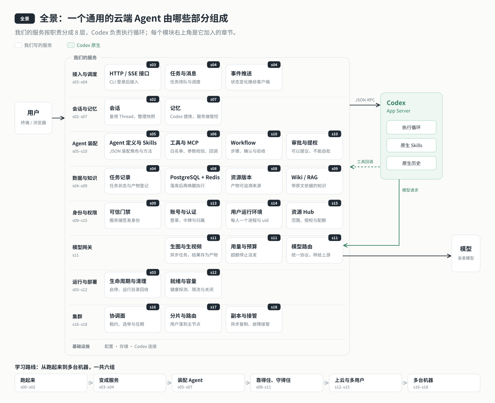
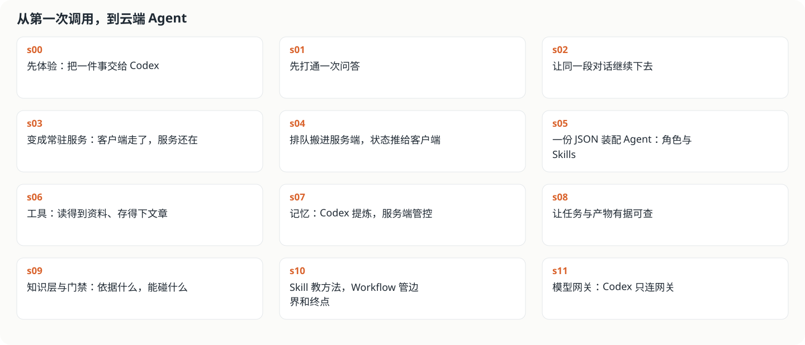

# 导论：Codex harness 是什么，为什么用它来做 Agent

`导论` → [s00](s00-sdk-quickstart/) → [s01](s01-single-turn/) → [s02](s02-multi-turn/) → [s03](s03-service/) → [s04](s04-events-messages/) → [s05](s05-agent-assembly/) → [s06](s06-tools/) → [s07](s07-memory/) → [s08](s08-data-layer/) → [s09](s09-knowledge-layer/) → [s10](s10-skill-workflow/) → [s11](s11-model-gateway/) → [s12](s12-deploy/README.md) → [s13](s13-auth/README.md) → [s14](s14-isolation/README.md) → [s15](s15-hub/README.md) → [s16](s16-coordination/README.md) → [s17](s17-sharding/README.md) → [s18](s18-replication/README.md) → [app](../app/)
> *"Agent = 模型 + Harness"* — 模型负责想，harness 负责做。这套教程带你亲手做一个**通用的云端 Agent 脚手架**：不自己造 harness，而是把 OpenAI Codex 的 harness 接进来，把精力留给业务。

---

## 为什么要做这件事

Codex 已经是一个很强的 Agent：会读文件、跑命令、调工具、改代码，执行循环、会话历史、上下文压缩、沙箱都做好了。可它是一个装在**你自己电脑上**的工具：你开着终端它才在，只有你一个人用，能碰你电脑上的一切。

想把这样一个 Agent 做成**服务**——放在服务器上长期在线，很多人随时连上来用，每个人只看得到自己的东西，能接入你自己的资料和工具，换哪家模型、花多少钱都管得住，机器坏了也不丢——中间还差很多东西。这些东西 Codex 不管，也不该由它管，它们才是一个 Agent 产品真正的业务部分。

这套教程做的就是这一段：**以 Codex 为执行引擎，一层一层搭出一个可以上线的云端 Agent。** 每一层都回答一个具体的问题：为什么需要它、它管什么、不管什么。

## 我们要做的是什么

一个**通用的云端 Agent 脚手架**。做完以后：

- 它常驻在服务器上，终端或浏览器随时连上去用，关掉电脑它也还在；
- 它是谁、会什么、能用哪些工具和资料，由一份 **Agent 配置**决定。换一份配置，就是另一个 Agent：写作助手、客服、研究员、数据分析……教程里用一个**写作助手**作为示例 Agent 贯穿各章演示，但脚手架本身不绑定任何业务；
- 任务排队执行，服务重启、网络断开也不丢、不重复；多步任务可以按流程走，关键处停下来等人确认；
- 多个用户各自登录、各用各的，彼此看不到对方的会话、文件和记忆，能用什么、能用多少由权益决定；
- 模型经网关统一接入，按用途挑模型、出错自动换、用量和预算管得住；
- 一台机器装不下就分到多台，一台坏了由另一台接手，丢了哪些内容如实告诉用户。

## 全景图



左边是用户，中间是我们写的服务，右边是 Codex（执行循环、原生 Skills、原生历史都在它那里）和模型。我们的服务按职责分成 8 层，每个模块右上角标着它在哪一章加入。读每一章时，都可以回到这张图，看这一章往哪一层加了什么。

## 每一章做什么

19 章分成六组。每一章只加一个单元：下面写清这个单元的专业名称，以及它给云端 Agent 加上了什么。

**跑起来**——先让 Codex 替你干活

| 章 | 这一章是 | 给云端 Agent 加上什么 |
|---|---|---|
| [s00](s00-sdk-quickstart/) | SDK 快速体验 | 用官方 SDK 交给 Codex 一个真实任务，先摸一摸引擎 |
| [s01](s01-single-turn/) | App Server 协议接入 | 打通"我们的程序 → App Server → 模型"这条主链路 |
| [s02](s02-multi-turn/) | 多轮会话（Thread / Turn） | 连续对话，断开以后还能接着聊 |

**变成服务**——客户端随时来去

| 章 | 这一章是 | 给云端 Agent 加上什么 |
|---|---|---|
| [s03](s03-service/) | 常驻服务（Client / Server） | 服务端常驻持有 Codex，客户端关掉，正在执行的一轮照样跑完 |
| [s04](s04-events-messages/) | 任务队列与事件推送（Queue + SSE） | 输入先记下再逐条执行，状态主动推给客户端 |

**装配 Agent**——它是谁、能做什么

| 章 | 这一章是 | 给云端 Agent 加上什么 |
|---|---|---|
| [s05](s05-agent-assembly/) | Agent 装配（Agent 定义 + Skills） | 一份 JSON 决定它是谁、怎么工作；换配置就换 Agent |
| [s06](s06-tools/) | 工具调用（Tool Registry + MCP） | 能读资料、存产物；能用什么由白名单说了算 |
| [s07](s07-memory/) | 记忆（Memory） | 记得住偏好；开不开、谁参与由服务端决定 |

**靠得住、守得住**——落库、门禁、流程、模型

| 章 | 这一章是 | 给云端 Agent 加上什么 |
|---|---|---|
| [s08](s08-data-layer/) | 持久化数据层（PostgreSQL + Outbox） | 任务与产物落库，重启不丢不重，产物有版本 |
| [s09](s09-knowledge-layer/) | 知识库与权限门禁（RAG + Gate） | 身份由服务端认定，所有访问过一道门；资料整理成知识库 |
| [s10](s10-skill-workflow/) | 工作流编排（Skill + Workflow） | 多步任务有边界、验收和确认点；可以提议，不能自批 |
| [s11](s11-model-gateway/) | 模型网关（Model Gateway） | 统一协议、多模型路由、备用链、用量与预算 |

**上云与多用户**——部署、账号、隔离、权限

| 章 | 这一章是 | 给云端 Agent 加上什么 |
|---|---|---|
| [s12](s12-deploy/README.md) | 容器化部署（Compose + 就绪探测） | 交给一台没人看着的服务器，自己启动、自己恢复，出错能回滚 |
| [s13](s13-auth/README.md) | 身份认证（Authentication） | 每个用户登录自己的账号，资源各有归属 |
| [s14](s14-isolation/README.md) | 多租户隔离（Tenant Isolation） | 每人一个 Codex 进程和系统账号，底层也互不可见 |
| [s15](s15-hub/README.md) | 访问控制与配额（Authorization + Quota） | 谁能用、谁能改、能分享给谁、能用多少，一处判定 |

**多台机器**——一台装不下、一台坏了

| 章 | 这一章是 | 给云端 Agent 加上什么 |
|---|---|---|
| [s16](s16-coordination/README.md) | 集群协调（etcd 租约与选举） | 多台机器知道谁活着、谁说了算，醒来的旧主写不进去 |
| [s17](s17-sharding/README.md) | 分片路由（Sharding） | 用户分到不同节点，从任意入口都能找到他 |
| [s18](s18-replication/README.md) | 高可用与故障接管（Replication / Failover） | 副本接手继续服务，丢了什么说得清 |

完整项目 [app](../app/README.md) 在 s11 之上持续开发，带 Web 工作台和互动课程；s12–s18 是各自独立的部署快照。

开工之前，先弄清楚我们要用的这个引擎。

---

## 先从一个公式说起

**Agent = LLM + Harness。**

模型很聪明，但它只会"想"：读进一段上下文，吐出一段文字，或者说一句"我要调用某个工具"。它碰不到你的文件，跑不了命令，也记不住上一次聊过什么。

把"想"变成"做"的，是模型外面那一圈程序，也就是 harness。它要做的事情很多：

- 把任务和上下文交给模型；
- 模型说要调工具，就真的去执行，再把结果喂回给模型；
- 一轮一轮循环，直到任务做完；
- 记住会话历史，上下文太长时做压缩；
- 管住权限：哪些命令能跑，哪些操作要先问人；
- 出错、中断、断线之后，还能接着来。

**Codex harness 就是 OpenAI 的明星产品 Codex 背后的那一圈程序。** OpenAI 在官方文章《[解锁 Codex 运行框架：我们如何构建 App Server](https://openai.com/zh-Hans-CN/index/unlocking-the-codex-harness/)》里说，Codex 的 Web 应用、CLI、IDE 扩展和 macOS 应用，底层都由同一个 Codex harness 驱动。我们的云端 Agent 用的，就是这个已经被 OpenAI 自家产品大规模验证过的执行引擎。

---

## Codex harness 开源了吗？

源码是公开的：它在 [openai/codex](https://github.com/openai/codex) 仓库里（Apache-2.0 许可证），核心的智能体循环在 `codex-rs/core`。

但是，**做产品的人不需要读它、改它、fork 它。** 本项目把 `@openai/codex` 作为一个 npm 依赖装进来，装进来的是一个编译好的程序：

```text
node_modules/@openai/
├── codex/                 # 启动入口
└── codex-darwin-arm64/    # 按平台下载的 Codex 程序（Linux 上是 codex-linux-*）
```

对我们来说，它就是一个**黑箱**。你不需要单独安装 Codex：代码运行起来，就会在你的电脑或服务器上启动一个 Codex。这个黑箱只留了一个入口，叫 **App Server**。

```text
你的 Agent 主程序 ──▶ App Server（JSON-RPC）──▶ Codex harness ──▶ 模型服务（DeepSeek、Kimi……）
```

---

## 黑箱里装了什么

官方把 Codex harness 的能力分成下面几块。核心是智能体循环，围绕它还有三类支撑能力：

| 能力 | 官方说法（概括） | 对你意味着什么 |
|------|---------------|--------------|
| 智能体循环 | 协调用户、模型和工具之间的交互 | 不用自己写"调模型 → 解析工具调用 → 执行 → 回填结果 → 再调模型"的循环 |
| 线程生命周期与持久化 | 线程可以创建、恢复、派生和归档，事件历史持久保存，客户端重连后能呈现一致的时间线 | 不用自己存聊天记录、拼上下文；断开之后还能接着聊 |
| 配置与身份验证 | 加载配置、管理默认值，运行"使用 ChatGPT 登录"等认证流程 | 模型、登录、默认值有统一的入口 |
| 工具执行与扩展 | 在沙箱里执行 shell / 文件工具，连接 MCP 服务器和技能，按一致的策略参与智能体循环 | 工具、MCP、Skill 由同一套规则管起来 |

这些能力全在黑箱里。我们后面做的每一章，都是在黑箱**外面**给云端 Agent 加东西，而不是去重写黑箱里面的东西。

---

## App Server：黑箱留出来的那扇门

App Server 的定位，是让你**把 Codex 深度集成进自己的产品**，同时拿到对话历史、审批和 Agent 执行事件这些能力。

它有两层意思：

1. **一套协议**：客户端和服务端之间的双向 JSON-RPC，按行收发 JSON（stdio 上的 JSONL）。
2. **一个长期运行的进程**：它托管着 Codex 的核心线程。官方介绍，进程里有四个组件：stdio 读取器、Codex 消息处理器、线程管理器和核心线程。客户端的请求被翻译成 Codex 内部的操作；Codex 内部的大量底层事件，再被翻译成一小组稳定的、可以直接拿来渲染界面的通知。

所以在这条连接上，你会看到三类消息：

| 消息 | 方向 | 例子 |
|------|------|------|
| 请求与回包 | 客户端 → 服务端 → 客户端 | `thread/start`、`turn/start` |
| 通知 | 服务端 → 客户端，**一个请求会带出很多条** | `item/started`、`item/agentMessage/delta`、`turn/completed` |
| 服务端发起的请求 | 服务端 → 客户端 | 智能体要执行命令前请求审批，**这一轮会暂停，直到客户端回复允许或拒绝** |

用它完成一次最简单的问答，流程是这样的：

```text
启动 App Server → 握手（initialize）→ 新建对话（thread/start）→ 发送问题（turn/start）
→ 等待回答完成（turn/completed）→ 关闭进程
```

### 它是怎么来的

官方文章讲了 App Server 的来历，值得一读：

- 一开始，Codex 只有终端界面（TUI）。做 VS Code 扩展时，OpenAI 想在 IDE 里驱动同一个智能体循环，又不想重写一遍。
- 他们先试着把 Codex 做成 MCP 服务器，发现很难在 VS Code 里维持 MCP 的语义。于是改成一套类似 TUI 循环的 JSON-RPC 协议，这就是 App Server 最早的版本。
- 后来 JetBrains、Xcode 想在自己的 IDE 里嵌入 Codex，Codex 桌面应用要并行编排多个智能体，这套协议就被设计成了稳定的平台接口。它**向后兼容**：旧版客户端可以安全地连接新版服务端。

这段历史说明了一件事：**App Server 不是给某个产品临时写的胶水，而是 OpenAI 自家所有 Codex 产品共用的接口。** 你接入的，和 OpenAI 自己用的是同一套。

---

## 三个原语：Item、Turn、Thread

用户和智能体的交互不是简单的"一问一答"。一次请求会展开成一串有结构的动作：思考、调用工具、看结果、改文件、再回答。为了让各种界面都能稳定地呈现这些动作，App Server 定义了三个边界清楚、各有生命周期的原语：

| 原语 | 是什么 | 打个比方 | 生命周期 |
|------|-------|---------|---------|
| Item（项目） | 输入输出的最小单位：一条用户消息、一条智能体消息、一次工具执行、一次审批请求、一份文件差异 | 聊天记录里的一个气泡、一条操作记录 | `item/started` → 可选的 `item/*/delta`（流式内容）→ `item/completed` |
| Turn（轮次） | 一次用户输入引发的全部工作，里面有多个 Item | 你问一个问题，它从思考、查资料到回答的整个过程 | `turn/started` → …… → `turn/completed` |
| Thread（线程） | 用户和智能体之间一段持续的会话，里面有多个 Turn | 一个聊天窗口 | 可以创建、恢复、派生、归档；历史持久保存 |

Item 的生命周期设计得很实用：`started` 时界面就能开始画，`delta` 时一点点流式追加，`completed` 时定稿。后面每一章的代码，都是围绕这三个原语展开的。

---

## 这带来了什么改变

如果不用现成的 harness，而是用 LangGraph、LangChain 这类框架从头搭一个 Agent，下面这些都要自己写：

- 组织模型和工具之间的反复调用；
- 维护多轮对话与上下文；
- 处理执行事件、中断和审批；
- 保存和恢复会话。

用 Codex harness，这些都已经在里面了，而且在 Codex 的各个产品里跑过。**你不用再从头造执行引擎，可以把精力放在自己的业务产品上。**

| 事情 | 自己从头搭 | 用 Codex harness |
|------|----------|----------------|
| 模型和工具的反复调用 | 自己写循环 | Codex 负责 |
| 多轮对话与上下文压缩 | 自己存、自己拼 | Codex 负责 |
| 执行事件、流式输出、审批 | 自己定义事件格式 | App Server 的通知与服务端请求 |
| 会话保存与恢复 | 自己落库 | Codex 原生持久化，按 Thread ID 恢复 |
| 这个 Agent 是谁、能用什么、能碰什么、做到什么算完 | 自己做 | **仍然要自己做，这正是本教程要带你做的** |

---

## 一个 Agent 完成任务，要回答六个问题

一个 Agent 要把一件事做好，至少要回答六个问题。Codex 回答了其中"怎么执行"的部分，剩下的要由我们在黑箱外面补上：

| 问题 | Codex 原生提供 | 我们在外面补什么 | 在哪一章 |
|------|--------------|----------------|---------|
| ① 我是谁？ | 放角色提示词的位置（`baseInstructions`） | 角色写什么、放在哪、改了以后旧会话怎么办；多用户以后，"我"还包括**以哪个用户的名义**在工作 | s05、s13 |
| ② 要做什么，做到什么算完？ | Turn 的生命周期和终态 `turn/completed` | 按终态判断成败；任务排队、持久化、可恢复；多步任务的验收和确认点 | s00、s01、s04、s08、s10 |
| ③ 之前聊过什么？ | Thread 历史持久化、恢复、上下文压缩、原生记忆 | 输入按顺序投递；选择恢复哪个会话；控制哪些会话参与记忆；历史随部署持久化与备份，按用户隔离存放，跟着用户分片，主节点坏了还能从副本接着聊 | s02、s03、s04、s07、s12、s14、s17、s18 |
| ④ 依据什么资料？ | 不管你的业务资料 | 资料目录与版本、知识库（Wiki / RAG）、产物能追溯到依据 | s06、s08、s09 |
| ⑤ 能用什么？ | 工具调用循环、MCP 接入、Skill 发现 | 工具注册表与白名单、Skill 的内容；模型自带的能力、生图生视频等其他模型；交付明确的运行环境；按权益决定每个用户能用哪些 Agent、工具和多少 token | s06、s10、s11、s12、s15 |
| ⑥ 谁说了算？ | 沙箱、审批请求 | 服务端掌管配置与开关；工具白名单、统一门禁、"可以提议，不能自批"；用量预算；账号与授权、用户隔离；多台机器之间用租约和任期决定谁能服务、谁的写入作数 | s03、s05、s06、s07、s09、s10、s11、s12–s18 |

一句话概括：**Codex 负责"怎么执行"，我们负责"执行什么、以谁的名义、在什么边界内"。**

---

## 有几种接入方式，为什么选 App Server

官方列出了驱动 Codex 的几种常见方式：

| 方式 | 适合 | 代价 |
|------|------|------|
| **App Server** | 想把完整的 harness 嵌进产品，以界面友好的事件流呈现；还能用"使用 ChatGPT 登录"、模型发现、配置管理 | 要用自己的语言写 JSON-RPC 客户端。官方的建议是：把 JSON Schema 和文档交给 Codex，它能帮你完成大部分工作 |
| 把 Codex 当 MCP 服务器（`codex mcp-server`） | 已经有基于 MCP 的工作流，想把 Codex 当成一个可调用的工具 | 只能拿到 MCP 暴露的内容，文件差异这类更丰富的会话语义映射不清楚 |
| 跨厂商的智能体协议 | 需要一层抽象来编排多家模型和运行时 | 往往趋同于通用子集，丰富的交互难以表达 |
| CLI 脚本模式（`codex exec`） | 一次性任务、CI 流水线 | 非交互，一条命令跑到底 |
| TypeScript SDK（`@openai/codex-sdk`） | Node 程序里几行代码调用 Codex；底层是 `codex exec`，一轮一个进程 | 与 CLI 脚本模式相同：事件单向流出，处理不了审批，也不能把工具调用接回自己的程序 |
| Python SDK（`openai-codex`） | Python 程序；底层就是 App Server 的 JSON-RPC 客户端 | 高层接口用起来方便；底层能力与 App Server 一致 |

官方说 App Server 是他们今后首要维护的集成方案，默认也推荐用它。注意两个官方 SDK 底下不一样：TypeScript SDK 包的是脚本模式，Python SDK 包的是 App Server。本教程主线用 Node：s00 先用 TypeScript SDK 体验一下（另有一个 Python SDK 的选读示例），s01 起直接对接 App Server 协议。

---

## 模型怎么接

对模型来说，连接方式就是三样东西：**API Key、Base URL、模型名**。写进 `.env`，Codex 就能连上。Codex 只使用 OpenAI 的 Responses API 跟模型对话，Kimi、DeepSeek 等提供了 Responses 接口的模型可以直接连。

**直连只用在 s01–s10**：前面这些章节只用一个模型，直连最简单，能把原理讲清楚。

**到 s11，必须打造一个模型网关**。线上的 Agent 不可能只跑一个模型：

- **协议要统一**：有的模型只有 Chat Completions 或 Claude 格式的接口；模型自带的能力（比如联网搜索）也要通过同一套协议用上。
- **模型要协调**：语言模型各有所长，有的快而便宜，有的更强；生图、生视频、RAG 的向量又各要各的模型；一家余额用完或者限流了，要能自动切到备用的那家。
- **用量要管住**：每一轮用了多少 token、花了多少钱要记账，超出预算要能停下来；各家的密钥也不该交给 Codex。

从 s11 开始，Codex 只连网关一个地址，其余都交给网关和我们写的路由、账本，详见 [s11 模型网关](s11-model-gateway/)。

---

三种模型接入路线、登录链接和自检命令见[接入模型](setup-models.md)。

## 这套教程怎么走



贯穿始终的一条原则：**不自造 agent loop**。模型与工具的执行循环始终交给 Codex，我们只在它外面一层层给云端 Agent 加上会话、角色与工具、数据、知识、权限和工作流，再把它部署上云、交给多个用户、扩展到多台机器。

每一章都按同一个顺序来讲：

1. **要回答的问题**：要做的云端 Agent 还缺什么；
2. **核心概念**：先把概念和道理讲清楚；
3. **分工**：哪些交给 Codex，哪些由我们来做；
4. **跑起来看看**：动手运行，看看机器上发生了什么变化、数据存在哪里；
5. **关键代码**：只看最关键的几段，代码逐行摘自该阶段的源码；
6. **小结**和**下一章**。

想看完整的设计取舍和命令细节，各阶段的 `docs/` 目录里都有。

---

## 延伸阅读

- OpenAI：[解锁 Codex 运行框架：我们如何构建 App Server](https://openai.com/zh-Hans-CN/index/unlocking-the-codex-harness/)
- OpenAI：[Unrolling the Codex agent loop](https://openai.com/index/unrolling-the-codex-agent-loop/)（拆解 harness 里的核心智能体循环）
- App Server 协议说明：[codex-rs/app-server/README.md](https://github.com/openai/codex/blob/main/codex-rs/app-server/README.md)
