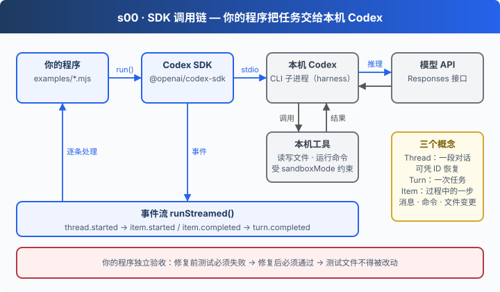

# s00: 先体验 — 让 Codex 替你干一件事

[导论](../introduction.md) → `s00` → [s01](../s01-single-turn/) → [s02](../s02-multi-turn/) → [s03](../s03-agent-core/) → [s04](../s04-data-layer/) → [s05](../s05-knowledge-layer/) → [s06](../s06-skill-workflow/) → [s07](../s07-model-gateway/) → [app](../../app/)
> *"模型提出操作，harness 负责执行"* — 先不管协议，用官方 SDK 把一个真实任务交给 Codex，亲眼看看 harness 替你做了哪些事。
>
> **对应六个问题**：② 要做什么，做到什么算完？

---

## 要回答的问题

动手做云端 Agent 之前，先摸一摸我们要用的引擎：把一个真实的任务交给 Codex，看看它到底替你做了哪些事。

你想让 AI 修一个 bug。在聊天窗口里，它给出修改建议；你复制、粘贴、跑测试，再把报错贴回去，它再改……

模型能推理，但碰不到你的文件和终端。每一个来回，**你都在给模型当 harness**：替它读文件、替它跑命令、替它把结果喂回去。

这一章想回答三个问题：

1. 把任务交给 Codex 之后，"读文件 → 跑命令 → 改代码 → 看结果 → 再改"这个循环，到底是谁在转？
2. 自己的程序要和 Codex 打交道，最少需要懂哪几个概念？
3. AI 说"修好了"，你凭什么相信？

---

## 核心概念

### 循环由 harness 来转



官方 TypeScript SDK 会在本机启动一个 Codex 子进程，通过 stdio 和它通信。推理 → 调工具 → 看结果 → 继续，这整个循环都在 Codex 内部完成。你的程序只是说一句"去做这件事"，然后等结果，或者一路看着它做。

这就是[导论](../introduction.md)里那个公式的第一次落地：**Agent = 模型 + harness**。模型决定下一步，harness 去执行。

### 三个概念就够了

| 概念 | 是什么 | 在 SDK 里 |
|------|-------|----------|
| Thread | 一段对话，凭 ID 可以恢复 | `codex.startThread()` / `resumeThread(id)` |
| Turn | 你交代的一次任务，以及随后的整个执行过程 | `thread.run()` / `thread.runStreamed()` |
| Item | 执行过程中的一步：一条消息、一次命令、一次文件变更 | 事件里的 `event.item` |

这三个概念就是 App Server 协议的三个原语。SDK 帮你包了一层，到 s01 你会直接和它们打交道。

### 权限由你给

Codex 能做多少事，由你开 Thread 时给的沙箱决定：只聊天用 `read-only`，要改代码才给 `workspace-write`。harness 会执行模型提出的操作，但**能碰到哪里，是你说了算**。

### SDK 在官方版图里的位置

官方对 SDK 的定位是：适合想要原生库接口、不想自己写 JSON-RPC 客户端的服务端工具。它比 App Server 发布得早，支持的语言更少，覆盖面也更小。所以本教程只在这一章用它体验，从 s01 开始直接对接 App Server。

---

## 分工：Codex 做什么，我们做什么

| 环节 | 谁负责 |
|------|-------|
| 理解任务，决定下一步做什么 | 模型 |
| 读文件、跑命令、改代码，把结果喂回模型，循环到做完 | Codex harness |
| 在哪个目录工作，给多大权限 | 你的程序（`workingDirectory`、`sandboxMode`） |
| 判断是不是真的做完了 | 你的程序：自己跑测试验收，不听模型自述 |

最后一行最重要。模型说"已修复"只是一句话，**验收必须由模型之外的程序来做**。这个原则会一直贯穿到 s06 的 Workflow 验收。

---

## 跑起来看看

**准备**（首次运行）：

```sh
cd stages/s00-sdk-quickstart
npm ci
npx codex login status   # 未登录就运行 npx codex login
npm run doctor           # 环境自检，不调用模型
```

使用 API Key 时，`cp .env.example .env` 后填写 `CODEX_API_KEY` 等配置。

**运行**：

```sh
npm run hello                          # 只读，一问一答
npm run fix                            # 在 .runs/ 下的练习目录里修复 add.mjs
npm run resume                         # 接着上一次 fix 的对话继续问
npm run json                           # 结构化输出
npm run app-server                     # 预览下一章：直接走 App Server 协议
```

> **安全提示**：`fix` 会给 Codex 写权限，但只作用于每次新建的 `.runs/repair-*` 练习目录，不会改动 `fixture/` 里的原文件。

**跑完之后，机器上多了什么**：

```text
s00-sdk-quickstart/
└── .runs/
    ├── repair-XXXXXX/        # 每次 fix 新建的练习目录：Codex 在这里改代码
    │   └── events.jsonl      # 这一轮的全部事件：命令、输出、文件变更
    └── latest-repair.json    # 最近一次 fix 的 threadId，resume 靠它找回对话

~/.codex/sessions/            # SDK 默认用你本机的 Codex 状态目录，会话记录存在这里
```

观察重点：

1. `fix` 的事件流里，Codex 先运行了什么命令？它是看到测试失败之后才去改代码的吗？
2. 打开 `events.jsonl`，数一数一个 Turn 里有几个 Item。
3. `resume` 时你的程序没有重发任何历史，Codex 却记得上一轮做了什么。历史在哪里？

完整的环境准备、VS Code 断点调试、API Key 路线和排错见 [新手集成与调试指南](docs/guide.md)。

---

## 关键代码

开一个 Thread，说清楚在哪个目录工作、给多大权限：

```javascript
const codex = new Codex({ apiKey: process.env.CODEX_API_KEY || undefined });
const thread = codex.startThread({
  workingDirectory: process.cwd(),
  skipGitRepoCheck: true,
  sandboxMode: "read-only",
  approvalPolicy: "never",
  webSearchMode: "disabled",
});
```

执行一轮。`run()` 会等到这一轮彻底结束：

```javascript
const result = await thread.run(prompt, { signal: AbortSignal.timeout(180_000) });
console.log("回答：", result.finalResponse);
console.log("对话 ID：", thread.id);
```

不相信 AI 说的"修好了"，由程序自己验收（`examples/02-fix.mjs`）：先确认测试本来是失败的，修完后检查测试文件没被改过，再跑一遍测试。

```javascript
const before = runTests();
if (before.error || before.status !== 1) throw new Error("练习的初始测试没有按预期失败。");

const thread = createCodex().startThread(threadOptions(workspace, "workspace-write"));
await streamTurn(thread, prompt, eventFile);

if (await readFile(path.join(workspace, "add.test.mjs"), "utf8") !== originalTest) {
  throw new Error("Codex 修改了测试文件，本次不算通过。");
}
const after = runTests();
if (after.error || after.status !== 0) {
  throw new Error(`修复后测试仍未通过：\n${after.stdout}\n${after.stderr}`);
}
```

想看执行过程，就改用 `runStreamed()`，每个命令、每次文件变更都会作为一个 Item 推过来；程序退出后凭 ID 用 `resumeThread()` 接着聊。完整代码在 [`examples/`](examples/)。

---

## 小结

- 几十行代码，你的程序就能把任务交给 Codex。循环由 harness 来转，你不用写一行"调模型、解析工具调用"的代码。
- 你的程序要管的是三件事：在哪做、给多大权限、做完怎么验收。
- Thread、Turn、Item 三个概念第一次出现。历史不在你的程序里，而在 Codex 的状态目录里。

---

## 下一章

SDK 把协议藏起来了，`run()` 一行就拿到答案。但我们要做的是一个云端 Agent：要实时显示模型正在输出的文字、管理多个会话、接入自己的工具、换成自己选的模型，这些都要直接和 App Server 对话。

[s01 单轮问答](../s01-single-turn/) → 去掉 SDK，自己接上模型，在 stdio 上说 JSON-RPC。stdout 里一行行 JSON，哪条才是这次请求的回答？拿到 `turn/start` 的回包，能宣布任务完成了吗？
