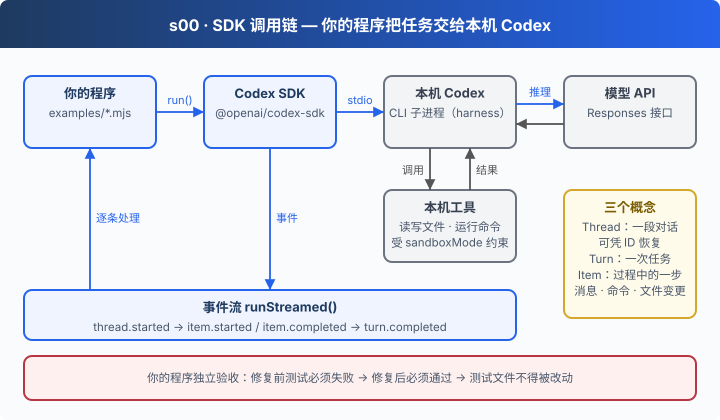

# s00: SDK 入门 — 先让 Codex 替你干一件事

`s00` → [s01](../s01-single-turn/) → [s02](../s02-multi-turn/) → [s03](../s03-agent-core/) → [s04](../s04-data-layer/) → [s05](../s05-knowledge-layer/) → [app](../../app/)
> *"模型提出操作，Harness 负责执行"* — 用官方 SDK 驱动本机 Codex，跑通"发任务 → 改代码 → 自己验收"。
>
> **Harness 层**: 入口 — 你的程序第一次把任务交给 Codex。

---

## 问题

你想让 AI 修一个 bug。在聊天窗口里，它给出修改建议；你复制、粘贴、跑测试，再把报错贴回去，它再改……

模型能推理，但碰不到你的文件和终端。每一个来回，你都在充当中间层。

Codex 自带一个 harness（本机执行程序）：读文件、跑命令、改代码、把结果喂回模型，循环到任务完成。剩下的问题是：**怎样从自己的程序里把任务交给它，并且确认它真的做完了？**

---

## 解决方案



官方 TypeScript SDK 会在本机启动 Codex 子进程，通过 stdio 与它通信。执行循环（推理 → 调工具 → 看结果 → 继续）全部在 Codex 内部完成，你的程序只需要理解三个概念：

| 概念 | 含义 | 在代码里 |
|------|------|---------|
| Thread | 一段对话，可以凭 ID 恢复 | `codex.startThread()` / `resumeThread(id)` |
| Turn | 你发出的一次任务，以及随后的整个执行过程 | `thread.run()` / `thread.runStreamed()` |
| Item | 执行过程中的一步：一条消息、一次命令、一次文件变更 | 事件里的 `event.item` |

权限由 `sandboxMode` 决定：只聊天用 `read-only`，要改代码才给 `workspace-write`。

---

## 工作原理

**第 1 步**：创建客户端。默认复用 `npx codex login` 的登录状态，也可以传 API Key。

```javascript
const codex = new Codex({ apiKey: process.env.CODEX_API_KEY || undefined });
```

**第 2 步**：开一个 Thread，说清楚在哪个目录工作、给多大权限。

```javascript
const thread = codex.startThread({
  workingDirectory: process.cwd(),
  skipGitRepoCheck: true,
  sandboxMode: "read-only",
  approvalPolicy: "never",
  webSearchMode: "disabled",
});
```

**第 3 步**：执行一轮，拿最终回答。`run()` 会等到这一轮彻底结束。

```javascript
const result = await thread.run(prompt, { signal: AbortSignal.timeout(180_000) });
console.log("回答：", result.finalResponse);
console.log("对话 ID：", thread.id);
```

**第 4 步**：想看过程，就改用流式事件。每个命令、每次文件变更都会作为一个 item 推过来。

```javascript
const { events } = await thread.runStreamed(prompt, { signal });
for await (const event of events) {
  if (event.type === "item.started" && event.item.type === "command_execution") {
    console.log("[执行命令]", event.item.command);
  }
  if (event.type === "item.completed") {
    const item = event.item;
    if (item.type === "agent_message") {
      finalResponse = item.text;
      console.log("[Codex]", item.text);
    } else if (item.type === "command_execution") {
      console.log(`[命令结果 exit=${item.exit_code}]`, item.aggregated_output);
    } else if (item.type === "file_change") {
      console.log("[文件变更]", item.status, item.changes);
    }
  }
  if (event.type === "turn.failed") throw new Error(event.error.message);
}
```

**第 5 步**：不相信 AI 说的"修好了"，由程序自己验收（`examples/02-fix.mjs`）。

```javascript
const before = runTests();
if (before.error || before.status !== 1) throw new Error("练习的初始测试没有按预期失败。");

const thread = createCodex().startThread(threadOptions(workspace, "workspace-write"));
await streamTurn(thread, prompt, eventFile);

if (await readFile(path.join(workspace, "add.test.mjs"), "utf8") !== originalTest) {
  throw new Error("Codex 修改了测试文件，本次不算通过。");
}
const after = runTests();
if (after.error || after.status !== 0) {
  throw new Error(`修复后测试仍未通过：\n${after.stdout}\n${after.stderr}`);
}
```

**第 6 步**：程序退出后，凭 ID 接着聊（`examples/03-resume.mjs`）。

```javascript
const { threadId, workspace } = await latestRepair();
// 即使上一个 Node 程序已经退出，仍能凭 ID 继续已有对话。
const thread = createCodex().resumeThread(threadId, threadOptions(workspace));
const prompt = process.argv.slice(2).join(" ") ||
  "请根据我们上一轮对话，用一句中文说出刚才修改了哪个文件、修复了什么。不要调用工具。";
await streamTurn(thread, prompt, path.join(workspace, `resume-${Date.now()}.jsonl`));
```

几十行代码，你的程序就能把任务交给本机 Codex，并独立判断结果是否可信。SDK 底层仍然是启动 `codex` 子进程、在 stdio 上收发 JSON；下一章会把这层封装拿掉。

---

## 试一下

**准备**（首次运行）：

```sh
cd stages/s00-sdk-quickstart
npm ci
npx codex login status   # 未登录就运行 npx codex login
npm run doctor           # 环境自检，不调用模型
```

使用 API Key 时，`cp .env.example .env` 后填写 `CODEX_API_KEY` 等配置。

**运行**：

```sh
npm run hello                          # 只读，一问一答
npm run hello -- "用一句话解释 harness"
npm run fix                            # 在 .runs/ 下的练习目录里修复 add.mjs
npm run resume                         # 接着上一次 fix 的对话继续问
npm run json                           # 结构化输出
npm run app-server                     # 预览下一章：直接走 App Server 协议
```

> **安全提示**：`fix` 会给 Codex 写权限，但只作用于每次新建的 `.runs/repair-*` 练习目录，不会改动 `fixture/` 里的原文件。

观察重点：

1. `fix` 的事件流里，Codex 先运行了什么命令？它是看到测试失败之后才去改代码的吗？
2. 打开 `.runs/repair-*/events.jsonl`，数一数一个 Turn 里有几个 item。
3. `resume` 时没有重发任何历史，Codex 却记得上一轮做了什么。历史保存在哪里？

完整的环境准备、VS Code 断点调试、API Key 路线和排错见 [新手集成与调试指南](docs/guide.md)。

---

## 接下来

SDK 把协议藏起来了：`run()` 一行就拿到答案。但要做一个真正的对话应用，比如显示模型正在输出的文字、同时管理多个会话、接入自己的工具，就得直接和 Codex App Server 对话。

s01 单轮问答 → 去掉 SDK，自己在 stdio 上说 JSON-RPC。stdout 里一行行 JSON，哪条是你这次请求的回答？拿到 `turn/start` 的回包，能宣布任务完成了吗？
