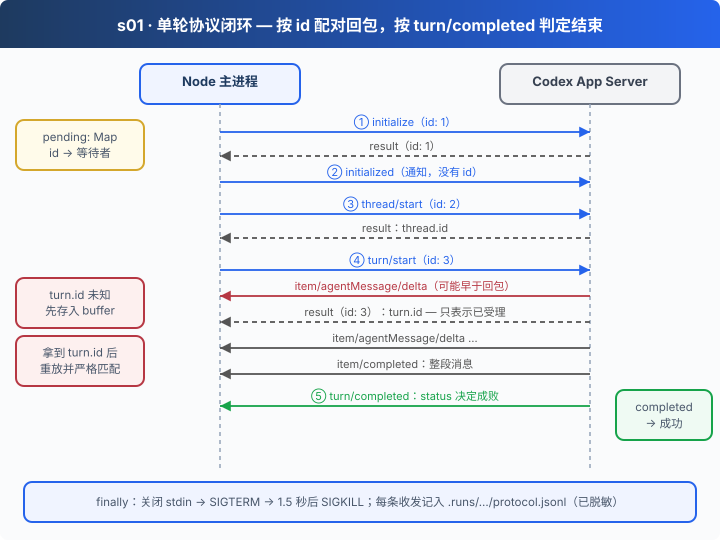

# s01: 单轮问答 — 先建立通信，再派发任务

[s00](../s00-sdk-quickstart/) → `s01` → [s02](../s02-multi-turn/) → [s03](../s03-agent-core/) → [s04](../s04-data-layer/) → [s05](../s05-knowledge-layer/) → [s06](../s06-skill-workflow/) → [app](../../app/)
> *"收到回包，不等于任务完成"* — 一轮的成败只看它自己的 `turn/completed`。
>
> **Harness 层**: 协议 — 在 stdio 上用 JSON-RPC 和 Codex App Server 对话。

---

## 问题

s00 里一行 `thread.run()` 就拿到了答案。可当你要做对话界面，需要显示模型正在输出的文字、管理多个会话、接入自己的工具时，SDK 的封装就不够用了，你得直接面对 App Server 协议。

启动 `codex app-server`，盯着它的 stdout，你会看到一行行 JSON 混在一起：有对你请求的回包，有服务端主动推来的通知，还有服务端反过来向你要审批的请求。

两个陷阱马上出现：

1. 发出 `turn/start`，很快收到回包。这时能宣布"完成"吗？不能。回包只表示"受理"，模型可能还没开始生成。
2. 更麻烦的是，这一轮的通知**可能比回包先到**。你还不知道 `turn.id`，就已经收到了属于它的事件。

---

## 解决方案



stdout 上每一行都是一条 JSON-RPC 消息。按有没有 `id`、有没有 `method` 分成三类，各走各的路：

| 消息形态 | 含义 | 处理 |
|---------|------|------|
| 有 `id`，无 `method` | 对我方请求的回包 | 按 `id` 找到等待者，resolve 或 reject |
| 有 `id`，有 `method` | 服务端向我方发的请求（如审批） | 本阶段一律拒绝：审批回 `decline`，其他回 `-32601` |
| 无 `id` | 通知：`item/*`、`turn/completed` 等 | 交给当前轮次，按 threadId + turnId 匹配 |

成败只有一个凭据：本轮的 `turn/completed`，且 `status === "completed"`。

---

## 工作原理

代码都在 [`05-app-server.mjs`](05-app-server.mjs) 里，分步来看：

**第 1 步**：启动 Codex 子进程。状态目录放在本阶段的 `.data/codex`，不碰你个人的 Codex 配置；记忆、shell、补丁等通用工具全部关闭。

```javascript
const home = path.join(root, ".data", "codex");
launch = { ...launch, env: { ...launch.env, CODEX_HOME: home, CODEX_SQLITE_HOME: home },
  args: [...launch.args, "-c", "features.memories=false", "-c", "features.shell_tool=false",
    "-c", "features.apply_patch_freeform=false", "-c", "agents.enabled=false", /* … */] };
const child = spawn(process.execPath, [cli, ...args], {
  cwd: workspace, stdio: ["pipe", "pipe", "pipe"], env: launch.env
});
```

**第 2 步**：每个请求分配一个递增 `id`，把等待者放进 `pending`。回包到达时按 `id` 取出来。

```javascript
function request(method, params) {
  const id = ++sequence;
  return new Promise((resolve, reject) => {
    const timer = setTimeout(() => fail(new Error(`App Server 请求超时：${method}`)), launch.timeoutMs);
    pending.set(id, { resolve, reject, timer });
    send({ id, method, params });
  });
}

// 读取 stdout 的每一行：
if (message.id !== undefined) {
  const waiter = pending.get(message.id);
  if (!waiter) return;
  pending.delete(message.id);
  clearTimeout(waiter.timer);
  if (message.error) waiter.reject(new Error(redact(message.error)));
  else waiter.resolve(message.result);
}
```

**第 3 步**：握手。`initialize` 是请求，要等回包；`initialized` 是通知，没有 `id`。

```javascript
await request("initialize", {
  clientInfo: { name: "app_server_project", title: "App Server Project", version: "1.0.0" },
  capabilities: null
});
send({ method: "initialized", params: {} });
```

**第 4 步**：开 Thread、发 Turn。在拿到 `turn.id` 之前到达的通知先放进 `buffer`，拿到之后再重放、严格匹配。

```javascript
function handleTurnEvent(message) {
  const turn = activeTurn;
  if (!turn || message.params?.threadId !== turn.threadId) return;
  // turn/start 的通知可能早于 RPC 响应到达，先暂存，拿到 ID 后再严格匹配。
  if (!turn.id) { turn.buffer.push(message); return; }
  const eventTurnId = message.params.turnId || message.params.turn?.id;
  if (eventTurnId !== turn.id) return;
  // …按 itemId 累积 delta，item/completed 时用整段文本覆盖
}

const result = await request("turn/start", {
  threadId, input: [{ type: "text", text: prompt, text_elements: [] }]
});
turn.id = result.turn.id;
for (const message of turn.buffer) handleTurnEvent(message);
```

**第 5 步**：只认自己的 `turn/completed`。`failed` 或中断都按失败处理，有文字输出也不算成功。

```javascript
if (message.method === "turn/completed") {
  if (message.params.turn.status === "completed") turn.completed.resolve(message.params.turn);
  else turn.completed.reject(new Error(redact(message.params.turn.error || { status: message.params.turn.status })));
}

// RPC 响应仅表示受理；每一轮都必须等自己的 turn/completed。
await turn.completed.promise;
console.log("模型回复：", redact([...turn.answers.values()].join("\n")));
```

最后在 `finally` 里关闭子进程：先 `SIGTERM`，1.5 秒后仍未退出就 `SIGKILL`。

两百多行代码，没有写任何模型调用或工具循环，这些都由 Codex 负责。我们只做三件事：把请求和回包对上，把通知归到正确的轮次，用明确的终态判断成败。后面每一章都建立在这条协议链路上。

---

## 试一下

**准备**（首次运行）：

```sh
cd stages/s01-single-turn
npm ci
cp .env.example .env
# 编辑 .env，填入 CODEX_API_KEY、CODEX_BASE_URL、CODEX_MODEL
npm run check            # 只校验本地配置，不发网络请求
```

**运行**：

```sh
npm start
npm start -- "请用一句话介绍你自己"
```

观察重点：

1. 终端先打印 Thread id，再打印 turn id。两者都由服务端生成，不是递增编号。
2. 打开输出末尾提示的 `protocol.jsonl`，找到 `turn/start` 的回包。在它之前，有没有已经到达的 `item/*` 通知？
3. 回包和 `turn/completed` 之间隔了多少条消息？

**离线实验**（不调用模型，使用本地假 App Server）：

```sh
npm run lesson -- list
npm run lesson -- s01-transport   # 回包早到、通知早到两种顺序都能正确配对
npm run lesson -- s01-lifecycle   # failed 被拒绝，挂起触发超时
```

设计取舍、数据流和当前边界见 [s01 设计说明](docs/design.md)。

---

## 接下来

现在每运行一次只能问一句，程序就退出了。

s02 多轮会话 → 改成循环聊天。模型回答时用户又敲了两行，会不会丢失、会不会抢跑？退出后想接着聊，要不要把历史消息再发一遍？
