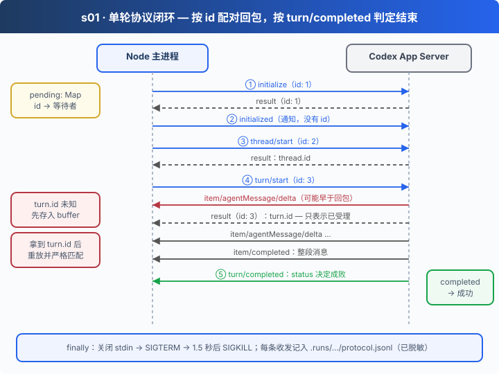

# s01: 单轮问答 — 接上模型，打通第一条链路

[导论](../introduction.md) → [s00](../s00-sdk-quickstart/) → `s01` → [s02](../s02-multi-turn/) → [s03](../s03-agent-core/) → [s04](../s04-data-layer/) → [s05](../s05-knowledge-layer/) → [s06](../s06-skill-workflow/) → [app](../../app/)
> *"收到回包，不等于任务完成"* — 不用 SDK，自己接上模型、启动 App Server、说 JSON-RPC。一轮算不算完成，只看它自己的 `turn/completed`。
>
> **对应六个问题**：② 要做什么，做到什么算完？

---

## 要回答的问题

云端 Agent 最核心的是一条链路：**我们的程序 → App Server → 模型**。后面加的会话、工具、数据、门禁，全都挂在这条链路上，所以第一步先把它打通。

按照 Agent = 模型 + harness 这个公式，先要有一个模型，再把它和 harness 连起来。这一章要回答：

1. **模型从哪里来？** 只能用 OpenAI 的模型吗，还是第三方模型也可以？
2. **怎么驱动 harness？** 不用 SDK，自己的程序怎么启动 Codex、和它说话？
3. **什么时候算答完？** stdout 上一行行 JSON 混在一起，哪条是回答？收到回包能不能宣布完成？
4. **跑完之后发生了什么？** 机器上多了哪些文件，数据存在哪里？

---

## 核心概念

### 第一步：接上模型

对模型来说，连接方式就是三样东西：**API Key、Base URL，以及你要用哪个模型**。它们写在 `.env` 里：

```sh
CODEX_API_KEY=            # 模型服务的密钥
CODEX_BASE_URL=https://api.deepseek.com
CODEX_MODEL=deepseek-flash
```

第三方模型也可以，前提是它提供 OpenAI 的 Responses 接口，因为 Codex 只用这套接口跟模型对话。DeepSeek、Kimi 都可以直连。只有 Chat Completions 或 Claude 格式接口的模型，要经过模型网关转换（见[导论](../introduction.md#模型怎么接)）。

`.env` 里还有一组 `CODEX_MODEL_*`，这是**模型目录**：声明这个模型的上下文有多长、能不能看图、有哪些推理档位。每次运行，程序都会把它写成 `.runs/app-server-*/models.json` 交给 Codex。Codex 靠它认识这个模型，以后换模型也只改这一处。注意，这些都是能力声明，不代表给 Agent 授予任何系统权限。

### 第二步：在本机跑出一个 Codex

不需要另外安装 Codex。`@openai/codex` 是本阶段的 npm 依赖，程序运行时把它作为子进程启动成 App Server，然后通过 stdin / stdout 收发 JSON-RPC。

本阶段只做问答，所以启动时把 Codex 的状态目录指到本阶段的 `.data/codex`（不碰你个人的 Codex 配置），并关闭记忆、shell、改文件这些通用工具。

### 第三步：分清三类消息

App Server 的连接是**双向**的。stdout 上的每一行都是一条 JSON-RPC 消息，按有没有 `id`、有没有 `method` 分成三类：

| 消息形态 | 含义 | 本阶段怎么处理 |
|---------|------|-------------|
| 有 `id`，无 `method` | 对我方请求的回包 | 按 `id` 找到等它的那个请求 |
| 有 `id`，有 `method` | 服务端反过来向我方发的请求，比如执行命令前要审批 | 一律拒绝：审批回 `decline`，其他回 `-32601` |
| 无 `id` | 通知：`item/*`、`turn/completed` 等 | 交给当前这一轮，按 threadId + turnId 对号入座 |

### 第四步：一轮的完整流程



```text
启动 App Server → initialize 请求 + initialized 通知（握手）→ thread/start（开对话）
→ turn/start（发问题）→ 一串 item 通知（流式输出）→ turn/completed（这一轮结束）→ 关闭进程
```

握手是官方协议的要求：调用任何方法之前，客户端必须先发 `initialize`，双方借此确认协议版本、功能开关和默认值。

这条流程里有两个坑：

1. **回包不等于完成。** 发出 `turn/start` 很快就会收到回包，但它只表示"受理了"，模型可能还没开始生成。官方的设计是"一个请求，多条通知"，结果在通知里。
2. **通知可能比回包先到。** 你还不知道这一轮的 `turn.id`，就已经收到了属于它的事件。先存起来，拿到 ID 再对。

成败只有一个凭据：**本轮自己的 `turn/completed`，并且 `status === "completed"`**。

---

## 分工：Codex 做什么，我们做什么

| Codex（App Server） | 我们的程序 |
|--------------------|----------|
| 调用模型，流式产出内容 | 准备 `.env` 和模型目录，启动、关闭子进程 |
| 维护 Thread、Turn、Item 的状态 | 给每个请求编号，把回包和请求对上 |
| 发出 `item/*`、`turn/completed` 通知 | 把通知归到正确的轮次，早到的先缓存 |
| 需要审批时反过来发请求，暂停这一轮 | 本阶段一律拒绝 |
| 给出这一轮的终态 | 只按终态判断成败，有文字输出也不算数 |

两百多行代码，没有一行是"调用模型"或"执行工具"。我们只做三件事：把请求和回包对上，把通知归到正确的轮次，用明确的终态判断成败。

---

## 跑起来看看

**准备**（首次运行）：

```sh
cd stages/s01-single-turn
npm ci
cp .env.example .env
# 编辑 .env，填入 CODEX_API_KEY，按需修改 CODEX_BASE_URL、CODEX_MODEL
npm run check            # 只校验本地配置，不发网络请求
```

**运行**：

```sh
npm start
npm start -- "请用一句话介绍你自己"
```

**跑完之后，机器上多了什么**：

```text
s01-single-turn/
├── node_modules/@openai/codex-*/   # npm 装进来的 Codex 程序，运行时被启动成 App Server
├── .runs/                          # 每次运行留下的记录
│   └── app-server-XXXXXX/
│       ├── models.json             # 这次运行交给 Codex 的模型目录（来自 .env）
│       └── protocol.jsonl          # 和 App Server 往来的每一条 JSON-RPC 消息
└── .data/codex/                    # Codex 自己的状态目录（CODEX_HOME）
    ├── config.toml                 # 启动时生成的 Codex 配置
    ├── sessions/…/rollout-*.jsonl  # 原生会话记录：消息、工具调用等历史
    └── state_*.sqlite 等           # Codex 的索引、元数据和内部状态
```

`.runs` 是"这次运行"的记录，可以随时删；`.data/codex` 是 Codex 的家，会话历史就存在这里，下一章恢复会话靠的就是它。

观察重点：

1. 终端先打印 Thread id，再打印 turn id。两者都由服务端生成，不是递增编号。
2. 打开 `protocol.jsonl`，找到 `turn/start` 的回包。在它之前，有没有已经到达的 `item/*` 通知？
3. 回包和 `turn/completed` 之间隔了多少条消息？

**离线实验**（不调用模型，使用本地假 App Server）：

```sh
npm run lesson -- list
npm run lesson -- s01-transport   # 回包早到、通知早到两种顺序都能正确配对
npm run lesson -- s01-lifecycle   # failed 被拒绝，挂起触发超时
```

设计取舍、数据流和当前边界见 [s01 设计说明](docs/design.md)。

---

## 关键代码

代码都在 [`05-app-server.mjs`](05-app-server.mjs) 里。

**请求和回包按编号对上**。每个请求分配一个递增的 `id`，等它的人放进 `pending`；回包到达时按 `id` 取出来：

```javascript
function request(method, params) {
  const id = ++sequence;
  return new Promise((resolve, reject) => {
    const timer = setTimeout(() => fail(new Error(`App Server 请求超时：${method}`)), launch.timeoutMs);
    pending.set(id, { resolve, reject, timer });
    send({ id, method, params });
  });
}

// 读取 stdout 的每一行：
if (message.id !== undefined) {
  const waiter = pending.get(message.id);
  if (!waiter) return;
  pending.delete(message.id);
  clearTimeout(waiter.timer);
  if (message.error) waiter.reject(new Error(redact(message.error)));
  else waiter.resolve(message.result);
}
```

**早到的通知先缓存**。拿到 `turn.id` 之前到达的通知放进 `buffer`，拿到之后再重放、严格匹配：

```javascript
function handleTurnEvent(message) {
  const turn = activeTurn;
  if (!turn || message.params?.threadId !== turn.threadId) return;
  // turn/start 的通知可能早于 RPC 响应到达，先暂存，拿到 ID 后再严格匹配。
  if (!turn.id) { turn.buffer.push(message); return; }
  const eventTurnId = message.params.turnId || message.params.turn?.id;
  if (eventTurnId !== turn.id) return;
  // …按 itemId 累积 delta，item/completed 时用整段文本覆盖
}

const result = await request("turn/start", {
  threadId, input: [{ type: "text", text: prompt, text_elements: [] }]
});
turn.id = result.turn.id;
for (const message of turn.buffer) handleTurnEvent(message);
```

**只认自己的 `turn/completed`**。`failed` 或中断都算失败：

```javascript
if (message.method === "turn/completed") {
  if (message.params.turn.status === "completed") turn.completed.resolve(message.params.turn);
  else turn.completed.reject(new Error(redact(message.params.turn.error || { status: message.params.turn.status })));
}

// RPC 响应仅表示受理；每一轮都必须等自己的 turn/completed。
await turn.completed.promise;
```

---

## 小结

- 模型接入只要 API Key、Base URL、模型名，外加一份模型目录。支持 Responses 接口的第三方模型可以直连；线上要多模型协作时再加模型网关。
- App Server 是一条双向连接：请求换回包，一个请求带出很多条通知，服务端还可能反过来向你要审批。
- 一轮的成败只看它自己的 `turn/completed`。回包只代表受理。
- 会话历史存在 Codex 的状态目录里，不在我们的程序里。

---

## 下一章

链路通了，但现在每运行一次只能问一句，程序就退出了。云端 Agent 可不能这样。

[s02 多轮会话](../s02-multi-turn/) → 改成循环聊天。一个聊天窗口里有很多轮，怎么让上一轮的输出不混进下一轮？模型回答时用户又敲了两行，会不会丢、会不会抢跑？退出后想接着聊，要不要把历史消息再发一遍？
