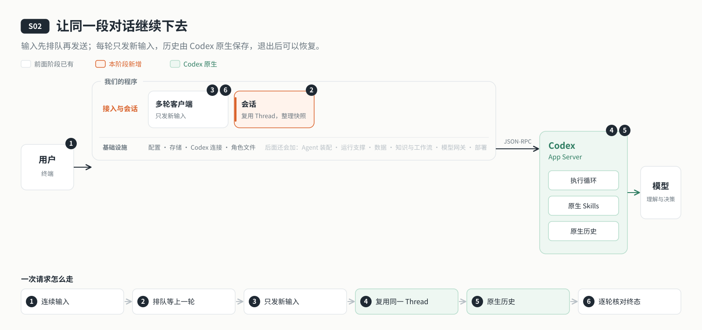

# s02: 多轮会话 — 一个聊天窗口，多轮对话

[导论](../introduction.md) → [s00](../s00-sdk-quickstart/) → [s01](../s01-single-turn/) → `s02` → [s03](../s03-agent-core/) → [s08](../s08-data-layer/) → [s09](../s09-knowledge-layer/) → [s10](../s10-skill-workflow/) → [s11](../s11-model-gateway/) → [app](../../app/)
> *"顺序交给队列，历史留给 Codex"* — 我们的程序只管按顺序发出每一轮，不保存、不拼接、不重发历史。
>
> **对应六个问题**：③ 之前聊过什么？

---



## 要回答的问题

云端 Agent 不是问一句就退出的脚本：用户会连续地问，会在它回答的时候接着打字，会关掉终端，过一会儿再回来接着聊。

上一章的程序每次运行只问一句。这一章把它改成"读一行、问一轮"的循环聊天，三个问题马上冒出来：

1. **多轮之间会不会串？** 上一轮还没输出完的内容，会不会混进下一轮的回答里？
2. **输入会不会丢、会不会抢跑？** 模型还在回答，用户又敲了两行，或者通过管道一次塞进多行。第二行要么被丢掉，要么在第一轮没结束时就发出去，两轮的输出搅在一起。
3. **上下文怎么带？退出后怎么继续？** 要不要像调用 Chat API 那样，每轮把历史消息全部再发一遍？程序关掉再打开，怎么回到刚才那段对话？

---

## 核心概念

### 先理解两个概念

- **Thread**：一段完整的对话，也就是一个聊天窗口。
- **Turn**：对话中的一轮。你发一个问题，Agent 处理并回复，这就是一个 Turn。

建立多轮对话，有两个关键：

1. **同一个窗口，复用同一个 Thread ID。** 第一条消息用 `thread/start` 开窗口，之后每一轮都用这个 Thread ID 发 `turn/start`。
2. **每一轮，用 Turn ID 区分开。** 聊天一般是串行的，但事件是异步到达的。每条通知都要核对 Thread ID 和 Turn ID，上一轮的尾巴才不会混进下一轮。

### 这么多 ID，头都晕了

到这里已经出现了四种 ID，分清楚它们各管什么：

| ID | 谁生成 | 标识什么 | 用来干什么 |
|----|-------|---------|----------|
| Thread ID | 服务端 | 哪一段会话（哪个聊天窗口） | 多轮复用同一个；恢复会话时凭它找回 |
| Turn ID | 服务端 | 同一会话里的哪一轮 | 把通知归到正确的一轮，保证轮与轮之间不乱 |
| JSON-RPC ID | 客户端，每次请求递增 | 一次接口调用 | 把回包和请求对上，跟会话无关 |
| Item ID | 服务端 | 一轮里的某一条消息、某一次工具调用 | 把流式片段（delta）拼回同一条消息 |

检查顺序是：先看 Thread ID 是不是这个窗口，再看 Turn ID 是不是这一轮。

### 历史留给 Codex

官方说，线程的事件历史由 Codex 持久保存，客户端断开重连后，可以呈现一致的时间线。Codex Web 就是这么做的：浏览器标签页关了、网断了，任务照样在服务器上跑，回来时接着看。

所以我们**不保存、不拼接、不重发历史**。每一轮只发这一轮的新输入，上下文由 Codex 从原生历史里取，太长了它自己会压缩。程序退出后想继续，用 `thread/list` 找到会话，再用 `thread/resume` 恢复。

### 输入先排队

用户的输入先进一个先进先出（FIFO）的队列，上一轮结束后才取下一条。这只是一个交互缓冲，不是在我们的程序里重写一个 agent loop。

---

## 分工：Codex 做什么，我们做什么

| 事情 | Codex | 我们的程序 |
|------|-------|----------|
| 多轮上下文 | 从原生历史里取，过长时自动压缩 | 只发本轮输入，复用 Thread ID |
| 会话持久化 | 把历史存进状态目录 | 不存聊天记录 |
| 恢复会话 | `thread/list`、`thread/resume` | 只列出本项目目录下的会话，让用户选 |
| 输入顺序 | — | FIFO 队列，上一轮结束才发下一条 |
| 轮与轮隔离 | 通知里带上 Thread ID、Turn ID | 严格按 ID 匹配，旧轮事件丢弃 |

从单轮到多轮，我们的程序新增的只是一个输入队列和一个 Thread ID 变量。真正的"记忆"一直在 Codex 那边，这正是不自造 loop 的好处。

---

## 跑起来看看

**准备**：

```sh
cd stages/s02-multi-turn
npm ci
cp .env.example .env    # 填入模型配置
```

**运行**：

```sh
npm start               # 进入循环聊天
```

试试这些输入：

1. `我叫小明，请记住` → 回车，再问 `我叫什么？`
2. 在模型回答第一句时，快速连敲两行 `第一行`、`第二行`
3. `/exit` 退出，重新 `npm start`，输入 `/resume`，选择刚才的会话，再问 `我们刚才聊了什么？`

**数据存在哪里**：聊天记录不在我们的程序里。打开 `.data/codex/sessions/` 下的 `rollout-*.jsonl`，你会看到同一个 Thread 的每一轮都追加在同一个文件里；恢复会话时，Codex 读的就是它。

观察重点：第 2 步的两行是按顺序、一轮一轮处理的吗？第 3 步恢复后，我们的程序有没有重发任何历史？

**离线实验**：

```sh
npm run lesson -- s02-fifo     # 提前输入按顺序取出；旧轮 STALE 事件不会串入新答案
npm run lesson -- s02-resume   # 选中会话后沿用其 ID；取消或失败时保留当前会话
```

设计取舍与当前边界见 [s02 设计说明](docs/design.md)。

---

## 关键代码

代码在 [`05-app-server.mjs`](05-app-server.mjs) 和 [`server/modules/sessions/history.mjs`](server/modules/sessions/history.mjs)。

**输入先进队列**。有人在等就直接交给他，没人等就排队：

```javascript
terminal.on("line", line => {
  if (waiting) { const resolve = waiting; waiting = null; resolve(line); }
  else queue.push(line);
});

async question(prompt) {
  output.write(prompt);
  // 缓冲提前输入/管道输入，避免等待模型时丢失后续行。
  if (queue.length) return queue.shift();
  if (ended) return null;
  return new Promise(resolve => { waiting = resolve; });
}
```

**只有第一条消息开 Thread**，之后每一轮都复用同一个 Thread ID：

```javascript
async function runTurn(prompt) {
  if (!threadId) await startThread();
  const turn = { threadId, id: null, answers: new Map(), buffer: [], completed: Promise.withResolvers() };
  // …后面与 s01 相同：turn/start → 重放早到通知 → 等 turn/completed
}
```

**恢复会话**。`excludeTurns: true` 表示不把历史轮次传回客户端，历史仍完整地留在 Codex 里，下一轮照样能用：

```javascript
const result = await request("thread/resume", {
  ...threadOptions, threadId: selected.id, cwd: selected.cwd, excludeTurns: true
});
selectThread(result);
```

---

## 小结

- Thread 是聊天窗口，Turn 是其中一轮。多轮靠复用 Thread ID，不串靠核对 Turn ID。
- 四种 ID 各管一件事：Thread ID 管会话，Turn ID 管轮次，JSON-RPC ID 管请求和回包，Item ID 管一条条消息。
- 历史由 Codex 持久保存。我们不存、不拼、不重发，恢复会话靠 `thread/resume`。

---

## 下一章

能连续聊了，但它还只是一个会聊天的模型：角色是代码里的一段固定文字，不能读写任何资料，也没有工具。而且它还是一个在你本机运行的程序，关掉终端就没了。

[s03 可配置 Agent](../s03-agent-core/) → 给 Agent 装上角色、工具和记忆，用一份配置文件来装配，并把它拆成常驻的服务端和连上去的客户端。模型能不能绕过配置，自己给自己加权限？
