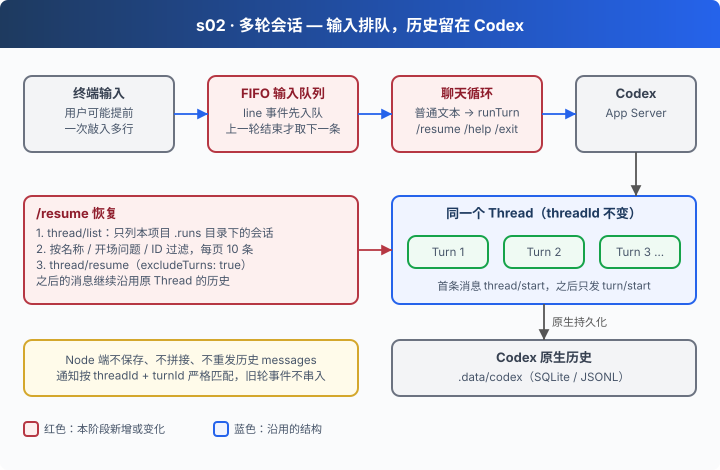

# s02: 多轮会话 — 连续输入不丢、不抢跑

[s00](../s00-sdk-quickstart/) → [s01](../s01-single-turn/) → `s02` → [s03](../s03-agent-core/) → [s04](../s04-data-layer/) → [s05](../s05-knowledge-layer/) → [app](../../app/)
> *"顺序交给队列，历史留给 Codex"* — Node 端只管按顺序发 Turn，不保存、不拼接、不重发历史。
>
> **Harness 层**: 会话 — 同一个 Thread 上的多次 Turn，以及退出后的恢复。

---

## 问题

s01 每次运行只问一句。把它改成"读一行、问一轮"的循环聊天，三个问题马上冒出来：

1. **输入丢失或抢跑**：模型还在回答时，用户又敲了两行，或者通过管道一次塞进多行。readline 的 `line` 事件不会等你，第二行要么被丢掉，要么在第一轮没结束时就发出去，两轮输出交织在一起。
2. **上下文怎么带**：要不要像调用 Chat API 那样，每轮把历史 `messages` 全部再发一遍？
3. **退出后怎么继续**：程序关掉再打开，怎么回到刚才那段对话？

---

## 解决方案



| 问题 | 机制 | 代码位置 |
|------|------|---------|
| 提前输入丢失、抢跑 | FIFO 输入缓冲：`line` 事件先入队，上一轮结束后才取下一条 | `createChatInput` |
| 多轮上下文 | 首条消息 `thread/start`，之后同一个 `threadId` 只发 `turn/start`；历史由 Codex 原生保存 | `runTurn` |
| 退出后继续 | `thread/list` 只列本项目运行目录下的会话 → 用户选择 → `thread/resume` | `resumeChat` / `listProjectThreads` |
| 旧轮事件串入新轮 | 通知按 threadId + turnId 严格匹配（沿用 s01） | `handleTurnEvent` |

这里的输入队列只是交互缓冲，不是在 Node 里重写一个 agent loop。

---

## 工作原理

代码在 [`05-app-server.mjs`](05-app-server.mjs) 和 [`server/modules/sessions/history.mjs`](server/modules/sessions/history.mjs)。

**第 1 步**：输入先进队列。有人在等就直接交给他，没人等就排队。`question()` 优先从队列里取。

```javascript
terminal.on("line", line => {
  if (waiting) { const resolve = waiting; waiting = null; resolve(line); }
  else queue.push(line);
});

async question(prompt) {
  output.write(prompt);
  // 缓冲提前输入/管道输入，避免等待模型时丢失后续行。
  if (queue.length) return queue.shift();
  if (ended) return null;
  return new Promise(resolve => { waiting = resolve; });
}
```

**第 2 步**：聊天循环。`await runTurn(prompt)` 等到本轮的 `turn/completed` 才返回，所以下一次 `question()` 天然排在后面。

```javascript
while (!fatalError) {
  const input = await chatInput.question("你 > ");
  if (input === null || input.trim() === "/exit") break;
  const prompt = input.trim();
  if (!prompt) continue;
  if (/^\/resume(?:\s|$)/.test(prompt)) {
    const keyword = prompt.slice("/resume".length).trim();
    if (await resumeChat(keyword || undefined)) break;
  } // …/help 与未知命令的提示
  else await runTurn(prompt);
}
```

**第 3 步**：只有第一条消息需要建 Thread。之后每一轮都复用同一个 `threadId`，上下文由 Codex 自己从原生历史里取。

```javascript
async function runTurn(prompt) {
  if (!threadId) await startThread();
  const turn = { threadId, id: null, answers: new Map(), buffer: [], completed: Promise.withResolvers() };
  // …后面与 s01 相同：turn/start → 重放早到通知 → 等 turn/completed
}
```

**第 4 步**：恢复会话。先用 `thread/list` 按本项目的运行目录过滤，避免列出你在别处用 Codex 产生的会话。

```javascript
const page = await request("thread/list", {
  limit: 100, sortKey: "updated_at", sortDirection: "desc",
  // 0.154.0 的 stdio app-server 实际可能记录为 vscode；不能只筛 appServer。
  sourceKinds: ["appServer", "vscode"], modelProviders: [], archived: false, cwd,
  ...(cursor ? { cursor } : {})
});
```

**第 5 步**：用户选中后调用 `thread/resume`。`excludeTurns: true` 表示不把历史轮次传回客户端，历史仍完整保存在 Codex 里，下一轮照样能用。

```javascript
const result = await request("thread/resume", {
  ...threadOptions, threadId: selected.id, cwd: selected.cwd, excludeTurns: true
});
selectThread(result);
```

从单轮到多轮，Node 端新增的只是一个输入队列和一个 `threadId` 变量。真正的"记忆"一直在 Codex 那边，这正是不自造 loop 的好处：上下文压缩、历史持久化都不用我们操心。

---

## 试一下

**准备**：

```sh
cd stages/s02-multi-turn
npm ci
cp .env.example .env    # 填入模型配置
```

**运行**：

```sh
npm start               # 默认进入循环聊天
```

试试这些输入：

1. `我叫小明，请记住` → 回车，再问 `我叫什么？`
2. 在模型回答第一句时，快速连敲两行 `第一行`、`第二行`
3. `/exit` 退出，重新 `npm start`，输入 `/resume`，选择刚才的会话，再问 `我们刚才聊了什么？`

观察重点：第 2 步的两行是按顺序、一轮一轮处理的吗？第 3 步恢复后，Node 有没有重发任何历史？

**离线实验**：

```sh
npm run lesson -- s02-fifo     # 提前输入按顺序取出；旧轮 STALE 事件不会串入新答案
npm run lesson -- s02-resume   # 选中会话后沿用其 ID；取消或失败时保留当前会话
```

设计取舍与当前边界见 [s02 设计说明](docs/design.md)。

---

## 接下来

现在的 Agent 只会问答：角色写死在代码里，不能读写任何资料，也没有工具。想把它改成写作助手或客服助手，就得改代码。

s03 可配置 Agent → 用一份 JSON 装配 Agent：角色、Skills、工具、能读写哪些目录。模型能不能绕过配置，自己给自己加权限？
