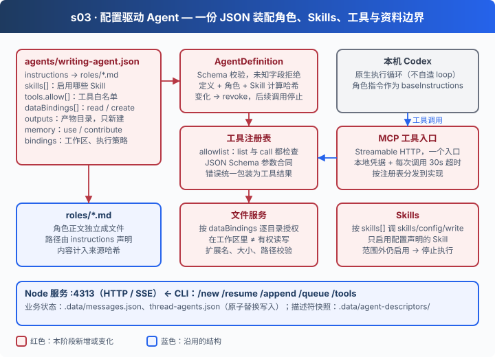

# s03: 可配置 Agent — 配置是装配合同，不是临时提示词

[s00](../s00-sdk-quickstart/) → [s01](../s01-single-turn/) → [s02](../s02-multi-turn/) → `s03` → [s04](../s04-data-layer/) → [s05](../s05-knowledge-layer/) → [s06](../s06-skill-workflow/) → [app](../../app/)
> *"改配置就能换 Agent，但模型不能自己给自己加权限"* — 能力和边界写在同一份 JSON 里，一起生效、一起失效。
>
> **Harness 层**: 装配 — 角色、Skills、工具和资料边界由配置决定，由服务端执行。

---

## 问题

你想把写作助手改成客服助手：换角色提示词、换资料目录、去掉联网工具。如果这些都写在代码里，每换一个 Agent 就要改一次代码。

就算把它们挪进配置文件，边界问题依然存在：

1. **隐藏不等于禁止**：工具清单里不列某个工具，模型仍可能凭名字直接调用它。
2. **在工作区里不等于有权读写**：Agent 能看到 `workspace/`，不代表它可以读 `drafts/`，更不代表它能覆盖 `outputs/` 里的成品。
3. **配置变了，旧会话还以为是原来的自己**：服务运行中有人改了角色文件或工具白名单，正在进行的会话继续用旧权限干活。

---

## 解决方案



一份 [`agents/writing-agent.json`](agents/writing-agent.json) 是唯一的装配入口：

| 字段 | 决定什么 |
|------|---------|
| `agent.instructions` | 角色正文所在的文件（`roles/*.md`），不从环境变量读取 |
| `agent.skills` | 启用哪些原生 Skill；范围外的一律禁用 |
| `agent.tools.allow` | 工具白名单；列出工具和调用工具时都检查 |
| `agent.dataBindings` | 每个资料源允许的动作：`read` / `create` |
| `agent.outputs` | 产物目录、格式与写入方式（`create-only`，不覆盖） |
| `agent.memory` | 是否使用、是否贡献原生记忆 |
| `bindings` | 工作区目录、资料源路径、执行策略（只读沙箱、关闭原生 shell 与写文件） |

服务端（`npm run server`，端口 4313）读取配置、装配运行态，再通过 HTTP / SSE 对外提供服务；CLI（`npm run chat`）只是一个客户端。工具通过 MCP 入口进入 Codex。

---

## 工作原理

**第 1 步**：一份 JSON 描述 Agent。未知字段直接拒绝（Schema `1.0`）。

```json
{
  "schemaVersion": "1.0",
  "agent": {
    "id": "writing-assistant",
    "instructions": "roles/writing-assistant.md",
    "skills": [],
    "tools": { "allow": ["list_files", "read_file", "write_file", "search_web", "read_webpage"] },
    "dataBindings": [
      { "sourceRef": "originals", "actions": ["read"], "methods": ["files"], "required": true },
      { "sourceRef": "drafts", "actions": ["read", "create"], "methods": ["files"], "required": true }
    ],
    "outputs": { "directory": "outputs", "formats": ["md", "txt"], "writeMode": "create-only" }
  }
}
```

**第 2 步**：服务启动时按固定顺序装配（[`server/main.mjs`](server/main.mjs)）：读定义 → 准备运行目录 → 文件服务 → 工具 → 连接 Codex → 核验 Skill → 生成描述符。

```javascript
const agent = new AgentDefinition(config.root, config.agentFile);
const runtime = await prepareRun(config.launch, config.root, { workspaceDir: agent.workspacePath, instructions: agent.instructions });
const localFiles = createFileTools(config.root, { workspaceDir: runtime.workspaceDir, sources: agent.sources,
  outputs: agent.outputs, assertCurrent: () => agent.assertCurrent() });
const tools = new ToolManager({ config, runtime, files, agent, boundary, log: safeLog, redact });
await tools.open();
const rpc = new CodexConnection({ launch: config.launch, runtime, redact, cli, log: safeLog });
await rpc.open();
const skills = await verifySkills(rpc, agent, runtime.workspaceDir);
await agent.activate(tools.registry.version, skills);
```

**第 3 步**：配置、角色、Skill 文件的内容一起算哈希。任何一个变了，立刻撤销，后续调用全部停止，必须重启并新建会话。

```javascript
sourceHash() {
  return digest([fs.readFileSync(this.file, "utf8"), fs.readFileSync(this.roleFile, "utf8"),
    ...this.skills.map(skill => digest(fs.readFileSync(skill.path)))]);
}
assertCurrent() {
  try { if (this.sourceHash() !== this.expected) this.revoked = true; } catch { this.revoked = true; }
  if (this.revoked) {
    const error = new AppError("Agent 定义、角色或 Skill 已变更；后续调用已停止，请受控重启服务后新建会话。", 409, "AGENT_CHANGED");
    this.revocation.abort(error); throw error;
  }
}
allowsTool(name) { this.assertCurrent(); return this.definition.agent.tools.allow.includes(name); }
```

**第 4 步**：Skill 只启用配置里声明的。Codex 发现的其他 Skill 会被主动关掉；关不掉就拒绝运行。

```javascript
for (const skill of discovered) {
  const enabled = requested.has(canonical(skill.path));
  if (skill.enabled !== enabled) {
    await rpc.request("skills/config/write", { path: skill.path, enabled });
    changed = true;
  }
}
if (discovered.some(skill => skill.enabled && !requested.has(canonical(skill.path))))
  throw new Error("Codex 仍启用了 Agent 范围外的 Skill，已停止执行。");
```

**第 5 步**：每次工具调用都要过白名单和参数合同（JSON Schema）。错误统一包装成工具结果返回给模型，不会让服务崩溃。

```javascript
validate(name, args) {
  const entry = entries.get(name);
  if (!entry || (agent && (!agent.allowsTool(name) || !currentNames().has(name)))) throw new Error("未授权的工具。");
  if (!entry.validate(args)) throw new Error(`工具参数不合法：${entry.validate.errors?.[0]?.message || "请检查参数"}`);
  return entry;
},
async call({ tool, namespace, arguments: args }, { signal } = {}) {
  if (namespace != null) throw new Error("未授权的工具命名空间。");
  const entry = this.validate(tool, args);
  const data = await entry.execute(args, { signal });
  return { success: true, contentItems: [{ type: "inputText", text: JSON.stringify(data ?? null) }] };
}
```

**第 6 步**：所有工具走同一个 MCP 入口，而不是每个工具起一个服务。入口校验本地凭据，拒绝跨源请求，每次调用最多 30 秒。

```javascript
if (request.headers.origin || auth.length !== expected.length || !timingSafeEqual(auth, expected)) {
  response.writeHead(403); response.end(); return;
}
server.setRequestHandler(ListToolsRequestSchema, () => ({ tools: registry.specs }));
server.setRequestHandler(CallToolRequestSchema, async ({ params }, extra) => {
  const result = await registry.call({ tool: params.name, arguments: params.arguments || {} },
    { signal: AbortSignal.any([extra.signal, controller.signal, AbortSignal.timeout(30000)]) });
  return { isError: !result.success, content: result.contentItems.map(item => ({ type: "text", text: redact(item.text) })) };
});
```

**第 7 步**：文件服务按资料绑定逐目录授权。能读的目录、能新建的目录、产物目录分开判断。

```javascript
const readable = (relative) =>
  !sources ||
  sources.some(
    (source) =>
      source.actions.includes("read") && covers(source.locator, relative),
  );
const writable = (relative) =>
  !sources ||
  sources.some(
    (source) =>
      source.actions.includes("create") && covers(source.locator, relative),
  ) ||
  (outputs && covers(outputs.directory, relative));
```

从这一章开始，"这个 Agent 能做什么"不再是代码里的常量，而是一份可审查、可替换的合同。模型只能在合同范围内行动；合同一变，旧的权限立即作废。

---

## 试一下

**准备**：

```sh
cd stages/s03-agent-core
npm ci
cp .env.example .env    # 填入模型配置；本阶段不需要数据库
```

**运行**（两个终端）：

```sh
npm run server          # 终端 1：服务监听 127.0.0.1:4313
npm run chat            # 终端 2：CLI 客户端
```

先放一份资料（`mkdir -p workspace/inputs` 后放入任意 `.md` 文件），然后试试：

1. `列出你能看到的资料目录`
2. `读取 inputs 下的资料并总结，保存到 outputs/summary.md`
3. `把 outputs/summary.md 改写成另一个版本并覆盖原文件`：create-only，应该被拒绝
4. 服务运行时修改 `agents/roles/writing-assistant.md` 的任意一个字，再让它列出资料目录：工具调用会被拒绝，提示受控重启后新建会话

CLI 常用命令：`/new` 新建会话、`/resume` 恢复、`/tools` 查看可用工具、`/queue` 查看排队任务、`/exit` 退出客户端（服务不停）。

**离线实验**：

```sh
npm run lesson -- s03-agent-config    # 未知字段、权限提升被拒绝；改动立即撤销旧权限
npm run lesson -- s03-skills          # 范围外 Skill 被禁用
npm run lesson -- s03-tool-registry   # 工具名、参数合同和实现如何接在一起
npm run lesson -- s03-mcp             # 入口拒绝无令牌和跨源请求
npm run lesson -- s03-workspace       # 路径遍历、符号链接绕过被拒绝；产物不能覆盖
```

六项配置的完整说明、文件工具规则与当前限制见 [s03 设计说明](docs/design.md) 和 [工具机制详解](docs/tools.md)。

---

## 接下来

业务状态还存在 `.data/*.json` 里。写任务和通知执行器是两步操作，服务在中间崩溃，任务就可能永远没人执行；Agent 根据原文写了摘要，后来原文改了一句，摘要却不知道自己已经过期。

s04 数据层 → PostgreSQL 记事实，Redis 只负责叫醒。消息收到了，为什么还需要一条 outbox？
