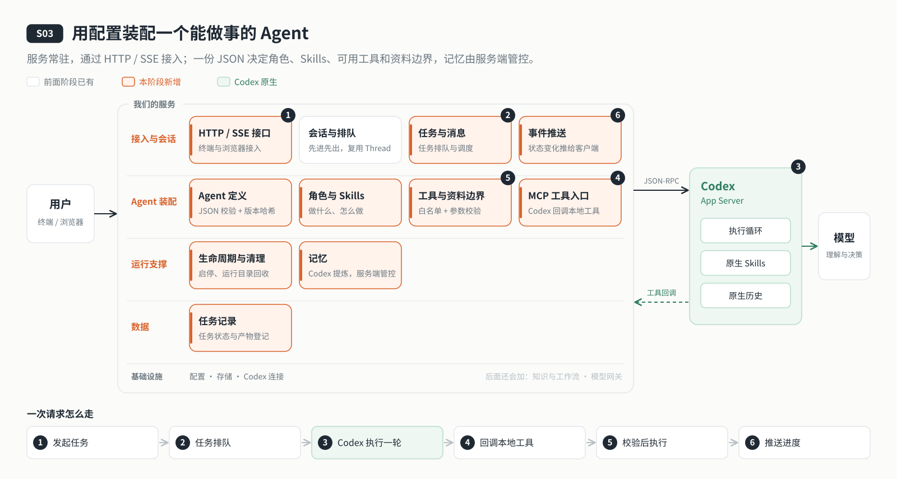

# s03: 可配置 Agent — 角色、工具、记忆，装配成一个 Agent

[导论](../introduction.md) → [s00](../s00-sdk-quickstart/) → [s01](../s01-single-turn/) → [s02](../s02-multi-turn/) → `s03` → [s04](../s04-data-layer/) → [s05](../s05-knowledge-layer/) → [s06](../s06-skill-workflow/) → [s07](../s07-model-gateway/) → [app](../../app/)
> *"改配置就能换 Agent，但模型不能自己给自己加权限"* — 角色、工具、记忆和资料边界写在同一份配置里，一起生效，一起失效。
>
> **对应六个问题**：① 我是谁？ ③ 之前聊过什么？ ⑤ 能用什么？ ⑥ 谁说了算？

---

## 要回答的问题

能连续对话以后，Agent 还只是一个"会聊天的模型"，而且关掉终端就没了。要让它变成一个能干活、能常驻的写作助手，还差几样东西：

1. **角色**：它是谁，按什么方法工作，边界在哪里？角色写在哪、什么时候生效？
2. **工具**：它怎么读资料、写文件、上网查？模型怎么知道有哪些工具、参数该怎么填？
3. **记忆**：上周聊过的偏好，这周还记得吗？记忆由谁来提炼、存在哪？
4. **常驻**：云端 Agent 要一直在线，用户随时连上来。程序该怎么拆？

再往前想一步：明天你想再做一个客服助手，换角色、换资料目录、去掉联网工具，难道每做一个 Agent 都要改一次代码？用配置文件来装配，还要守住三条边界：

- **隐藏不等于禁止**：工具清单里不列某个工具，模型仍可能凭名字直接调用它。
- **在工作区里不等于有权读写**：Agent 能看到 `workspace/`，不代表它能读 `drafts/`，更不代表它能覆盖 `outputs/` 里的成品。
- **配置变了，旧会话还以为自己是原来那个 Agent**：服务运行中有人改了角色或工具白名单，正在进行的会话继续用旧权限干活。

---

## 核心概念

### 角色定义：给 Agent 一个"人设和工作方法"

角色通常就是一段提示词，写清楚 Agent 是谁、要帮用户做什么、按什么方法做、哪些事不能做。本阶段的写作助手，角色写在 [`agents/roles/writing-assistant.md`](agents/roles/writing-assistant.md)，开头是这样的：

```text
你是“AI 知识整理助手”。

你的任务是以用户的观点为起点，理解其真正想表达的内容，通过资料研究、文章编写、事实核查、润色和最终合稿，
帮助用户形成有依据、有个人表达、逻辑完整的文章。你是在帮助用户发展和表达观点，而不是用通用的 AI 文章替换用户的观点。……
```

角色不是随便塞进第一条消息里的。它通过 Codex 留给角色的两个位置生效：

```text
agents/roles/writing-assistant.md（角色正文）
  ├─ 模型目录 models.json → instructions_template（启用模型目录时）
  └─ 会话服务 → baseInstructions
        ├─ thread/start：新建会话时带上
        └─ thread/resume：恢复会话时也带上
```

一个好的角色还会写清楚工具边界：只用本轮实际提供的工具，工具没提供或调用失败时如实说明，不能声称自己"已经联网核查"。**角色描述不等于能力，也不能扩大权限**，真正的权限由下面的工具和门禁决定。

### 工具调用：从一份 JSON 到模型的选择

工具怎么接进来？一条完整的链路是这样的：

```text
config/tools/*.json                     每组工具一个文件：工具名、说明、参数（JSON Schema）
        ↓
校验配置、编译参数 Schema（loader.mjs）
        ↓
动态导入对应的 .mjs，调用 createTools() 拿到执行函数
        ↓
Registry：工具名 → 定义 + 校验器 + 执行函数
        ↓
本地 MCP 服务 → Codex 发现工具 → 模型决定调用哪个、传什么参数
```

**Registry** 就是一张按工具名查的内存表，把分开写的配置和代码关联起来。每个工具在表里有三样东西：

| 部分 | 作用 |
|------|------|
| 定义（spec） | 告诉模型这个工具能干什么、需要什么参数 |
| 校验器（validate） | 检查模型传来的参数是否符合 Schema，不合法直接拒绝 |
| 执行函数（execute） | 真正去读文件、写文件、抓网页 |

所有工具走**同一个本地 MCP 入口**，而不是一个工具起一个服务。官方说，Codex 会连接 MCP 服务器和技能，让它们按一致的策略参与智能体循环。我们要做的，是把自己的工具按 MCP 的方式交给 Codex。

### 记忆管理：Codex 提炼，服务端管控

Codex 原生就有长期记忆。三方分工如下：

| 谁 | 负责什么 |
|----|---------|
| Codex | 从历史会话里提炼记忆、合并记忆，并在后续会话中使用 |
| 服务端 | 是否开启、存在哪、状态检查、摘要查看，以及**哪些会话可以贡献记忆** |
| CLI 客户端 | 提供操作命令、展示结果，不直接读写记忆文件 |

记忆文件都在本阶段的 Codex 状态目录里：

```text
.data/codex/
  ├── config.toml            # 启动时生成的 Codex 配置
  ├── …                      # 原生会话记录和数据库
  └── memories/
      ├── raw_memories.md    # 提炼出的原始记忆
      ├── MEMORY.md          # 合并后的详细记忆
      └── memory_summary.md  # 后续会话使用的摘要
```

记忆默认关闭（`AGENT_MEMORY_ENABLED=false`），开启后才会在会话空闲一段时间后提炼。

### 一份配置，装配一个 Agent



角色、工具、记忆，再加上资料边界，都写进一份 [`agents/writing-agent.json`](agents/writing-agent.json)。它是唯一的装配入口：

| 字段 | 决定什么 |
|------|---------|
| `agent.instructions` | 角色正文在哪个文件 |
| `agent.skills` | 启用哪些原生 Skill，范围外的一律关掉 |
| `agent.tools.allow` | 工具白名单：列出工具时检查，调用工具时**再检查一次** |
| `agent.dataBindings` | 每个资料源允许的动作：`read` / `create` |
| `agent.outputs` | 产物目录、格式与写入方式（`create-only`，不覆盖） |
| `agent.memory` | 是否使用、是否贡献原生记忆 |
| `bindings` | 工作区目录、资料源路径、执行策略（只读沙箱，关闭原生 shell 与写文件） |

配置、角色、Skill 文件的内容一起算一个哈希。任何一个变了，旧的权限立即作废，必须重启服务、新建会话。

### 拆成服务端和客户端

云端 Agent 要一直在线，所以从这一章开始，程序拆成两半：**服务端**（`npm run server`，端口 4313）读取配置、装配 Agent、连接 Codex，常驻运行，通过 HTTP 和流式事件（SSE）对外提供服务；**客户端**（`npm run chat`）只负责连上去收发消息，关掉也不影响服务。以后把服务端放到云端服务器上，客户端从任何地方连过去，就是云端 Agent 的样子。

---

## 分工：Codex 做什么，我们做什么

| 事情 | Codex | 我们的程序 |
|------|-------|----------|
| 角色 | 留出 `baseInstructions`、`instructions_template` 两个位置 | 角色写什么、从哪个文件读、改了以后让旧会话失效 |
| 工具 | 通过 MCP 发现工具，在循环里让模型选择和调用 | 工具定义、参数校验、执行函数、白名单，每次调用都重新检查 |
| Skill | 发现和调用原生 Skill | 只启用配置里声明的，关不掉范围外的就拒绝运行 |
| 记忆 | 提炼、合并、使用记忆 | 开关、存储位置、哪些会话可以贡献 |
| 资料 | — | 文件服务按目录授权：能读、能新建、产物不覆盖 |
| 常驻与连接 | App Server 作为服务端的子进程一直运行 | 服务端常驻，经 HTTP / SSE 对外；客户端随时断开、随时重连 |

模型能决定"调用哪个工具、传什么参数"，但工具存不存在、参数合不合法、目录能不能写，都由服务端说了算。

---

## 跑起来看看

**准备**：

```sh
cd stages/s03-agent-core
npm ci
cp .env.example .env    # 填入模型配置；本阶段不需要数据库
```

**运行**（两个终端）：

```sh
npm run server          # 终端 1：服务监听 127.0.0.1:4313
npm run chat            # 终端 2：CLI 客户端
```

先放一份资料（`mkdir -p workspace/inputs` 后放入任意 `.md` 文件），然后试试：

1. `列出你能看到的资料目录`
2. `读取 inputs 下的资料并总结，保存到 outputs/summary.md`
3. `把 outputs/summary.md 改写成另一个版本并覆盖原文件`：create-only，应该被拒绝
4. 服务运行时修改 `agents/roles/writing-assistant.md` 的任意一个字，再让它列出资料目录：工具调用会被拒绝，提示受控重启后新建会话

CLI 常用命令：`/new` 新建会话、`/resume` 恢复、`/tools` 查看可用工具、`/memory` 查看记忆状态、`/exit` 退出客户端（服务不停）。

**这次运行多了什么**：`.runs/app-server-*/models.json` 里多了 `instructions_template`（角色正文）；`workspace/outputs/` 里出现了 Agent 写的文件；开启记忆并空闲一段时间后，`.data/codex/memories/` 下会出现记忆文件。

**离线实验**：

```sh
npm run lesson -- s03-agent-config    # 未知字段、权限提升被拒绝；改动立即撤销旧权限
npm run lesson -- s03-skills          # 范围外 Skill 被禁用
npm run lesson -- s03-tool-registry   # 工具名、参数合同和实现如何接在一起
npm run lesson -- s03-mcp             # 入口拒绝无令牌和跨源请求
npm run lesson -- s03-workspace       # 路径遍历、符号链接绕过被拒绝；产物不能覆盖
```

六项核心配置的完整说明、文件工具规则与当前限制见 [s03 设计说明](docs/design.md) 和 [工具机制详解](docs/tools.md)。

---

## 关键代码

**角色进入 Codex 的两个位置**（[`server/modules/agents/index.mjs`](server/modules/agents/index.mjs)、[`server/modules/sessions/index.mjs`](server/modules/sessions/index.mjs)）：

```javascript
if (config.launch.catalog) for (const model of config.launch.catalog.models) model.model_messages = { instructions_template: this.instructions };
// …会话服务新建、恢复会话时都带上：
baseInstructions: config.agent?.instructions || "",
```

**Registry 的校验与调用**（[`server/modules/tools/loader.mjs`](server/modules/tools/loader.mjs)）。白名单和参数合同每次调用都检查；出错统一包装成工具结果返回给模型，不会让服务崩溃：

```javascript
validate(name, args) {
  const entry = entries.get(name);
  if (!entry || (agent && (!agent.allowsTool(name) || !currentNames().has(name)))) throw new Error("未授权的工具。");
  if (!entry.validate(args)) throw new Error(`工具参数不合法：${entry.validate.errors?.[0]?.message || "请检查参数"}`);
  return entry;
},
async call({ tool, namespace, arguments: args }, { signal } = {}) {
  if (namespace != null) throw new Error("未授权的工具命名空间。");
  const entry = this.validate(tool, args);
  const data = await entry.execute(args, { signal });
  return { success: true, contentItems: [{ type: "inputText", text: JSON.stringify(data ?? null) }] };
}
```

**配置一变，旧权限作废**。配置、角色、Skill 的内容一起算哈希，每次检查权限前先核对：

```javascript
sourceHash() {
  return digest([fs.readFileSync(this.file, "utf8"), fs.readFileSync(this.roleFile, "utf8"),
    ...this.skills.map(skill => digest(fs.readFileSync(skill.path)))]);
}
assertCurrent() {
  try { if (this.sourceHash() !== this.expected) this.revoked = true; } catch { this.revoked = true; }
  if (this.revoked) {
    const error = new AppError("Agent 定义、角色或 Skill 已变更；后续调用已停止，请受控重启服务后新建会话。", 409, "AGENT_CHANGED");
    this.revocation.abort(error); throw error;
  }
}
allowsTool(name) { this.assertCurrent(); return this.definition.agent.tools.allow.includes(name); }
```

---

## 小结

- **角色**是 Agent 的人设和工作方法，通过 `baseInstructions` 和 `instructions_template` 进入 Codex，新建和恢复会话时都要带上。
- **工具**从 `config/tools/*.json` 到 Registry，再经一个 MCP 入口交给 Codex。模型负责选择，服务端负责校验和执行。
- **记忆**由 Codex 提炼和使用，服务端决定开不开、存在哪、哪些会话能贡献。
- 一份配置装配一个 Agent。能力和边界写在一起，配置一变，旧权限立即作废。
- 程序拆成常驻的服务端和连上去的客户端，这是云端 Agent 的雏形。

---

## 下一章

Agent 已经是一个常驻的服务了。可一旦放到云端长期运行，它要面对的情况比在本机复杂得多：服务会重启，客户端会断线，几个任务同时提交要排队，原文改了一句，依据它写的产物要知道自己过期了。

[s04 数据层](../s04-data-layer/) → 让云端 Agent 靠得住。对话历史归 Codex，业务事实归我们：哪些数据该交给数据库，哪些仍然留给 Codex？
