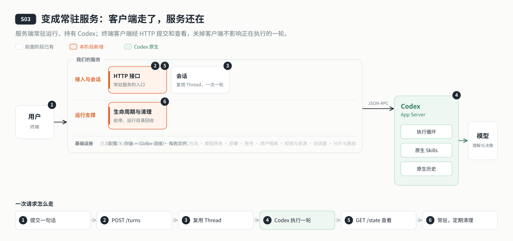

# s03: 服务化 — 服务端常驻，客户端随时连上来

[导论](../introduction.md) → [s00](../s00-sdk-quickstart/) → [s01](../s01-single-turn/) → [s02](../s02-multi-turn/) → `s03` → [s04](../s04-events-messages/) → [s05](../s05-agent-assembly/) → [s07](../s07-memory/) → [s08](../s08-data-layer/) → [s09](../s09-knowledge-layer/) → [s10](../s10-skill-workflow/) → [s11](../s11-model-gateway/) → [app](../../app/)
> *"客户端走了，服务还在"* — Codex、模型密钥和正在执行的那一轮都归服务端；客户端只负责提交和查看。
>
> **对应六个问题**：③ 之前聊过什么？ ⑥ 谁说了算？

---



## 要回答的问题

上一章做到了连续对话、退出后还能恢复。可它仍然是一个跑在你终端里的程序：程序退出，Codex 子进程跟着退出，正在回答的那一轮也就没了。云端 Agent 要一直在线，用户从任何地方连上来，这一章要把它拆成两半：

1. **谁常驻，谁可以走？** 哪一半持有 Codex 和模型密钥、一直运行？哪一半只是连上去看一看，随时可以关掉？
2. **一轮交出去以后归谁？** 客户端提交了一句话就断开了，这一轮还继续吗？回来以后去哪看结果？
3. **服务谁都能连吗？** 本机任何一个程序、任何一个网页，都能往这个端口发请求，让 Agent 替它干活吗？
4. **常驻以后会积累什么？** 每次启动都会留下运行目录和协议日志，日积月累怎么清理，才不会误删正在用的东西？

---

## 核心概念

### 服务端和客户端

从这一章开始，程序拆成两个进程：

| | 服务端（`npm run server`） | 客户端（`npm run chat`） |
|---|---|---|
| 读取什么 | `.env`：模型地址、密钥、端口 | `.data/connection.json`：服务地址和连接令牌 |
| 持有什么 | Codex App Server 子进程、所有会话、正在执行的轮次 | 只有当前选中的 Thread id |
| 能不能关 | 关掉就停止服务 | 随时关，服务和正在执行的一轮不受影响 |

客户端不读 `.env`、不启动 Codex、碰不到模型密钥。以后把服务端放到云端服务器上，客户端从任何地方连过去，就是云端 Agent 的样子。

### 一轮由服务端发起

客户端不再直接跟 Codex 说话，而是通过 HTTP 请求服务端：

```text
客户端                         服务端                          Codex
  │ POST /sessions ───────────▶ thread/start ────────────────▶ │
  │ POST /turns ──────────────▶ turn/start ──────────────────▶ │
  │ ◀──── 202 + turn id         │ ◀──── 通知：增量、完成 ──────── │
  │ GET /state（反复查看）──────▶ 会话快照（回复、状态）           │
```

`POST /turns` 一返回，这一轮就已经交给了 Codex，后面的通知由服务端接收、整理成会话快照。客户端每隔一小段时间用 `GET /state` 查看快照，把新增的文字显示出来。客户端断开只是停止查看，不会取消这一轮；重新连上来，用 `/resume` 就能看到结果。

服务端在这一章还不排队：同一个会话上一轮没结束，再提交会得到 `409`。连续输入的顺序由客户端自己守着，上一轮结束才发下一条。

### 连接令牌：只有本机客户端能连

服务只监听 `127.0.0.1`。每次启动生成一个随机的**连接令牌**，和服务地址一起写进 `.data/connection.json`（权限 `0600`）。每个请求都要带上 `Authorization: Bearer <令牌>`；带了 `Origin` 头的请求（来自网页）一律拒绝。连接令牌和模型 API Key 是两回事：令牌只决定"能不能连上这个服务"，泄露了也拿不到模型密钥。

### 生命周期：启动有顺序，关闭倒着来

服务端启动时依次拿到几样资源：独占锁、运行目录、Codex 子进程、HTTP 端口、连接文件。每拿到一样，就登记一个对应的清理动作；关闭（或启动中途失败）时倒着执行这些动作。这样不会留下半个服务：锁文件、连接文件都会删掉，运行目录标记为已结束。

**独占锁**（`.data/server.lock`）保证同一个目录只有一个服务在跑。重复启动会被拒绝；上次异常退出留下的旧锁，确认原进程已经不在之后才会清理。

### 运行目录与维护

每次启动都会在 `.runs/app-server-*/` 下新建一个运行目录，放本次的模型目录 `models.json`、协议日志 `protocol.jsonl` 和运行标记 `run.json`。Codex 的工作目录则固定为 `workspace/`，原生历史固定在 `.data/codex/`，都不随运行目录变化。

服务常驻以后运行目录越积越多，维护模块在启动时和之后每小时检查一次：只删除超过 7 天、且不在最近 5 次之内的目录。删除之前还要确认没人在用：当前这次运行、正在加载或已加载的会话、仍然活着的进程、被打开的文件，都不删；目录里出现了运行缓存以外的东西，也不删。删日志之前，先把其中的会话位置写进 `.data/session-index.json`，日志删掉以后 `/resume` 仍然找得到旧会话。

---

## 分工：Codex 做什么，我们做什么

| 事情 | Codex | 我们的程序 |
|------|-------|----------|
| 执行一轮 | 接收 `turn/start`，跑完执行循环，推送增量与完成通知 | 服务端发起这一轮，接收通知，整理成会话快照 |
| 历史 | 原生保存每个 Thread 的完整历史 | 只在内存里留最近的轮次；恢复会话靠 `thread/resume` |
| 常驻 | App Server 作为服务端的子进程一直运行 | 服务端常驻，客户端经 HTTP 连接，断开不影响执行 |
| 连接安全 | — | 只监听本机，连接令牌认证，拒绝网页跨源请求 |
| 启停与清理 | — | 独占锁、按顺序启动、倒序关闭；定期清理旧运行目录 |

---

## 跑起来看看

**准备**：

```sh
cd stages/s03-service
npm ci
cp .env.example .env    # 填入模型配置
```

**运行**（两个终端）：

```sh
npm run server          # 终端 1：服务监听 127.0.0.1:4313
npm run chat            # 终端 2：CLI 客户端
```

试试这几件事：

1. 问一个需要较长回答的问题，在它回答到一半时按 Ctrl+C 关掉客户端。
2. 重新 `npm run chat`，输入 `/resume`，选中刚才的 Thread id：回复是完整的，说明那一轮在服务端跑完了。
3. 再开一个终端运行 `npm run server`：会提示本项目已有服务在运行，拒绝重复启动。
4. 在终端 1 按 Ctrl+C 停止服务：`.data/connection.json` 和 `.data/server.lock` 都被删掉，这时客户端会提示找不到服务。

CLI 命令：`/new` 新建会话、`/resume [关键词]` 恢复、`/exit` 只退出客户端。

**这次运行多了什么**：

```text
.data/
  ├── connection.json      # 服务地址 + 连接令牌（运行时存在，停止后删除）
  ├── server.lock          # 独占锁（同上）
  ├── session-index.json   # 清理运行目录前保存的会话位置
  └── codex/               # Codex 原生历史与配置（config.toml）
.runs/app-server-*/        # 每次启动一个：models.json、protocol.jsonl、run.json
workspace/                 # Codex 的固定工作目录
```

**离线实验**：

```sh
npm run lesson -- s03-resident   # 客户端被关掉，服务端这一轮照常完成
npm run lesson -- s03-one-turn   # 上一轮没结束再提交：409，服务端不排队
npm run lesson -- s03-cleanup    # 运行目录只在确认没人使用后才删除
```

启动顺序、接口清单与清理规则见 [s03 设计说明](docs/design.md)。

---

## 关键代码

**服务端替客户端发起一轮**（[`server/modules/sessions/index.mjs`](server/modules/sessions/index.mjs)）。请求返回时这一轮已经交给 Codex；上一轮没结束就拒绝，不在这里排队：

```javascript
async startTurn(threadId, text) {
  requireText(text);
  await this.ensure(threadId);
  const session = this.sessions.get(threadId);
  if (session.activeTurnId || this.starting.has(threadId)) throw new AppError("上一轮还在执行，请等它结束再发送。", 409, "TURN_IN_PROGRESS");
  this.starting.add(threadId);
  try {
    const result = await this.rpc.request("turn/start", { threadId, input: [{ type: "text", text: text.trim(), text_elements: [] }] });
    const turn = this.recordTurn(threadId, result.turn);
    return { threadId, turnId: turn.id, status: turn.status };
  } finally { this.starting.delete(threadId); }
}
```

**HTTP 入口先认人，再干活**（[`server/modules/http/index.mjs`](server/modules/http/index.mjs)）。网页来的请求和没有令牌的请求，到不了会话模块：

```javascript
if (request.headers.origin) throw new AppError("当前接口仅供本机 CLI 使用。", 403);
if (!authenticated(request, token)) throw new AppError("Agent 服务认证失败，请重新连接。", 401);
// …
if (route === "POST /turns") {
  const body = await readBody(request);
  return json(202, await sessions.startTurn(body.threadId, body.text));
}
```

**清理之前，先确认没人在用**（[`server/modules/maintenance/index.mjs`](server/modules/maintenance/index.mjs)）。超过保留期的目录，还要逐个排除使用中的，删除前保存会话索引：

```javascript
const old = candidates.slice(this.policy.keep).filter(item => item.modified < now - this.policy.maxAgeMs && !this.protected(item.directory));
// …
if (this.protected(directory) || ownerAlive(directory) || opened.some(file => file === directory || file.startsWith(directory + path.sep))) continue;
await rememberRunHistory(this.root, directory, this.runtime?.workspaceDir);
```

---

## 小结

- 程序拆成常驻的服务端和随时可走的客户端。Codex、模型密钥和正在执行的轮次都归服务端。
- 一轮由服务端发起：`POST /turns` 立即返回，客户端用 `GET /state` 查看；断开只是停止查看，不会取消执行。
- 服务只监听本机，凭连接令牌认证，拒绝网页跨源请求；令牌和模型密钥互不相干。
- 生命周期按顺序拿资源、倒着释放；维护模块只清理确认没人在用的旧运行目录。

---

## 下一章

服务端常驻了，可它还不会排队：上一轮没结束，新的输入只能在客户端等着，客户端一关，没发出去的就丢了。客户端也只能一遍遍地查快照，才知道回复写到了哪里。

[s04 事件与消息](../s04-events-messages/) → 把排队搬进服务端，用任务记录保住每一条输入，并把状态变化主动推给客户端（SSE）。断线重连以后，客户端怎么知道自己错过了什么，又不会把旧消息再发一遍？
