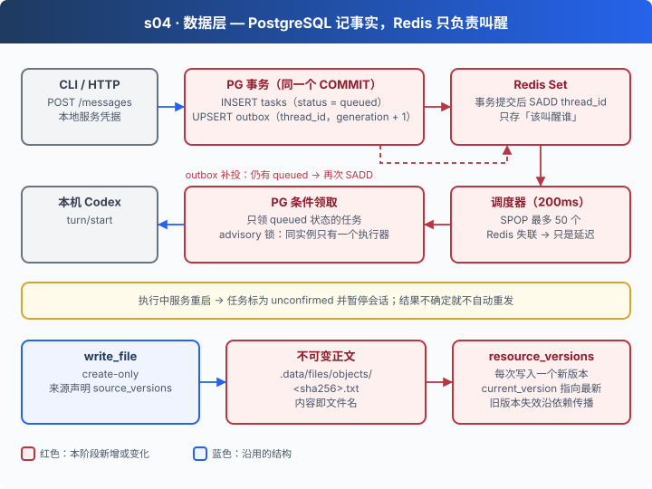

# s04: 数据层 — 让每次执行有据可查

[s00](../s00-sdk-quickstart/) → [s01](../s01-single-turn/) → [s02](../s02-multi-turn/) → [s03](../s03-agent-core/) → `s04` → [s05](../s05-knowledge-layer/) → [s06](../s06-skill-workflow/) → [app](../../app/)
> *"PostgreSQL 记事实，Redis 只负责叫醒"* — 任务和调度出口写在同一个事务里，丢了唤醒信号也能补投。
>
> **Harness 层**: 持久化 — 任务、调度与资源版本。

---

## 问题

s03 把业务状态存在 `.data/messages.json` 里。单进程、低并发时它够用，但有三类事情它说不清楚：

1. **消息收到了，却没人执行**：服务先写任务、再通知执行器。如果在这两步之间崩溃，任务就躺在文件里没人管；反过来，执行器被叫醒了，却读不到还没写完的任务。
2. **唤醒信号丢了怎么办**：引入 Redis 做调度后，Redis 重启或断线，排队中的任务是不是也跟着没了？
3. **原文改了，产物还算数吗**：Agent 根据 `inputs/report.md` 写了一份摘要。后来有人改了原文一句话，这份摘要应该继续当真，还是标记为过期？

还有一个更隐蔽的问题：执行到一半服务重启，这条任务到底执行了没有？重发可能做两遍，不重发可能漏掉。

---

## 解决方案



三种存储，各管一件事：

| 存储 | 存什么 | 不存什么 |
|------|--------|---------|
| PostgreSQL（`agent_s04`，schema v1） | 任务原文与状态（`tasks`）、调度出口（`outbox`）、会话、资源与版本、依赖关系、产物 | 完整的模型对话。那仍在 Codex 原生存储里 |
| Redis | 一个 Set：哪些 Thread 需要被叫醒 | 任务本身、任务顺序 |
| `.data/files/objects/` | 以 sha256 命名的不可变正文 | 可被原地修改的副本 |

两条原则：

- **事实只在 PG 里**：Redis 里的东西丢了，可以从 PG 重新推出来；反过来不行。
- **不确定就不重发**：执行中断的任务标为 `unconfirmed` 并暂停会话，由人决定下一步。

---

## 工作原理

代码在 [`server/modules/data/`](server/modules/data/) 下。

**第 1 步**：任务和 outbox 写在同一个事务里（[`jobs.mjs`](server/modules/data/jobs.mjs)）。先锁住会话行，检查排队上限，再写任务、写 outbox。要么都成功，要么都回滚。

```javascript
async create(job) {
  return transaction(this.pool, async (client) => {
    // 锁住会话行，串行化同一会话的并发写入
    const found = await this.query(
      "SELECT id FROM agent_data.conversations WHERE instance_id=$1 AND owner_id=$2 AND id=$3 FOR UPDATE",
      [job.threadId],
      client,
    );
    if (!found.rowCount) throw new AppError("会话不存在。", 404);
    // …检查本会话排队数，超过 100 条拒绝
    await this.query(
      `INSERT INTO agent_data.tasks(instance_id,id,thread_id,text,mode,target_turn_id,turn_id,agent_hash,status,created_at,error)
      SELECT $1,$3,$4,$5,$6,$7,NULL,$8,'queued',$9,NULL WHERE $2::uuid IS NOT NULL`,
      [
        job.id,
        job.threadId,
        job.text,
        job.mode,
        job.targetTurnId,
        job.agentHash || null,
        job.createdAt,
      ],
      client,
    );
    await this.wake(job.threadId, client);
    // …更新会话名称与 updated_at
  });
}
```

`wake()` 并不碰 Redis，它只是在 PG 里记一笔"这个 Thread 该被叫醒了"：

```javascript
async wake(threadId, client = this.pool) {
  await this.query(
    `INSERT INTO agent_data.outbox(instance_id,thread_id)
    SELECT $1,id FROM agent_data.conversations WHERE instance_id=$1 AND owner_id=$2 AND id=$3
    ON CONFLICT(instance_id,thread_id) DO UPDATE SET generation=outbox.generation+1,due_at=now()`,
    [threadId],
    client,
  );
}
```

**第 2 步**：调度器每 200ms 轮询一次（[`queue.mjs`](server/modules/data/queue.mjs)）。先把 outbox 里到期的 Thread 推进 Redis Set，再从 Set 里弹出最多 50 个去执行。Redis 出错只会让这一轮跳过，outbox 里的记录还在，下一轮会重新推。

```javascript
async poll() {
  const rows = await this.jobs.deliveries(); // 数据库失败会停止执行，Redis 失败只会延迟调度
  for (const row of rows) {
    try {
      await this.commands.sAdd(this.key, row.thread_id);
    } catch {
      this.healthy = false;
      return;
    }
    await this.jobs.delivered(row);
  }
  let ids;
  try {
    ids = await this.commands.sPop(this.key, 50);
    this.healthy = true;
  } catch {
    this.healthy = false;
    return;
  }
  for (const id of Array.isArray(ids) ? ids : ids ? [ids] : [])
    this.deliver(id);
}
```

`deliveries()` 只挑"到期、会话没暂停、而且确实还有 queued 任务"的 Thread；`delivered()` 把下次到期时间推后 5 秒，防止反复推送：

```sql
SELECT o.thread_id,o.generation FROM agent_data.outbox o
JOIN agent_data.conversations c ON c.instance_id=o.instance_id AND c.id=o.thread_id
WHERE o.instance_id=$1 AND c.owner_id=$2 AND NOT c.paused AND o.due_at<=now()
AND EXISTS(SELECT 1 FROM agent_data.tasks t WHERE t.instance_id=o.instance_id AND t.thread_id=o.thread_id AND t.status='queued')
ORDER BY o.due_at LIMIT 100
```

**第 3 步**：执行中断时不猜结果。服务重启后，所有处于执行中的任务改为 `unconfirmed`，所在会话暂停；只有确定没发出去的 `queued` 任务才重新唤醒。

```javascript
async recover(reason) {
  await transaction(this.pool, async (client) => {
    await this.query(
      `UPDATE agent_data.tasks t SET status='unconfirmed',error=$3 WHERE ${owned} AND status=ANY($4::text[])`,
      [reason, executing],   // executing = starting / running / steering
      client,
    );
    // 接着把含有 unconfirmed 任务的会话标记为 paused=true。
    // 最后查出仍有 queued 任务的会话，逐个 wake()：queued 一定还没派发，可以安全恢复。
  });
}
```

**第 4 步**：资源每写一次就是一个新版本（[`resources.mjs`](server/modules/data/resources.mjs)）。正文以 sha256 命名存成不可变文件，`resources.current_version` 指向最新版本；旧版本被替换时，沿依赖关系把派生内容标记为失效。

```javascript
async version(row, body, client, humanEdited = false) {
  const versionId = randomUUID();
  await this.query(
    `INSERT INTO agent_data.resource_versions(instance_id,id,resource_id,revision,blob,bytes)
    SELECT $1,$3,$4,$5,$6,$7 WHERE $2::uuid IS NOT NULL`,
    [versionId, row.id, body.revision, body.blob, body.bytes],
    client,
  );
  await this.query(
    `UPDATE agent_data.resources SET current_version=$4,state='ready',human_edited=human_edited OR $5,updated_at=now()
    WHERE instance_id=$1 AND owner_id=$2 AND id=$3`,
    [row.id, versionId, humanEdited],
    client,
  );
  if (row.current_version) await this.invalidate(row.id, client);
  return { resourceId: row.id, versionId, revision: body.revision };
}
```

`write_file` 写产物时可以声明 `source_versions`，即它引用了哪些资料的哪个版本。原文一旦更新，引用旧版本的产物就会失效。这能做来源追踪，但不证明内容在语义上真的引用正确。

这一章没有改动任何模型交互，Codex 的执行循环和 s03 完全一样。变的是"服务端记住了什么、怎么记"：每个状态变化都落在事务里，每个不确定都显式暴露出来。

---

## 试一下

**准备**（需要 Docker）：

```sh
cd stages/s04-data-layer
npm ci
cp .env.example .env
# 编辑 .env：模型配置，以及
#   DATABASE_URL=postgresql://agent:<密码>@127.0.0.1:5432/agent_s04
#   REDIS_URL=redis://127.0.0.1:6379
export AGENT_DB_PASSWORD=<与 DATABASE_URL 中相同的密码>
docker compose up -d postgres redis
npm run data:migrate
npm run data:check
```

**运行**（两个终端）：

```sh
npm run server          # 终端 1：127.0.0.1:4314
npm run chat            # 终端 2
```

把一份资料放到 `workspace/inputs/report.md`，然后在聊天里输入：

```text
读取 inputs/report.md，将摘要保存到 outputs/report-summary.md，并声明来源版本
```

再查一下数据库里发生了什么：

```sh
docker compose exec postgres psql -U agent -d agent_s04 \
  -c "SELECT id, status, substring(text,1,40) FROM agent_data.tasks ORDER BY created_at DESC LIMIT 5;"
```

观察重点：

1. 发一条消息后立刻 `docker compose stop redis`，等几秒再 `start`。任务是丢了，还是在 Redis 恢复后继续执行？
2. 任务执行中按 `Ctrl+C` 停掉服务再启动，这条任务的状态是什么？CLI 里用 `/continue` 继续队列时，它会被重发吗？

**实验**：本阶段的三节课需要真实的临时 PostgreSQL / Redis（`PATH` 中有 `initdb`、`pg_ctl`、`redis-server`），默认不运行，需要显式开启：

```sh
npm run lesson -- s04-persistence --integration   # 三节课共用一组集成测试，运行一次即可
npm test                                           # 单元测试，不需要数据库
```

四层架构说明、schema 表清单、从 s03 导入数据与限制说明见 [s04 设计说明](docs/design.md) 和 [数据层详解](docs/data-layer.md)。

---

## 接下来

Agent 现在能可靠地读写资料了，但"资料"只是一堆散落的文件，没有组织成知识。权限判定也散落在各处：文件工具一套，将来的知识工具又是一套，新加一个工具就可能漏掉检查。

s05 知识层 → 一道统一的门禁，加上版本化 Wiki 和可选的 RAG。模型在工具参数里写"我是管理员"，为什么不算数？
