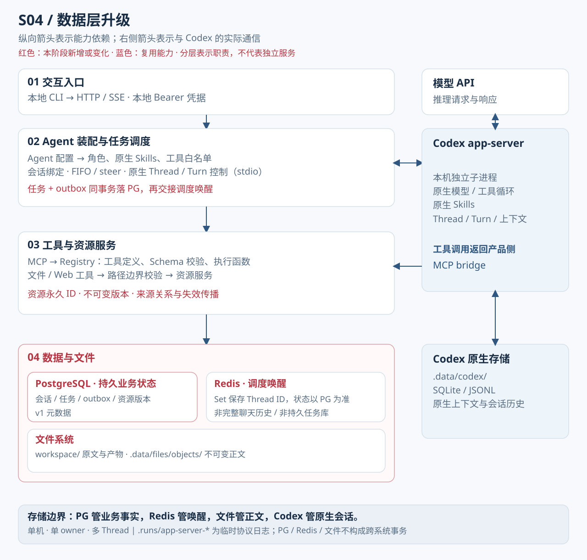

# s04 — 数据层升级

在 s03 全部配置能力基础上，将业务数据迁移至 PostgreSQL，以 Redis 提供调度唤醒。服务监听 `127.0.0.1:4314`。数据层技术细节见 [数据层详解](docs/data-layer.md)。



> 图为职责划分，不是每层起一个独立进程。右侧 Codex 原生运行时是独立进程，与主进程通过 stdio 通信，自有原生存储（`.data/codex/`）由 Codex 管理不改动。红色标注为相比 s03 的新增/变化项。

---

## 设计原理

s03 已有 FIFO/steer、重启不确定执行暂停，但以单文件 JSON 管理状态，存在以下局限：

1. **资源元数据缺失**：文件内容无版本记录，依赖链无法追踪，来源失效无感知。
2. **跨记录操作无事务保证**：任务与调度出口若分两步写，崩溃时可能不一致。

s04 目标：**以关系型事务保证任务入队原子性，以不可变内容版本支撑来源追踪，以 Redis Set 加速调度唤醒。**

**关键约束：**

- **单机单 owner**：owner 由 `.data/identity.json` 生成，DB 记录归属；无多账户登录，无共享 KB，Bearer 是本地服务凭据而非用户认证。
- **PG / Redis 必需**，不回退本地 JSON。
- **数据库不存完整原生对话**：PG 的 `tasks.text` 保存用户任务原文；完整模型回复与工具历史由 Codex 原生存储（SQLite/JSONL）管理。
- s04 使用数据库 `agent_s04`（schema v1）；s05 使用独立的 `agent_s05`（v2）。两个 Compose 都绑定 5432/6379，不能同时启动两套依赖；可共用一组 PG/Redis 并使用不同数据库。

---

## 架构改进

架构图分为四层（图左）+ Codex 原生运行时（图右）。以下逐层说明各层为何存在、输入输出及代码位置。

### 01 交互入口

**为何存在**：统一对外接口，接收 CLI 请求、校验本地服务凭据，并返回任务状态和流式事件。

| 方向 | 内容 |
|------|------|
| 输入 | HTTP POST `/messages`、POST / GET `/sessions`；Bearer 本地凭据 |
| 输出 | SSE token 流；任务 ID；会话状态 |
| 代码 | [HTTP 路由](server/modules/http/index.mjs)、[CLI](client/main.mjs) |

owner 来自服务端 `.data/identity.json`；本阶段尚未引入 s05 的统一 Task 门禁。

### 02 Agent 装配与任务调度

**为何存在**：将 Agent 配置转化为可执行的运行态，并以事务性队列驱动任务生命周期。

| 方向 | 内容 |
|------|------|
| 输入 | `agents/writing-agent.json`（schemaVersion 1.0）；来自 01 层的请求 |
| 输出 | 写 PG `agent_versions`；task + outbox 同 PG 事务；Redis Set 唤醒信号；向 Codex stdio 发送指令 |
| 代码 | [Agent 装配](server/modules/agents/index.mjs)、[调度](server/modules/messages/index.mjs)、[会话](server/modules/sessions/index.mjs)；底层由 [jobs.mjs](server/modules/data/jobs.mjs) 与 [queue.mjs](server/modules/data/queue.mjs) 支撑 |

**关键实现**：

- `jobs.mjs` 在同一 PG 事务中写 `tasks` + `outbox`，事务提交后再向 Redis Set 推 Thread ID。Redis 失联时 outbox 留存，可补投，不丢任务。
- `queue.mjs` 以 Redis **Set**（非 List）存 Thread ID，`sAdd/sPop`；PG 负责状态顺序，Redis 仅唤醒。
- PG advisory 锁防止同实例启动多个执行器；任务领取另有 PG 状态条件校验。
- 不确定失败时任务恢复为 `unconfirmed` 并暂停，不自动重发。

### 03 工具与资源服务

**为何存在**：向 Codex 暴露受控工具集，并以不可变版本存储资源内容供来源追踪。

| 方向 | 内容 |
|------|------|
| 输入 | Codex 工具调用（MCP Streamable HTTP）；文件写入请求 |
| 输出 | 工具执行结果；`.data/files/objects/<sha256>.txt` blob；PG `resource_versions`、`dependencies`、`artifacts` 记录 |
| 代码 | [mcp-server.mjs](server/modules/tools/mcp-server.mjs)（传输）；[resources.mjs](server/modules/data/resources.mjs)（版本存储） |

文件路径为 `.data/files/objects/<sha256>.txt`，**无 hash 子目录**。`write_file` 仍为 create-only，不覆盖。`dependencies` 表可追踪版本依赖与失效传播，`source_versions` 声明来源但不证明语义引用完全。

### 04 数据与文件

**为何存在**：将业务状态从本地 JSON 升级为关系型持久化，以 Redis 提供低延迟调度唤醒，以 immutable blob 管理文件内容。

| 子系统 | 作用 | 关键约束 |
|--------|------|----------|
| **PostgreSQL** `agent_s04` | 所有业务状态；单实例多 Thread 共用 | schema v1；PG 内操作原子，跨存储（blob+PG）非原子 |
| **Redis** | Thread ID Set；200ms 唤醒；失联时 outbox 补投 | 仅唤醒，不存任务 ID 队列 |
| **文件** `.data/files/objects/` | immutable blob，sha256 命名 | 无 hash 子目录；`.data/codex/` 由 Codex 管理 |

<details>
<summary>schema v1 表清单</summary>

| 表 | 用途 |
|----|------|
| `users` | 本机 owner |
| `agent_versions` | 描述符版本 |
| `conversations` | 会话绑定版本 |
| `tasks` | 任务，含 `tasks.text` 用户任务原文 |
| `outbox` | 与任务同事务写入的调度出口 |
| `resources` | 资源 ID → 路径映射 |
| `resource_versions` | 不可变内容 blob（sha256、路径） |
| `dependencies` | 版本依赖与失效传播 |
| `artifacts` | 产物记录 |
| `preferences` | 配置偏好 |
| `imports` | 导入记录 |
| `notifications` | 任务终态通知记录 |
| `migrations` | 数据库迁移版本 |

</details>

---

## 技术实现流程

以下步骤与架构图层编号对应，走通一个完整任务闭环。

### 前置：启动服务（01 层上线）

**服务终端**：

```bash
cd stages/s04-data-layer
npm ci
test -f .env || cp .env.example .env
# 编辑 .env（必填项）：
#   CODEX_API_KEY=...
#   CODEX_BASE_URL=...
#   CODEX_MODEL=...
#   DATABASE_URL=postgresql://agent:<密码>@127.0.0.1:5432/agent_s04
#   REDIS_URL=redis://127.0.0.1:6379

export AGENT_DB_PASSWORD=自己设置的密码
# 必须与 .env 中 DATABASE_URL 的密码一致
docker compose up -d postgres redis   # 04 层：PG + Redis 就绪

npm run data:migrate                  # 初始化 schema v1
npm run data:check                    # 验证连接与表结构

npm run server                        # 01 层监听 :4314，02 层 advisory 锁生效
```

### 步骤 1：发起任务（01→02 层）

先将自己的 Markdown 或文本资料放到 `workspace/inputs/report.md`。

**客户端终端**：

```bash
npm run chat
# 在 chat 交互中输入任务，例如：
# > 读取 inputs/report.md，将摘要保存到 outputs/report-summary.md，并声明来源版本
```

- 01 层校验本地凭据后，将请求交给任务调度器。
- 02 层在同一 PG 事务写 `tasks` + `outbox`，事务提交后推 Thread ID 到 Redis Set。
- 02 层调度器 200ms 轮询 Redis，取到 ID → PG 状态校验并领取任务；advisory 锁在服务启动时持有。

### 步骤 2：工具调用与文件版本（02→03 层）

Codex 通过 MCP bridge（`server/modules/tools/mcp-server.mjs`）发起工具调用：

- `read_file`：读 workspace 文件，边界校验通过后返回内容。
- `write_file`：create-only，内容以 sha256 命名写 `.data/files/objects/<sha256>.txt`（03 层），同时 PG 写 `resource_versions`（04 层）。
- 重新读取或校验来源发现版本变化后，资源服务沿依赖关系传播失效。

### 步骤 3：验证任务结果（04 层查询）

**客户端终端**：

```bash
npm run data:check           # 验证 PG / Redis 状态

# 使用本阶段的 Compose 查询业务任务
docker compose exec postgres psql -U agent -d agent_s04 \
  -c "SELECT id, status, substring(text,1,60) FROM agent_data.tasks ORDER BY created_at DESC LIMIT 5;"
```

- `status=completed`：任务正常完成；检查 `workspace/outputs/report-summary.md` 及聊天中的工具结果。
- `status=unconfirmed`：执行中服务异常重启，已暂停，需人工决策是否重试。不自动重发。

### 步骤 4：可选 — 从 s03 导入数据（04 层）

仅在需要迁移 s03 本地 JSON 时执行。**必须停服并备份**；将待导入的旧业务 JSON 放到本阶段的 `.data/` 后先预检，原文件不删。原生 Codex 历史不由此命令迁移：

```bash
npm run data:import            # dry-run 预检
npm run data:import -- --apply # 确认后实际写入 PG
```

描述符版本不同时已有 Thread 需新建，不自动迁移。不声称无损 Thread 迁移。

### 步骤 5：运行验证套件

```bash
npm test                  # 单元测试
npm run test:data         # 临时真实 PG/Redis 实例，不读 .env，不调用真实模型
npm run test:codex-tools
npm run test:codex-memory
```

`test:data` 使用临时独立 PG/Redis 实例，模型由本地模拟 Responses 服务提供。集成验证结果写入 [`../verification.json`](../verification.json)，文档不预填结果；实际通过情况以 `verification.json` 为准。

---

## 核心代码

以下为**伪代码**，展示关键闭环，非直接可执行代码。真实实现见下方文件链接。

### task + outbox 同事务（02 层 → 04 层）

```pseudo
// jobs.mjs
async function createTask(db, taskData):
    threadId = taskData.threadId
    using sameClient transaction:
        taskId = await client.insert("tasks", {...taskData, status: "queued"})
        await client.upsert("outbox", {
            thread_id: threadId,   // outbox 以 Thread 为键，不是 taskId
            generation: nextGeneration,
            due_at: now()
        })
    // 事务提交后才返回"已接收"
    return taskId
```

实现对应 [jobs.mjs](server/modules/data/jobs.mjs)；唤醒与补投见 [queue.mjs](server/modules/data/queue.mjs)，不可变版本见 [resources.mjs](server/modules/data/resources.mjs)。

---

## 限制说明

| 限制项 | 说明 |
|--------|------|
| 单机单 owner | 无多账户；owner 由本机 identity 文件生成；Bearer 是本地凭据 |
| PG / Redis 必需 | 不回退本地 JSON |
| 端口独占 | s04 / s05 的 compose 共用 5432/6379，不可同时启动 |
| 任务文本存储 | PG `tasks.text` 存用户任务原文；完整原生对话由 Codex 管理 |
| 来源声明非语义证明 | `source_versions` 声明来源，不证明模型语义引用完全 |
| 跨存储非原子 | blob 文件与 PG 记录无跨存储原子保证；PG 内操作原子 |
| 执行不确定不重发 | 重启后执行中任务变 unconfirmed，不自动重发 |
| 不声称生产验收 | s04 是可靠性基础提升，非已验收生产系统 |

## 本地 Web 外部客户端

启动本阶段的服务后，在 `../../app` 运行 `npm run web`，在工作台选择本阶段。Web 接入层使用本阶段的连接文件，状态仍归本阶段管理。教学与客户端说明见 [web/README.md](../../app/web/README.md)。

## 机制课程与逐课实验

本版配套机制课位于 [互动课堂](http://127.0.0.1:4320/course/#module-4)。在本目录运行 `npm run lesson -- list` 查看课时，运行 `npm run lesson -- <id>` 读取问题、执行验证并观察断言结果。依赖与验证边界见 [实验说明](lessons/README.md)。页面推演与终端运行结果分开展示。
