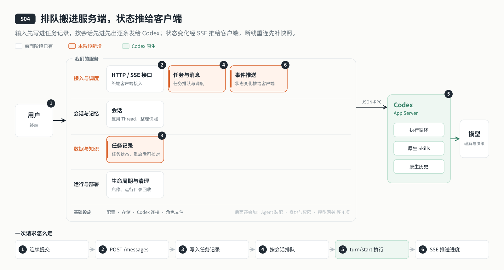

# s04: 事件与消息 — 排队搬进服务端，状态推给客户端

[导论](../introduction.md) → [s00](../s00-sdk-quickstart/) → [s01](../s01-single-turn/) → [s02](../s02-multi-turn/) → [s03](../s03-service/) → `s04` → [s05](../s05-agent-assembly/) → [s06](../s06-tools/) → [s07](../s07-memory/) → [s08](../s08-data-layer/) → [s09](../s09-knowledge-layer/) → [s10](../s10-skill-workflow/) → [s11](../s11-model-gateway/) → [s12](../s12-deploy/) → [s13](../s13-auth/README.md) → [s14](../s14-isolation/README.md) → [app](../../app/)
> *"先记下来，再一条条做"* — 每条输入先写进任务记录，由服务端按顺序交给 Codex；状态变化主动推给客户端，客户端在不在线都不影响执行。
>
> **对应六个问题**：② 要做什么，做到什么算完？ ③ 之前聊过什么？

---



## 要回答的问题

上一章，服务端常驻了，交出去的一轮客户端关了也会跑完。可它还不会排队：上一轮没结束，新的输入只能在客户端等着，客户端一关，没发出去的就丢了；客户端也只能一遍遍地查快照，才知道回复写到了哪里。这一章要回答：

1. **输入放在哪里排队？** 用户连着提交三条，客户端随后就关了，后两条怎么不丢、不乱序、不并发？
2. **一条输入从提交到完成，经过哪些状态？** 失败了、结果拿不准了，下一条还要不要接着发？
3. **进度怎么推给客户端？** 不再一遍遍地问，而是有变化就推；连接断了又连上，怎么补上中间错过的？
4. **服务重启时有一条正在执行**，重启以后要不要自动再发一次？

---

## 核心概念

### 任务记录：先记下来，再执行

客户端提交的每一条输入都带着自己生成的**消息 ID**。服务端收到后先写进任务记录 `.data/messages.json`，立刻回 `202 queued`，不等模型。同一个消息 ID 再提交一次，返回原来那条记录，不会执行两遍；同一个 ID 换了内容，返回 409。

每条任务有一个状态：

```text
queued ──▶ starting ──▶ running ──▶ completed
                          │     └──▶ failed / interrupted     （队列暂停）
                          └────────▶ unconfirmed              （结果不确定，队列暂停，不重发）
```

`starting` 在发给 Codex 之前先写盘。发出后如果连接断了、请求超时，就不知道 Codex 到底有没有收到，这时记为 `unconfirmed`，而不是假装失败后再发一次。

### 服务端排队：同一会话一次一轮

调度器按会话（Thread）排队：同一个会话里，上一轮没结束，下一条就继续排着；不同会话互不影响。一轮结束（`turn/completed`）后调度器被唤醒，按先进先出取下一条，发 `turn/start`。

有两种情况会让队列**暂停**：一轮失败或被中断，以及结果不确定（`unconfirmed`）。暂停后不再自动发下一条，直到用户查看过（`/queue`）并明确输入 `/continue`。失败的那一条不会被重跑。

每一轮还有一个执行上限（`AGENT_TURN_TIMEOUT_MS`，默认 10 分钟）：超时后服务端暂停队列，并请求 Codex 中断这一轮（`turn/interrupt`）。

### 追加：补充给正在执行的那一轮

普通消息总是新开一轮。如果想给正在执行的那一轮补一句要求，要显式用 `/append`，并指明目标 turn id：

- 目标那一轮还在执行：用 `turn/steer` 直接补进去，不新开一轮。
- 目标那一轮刚好结束了：这条追加排到普通消息前面，新开一轮，并在输入里引用原来的要求。

自然语言里写"接着之前那个"不会触发追加：哪一轮、怎么补，必须由用户的操作明确指定。

### 事件推送：SSE

客户端订阅 `GET /events?threadId=…`，这是一条 SSE（Server-Sent Events）长连接，服务端有变化就往里写一条：

| 事件 | 什么时候推 | 内容 |
|------|----------|------|
| `snapshot` | 每次连接上来的第一条 | 完整的会话快照 + 队列快照 |
| `session` | 回复增量、轮次开始或结束 | 会话快照 |
| `queue` | 任务状态变化、暂停或继续 | 队列快照 |
| `fatal` | Codex 连接失效 | 服务已停止调度的提示 |
| `shutdown` | 服务端正常关闭 | 关闭提示；排队中的消息保留，重启后可继续 |

事件中心给每条事件编一个递增的序号，只转发给订阅了对应 Thread 的连接。序号只用于排查问题：本阶段的客户端重连时不按序号补发，而是靠下面的快照。

### 断线重连：先补快照

连接断了，客户端一秒后自动重连。服务端的处理顺序是：先在事件中心登记，再取一份完整快照发出去，最后补上这期间暂存的事件。所以断开期间发生的变化都在快照里，不会漏；快照之后的事件也不会抢到快照前面。

**订阅和提交是两件事**：重连只是重新订阅，不会产生新的提交，已经提交的消息不会被再发一遍。

### 重启：不确定的就停下来

服务启动时先恢复任务记录：排队中的保持排队；执行到一半的（`starting` / `running` / `steering`）一律标成 `unconfirmed`，所在会话的队列暂停。服务正常关闭时也做同样的处理。这样宁可停下来等人核对，也不会把同一件事做两遍。

---

## 分工：Codex 做什么，我们做什么

| 事情 | Codex | 我们的程序 |
|------|-------|----------|
| 执行一轮 | 接收 `turn/start`，跑完执行循环 | 决定什么时候发、发哪一条：按会话先进先出，一次一轮 |
| 追加 | 提供 `turn/steer`，把输入补进正在执行的一轮 | 只在用户显式追加、目标仍在执行时才调用；否则排队新开一轮 |
| 中断 | 提供 `turn/interrupt` | 超时后暂停队列并请求中断 |
| 任务状态 | — | 任务记录：每条输入的状态、幂等、暂停与继续、重启后核对 |
| 推送 | 推送 JSON-RPC 通知给服务端 | 整理成会话 / 队列快照，经 SSE 推给订阅的客户端；重连先补快照 |

---

## 跑起来看看

**准备**：

```sh
cd stages/s04-events-messages
npm ci
cp .env.example .env    # 填入模型配置
```

**运行**（两个终端）：

```sh
npm run server          # 终端 1：服务监听 127.0.0.1:4319
npm run chat            # 终端 2：CLI 客户端
```

试试这几件事：

1. 问一个需要较长回答的问题，不等它答完，再连着输入两句。三条都立刻被接收，按顺序一条条执行。
2. 输入 `/queue` 查看队列：正在执行的、排队中的、已经完成的都在里面。
3. 在第一条还在回答时按 Ctrl+C 关掉客户端，过一会儿重新 `npm run chat`，用 `/resume` 选中这个会话：后面两条也执行完了。
4. 回答进行中输入 `/append 请再简短一些`：补充会进入正在执行的那一轮。
5. 在终端 1 按 Ctrl+C 停止服务，再重新启动：如果停止时有一条正在执行，它会显示为 `unconfirmed`，队列暂停；查看后用 `/continue` 继续，未确认的那条不会被重发。

CLI 命令：`/queue` 查看队列、`/append` 追加到当前一轮、`/append-to <turn id> 内容` 指定追加目标、`/continue` 继续暂停的队列、`/new`、`/resume`、`/exit`。

**这次运行多了什么**：`.data/messages.json`，保存每条任务的状态和暂停中的会话。

**离线实验**：

```sh
npm run lesson -- s04-queue       # 先进先出、一次一轮，客户端退出后继续执行
npm run lesson -- s04-reconnect   # 连接先收到快照；重连不会产生新消息
npm run lesson -- s04-restart     # 重启后执行中的标成 unconfirmed，不自动重发
```

状态流转、接口清单与限制见 [s04 设计说明](docs/design.md)。

---

## 关键代码

**先写进任务记录，再排队**（[`server/modules/messages/index.mjs`](server/modules/messages/index.mjs)）。同一个消息 ID 再提交，返回原来那条：

```javascript
const existing = await this.job(id);
if (existing) {
// …
  return this.publicJob(existing);
}
// …
await this.store.create({ id, threadId, text, mode, targetTurnId, createdAt: Date.now() });
await this.publish(threadId);
this.schedule(threadId);
```

**调度：一次一轮，追加优先**。已经有一轮在执行，其余的继续排着；状态先改成 `starting` 写盘，再发给 Codex：

```javascript
if (active || all.some((j) => executing.includes(j.status))) return;
const job = pending.find((j) => j.mode === "append") || pending[0];
if (!job) return;
if (!(await this.store.patch(job.id, { status: "starting" }, ["queued"])))
  return;
```

**SSE：先订阅，再发快照，再补暂存的事件**（[`server/modules/http/index.mjs`](server/modules/http/index.mjs)）：

```javascript
hub.on("event", listener);
// …
const queue = await messages.snapshot(id);
write({ type: "snapshot", threadId: id, data: { session: sessions.snapshot(id), queue } });
snapshotSent = true;
for (const event of buffered) write(event);
```

---

## 小结

- 输入先写进任务记录，再由服务端按会话先进先出逐条发给 Codex；客户端在不在线都不影响执行。
- 每条任务有明确的状态；失败或结果不确定时队列暂停，由用户查看后明确继续，不重跑、不重发。
- 追加必须显式指明目标：目标还在执行就 `turn/steer`，已经结束就排在前面新开一轮。
- 状态经 SSE 推给客户端；每次连接先给完整快照，断线重连不会漏掉状态，也不会把消息再发一遍。

---

## 下一章

现在的 Agent 能可靠地排队执行了，可它还是那个只会问答的助手：角色是代码里的一句固定文字，想换个角色、换一套方法，就得改代码。

[s05 Agent 装配](../s05-agent-assembly/) → 用一份 JSON 定义 Agent：它是谁、按什么方法工作、启用哪些 Skill。配置改了以后，正在进行的会话凭什么知道自己已经不是原来那个 Agent？
