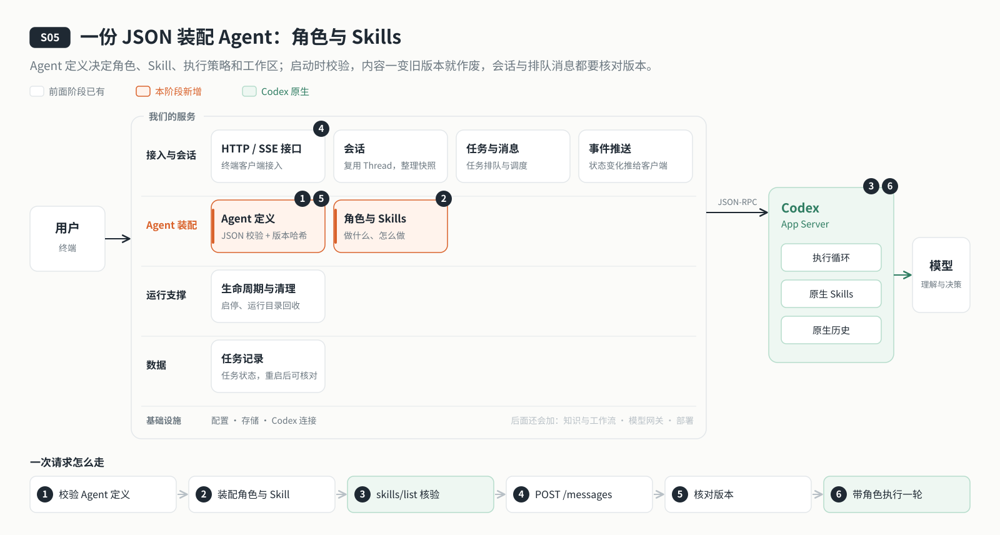

# s05: Agent 装配 — 一份 JSON 决定它是谁

[导论](../introduction.md) → [s00](../s00-sdk-quickstart/) → [s01](../s01-single-turn/) → [s02](../s02-multi-turn/) → [s03](../s03-service/) → [s04](../s04-events-messages/) → `s05` → [s06](../s06-tools/) → [s07](../s07-memory/) → [s08](../s08-data-layer/) → [s09](../s09-knowledge-layer/) → [s10](../s10-skill-workflow/) → [s11](../s11-model-gateway/) → [s12](../s12-deploy/) → [s13](../s13-auth/README.md) → [s14](../s14-isolation/README.md) → [s15](../s15-hub/README.md) → [s16](../s16-coordination/README.md) → [s17](../s17-sharding/README.md) → [s18](../s18-replication/README.md) → [app](../../app/)
> *"改配置就能换 Agent，但改了就得重新开始"* — 角色、Skill 和执行策略写在同一份定义里，一起生效；内容一变，旧版本立即作废。
>
> **对应六个问题**：① 我是谁？ ⑥ 谁说了算？

---



## 要回答的问题

上一章，云端 Agent 能可靠地排队执行、把进度推给客户端了。可它还是那个只会问答的助手：角色是代码里的一句固定文字。要让它变成一个写作助手，明天再变成一个客服助手，难道每次都改代码？这一章要回答：

1. **角色写在哪里？** 它是谁、按什么方法工作、哪些事不能做，怎样交给 Codex？
2. **Skill 怎么管？** 工作区里冒出一个新的 Skill，Agent 能不能自己用上？
3. **定义写错了怎么办？** 有人在配置里放宽了沙箱，或者引用了不存在的东西，服务该怎样处理？
4. **运行中改了定义怎么办？** 正在进行的会话、还在排队的消息，是悄悄换成新角色，还是继续用旧的？

---

## 核心概念

### Agent 定义：一份 JSON 装配一个 Agent

[`agents/writing-agent.json`](agents/writing-agent.json) 是唯一的装配入口：

| 字段 | 决定什么 |
|------|---------|
| `agent.id`、`agent.version` | 这个 Agent 叫什么、第几版 |
| `agent.instructions` | 角色正文在哪个文件（相对定义目录） |
| `agent.skills` | 启用哪些原生 Skill，每个是必需还是可选 |
| `agent.executionRef` | 用 `bindings.executions` 里的哪一条执行策略 |
| `bindings.workspaceDir` | Codex 的工作区目录 |
| `bindings.skills` | 每个 Skill 的文件位置和依赖 |
| `bindings.executions` | 执行策略：只读沙箱、不审批、不开原生 shell 和写文件 |

服务启动时先用 JSON Schema 校验：未知字段、缺少必需字段、把沙箱放宽成可写，都直接拒绝启动。环境变量 `AGENT_DEFINITION` 可以换一份定义文件。

### 角色：Agent 的人设和工作方法

角色就是一段提示词，写在独立的文件里，本阶段是 [`agents/roles/writing-assistant.md`](agents/roles/writing-assistant.md)。它通过 Codex 留给角色的两个位置生效：

```text
agents/roles/writing-assistant.md（角色正文）
  ├─ 模型目录 models.json → instructions_template（启用模型目录时）
  └─ 会话服务 → baseInstructions
        ├─ thread/start：新建会话时带上
        └─ thread/resume：恢复会话时也带上
```

角色不是拼进用户消息里的：每一轮只发用户这一句。**角色描述不等于能力，也不能扩大权限**：就算角色里写"可以执行命令"，执行策略仍是只读沙箱。本阶段的角色也明确告诉模型：现在没有任何工具，不能联网、不能读写文件。

### Skill：发现不等于授权

Skill 是 Codex 原生支持的"方法说明书"：一个 `SKILL.md` 文件，告诉模型某类事情该怎么做。Codex 会自己从工作区发现 Skill，但发现了不等于这个 Agent 可以用：

- 启动时，服务端向 Codex 要一份发现清单（`skills/list`），只启用定义里声明的，范围外的一律关掉（`skills/config/write`）；关不掉就拒绝运行。
- 每一轮发出前再核对一次；有效集合变了，就停下来要求受控重启。
- 用户在消息里写 `$名称` 引用 Skill 时，只有已启用的才会作为 Skill 输入交给 Codex；引用 Codex 发现了、但不在定义里的 Skill 会被拒绝；不是任何 Skill 名称的 `$名称`（比如 `$HOME`）当普通文字放行。

### 版本：内容一变，旧版本作废

定义文件、角色文件和每个 Skill 文件的内容一起算一个哈希。服务运行中，每次新建会话、每一轮发出之前都重新计算一次；只要和启动时不一样，这个 Agent 版本立即作废，后续请求返回 `AGENT_CHANGED`，必须受控重启。把文件改回去也不能恢复。

核验完 Skill 后，服务端生成一份**描述符**：Agent id 和版本、定义与角色的哈希、实际启用的 Skill、工作区和执行策略，再对整份描述符算一个哈希，作为这一版的标识。描述符不含角色正文和密钥，写进 `.data/agent-descriptors/`。

每个会话在创建时绑定当时的版本（`.data/thread-agents.json`），每条排队消息也记下提交时的版本。恢复会话、发出一轮之前都要核对：版本对不上就拒绝执行，提示新建会话，原来的历史不改。新旧两个 Agent 不会混在同一个会话里。

---

## 分工：Codex 做什么，我们做什么

| 事情 | Codex | 我们的程序 |
|------|-------|----------|
| 角色 | 留出 `baseInstructions`、`instructions_template` 两个位置 | 角色写什么、从哪个文件读、新建和恢复会话时都带上 |
| Skill | 发现、解析并注入 Skill 正文 | 只启用定义里声明的；每轮前核对有效集合；拒绝范围外的引用 |
| 执行策略 | 按 `sandbox`、`approvalPolicy` 执行 | 策略写在定义里，schema 只允许只读沙箱、不审批 |
| 版本 | — | 内容哈希、描述符、会话与消息的版本绑定；变了就作废 |

---

## 跑起来看看

**准备**：

```sh
cd stages/s05-agent-assembly
npm ci
cp .env.example .env    # 填入模型配置
```

**运行**（两个终端）：

```sh
npm run server          # 终端 1：服务监听 127.0.0.1:4323；启动日志里有 Agent id 和版本
npm run chat            # 终端 2：CLI 客户端
```

试试这几件事：

1. 问它"你是谁、能帮我做什么"：回答来自角色文件，不是代码里的固定文字。
2. 服务运行时，在 `agents/roles/writing-assistant.md` 里改一个字，再发一条消息：这条消息失败，提示受控重启后新建会话。
3. 重启服务后 `/resume` 刚才的会话：会话绑定的是旧版本，被拒绝；`/new` 新建会话后恢复正常。
4. 停止服务，在 `agents/writing-agent.json` 里把 `sandbox` 改成 `workspace-write`，再 `npm run server`：定义校验不过，服务拒绝启动。记得改回去。

**这次运行多了什么**：

```text
.data/
  ├── agent-descriptors/<哈希>.json   # 每个 Agent 版本的描述符
  └── thread-agents.json              # 每个会话绑定的 Agent 版本
```

**离线实验**：

```sh
npm run lesson -- s05-agent-config   # 越权、缺引用的定义被拒绝；改动立即作废；不兼容的会话被拒绝
npm run lesson -- s05-skills         # 范围外 Skill 被禁用；必需 Skill 缺失时拒绝启动
```

字段说明、启动顺序与限制见 [s05 设计说明](docs/design.md)。

---

## 关键代码

**读定义、校验、装配角色和执行策略**（[`server/modules/agents/index.mjs`](server/modules/agents/index.mjs)）：

```javascript
this.raw = fs.readFileSync(trustedFile(this.file, directory), "utf8");
const definition = validateDefinition(JSON.parse(this.raw));
// …
this.roleFile = trustedFile(path.resolve(directory, agent.instructions), directory);
this.role = loadRole(this.roleFile);
this.workspacePath = path.resolve(directory, bindings.workspaceDir);
this.execution = Object.hasOwn(bindings.executions, agent.executionRef) ? bindings.executions[agent.executionRef] : null;
if (!this.execution) throw new Error(`缺少执行策略：${agent.executionRef}`);
```

**内容一变，旧版本作废**。每次新建会话、发出一轮之前都会检查：

```javascript
sourceHash() {
  return digest([fs.readFileSync(this.file, "utf8"), fs.readFileSync(this.roleFile, "utf8"),
    ...this.skills.map(skill => digest(fs.readFileSync(skill.path)))]);
}
assertCurrent() {
  try { if (this.sourceHash() !== this.expected) this.revoked = true; } catch { this.revoked = true; }
```

**只启用定义里声明的 Skill**（[`server/modules/codex/skills.mjs`](server/modules/codex/skills.mjs)）：

```javascript
for (const skill of discovered) {
  const enabled = requested.has(canonical(skill.path));
  if (skill.enabled !== enabled) {
    await rpc.request("skills/config/write", { path: skill.path, enabled });
    changed = true;
  }
}
```

---

## 小结

- 一份 Agent 定义装配一个 Agent：角色、Skill、执行策略和工作区都写在里面，启动时先过 schema 校验。
- 角色通过 `baseInstructions` 和 `instructions_template` 进入 Codex，新建和恢复会话都带上；角色描述不能扩大权限。
- Skill 由 Codex 发现和注入，但只有定义里声明的才会被启用；每轮前都重新核对。
- 定义、角色、Skill 的内容一变，旧版本立即作废；会话和排队消息都记着自己的版本，对不上就拒绝执行。

---

## 多用户时会怎样

本章的每个 Skill 都记了一个**范围**，现在只有"系统"一种：随 Agent 一起交付，所有会话都能用。等到多个用户共用这个 Agent，就会出现用户自己上传的 Skill。它默认只给上传者自己用，想分享给别人，要另一位管理员批准。这在 [s15 权限与资源 Hub](../s15-hub/README.md) 里实现；用户是谁、他的 Skill 装在哪里，分别由 [s13](../s13-auth/README.md) 和 [s14](../s14-isolation/README.md) 回答。

## 下一章

Agent 有了角色和工作方法，可它还碰不到任何资料：读不了你给的文件，也不能把写好的文章保存下来。

下一章给它装上工具：一份工具配置、一个白名单、每次调用都校验参数；资料目录按用途授权，能读的不一定能写，写过的不能覆盖。模型能不能凭名字调用一个没给它的工具？见 [s06 工具](../s06-tools/)。
