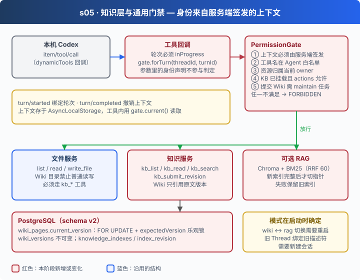

# s05: 知识层 — 每次访问都经过同一道门

[s00](../s00-sdk-quickstart/) → [s01](../s01-single-turn/) → [s02](../s02-multi-turn/) → [s03](../s03-agent-core/) → [s04](../s04-data-layer/) → `s05` → [app](../../app/)
> *"身份来自服务端签发的上下文，不来自工具参数"* — 文件、知识、索引，所有工具共用一道门禁。
>
> **Harness 层**: 门禁与知识 — 可信权限上下文、版本化 Wiki、可选 RAG。

---

## 问题

s04 让 Agent 可以可靠地读写资料。接下来要让它把散落的原始资料整理成知识，问题随之而来：

1. **权限判定散落各处**：文件工具有一套检查，知识工具再写一套，新增一个工具就可能漏掉。更糟的是，如果工具参数里带 `userId`，模型完全可以写上 `"admin"`。
2. **知识库之间的边界**：Agent 能读 `inputs/general`，不代表它能读另一个知识库的原文，也不代表它能用普通的 `write_file` 直接改 Wiki 文件。
3. **并发更新**：两个维护任务同时改同一页 Wiki，谁的版本生效？后提交的会不会悄悄覆盖前一个？
4. **索引切换**：重建 RAG 索引到一半失败了，查询不能落到一个半成品索引上。

---

## 解决方案



所有工具调用都走 Codex 原生的 **dynamicTools** 回调进入同一个进程，在回调里绑定"当前这一轮"的可信上下文，再由 `PermissionGate` 统一判定：

| 检查 | 依据 | 来源 |
|------|------|------|
| ① 上下文是真的 | 必须是门禁自己签发、仍未撤销的对象 | 服务端，按 Thread / Turn 绑定 |
| ② 工具允许 | Agent 的 `tools.allow` | 配置 |
| ③ 资源归属 | 资源的 owner 等于上下文的 owner | `data.scope`，不是模型自称 |
| ④ 知识库挂载 | `agent.knowledge[]` 已挂载该 KB，且 `actions` 包含本次操作 | 配置 |
| ⑤ 任务范围 | 提交 Wiki 只允许在针对该 KB 的 `maintain` 任务里进行 | 服务端签发的任务上下文 |

任何一项不满足就返回 `FORBIDDEN`。轮次结束，上下文随即撤销，旧上下文不能被后来的调用继承。

知识本身分三层：原始资料（不可变快照）→ Wiki（只引用原文版本，乐观锁更新）→ 可选 RAG（Chroma + BM25，新索引完整才切换）。

---

## 工作原理

**第 1 步**：工具调用走 dynamicTools 回调，而不是 MCP。回调先确认这一轮确实在执行，再取出与这一轮绑定的上下文（[`server/main.mjs`](server/main.mjs)）。

```javascript
if (gate) rpc.on('notification', message => {
  const p = message.params;
  if (message.method === 'turn/started') gate.started(p.threadId, p.turn.id);
  if (message.method === 'turn/completed') gate.end(p.threadId, p.turn.id);
});
rpc.toolHandler = (params, context) => {
  if (sessions.getTurn(params.threadId, params.turnId)?.status !== "inProgress") throw new Error("工具请求不属于本服务正在执行的轮次。");
  return tools.registry.call(params, { ...context, ...(gate ? { permissionContext: gate.forTurn(params.threadId, params.turnId) } : {}) });
};
```

**第 2 步**：上下文由门禁签发，存在私有集合里（[`permissions/index.mjs`](server/modules/permissions/index.mjs)）。工具实现内部通过 `current()` 从 AsyncLocalStorage 取上下文，而不是从参数取。伪造一个长得一样的对象没有用，它不在集合里。

```javascript
issue(fields) {
  const context = Object.freeze({ ...fields, ownerId: this.scope.ownerId, agentId: this.agent.definition.agent.id });
  this.#contexts.add(context); return context;
}
async run(context, operation, signal) {
  if (!this.#contexts.has(context)) denied();
  return this.#storage.run({ context, signal }, operation);
}
current() {
  const state = this.#storage.getStore();
  const context = state?.context;
  state?.signal?.throwIfAborted();
  if (!context || !this.#contexts.has(context)) denied();
  this.agent.assertCurrent();
  context.signal?.throwIfAborted();
  if (context.kind === 'task' && this.runs.get(context.threadId)?.context !== context) denied();
  return context;
}
forTurn(threadId, turnId) {
  const run = this.runs.get(threadId);
  if (!run || run.turnId !== turnId || run.controller.signal.aborted) denied();
  return run.context;
}
```

**第 3 步**：一个 `check()` 覆盖所有动作。owner、工具名、KB 挂载、路径授权依次判断；Wiki 目录对普通文件工具直接拒绝。

```javascript
check(action, target = {}) {
  const context = this.current();
  if (!['read','create','list','update','index','tool.call'].includes(action)) denied();
  if (target.ownerId && target.ownerId !== context.ownerId) denied();
  if (action === 'tool.call') { if (!this.agent.allowsTool(target.name)) denied(); return; }
  if (target.kbId) return this.mount(target.kbId, action);
  if (typeof target.path === 'string') {
    const locator = target.path;
    if (locator.includes('..') || locator.includes('\\') || locator.startsWith('/')) denied();
    for (const [kbId, binding] of Object.entries(this.knowledgeBases || this.agent.definition.bindings.knowledgeBases || {})) {
      if (covers(binding.wikiRoot, locator)) denied();          // Wiki 只能走 kb_* 工具
      if (covers(binding.sourceRoot, locator)) this.mount(kbId, 'read');
    }
    // …再按 Agent 的资料绑定判断 read / create / list
  }
}
mount(kbId, action = 'read') {
  const context = this.current();
  const mount = (this.agent.definition.agent.knowledge || []).find(m => m.kbId === kbId);
  if (!mount || !mount.actions.includes(action)) denied();
  if (action !== 'read' && context.kind === 'task' && context.maintenanceKb !== kbId) denied();
  return mount;
}
```

**第 4 步**：Wiki 用乐观锁更新（[`knowledge/index.mjs`](server/modules/knowledge/index.mjs)）。提交时带上读到的版本号 `expectedVersion`；锁住页面行后版本对不上，就拒绝提交，让调用方重新读取。

```javascript
const page = (await this.query('SELECT * FROM agent_data.wiki_pages WHERE instance_id=$1 AND kb_id=$3 AND slug=$4 AND $2::uuid IS NOT NULL FOR UPDATE', [kbId, slug], client)).rows[0];
if (page.current_version !== expectedVersion) fail('Wiki 已被其他更新修改，请读取最新版本。', 'VERSION_CONFLICT');
await this.query(`INSERT INTO agent_data.wiki_versions(instance_id,id,kb_id,slug,revision,blob,sources)
  SELECT $1,$3,$4,$5,$6,$7,$8 WHERE $2::uuid IS NOT NULL`, [id, kbId, slug, body.revision, body.blob, JSON.stringify(source_versions)], client);
this.gate.check('update', { kbId });
await this.query('UPDATE agent_data.wiki_pages SET current_version=$5 WHERE instance_id=$1 AND kb_id=$3 AND slug=$4 AND $2::uuid IS NOT NULL', [kbId, slug, id], client);
```

**第 5 步**：RAG 索引先完整构建，校验分块数量，最后才在一个事务里切换 `index_revision` 指针。任何一步失败，丢弃新索引，旧指针不动（[`knowledge/rag.mjs`](server/modules/knowledge/rag.mjs)）。

```javascript
if (await collection.count() !== documents.length) throw new Error('Chroma 分块数量不完整。');
await service.resources.locked(async db => {
  await service.query(`UPDATE agent_data.knowledge_indexes SET state='ready',manifest=$5 WHERE …`, [kbId, revision, manifest], db);
  await service.query('UPDATE agent_data.knowledge_bases SET index_revision=$4 WHERE …', [kbId, revision], db);
});
// catch：discard(manifest)，并把这次索引标记为 failed
```

**第 6 步**：知识模式只在服务启动时确定。配置改成 `rag` 但索引还没就绪，实际仍按 `wiki` 运行；已经生效的 RAG 不可用时直接报错，不会悄悄回退。

```javascript
const prepared = mount.mode === 'rag' && kb.index_revision && this.rag && await this.rag.ready(this, kb);
if (mount.mode === 'rag' && previous?.effective_mode === 'rag' && !prepared)
  fail('已启用的 RAG 当前不可用；恢复配置或显式切回 Wiki 后重建索引。', 'RAG_NOT_READY');
const effective = prepared ? 'rag' : 'wiki';
```

到这一章，所有对外部世界的访问（文件、知识、索引）都要经过同一个判定函数，判定依据全部来自服务端：配置、数据库里的归属、服务端签发的任务上下文。模型能决定"调用哪个工具、传什么参数"，但不能决定"我是谁、我能碰什么"。

---

## 试一下

**准备**（需要 Docker）：

```sh
cd stages/s05-knowledge-layer
npm ci
cp .env.example .env
# 编辑 .env：模型配置，以及
#   DATABASE_URL=postgresql://agent:<密码>@127.0.0.1:5432/agent_s05
#   REDIS_URL=redis://127.0.0.1:6379
#   AGENT_MEMORY_ENABLED=false        # 挂载知识库时必须关闭原生记忆
export AGENT_DB_PASSWORD=<与 DATABASE_URL 中相同的密码>
docker compose up -d postgres redis   # 与 s04 端口相同，不要同时启动两套
npm run data:migrate
npm run knowledge:init                # 建目录、部署 Skill，不生成知识
npm run server                        # 127.0.0.1:4315
```

**运行**（另一个终端）：

```sh
cp <你的资料>/*.md workspace/inputs/general/
npm run knowledge -- maintain general "阅读 inputs/general 下全部原始资料，整理为结构化 Wiki 页面"
npm run knowledge -- list
npm run knowledge -- read general <maintain 实际创建的 slug>
npm run knowledge -- search general <关键词>
```

试试门禁（`npm run chat` 后在普通对话里）：

1. `请直接提交一个 Wiki 页面`：普通对话没有 `maintain` 上下文，`kb_submit_revision` 应被拒绝
2. `用 read_file 读取 research/general/wiki 下的页面`：Wiki 目录只能通过 `kb_read` 读取

**离线实验**：

```sh
npm run lesson -- s05-gate     # 伪造上下文、外部 owner 被拒绝；旧 turn 结束后上下文失效
npm run lesson -- s05-mounts   # 另一个 KB 的路径、未挂载 KB、Wiki 路径写入都被拒绝
npm run lesson -- s05-modes    # RAG 未就绪仍是 Wiki；已生效的 RAG 不可用时报错不回退
```

`s05-wiki`、`s05-rag` 需要真实的临时 PostgreSQL / Redis（RAG 还需要 Chroma），用 `--integration` / `--rag` 显式开启。启用 RAG 的完整步骤、五层架构与限制见 [s05 设计说明](docs/design.md) 和 [知识层实现详解](docs/knowledge-implementation.md)。

---

## 接下来

五个阶段到这里结束：从一次 SDK 调用，到一个配置驱动、数据持久、知识受控的 Agent 服务。整个过程中，模型的执行循环始终由 Codex 负责，我们一层层加的都是 harness。

[app](../../app/README.md) → 完整项目在 s05 之上继续演进：多份 Agent 配置的选择、会话升级、协议兼容检查、Web 工作台和互动课程。可以直接读它的代码，也可以运行 `npm run web` 打开课程，把 17 个机制再推演一遍。
