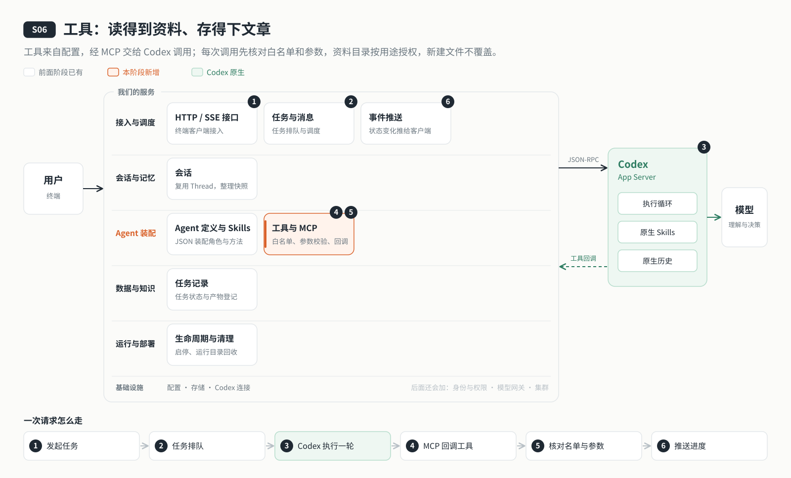

# s06: 工具 — 让它读得到资料、存得下文章

[导论](../introduction.md) → [s00](../s00-sdk-quickstart/) → [s01](../s01-single-turn/) → [s02](../s02-multi-turn/) → [s03](../s03-service/) → [s04](../s04-events-messages/) → [s05](../s05-agent-assembly/) → `s06` → [s07](../s07-memory/) → [s08](../s08-data-layer/) → [s09](../s09-knowledge-layer/) → [s10](../s10-skill-workflow/) → [s11](../s11-model-gateway/) → [s12](../s12-deploy/) → [s13](../s13-auth/README.md) → [s14](../s14-isolation/README.md) → [s15](../s15-hub/README.md) → [s16](../s16-coordination/README.md) → [s17](../s17-sharding/README.md) → [s18](../s18-replication/README.md) → [app](../../app/)
> *"给它的工具，它才能用；给它的目录，它才能碰"* — 工具来自一份配置，Agent 定义里列出能用哪些；每次调用先核对名单和参数，资料目录按用途授权，写过的文件不覆盖。
>
> **对应六个问题**：④ 依据什么资料？ ⑤ 能用什么？ ⑥ 谁说了算？

---



## 要回答的问题

上一章，云端 Agent 有了角色和工作方法，可它什么都碰不到：你给它的资料它读不了，写好的文章也存不下来。这一章给它装上工具，要回答：

1. **工具从哪来？** 新增一个工具，要不要改主程序？
2. **能用哪些，谁说了算？** 模型凭名字调用一个没给它的工具，会怎样？参数乱填呢？
3. **资料目录怎么管？** 原始资料能不能被改掉？写好的文章能不能被覆盖？
4. **Codex 怎么调到我们的工具？** 工具跑在我们的服务里，Codex 跑在另一个进程里，中间靠什么连起来？

---

## 核心概念

### 工具：一份配置，一个实现

工具写在 [`config/tools/`](config/tools/) 里，每个文件声明一组工具：名字、说明、参数的 JSON Schema、实现模块。本阶段有四个：

| 工具 | 做什么 |
|------|-------|
| `list_files` | 列出工作区里获准读取的目录 |
| `read_file` | 读取获准来源的 `.md` / `.txt` 文件，最大 256 KiB |
| `write_file` | 在授权范围新建 `.md` / `.txt` 文件，不覆盖已有文件 |
| `read_webpage` | 读取公开网页的静态正文，不访问本机和内网 |

服务启动时把这些配置装配成一个**工具注册表**：名字和实现一一配对，参数 schema 预先编译好。重复的名字、找不到的实现、写错的 schema 都会让启动失败。新增工具只要加配置和实现，再把名字加进 Agent 定义的 `agent.tools.allow`（定义变了要重启服务、新建会话），主程序不用改。

### 白名单：Agent 定义说了算

注册了不等于能用。Agent 定义里的 `agent.tools.allow` 列出这个 Agent 能用哪些工具，Codex 看到的工具清单只包含名单里的。即使模型凭名字直接调用名单外的工具，注册表也会先核对名单，返回"未授权的工具"，实现根本不会被执行。参数不符合 schema 也一样：先拒绝，再说别的。

### 资料边界：按用途授权

工作区分四个目录。能读哪些由 Agent 定义里的 `dataBindings` 决定；能新建哪些，来自 `dataBindings` 里的 `create` 权限，或者 `outputs` 产物规则（产物规则只给新建权，不附带读取权）：

| 目录 | 用途 | 权限 |
|------|------|------|
| `inputs/` | 你给的原始资料 | 只读 |
| `research/` | 整理出的研究笔记 | 读 + 新建 |
| `drafts/` | 草稿 | 读 + 新建 |
| `outputs/` | 最终文章 | 读 + 新建（按产物规则：只能新建 `.md` / `.txt`） |

路径只能落在这四个目录里，不能经过符号链接，只允许 `.md` 和 `.txt`。新建文件用"不存在才创建"的方式写入，已有的文件不会被覆盖，想改就另存一个新版本（比如 `article-v2.md`）。

### MCP：Codex 怎么调到我们的工具

工具跑在我们的服务进程里。服务启动时在本机回环地址开一个 MCP 入口，带一个随机令牌，再把这个入口写进 Codex 的配置。Codex 需要用工具时，通过 MCP 的 `tools/list` 拿清单、用 `tools/call` 调用；我们的注册表核对后执行，把结果交回。Codex 自己的 shell、写文件等原生能力仍然关着，所以它只能经由这些工具碰到资料。

### 版本：工具变了，旧会话不混用

工具配置也算进 Agent 的版本描述符：工具版本、允许名单、资料绑定、产物规则都在里面。运行中修改工具目录：删除或禁用工具立即生效，后续调用就会被拒绝；换一套新的实现则要等正在进行的轮次和工具调用都结束才切换。版本变了之后，旧会话需要新建，不会在同一个会话里混用两套工具。

---

## 分工：Codex 做什么，我们做什么

| 事情 | Codex | 我们的程序 |
|------|-------|----------|
| 决定用不用工具 | 模型看清单、决定调用哪个、填什么参数 | 只把名单里的工具放进清单 |
| 调用通道 | 作为 MCP 客户端发 `tools/list`、`tools/call` | 提供带令牌、只监听本机的 MCP 入口 |
| 执行 | 等结果，交回模型继续推理 | 核对名单与参数，执行实现，按目录权限读写 |
| 资料安全 | 原生 shell、写文件保持关闭 | 只读目录、不覆盖写入、路径与格式检查 |

---

## 跑起来看看

**准备**：

```sh
cd stages/s06-tools
npm ci
cp .env.example .env    # 填入模型配置
```

把一份资料放进工作区，比如 `workspace/inputs/notes.md`。

**运行**（两个终端）：

```sh
npm run server          # 终端 1：服务监听 127.0.0.1:4324；启动日志里能看到工具已核验
npm run chat            # 终端 2：CLI 客户端
```

试试这几件事：

1. 输入 `/tools`，看看已加载的工具和状态。
2. 让它"读一下 inputs/notes.md，整理成三条要点，存到 research/"：观察它先调 `read_file`、再调 `write_file`，`research/` 里多了一个文件。
3. 让它"把 inputs/notes.md 改成别的内容"：`inputs/` 只读，写入被拒绝，它会如实告诉你。
4. 让它再存一次同名文件：已有文件不覆盖，它会换一个新文件名。

**这次运行多了什么**：

```text
workspace/
  ├── inputs/      # 你放进去的原始资料（只读）
  └── research/    # Agent 新建的笔记
.runs/app-server-*/tools-*/   # 本次运行使用的工具代码快照
```

**离线实验**：

```sh
npm run lesson -- s06-tool-registry   # 配置装配工具；重复名、缺实现、坏 schema 被拒绝
npm run lesson -- s06-mcp             # 一个 MCP 入口承载多个工具；无令牌、跨源请求被拒绝
npm run lesson -- s06-workspace       # 读权限和新建权限分开判断；不覆盖已有文件
```

工具字段、调用流程与限制见 [s06 设计说明](docs/design.md) 和 [工具机制详解](docs/tools.md)。

---

## 关键代码

**每次调用先核对名单和参数**（[`server/modules/tools/loader.mjs`](server/modules/tools/loader.mjs)）：

```javascript
validate(name, args) {
  const entry = entries.get(name);
  if (!entry || (agent && (!agent.allowsTool(name) || !currentNames().has(name)))) throw new Error("未授权的工具。");
  if (!entry.validate(args)) throw new Error(`工具参数不合法：${entry.validate.errors?.[0]?.message || "请检查参数"}`);
  return entry;
},
```

**原始资料只读**（[`server/modules/data/files.mjs`](server/modules/data/files.mjs)）：

```javascript
if (parts.length && !AREAS.includes(parts[0]))
  throw new Error("路径只能位于 inputs、research、drafts、outputs。");
if (file && (parts.length < 2 || !/\.(md|txt)$/i.test(relative)))
  throw new Error("当前只支持 .md 和 .txt 文件。");
if (createParents && parts[0] === "inputs")
  throw new Error(
    "inputs 为原始资料只读目录，请写入 research、drafts 或 outputs。",
  );
```

**写过的文件不覆盖**：

```javascript
fs.writeFileSync(file, content, {
  flag: "wx",
  mode: 0o600,
  flush: true,
});
```

---

## 小结

- 工具来自 `config/tools/` 的配置，启动时装配成注册表；新增工具不用改主程序。
- Agent 定义的 `tools.allow` 决定能用哪些；名单外的工具、不合法的参数在执行前就被拒绝。
- 资料按目录授权：`inputs/` 只读，新建文件不覆盖，路径和格式都要检查。
- Codex 通过本机的 MCP 入口调用我们的工具；它自己的 shell 和写文件仍然关着。
- 工具也算进 Agent 版本，变了之后旧会话不混用。

---

## 多用户时会怎样

本章的工具组预留 `scope`，当前只接受 `system`，工具清单会返回每组的有效范围。多用户时，工具可用范围将是 Agent 白名单 ∩ 用户权益 ∩ 工具组 scope，届时 scope 将增加 `shared`、`private`。当前仍只按已有白名单和资源门禁执行，填写 scope 不会增加或收回权限。用户身份、隔离边界和范围管理分别在 s13 账号与认证、s14 用户隔离、s15 权限与资源 Hub 中展开。

## 下一章

现在它能读资料、写文章了，可每次新建会话，它都不记得你上次说过的偏好：喜欢什么文风、文章给谁看。

下一章打开 Codex 的原生记忆：记忆由 Codex 提炼，由服务端决定开不开、哪些会话参与。见 [s07 记忆](../s07-memory/)。
