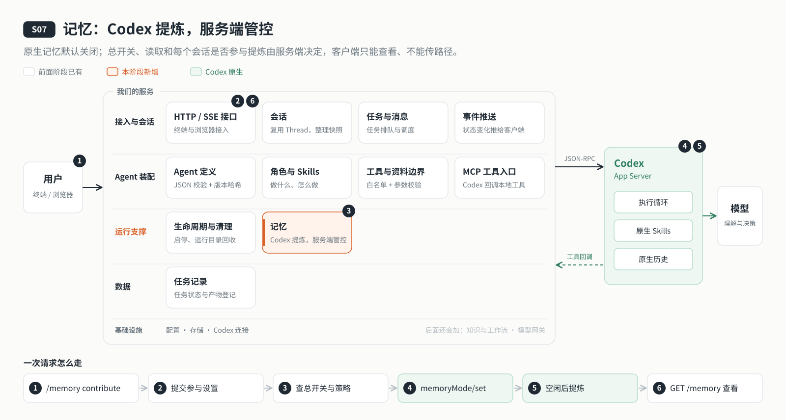

# s07: 记忆 — Codex 提炼，服务端管控

[导论](../introduction.md) → [s00](../s00-sdk-quickstart/) → [s01](../s01-single-turn/) → [s02](../s02-multi-turn/) → [s03](../s03-service/) → [s04](../s04-events-messages/) → [s05](../s05-agent-assembly/) → [s06](../s06-tools/) → `s07` → [s08](../s08-data-layer/) → [s09](../s09-knowledge-layer/) → [s10](../s10-skill-workflow/) → [s11](../s11-model-gateway/) → [s12](../s12-deploy/) → [s13](../s13-auth/README.md) → [s14](../s14-isolation/README.md) → [s15](../s15-hub/README.md) → [s16](../s16-coordination/README.md) → [s17](../s17-sharding/README.md) → [s18](../s18-replication/README.md) → [app](../../app/)
> *"记忆交给 Codex 提炼，开不开、谁能参与由服务端说了算"* — 客户端只能查看和提出设置，不能传路径，也不能绕过总开关。
>
> **对应六个问题**：③ 之前聊过什么？ ⑥ 谁说了算？

---



## 要回答的问题

到这里，云端 Agent 已经是一个常驻服务：任务在服务端排队，状态推给客户端，一份 JSON 装配出它的角色和 Skills，工具经白名单和参数校验后才执行。可每个会话仍然是从零开始的：上周告诉过它"我的文章不要用小标题"，这周新开一个会话，它就忘了。

Codex 原生就有长期记忆。接进来之前，要先想清楚四件事：

1. **谁来提炼？** 是我们自己把历史拼成摘要，还是交给 Codex？
2. **存在哪？** 记忆文件会不会写到个人的 `~/.codex`，和别的项目混在一起？
3. **谁能开、谁能关？** 默认开着吗？某个会话聊的是隐私内容，能不能不让它参与提炼？
4. **客户端能碰到多少？** 客户端能不能指定一个路径读文件、能不能直接清空记忆？

---

## 核心概念

### 记忆由 Codex 提炼和使用

Codex 会在会话空闲一段时间后，从历史里提炼出记忆、再合并成摘要，后续会话自动使用。我们不自己拼接历史，也不把摘要塞进用户消息。三方分工如下：

| 谁 | 负责什么 |
|----|---------|
| Codex | 从历史会话里提炼记忆、合并记忆，并在后续会话中使用 |
| 服务端 | 是否开启、存在哪、核验实际配置、摘要查看，以及**哪些会话可以贡献记忆** |
| CLI 客户端 | 提供 `/memory` 命令、展示结果，不直接读写记忆文件 |

### 存在本服务自己的状态目录

记忆文件在本阶段的 Codex 状态目录里，不进个人目录：

```text
.data/codex/
  ├── config.toml            # 启动时生成的 Codex 配置（含 [features] 与 [memories]）
  ├── …                      # 原生会话记录和数据库
  └── memories/
      ├── raw_memories.md    # 提炼出的原始记忆
      ├── MEMORY.md          # 合并后的详细记忆
      └── memory_summary.md  # 后续会话使用的摘要
```

服务端只按这三个固定文件名读取，不接受客户端传来的路径，不跟随符号链接，拒绝硬链接。

### 三道开关

记忆默认关闭。要让一个会话的内容进入记忆，三道开关都要打开：

| 开关 | 在哪设置 | 管什么 |
|------|---------|--------|
| 总开关 | `.env` 的 `AGENT_MEMORY_ENABLED` | 是否启用原生记忆；修改后需重启服务。下面的设置都要它开着才生效 |
| Agent 策略 | `agents/writing-agent.json` 的 `agent.memory` | 这个 Agent 是否使用（`use`）记忆、新会话默认是否贡献（`contribute`）；本阶段默认两项都是 `false` |
| 会话参与 | `/memory contribute on|off` | 这一个 Thread 之后是否参与提炼 |

读取与贡献是分开的：`AGENT_MEMORY_USE` 与 `agent.memory.use` 同时为真才使用记忆；`contribute` 关闭不禁止读取，也不会删除过去已经提炼的内容。此外 `AGENT_MEMORY_GENERATE` 单独控制原生后台是否生成记忆，同样受总开关约束。

### 开了不等于已经生成

服务启动时，服务端会向 Codex 读回实际生效的配置（`config/read`），和自己写入的逐项比对，不一致就拒绝启动，不会"假报开启成功"。即使配置一致，也只代表"允许提炼"：原生后台按空闲时间等条件处理，不是每轮即时保存。本阶段关闭了原生 Shell 和写文件工具，Codex 0.154.0 的后台合并因此写不出最终摘要，`/memory` 会如实报告这一点。

---

## 分工：Codex 做什么，我们做什么

| 事情 | Codex | 我们的程序 |
|------|-------|----------|
| 提炼与合并 | 按空闲条件在后台提炼、合并记忆 | — |
| 使用记忆 | 在后续会话中带上记忆摘要 | 决定是否允许使用（`use` 开关） |
| 开关与位置 | 读取 `config.toml` | 生成 `config.toml`，固定 `CODEX_HOME` 为本项目目录，启动时核验实际配置 |
| 会话参与 | 提供 `thread/memoryMode/set` | 新建会话时按策略设置；只在该会话没有执行中的轮次时修改 |
| 查看 | — | 只读固定文件，限长 64 KiB、脱敏后返回；不提供任意路径或清空接口 |

---

## 跑起来看看

**准备**：

```sh
cd stages/s07-memory
npm ci
cp .env.example .env    # 填入模型配置；需要体验记忆时设 AGENT_MEMORY_ENABLED=true
# 想让这个 Agent 使用、贡献记忆，还要把 agents/writing-agent.json 里 agent.memory 的 use、contribute 改成 true
```

**运行**（两个终端）：

```sh
npm run server          # 终端 1：服务监听 127.0.0.1:4325；启动日志会写明记忆开关
npm run chat            # 终端 2：CLI 客户端
```

试试这几条命令：

1. `/memory`：查看总开关、是否使用、新会话是否参与提炼、摘要是否存在。默认是关闭的。
2. `/memory show`：查看记忆摘要；还没有生成时会明确说明。
3. `/memory contribute off`：让当前会话之后不参与提炼。总开关关闭时，`/memory contribute on` 会被拒绝。

**这次运行多了什么**：`.data/codex/config.toml` 的 `[features] memories` 按总开关写入，并多了 `[memories]` 一段。三道开关都打开、会话空闲足够长时间后，原生后台会开始提炼，`.data/codex/memories/` 下会出现中间产物；本阶段关闭了原生 shell 和写文件，最终摘要的合并写不出来，`/memory` 会如实显示。

**离线实验**：

```sh
npm run lesson -- s07-memory   # 默认关闭、配置核验、固定文件读取、会话参与设置
```


---

## 关键代码

**生成 Codex 配置，记忆开关和存储位置都由服务端写定**（[`server/modules/codex/config.mjs`](server/modules/codex/config.mjs)）：

```javascript
const content = `${HEADER}\nsqlite_home = ${JSON.stringify(paths.home)}\n` +
  table("features", { memories: memory.enabled }) +
  table("memories", {
    use_memories: memory.use, generate_memories: memory.generate,
    extract_model: memory.extractModel, consolidation_model: memory.consolidationModel,
    min_rollout_idle_hours: memory.minIdleHours,
    // 禁用通用 Shell 时，召回细节使用原生的受限记忆工具。
    dedicated_tools: true
  }) + Object.entries(mcpServers).map(([name, settings]) => table(`mcp_servers.${name}`, settings)).join("");
writeText(paths.configFile, content);
```

**启动时读回实际配置并逐项比对**（[`server/modules/memory/index.mjs`](server/modules/memory/index.mjs)）。不一致就拒绝启动：

```javascript
const { config: actual } = await this.rpc.request("config/read", { includeLayers: false });
const memory = actual?.memories;
const requested = this.config.memory;
if (actual?.features?.memories !== requested.enabled || memory?.use_memories !== requested.use ||
    memory?.generate_memories !== requested.generate || memory?.extract_model !== (requested.extractModel ?? null) ||
    memory?.consolidation_model !== (requested.consolidationModel ?? null) || memory?.min_rollout_idle_hours !== requested.minIdleHours || memory?.dedicated_tools !== true) {
  throw new Error("Codex 记忆配置与服务端配置不一致，请检查配置覆盖；不会假报开启成功。");
}
```

**会话参与设置：先查总开关和 Agent 策略，再确认会话属于本项目，一轮结束后才调用原生接口**：

```javascript
if (enabled && !this.effective?.enabled) throw new AppError("记忆总开关尚未开启，请配置 AGENT_MEMORY_ENABLED 并重启服务。", 409);
if (enabled && this.config.agent && !this.config.memory.contribute) throw new AppError("当前 Agent 策略禁止会话贡献记忆。", 409);
await this.sessions.ensure(threadId); // 复用项目会话校验，不能操作其他项目的 Thread。
return this.sessions.atBoundary(async () => {
  if (this.sessions.sessions.get(threadId)?.activeTurnId) throw new AppError("请在当前 turn 结束后修改记忆参与设置。", 409);
  const mode = enabled ? "enabled" : "disabled";
  await this.rpc.request("thread/memoryMode/set", { threadId, mode });
  return { threadId, mode, note: "设置已提交：只控制此 Thread 后续参与提炼的资格；不停止已运行的后台任务，不立即删除过去贡献的记忆，也不控制读取。" };
}, { allowBusy: true });
```

---

## 小结

- 记忆由 Codex 提炼、合并和使用；我们不自己拼接历史。
- 记忆文件在本服务的 `.data/codex/memories/`，服务端只读固定文件名，不接受客户端路径。
- 总开关、Agent 策略、会话参与三道开关都由服务端掌握；启动时核验实际配置，开了不等于已经生成。
- 客户端只能查看和提出会话参与设置，没有清空或任意读取的接口。

---

## 下一章

Agent 现在能记住偏好了。可一旦放到云端长期运行，它要面对的情况比在本机复杂得多：服务会重启，几个任务同时提交要排队，原文改了一句，依据它写的产物要知道自己过期了。

[s08 数据层](../s08-data-layer/) → 让云端 Agent 靠得住。对话历史归 Codex，业务事实归我们：哪些数据该交给数据库，哪些仍然留给 Codex？
