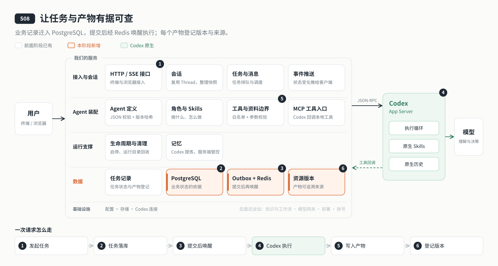

# s08: 数据层 — 对话历史归 Codex，业务事实归我们

[导论](../introduction.md) → [s00](../s00-sdk-quickstart/) → [s01](../s01-single-turn/) → [s02](../s02-multi-turn/) → [s03](../s03-service/) → [s04](../s04-events-messages/) → [s05](../s05-agent-assembly/) → [s06](../s06-tools/) → [s07](../s07-memory/) → `s08` → [s09](../s09-knowledge-layer/) → [s10](../s10-skill-workflow/) → [s11](../s11-model-gateway/) → [s12](../s12-deploy/) → [s13](../s13-auth/README.md) → [app](../../app/)
> *"PostgreSQL 记事实，Redis 只负责叫醒"* — 任务和"该叫醒谁"写在同一个事务里，唤醒信号丢了也能补上；不确定的事不猜，交给人决定。
>
> **对应六个问题**：② 要做什么，做到什么算完？ ④ 依据什么资料？

---



## 要回答的问题

云端 Agent 要长期在线，就得靠得住。到上一章为止，它的状态还只是存在本机的几个 JSON 文件里，在云端长期运行时，下面这些事它都说不清楚：

1. **消息收到了，却没人执行**：服务先记下任务、再通知执行器。如果在这两步之间崩溃，任务就躺在那里没人管。
2. **唤醒信号丢了怎么办**：用 Redis 来调度任务，Redis 重启或断线了，排队中的任务会不会跟着没了？
3. **执行到一半服务重启**：这条任务到底执行了没有？重发可能做两遍，不重发可能漏掉。
4. **原文改了，产物还算数吗**：Agent 根据 `inputs/report.md` 写了一份摘要。后来有人改了原文一句话，这份摘要该继续当真，还是标记为过期？

---

## 核心概念

### 两类数据，两个主人

Codex 已经替我们保存了很多东西，s02 恢复会话靠的就是它。所以动手建数据库之前，第一件事是分清哪些数据归 Codex，哪些归我们：

| 数据 | 归谁 | 存在哪里 |
|------|------|---------|
| 完整的对话历史：消息、工具调用、模型输出 | Codex | `.data/codex/sessions/` 下的 `.jsonl` 会话记录 |
| Codex 的索引、元数据与内部状态 | Codex | `.data/codex/` 下的 SQLite |
| 原生记忆：提炼出的摘要和经验（不是完整会话） | Codex | `.data/codex/memories/` |
| 会话归属、任务原文与状态、调度出口、去重记录 | **我们** | PostgreSQL |
| 资料与产物的每一个版本、它们之间的依赖 | **我们** | PostgreSQL 记元数据，正文存成不可变文件 |

**我们不把对话历史再存一份。** 数据库只存 Codex 不知道的业务事实：谁提交了什么任务，排在第几个，执行到哪一步，产物依据的是哪个版本的资料。

官方在讲 Codex Web 时说过一个道理：网页会话是临时的，标签页会关、网络会断，所以客户端不能当作长期任务的可信数据源；状态和进度要留在服务器上，任务才能在标签页消失后继续运行。云端 Agent 也是这个思路：**事实只在服务端的数据库里**。

### 三种存储，各管一件事

| 存储 | 存什么 | 不存什么 |
|------|--------|---------|
| PostgreSQL（`agent_s08`，schema v1） | 任务原文与状态（`tasks`）、调度出口（`outbox`）、会话、资源与版本、依赖关系、产物 | 完整的模型对话，那仍在 Codex 原生存储里 |
| Redis | 一个集合：哪些 Thread 需要被叫醒 | 任务本身、任务顺序 |
| `.data/files/objects/` | 以 sha256 命名的不可变正文 | 可以原地修改的副本 |

### outbox：先记一笔"该叫醒谁"

"写任务"和"通知执行器"如果分两步做，中间崩溃就会出问题。解决办法是 outbox：提交任务时，在**同一个数据库事务**里顺手记一笔"这个 Thread 该被叫醒了"。两件事要么都成功，要么都回滚。

调度器定时把 outbox 里到期的记录推进 Redis，执行器再从 Redis 里取。Redis 丢了数据也不要紧，outbox 还在，下一轮会重新推。

### 两条原则

- **事实只在 PostgreSQL 里**：Redis 里的东西丢了，可以从 PostgreSQL 重新推出来，反过来不行。
- **不确定就不重发**：执行中断的任务标为 `unconfirmed`，所在会话暂停，由人决定下一步。宁可停下来问，也不要偷偷做两遍。

### 产物能追溯到依据

资料每写一次就是一个新版本，正文以 sha256 命名存成不可变文件。Agent 写产物时可以声明它依据了哪些资料的哪个版本；原文一旦更新，引用旧版本的产物就被标记为失效。这能追溯来源，但不能证明内容在语义上真的引用正确。

---

## 分工：Codex 做什么，我们做什么

| 事情 | Codex | 我们的程序 |
|------|-------|----------|
| 对话历史、上下文、原生记忆 | 持久保存，恢复时自己读 | 不重复保存 |
| 执行循环 | 和前面各章一样 | — |
| 任务排队与调度 | — | PostgreSQL 任务表 + outbox，Redis 只负责叫醒 |
| 中断后的恢复 | 线程历史还在 | 执行中的任务标为 `unconfirmed`，暂停会话，等人决定 |
| 资料与产物版本 | — | 不可变正文、版本记录、依赖与失效 |

这一章不碰任何模型交互，加的是"服务端记住什么、怎么记"：每个状态变化都落在事务里，每个不确定都明明白白地摆出来。

---

## 跑起来看看

**准备**（需要 Docker）：

```sh
cd stages/s08-data-layer
npm ci
cp .env.example .env
# 编辑 .env：模型配置，以及
#   DATABASE_URL=postgresql://agent:<密码>@127.0.0.1:5432/agent_s08
#   REDIS_URL=redis://127.0.0.1:6379
export AGENT_DB_PASSWORD=<与 DATABASE_URL 中相同的密码>
docker compose up -d postgres redis
npm run data:migrate
npm run data:check
```

**运行**（两个终端）：

```sh
npm run server          # 终端 1：127.0.0.1:4314
npm run chat            # 终端 2
```

把一份资料放到 `workspace/inputs/report.md`，然后在聊天里输入：

```text
读取 inputs/report.md，将摘要保存到 outputs/report-summary.md，并声明来源版本
```

**数据存在哪里**：对话历史仍在 `.data/codex/sessions/`；任务和版本在数据库里，查一下：

```sh
docker compose exec postgres psql -U agent -d agent_s08 \
  -c "SELECT id, status, substring(text,1,40) FROM agent_data.tasks ORDER BY created_at DESC LIMIT 5;"
```

观察重点：

1. 发一条消息后立刻 `docker compose stop redis`，等几秒再 `start`。任务是丢了，还是在 Redis 恢复后继续执行？
2. 任务执行中按 `Ctrl+C` 停掉服务再启动，这条任务的状态是什么？CLI 里用 `/continue` 继续队列时，它会被重发吗？

**实验**：本阶段的三节课需要真实的临时 PostgreSQL / Redis（`PATH` 中有 `initdb`、`pg_ctl`、`redis-server`），默认不运行，需要显式开启：

```sh
npm run lesson -- s08-persistence --integration   # 三节课共用一组集成测试，运行一次即可
npm test                                           # 单元测试，不需要数据库
```

四层架构、表结构清单与限制说明见 [s08 设计说明](docs/design.md) 和 [数据层详解](docs/data-layer.md)。

---

## 关键代码

代码在 [`server/modules/data/`](server/modules/data/) 下。

**任务和 outbox 在同一个事务里**（[`jobs.mjs`](server/modules/data/jobs.mjs)）。先锁住会话行，再写任务、记 outbox：

```javascript
async create(job) {
  return transaction(this.pool, async (client) => {
    // 锁住会话行，串行化同一会话的并发写入
    const found = await this.query(
      "SELECT id FROM agent_data.conversations WHERE instance_id=$1 AND owner_id=$2 AND id=$3 FOR UPDATE",
      [job.threadId],
      client,
    );
    if (!found.rowCount) throw new AppError("会话不存在。", 404);
    // …检查本会话排队数（超过 100 条拒绝），写入状态为 queued 的任务
    await this.wake(job.threadId, client);
    // …更新会话名称与 updated_at
  });
}
```

`wake()` 并不碰 Redis，它只是在数据库里记一笔"这个 Thread 该被叫醒了"：

```javascript
async wake(threadId, client = this.pool) {
  await this.query(
    `INSERT INTO agent_data.outbox(instance_id,thread_id)
    SELECT $1,id FROM agent_data.conversations WHERE instance_id=$1 AND owner_id=$2 AND id=$3
    ON CONFLICT(instance_id,thread_id) DO UPDATE SET generation=outbox.generation+1,due_at=now()`,
    [threadId],
    client,
  );
}
```

**Redis 出错只会延迟，不会丢**（[`queue.mjs`](server/modules/data/queue.mjs)）。调度器每 200 毫秒把 outbox 里到期的 Thread 推进 Redis，再弹出最多 50 个去执行：

```javascript
async poll() {
  const rows = await this.jobs.deliveries(); // 数据库失败会停止执行，Redis 失败只会延迟调度
  for (const row of rows) {
    try {
      await this.commands.sAdd(this.key, row.thread_id);
    } catch {
      this.healthy = false;
      return;
    }
    await this.jobs.delivered(row);
  }
  // …再从 Redis 集合里弹出最多 50 个 Thread，逐个派发
}
```

**中断了不猜结果**。服务重启后，执行中的任务改为 `unconfirmed`，所在会话暂停；只有确定还没派发的 `queued` 任务才重新唤醒：

```javascript
async recover(reason) {
  await transaction(this.pool, async (client) => {
    await this.query(
      `UPDATE agent_data.tasks t SET status='unconfirmed',error=$3 WHERE ${owned} AND status=ANY($4::text[])`,
      [reason, executing],   // executing = starting / running / steering
      client,
    );
    // 接着把含有 unconfirmed 任务的会话标记为 paused=true。
    // 最后查出仍有 queued 任务的会话，逐个 wake()：queued 一定还没派发，可以安全恢复。
  });
}
```

---

## 小结

- 对话历史、原生记忆归 Codex；会话归属、任务、调度、资料版本这些业务事实归我们。不重复保存，也不混在一起。
- 任务和 outbox 写在同一个事务里，Redis 只负责叫醒，丢了也能从数据库补回来。
- 不确定就不重发：中断的任务停下来，等人决定。
- 产物记录它依据的资料版本，原文一改就能发现产物过期。

---

## 下一章

云端 Agent 靠得住了。可它对外提供服务，还得守得住：这次工具调用是以谁的名义发起的，能碰哪些资料，由谁说了算？另外，它依据的资料还只是一堆散落的文件，没有组织成知识。

[s09 知识层与门禁](../s09-knowledge-layer/) → 一道统一的门禁，加上版本化 Wiki 和可选的 RAG。模型在工具参数里写"我是管理员"，为什么不算数？
