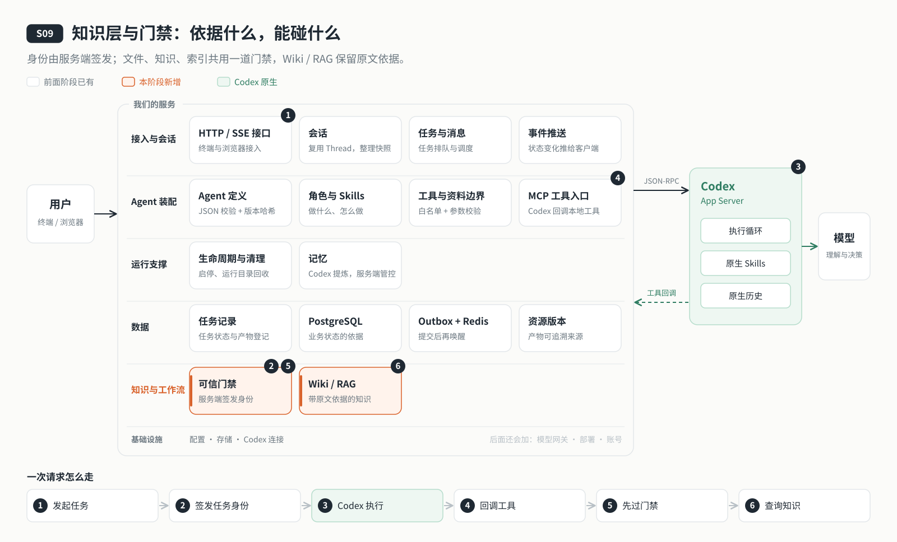

# s09: 知识层与门禁 — Agent 依据什么，能碰什么

[导论](../introduction.md) → [s00](../s00-sdk-quickstart/) → [s01](../s01-single-turn/) → [s02](../s02-multi-turn/) → [s03](../s03-service/) → [s04](../s04-events-messages/) → [s05](../s05-agent-assembly/) → [s06](../s06-tools/) → [s07](../s07-memory/) → [s08](../s08-data-layer/) → `s09` → [s10](../s10-skill-workflow/) → [s11](../s11-model-gateway/) → [s12](../s12-deploy/) → [s13](../s13-auth/README.md) → [app](../../app/)
> *"身份来自服务端签发的上下文，不来自工具参数"* — 文件、知识、索引，所有工具共用一道门禁；知识分层管理，每次更新都有版本。
>
> **对应六个问题**：④ 依据什么资料？ ⑥ 谁说了算？

---



## 要回答的问题

云端 Agent 对外提供服务，必须守得住两件事：每一次访问是以谁的名义、能碰什么；它依据的资料能不能组织成可靠的知识。具体来说：

1. **"我是谁"由谁说了算？** 如果工具参数里带 `userId`，模型完全可以写上 `"admin"`。如果每个工具各写一套权限检查，新增一个工具就可能漏掉。
2. **知识库之间的边界**：Agent 能读 `inputs/general`，不代表它能读另一个知识库的原文，也不代表它能用普通的 `write_file` 直接改 Wiki 文件。
3. **并发更新**：两个维护任务同时改同一页 Wiki，谁的版本生效？后提交的会不会悄悄覆盖前一个？
4. **索引切换**：重建 RAG 索引到一半失败了，查询不能落到一个半成品索引上。

---

## 核心概念

### 身份必须由服务端认定

这一章最重要的一句话：**模型能决定"调用哪个工具、传什么参数"，但不能决定"我是谁、我能碰什么"。**

所以身份不能从工具参数里来，必须由服务端在执行时确定。具体做法是：

- 工具调用改走 Codex 原生的 **dynamicTools** 回调。调用直接回到我们自己的进程里，并且带着它属于哪个 Thread、哪个 Turn。
- 每一轮开始时，门禁签发一份**可信上下文**（属于谁、哪个 Agent、本任务有什么授权），和这一轮绑定；轮次结束，上下文随即撤销。
- 工具实现从门禁那里取上下文，而不是从参数里取。伪造一个长得一样的对象也没用，它不在门禁签发过的集合里。

这和多用户系统的原则是一致的：每次请求都要按服务端认定的身份鉴权，不能只凭一个 threadId 就访问会话；工具调用也要带上可信的执行身份，由服务端决定可用的工具和文件范围。我们的云端 Agent 目前只服务一个用户，规矩先立好。

### 一道门禁，五项检查

所有对外部世界的访问（文件、知识、索引）都经过同一个 `PermissionGate`：

| 检查 | 依据 | 来源 |
|------|------|------|
| ① 上下文是真的 | 必须是门禁自己签发、还没撤销的对象 | 服务端，按 Thread / Turn 绑定 |
| ② 工具允许 | Agent 的 `tools.allow` | 配置 |
| ③ 资源归属 | 资源的 owner 等于上下文的 owner | 数据库里的归属，不是模型自称 |
| ④ 知识库挂载 | `agent.knowledge[]` 挂载了这个知识库，且允许本次操作 | 配置 |
| ⑤ 任务范围 | 提交 Wiki 只允许在针对这个知识库的维护任务里进行 | 服务端签发的任务上下文 |

任何一项不满足，就返回 `FORBIDDEN`。

### 知识分三层

| 层 | 是什么 | 怎么保证可靠 |
|----|-------|------------|
| 原始资料 | 用户放进来的文件 | 存成不可变快照，每个版本都能找回 |
| Wiki | 从原始资料整理出来的结构化页面 | 只引用原文的具体版本；用乐观锁更新，版本对不上就拒绝提交 |
| RAG（可选） | Chroma 向量检索 + BM25 关键词检索 | 新索引完整构建并校验后，才切换过去；失败就丢弃，旧索引不动 |

知识模式只在服务启动时确定。配置改成 RAG 但索引还没就绪，就仍按 Wiki 运行；已经生效的 RAG 不可用时直接报错，不会悄悄回退。

---

## 分工：Codex 做什么，我们做什么

| 事情 | Codex | 我们的程序 |
|------|-------|----------|
| 工具调用 | 模型决定调用哪个工具，Codex 通过 dynamicTools 把调用连同 Thread / Turn 交给我们 | 绑定这一轮的可信上下文，统一过门禁 |
| 沙箱 | 只读沙箱，原生 shell 与写文件关闭 | 所有读写都走我们自己的、受门禁保护的工具 |
| 知识 | 不管你的业务知识 | 原始资料快照、Wiki 版本、RAG 索引 |
| 检索结果 | 把工具结果交给模型去用 | 只返回门禁允许的知识库里的内容 |

到这一章，判定"能不能"的依据全部来自服务端：配置、数据库里的归属、服务端签发的任务上下文。

---

## 跑起来看看

**准备**（需要 Docker）：

```sh
cd stages/s09-knowledge-layer
npm ci
cp .env.example .env
# 编辑 .env：模型配置，以及
#   DATABASE_URL=postgresql://agent:<密码>@127.0.0.1:5432/agent_s09
#   REDIS_URL=redis://127.0.0.1:6379
#   AGENT_MEMORY_ENABLED=false        # 挂载知识库时必须关闭原生记忆
export AGENT_DB_PASSWORD=<与 DATABASE_URL 中相同的密码>
docker compose up -d postgres redis   # 与 s08 端口相同，不要同时启动两套
npm run data:migrate
npm run knowledge:init                # 建目录、部署 Skill，不生成知识
npm run server                        # 127.0.0.1:4315
```

**运行**（另一个终端）：

```sh
cp <你的资料>/*.md workspace/inputs/general/
npm run knowledge -- maintain general "阅读 inputs/general 下全部原始资料，整理为结构化 Wiki 页面"
npm run knowledge -- list
npm run knowledge -- read general <maintain 实际创建的 slug>
npm run knowledge -- search general <关键词>
```

试试门禁（`npm run chat` 后在普通对话里）：

1. `请直接提交一个 Wiki 页面`：普通对话没有维护任务的上下文，提交会被拒绝
2. `用 read_file 读取 research/general/wiki 下的页面`：Wiki 目录只能通过 `kb_read` 读取

**数据存在哪里**：原始资料在 `workspace/inputs/`，Wiki 页面的正文在 `workspace/research/<知识库>/wiki/`；每个版本、引用了哪些原文版本、当前生效的是哪个索引，都记在数据库里。

**离线实验**：

```sh
npm run lesson -- s09-gate     # 伪造上下文、外部 owner 被拒绝；旧 turn 结束后上下文失效
npm run lesson -- s09-mounts   # 另一个 KB 的路径、未挂载 KB、Wiki 路径写入都被拒绝
npm run lesson -- s09-modes    # RAG 未就绪仍是 Wiki；已生效的 RAG 不可用时报错不回退
```

`s09-wiki`、`s09-rag` 需要真实的临时 PostgreSQL / Redis（RAG 还需要 Chroma），用 `--integration` / `--rag` 显式开启。启用 RAG 的完整步骤、五层架构与限制见 [s09 设计说明](docs/design.md) 和 [知识层实现详解](docs/knowledge-implementation.md)。

---

## 关键代码

**工具调用和这一轮绑定**（[`server/main.mjs`](server/main.mjs)）。先确认这一轮确实在执行，再取出与它绑定的上下文：

```javascript
rpc.toolHandler = (params, context) => {
  if (sessions.getTurn(params.threadId, params.turnId)?.status !== "inProgress") throw new Error("工具请求不属于本服务正在执行的轮次。");
  return tools.registry.call(params, { ...context, ...(gate ? { permissionContext: gate.forTurn(params.threadId, params.turnId) } : {}) });
};
```

**上下文由门禁签发，从门禁取**（[`permissions/index.mjs`](server/modules/permissions/index.mjs)）。签发的上下文存在私有集合里；工具通过 `current()` 取，不认参数：

```javascript
issue(fields) {
  const context = Object.freeze({ ...fields, ownerId: this.scope.ownerId, agentId: this.agent.definition.agent.id });
  this.#contexts.add(context); return context;
}
current() {
  const state = this.#storage.getStore();
  const context = state?.context;
  state?.signal?.throwIfAborted();
  if (!context || !this.#contexts.has(context)) denied();
  this.agent.assertCurrent();
  // …任务上下文还要核对它仍属于这个会话当前的执行
  return context;
}
```

**Wiki 用乐观锁更新**（[`knowledge/index.mjs`](server/modules/knowledge/index.mjs)）。提交时带上读到的版本号，锁住页面后版本对不上就拒绝：

```javascript
const page = (await this.query('SELECT * FROM agent_data.wiki_pages WHERE instance_id=$1 AND kb_id=$3 AND slug=$4 AND $2::uuid IS NOT NULL FOR UPDATE', [kbId, slug], client)).rows[0];
if (page.current_version !== expectedVersion) fail('Wiki 已被其他更新修改，请读取最新版本。', 'VERSION_CONFLICT');
```

---

## 小结

- 身份由服务端认定：上下文由门禁签发、和轮次绑定、轮次结束即撤销，工具参数里的"我是管理员"不算数。
- 一道门禁覆盖所有访问，五项检查的依据全部来自服务端。
- 知识分三层：原始资料不可变，Wiki 有版本且防并发覆盖，RAG 完整就绪才切换。

---

## 延伸：让多个用户共用这个云端 Agent

我们做的云端 Agent 是"一个用户、一个 Agent 配置、多个会话"：所有会话共享同一个角色、同一套工具、同一个工作区和同一个 Codex 状态目录。要让多个用户共用，主链路要变成：

```text
请求 → 身份认证 → 权限检查 → 业务模块 → 这个用户的运行环境 → Codex + 工具
```

沿着这条链路，还要加上这些：

| 方面 | 还要加上什么 |
|------|------------|
| 认证 | 每个用户有自己的访问凭证，不再共用一个连接令牌 |
| 鉴权 | 不只看有没有服务令牌，还要看会话、操作是否属于当前用户 |
| 数据库 | 在任务、队列、资源版本之外，保存用户、凭证和会话归属 |
| Codex | 每个活跃用户一个独立进程，空闲时回收，下次从持久化状态恢复 |
| 文件与记忆 | 按服务端生成的用户 ID 分目录 |
| 工具 | 按用户权限过滤，调用时再检查一次 |

本章立下的规矩（身份由服务端认定、每次访问都过门禁）就是多用户的地基。在它上面还要补两块：

- **认证**：账号密码、邮箱、手机短信、第三方账号、企业 SSO、Passkey 都是登录方式；Cookie、Token、JWT 则是登录成功后维持身份的机制。可以接托管认证服务（如 Clerk、Auth0），可以自托管身份系统（如 Keycloak），小系统也可以用成熟的认证库自己管。不管哪种，最后都要把外部身份映射成项目内部的用户 ID，再挂上账号状态、会话归属、工具权限和配额。
- **权限模型**：ACL 在资源上挂一张"谁能做什么"的名单；RBAC 按角色分配权限；ReBAC 按用户与对象之间的关系判断；ABAC 按用户、资源、请求的属性判断；规则经常变化、需要多个系统统一遵守时，可以用独立的策略引擎（PBAC）。概念对比见 [OpenFGA 的说明](https://openfga.dev/docs/authorization-concepts)。

账号与令牌设计、MCP 执行授权、资源归属等完整设计见 [多用户方案](docs/multi-user-upgrade-plan.md)。

---

## 多用户时会怎样

本章的知识库增加 `visibility`，新建及已有知识库默认是 `private`，也可记录 `system`。多用户时，知识库会按个人与系统可见性组织，并由统一门禁结合用户身份、挂载关系和动作权限判定访问。当前即使记录为 `system`，仍按 owner 判定，不会向其他用户开放。身份、隔离和资源共享分别见 s13 账号与认证、s14 用户隔离、s15 权限与资源 Hub。

## 下一章

云端 Agent 守得住了，也能维护知识库了。可真实的工作往往是多步的：写一篇文章要先定大纲、等你确认，再去研究和成稿；维护知识库需要额外的写权限，而且只该在那一次任务里有效。它要干的活也不止一种，每加一类活就改一次代码，显然不行。

[s10 Skill 与 Workflow](../s10-skill-workflow/) → 把"一类任务"抽象成 Workflow：本任务额外的授权、注入哪个 Skill、做完检查什么、哪里停下来等人确认。怎么做仍交给模型，Workflow 会不会把 Agent 变成一条脚本流水线？
