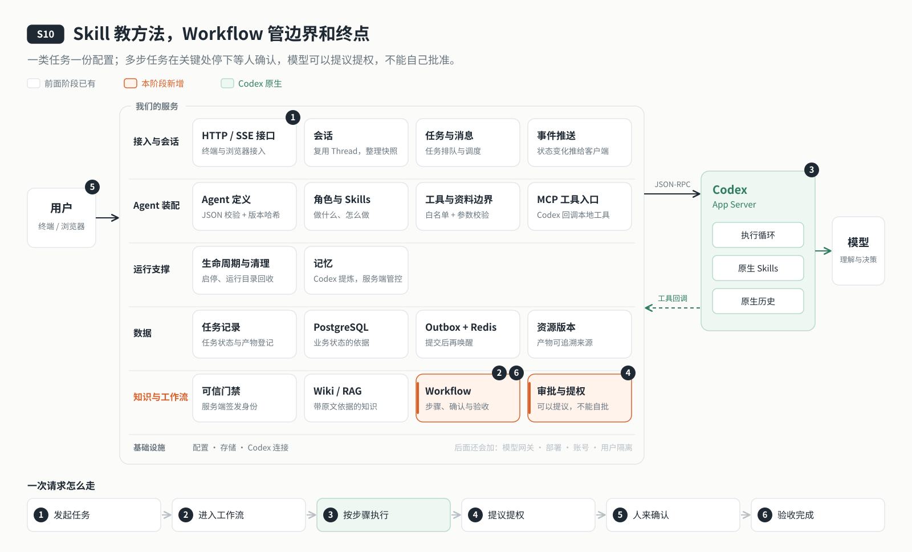

# s10: Skill 与 Workflow — Skill 教方法，Workflow 管边界和终点

[导论](../introduction.md) → [s00](../s00-sdk-quickstart/) → [s01](../s01-single-turn/) → [s02](../s02-multi-turn/) → [s03](../s03-service/) → [s04](../s04-events-messages/) → [s05](../s05-agent-assembly/) → [s06](../s06-tools/) → [s07](../s07-memory/) → [s08](../s08-data-layer/) → [s09](../s09-knowledge-layer/) → `s10` → [s11](../s11-model-gateway/) → [s12](../s12-deploy/) → [s13](../s13-auth/README.md) → [s14](../s14-isolation/README.md) → [app](../../app/)
> *"可以提议，不能自批"* — 判断要不要做，交给模型；给不给权限，留在模型之外。
>
> **对应六个问题**：② 要做什么，做到什么算完？ ⑤ 能用什么？ ⑥ 谁说了算？

---



## 要回答的问题

云端 Agent 要真正会干活。我们的写作 Agent 要干的活不止一种：写文章、维护知识库，以后还会更多。每一类活都有自己的步骤、权限和验收：写文章要先定大纲，等你确认后再研究和成稿；维护知识库需要额外的写权限，但只该在这一次任务里有效。

如果这些都只写在角色提示词里，"理解观点 → 研究 → 大纲 → 初稿 → 核查 → 润色 → 定稿"就只是一段建议：模型跳了步，服务端不知道；你想先看大纲再决定，没有地方停下来；做完了，也没法判断算不算完成。每加一类活就改一次代码，也不现实。

所以这一章要回答：

1. **方法放在哪？** 写作规范、维护知识库的步骤，应该写进角色提示词，还是单独放？
2. **一类任务怎么定义？** 加一种新任务，能不能只改配置、不改代码？
3. **多步任务怎么管？** 哪里必须停下来等人拍板，做完怎么验收？
4. **模型想做一件超出当前权限的事，怎么办？** 它能不能自己批准自己？

---

## 核心概念

### Skill：教 Agent 怎么做

Skill 是一份方法说明：怎么写文章、怎么维护知识库、按什么规范、用什么模板。Codex 原生就能发现和调用 Skill。官方在谈集成协议时也提到，Skill 正在成为一种跨厂商的通用标准（见 [agentskills.io](https://agentskills.io/home)）。

但 Skill **只教方法，不给权限**。它也不能放在工作区里：工作区是用户和模型读写的数据，受信的配置不该放在那里。所以 Skill 跟着 Agent 包走，启动时同步到 Codex 的状态目录。另外，我们关掉了原生 shell，模型看得到技能清单却打不开 SKILL.md，所以再给它一个只读的 `skill_read` 工具。

### Workflow：管边界和终点，不管路径

Workflow 定义"一类任务"：本任务额外给什么授权、注入哪个 Skill、能往哪里写、做完检查什么、哪里停下来等人确认。

**它只管边界和终点，不管路径。** 怎么拆解、先查什么、调哪些工具、调几次，仍由 Codex 的执行循环决定。为了不把 Workflow 写成脚本流水线，定了四条规则：

1. 只在**权限要变**或**必须由人拍板**的地方切步骤，不按"怎么做"切。
2. Workflow 只写目标、边界、验收；方法写进 Skill，只作参考。
3. 验收只看结果，不检查调用过哪些工具、按什么顺序。
4. 确认点从严："写文章"只在大纲之后停一次。

### 三件事分开放

| 层 | 回答什么 | 谁定义 | 能否授权 | 放在哪里 |
|----|---------|-------|---------|---------|
| Skill | 怎么做：方法、规范、模板 | 部署者，跟着 Agent 包 | **不能** | `agents/<id>/skills/`，启动时同步到 `CODEX_HOME` |
| Workflow | 本任务的授权、Skill、写入位置、验收、确认点 | 部署者，只能组合代码提供的积木 | 能，只在本任务有效 | `agent.json` 的 `workflows` |
| Workspace | 数据放在哪 | 用户与模型（受资源规则约束） | — | `bindings.workspaceDir` |

### 可以提议，不能自批

普通对话里，模型发现"这件事需要维护知识库"，但它当前没有改 Wiki 的权限。它可以用 `propose_task` **提议**一个任务；提议只会被记下来，等用户确认时，服务端才以**用户的身份**核对授权并执行。模型永远不能批准自己的提议。

### 关掉会绕过边界的原生能力

有两项 Codex 原生能力会绕过我们的边界：工作区及其上级目录的 `AGENTS.md` 会进入模型上下文；原生的"线程目标"一旦设置，会绕过任务队列自动连续发起轮次。受限启动把这两项都关掉，并在启动后核对配置确实生效。

---

## 分工：Codex 做什么，我们做什么

| 事情 | Codex | 我们的程序 |
|------|-------|----------|
| Skill | 发现 Skill，在执行中使用 | Skill 跟着 Agent 包走，启动时同步；`skill_read` 只读白名单文件 |
| 任务怎么做 | 执行循环：拆解、研究、调工具、写作 | 不干涉，只给目标和边界 |
| 任务的边界 | — | Workflow 的授权只在本任务有效，`writes` 只能收窄写入位置 |
| 做到什么算完 | 给出每一轮的终态 | 按 Workflow 的验收检查结果，不通过记为 `needs-review` |
| 何时停下来问人 | — | 确认点停在 `waiting`，用户 `/confirm` 后继续 |
| 提议与批准 | 模型可以提议 | 只有用户能批准，批准时以用户身份核对授权 |

维护知识库就是 `agent.json` 里的一条声明 `{ "id": "knowledge-maintain" }`。再加一类任务，改的是 `agent.json`，不是代码；只有需要新的授权类型或验收检查时，才需要写代码。

---

## 跑起来看看

**准备**（与 s09 相同，需要 PostgreSQL / Redis 和模型配置；本阶段端口 4316）：

```sh
cd stages/s10-skill-workflow
npm ci
cp .env.example .env    # 填入模型配置、DATABASE_URL、REDIS_URL
npm run data:migrate
npm run agent:init && npm run knowledge:init
npm run server          # 另开终端：npm run chat
```

试试这些输入：

1. `/workflow` → 列出当前 Agent 启用的工作流。
2. `/workflow write-article 写一篇关于社区咖啡馆的文章` → 大纲存进 `drafts/` 后停下。输入 `/confirm 第二部分多写案例`，看第 2 步怎么接着做、结束时报告的验收结果。
3. 普通对话里说"把 inputs/general 里的新资料整理进知识库" → Agent 直接改 Wiki 会被拒绝，它会提议 `knowledge-maintain`。`/confirm` 执行，或 `/reject` 忽略。
4. 复制一个 Agent 包：`cp -r agents/writing agents/mine`，改 `agent.json` 的 `id` 和 `role.md`，再用 `AGENT_DEFINITION=agents/mine/agent.json npm run check` 检查。

**这次运行多了什么**：Agent 包 `agents/writing/` 里的 Skill 被同步到 `.data/codex/skills/`；写文章的大纲出现在 `workspace/drafts/`，定稿在 `workspace/outputs/`；任务的步骤、状态和验收结果记在数据库里。

观察重点：第 2 步里，模型研究、写作、核查的顺序是谁决定的？第 3 步里，提议之后、确认之前，知识库有没有变化？

**离线实验**（不调用模型）：

```sh
npm run lesson -- list
npm run lesson -- s10-propose   # 提议只记录为 proposed，确认时才授权
npm run lesson -- s10-steps     # 停在确认点时普通对话照常执行
```

设计取舍、实施顺序与验证记录见 [s10 设计说明](docs/design.md) 和 [Skill 与 Workflow 设计](docs/skill-workflow-design.md)。

---

## 关键代码

**在 `agent.json` 里声明 Workflow**。只写 `id` 是启用内置的，带其他字段的是自定义组合。"写文章"分两步，第 1 步只能写 `drafts/`，做完停下来等确认：

```json
"workflows": [
  { "id": "knowledge-maintain" },
  { "id": "write-article", "label": "写文章", "skill": "write-article", "steps": [
    { "id": "outline", "goal": "理解用户观点，确定立意与大纲，保存到 drafts/ 并请用户确认", "writes": ["drafts"], "confirm": true },
    { "id": "final", "goal": "按确认的大纲完成研究、写作、事实核查和润色，定稿保存到 outputs/",
      "writes": ["research", "drafts", "outputs"], "checks": ["file-exists", "format"] } ] }
]
```

**一步结束后只看结果决定去向**（[`messages/index.mjs`](server/modules/messages/index.mjs)）。验收不通过记为 `needs-review`；还有下一步时，要么停在 `waiting` 等确认，要么直接排队：

```javascript
if (!checksPassed(step.checks, checks)) return { status: "needs-review", checks };
if (step.index < step.total - 1) return step.confirm ? { status: "waiting", checks } : { status: "queued", step: step.index + 1, checks };
return { status: "completed", checks };
```

**提议只是记录，确认时才授权**。`propose_task` 只能把任务记为 `proposed`；用户确认时，才在用户身份下核对 Workflow 需要的授权：

```javascript
if (job.status === "proposed") {
  const workflow = this.resolve({ id: job.workflow, params: job.params ?? null });
  if (workflow.grants.length) this.gate?.authorize(workflow.grants);
}
```

---

## 小结

- Skill 教方法，不给权限；它跟着 Agent 包走，不放在工作区里。
- Workflow 管边界和终点，不管路径：授权、写入位置、验收、确认点由服务端执行，怎么做仍交给模型。
- 模型可以提议，不能自批。
- 新增一类任务，改的是配置，不是代码。

---

## 延伸：多 Agent 与多主机

我们的云端 Agent 是"一个 Agent 服务多个会话"。再往前走，还有两个方向。

**多 Agent**：一个用户拥有多个 Agent，Agent 之间还要协作，比如一个研究 Agent 同时调查两个市场：

```text
研究 Agent
    ├─ 执行任务 A：调查新能源汽车市场
    │    ├─ 调用网页读取工具
    │    └─ 保存研究结果
    └─ 执行任务 B：调查机器人市场
         ├─ 调用网页读取工具
         └─ 保存研究结果
```

先分清三个概念：

| 概念 | 是什么 | 例子 |
|------|-------|------|
| Agent | 一套可以复用的身份、指令、工具和权限配置 | 研究 Agent |
| 任务执行（Run） | 这个 Agent 为某个任务工作的一次过程 | 调查新能源汽车市场、调查机器人市场，是两次 Run |
| 运行实例（Runtime） | 承载执行的进程、容器或沙箱 | 运行 Codex 的进程，以及它能用的文件目录 |

**Agent 不等于进程**：Agent 是长期的配置与身份，运行实例是它执行一次任务时按需启动的对象。多 Agent 要额外回答：记忆和文件哪些私有、哪些共享、哪些只在本次任务有效；一个 Agent 能不能把任务委派给另一个 Agent，能传哪些资料；接到委派的 Agent 能用哪些工具、碰哪些资源；委派任务的超时、失败、重试、取消和费用上限怎么处理。这些都是 s10"可以提议，不能自批"原则的延续。官方提到，Codex 桌面应用就需要并行编排多个 Codex 智能体，这也是 App Server 被做成平台接口的原因之一。

**多主机**：一台机器装不下时，就要做分布式执行调度：节点注册与心跳、会话路由到哪台机器、任务租约、节点故障后由别的节点接管、跨节点传递事件。官方的 Codex Web 就是这样运行的：工作节点为每个任务准备一个容器，在里面启动 App Server，浏览器经后端看到流式事件。官方还计划让终端界面也能连接远程机器上的 App Server，让智能体在笔记本休眠或断线时继续运行。

---

## 多用户时会怎样

本章的 Skill 包和 Workflow 会在多用户时扩展为可按用户装配、按资源范围执行的任务能力。Skill 的 `scope` 当前只记录 `system`，工具组 scope 和知识库 visibility 也只作为资源元数据，Workflow 的授权方式保持不变。后续资源 Hub 会集中管理这些范围，Skill 的使用本身仍不授予工具或知识库权限。具体见 s13 账号与认证、s14 用户隔离、s15 权限与资源 Hub。

## 下一章

到这里，云端 Agent 能聊、能干活、靠得住、守得住，还能按流程完成多步任务。可它从头到尾只直连一家模型：`.env` 里一个 API Key、一个模型名。线上的 Agent 不可能这样跑：对话、向量、生图各要各的模型，一家余额用完服务就停，每一轮花了多少钱也没人知道。

[s11 模型网关](../s11-model-gateway/) → Codex 只连一个网关，网关替它统一协议、协调多个模型，我们再记下每一轮的用量、超预算就停派新任务。为什么"选哪个模型"要自己写，而"出错时改用谁"交给网关？

还有两个问题留在 [app](../../app/README.md) 里继续做：模型会不会主动去读 Skill，需要用真实模型评估；一个任务要跨很多轮才能做完时，Codex 原生的线程目标能自主推进，但它会绕过任务队列，接入任务与门禁之后才能打开。
