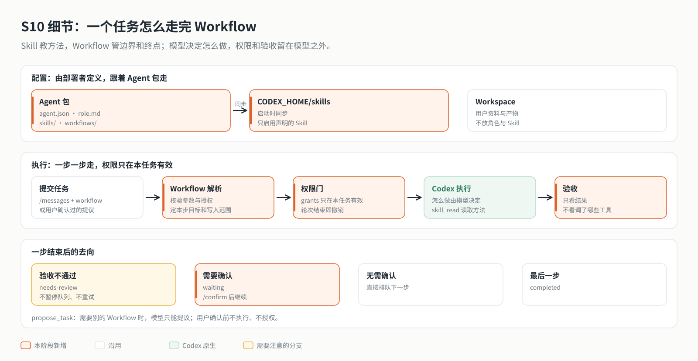

# s10 设计说明：Skill 与 Workflow

> 本文是设计说明，供深入阅读。章节入门（要回答的问题 → 核心概念 → 分工 → 跑起来看看 → 关键代码）见 [README](../README.md)。Skill 安装、Workflow 权限与验证边界见 [Skill 与 Workflow 设计](skill-workflow-design.md)。

在 s09 的知识层与通用门禁之上，把"一类任务"抽象成 Workflow，把 Skill 从工作区移进 Agent 包。服务监听 `127.0.0.1:4316`。本阶段快照取自 2026-10-31 的 `app/`，因此也包含 s09 之后陆续加入的配置选择、会话升级、协议兼容检查和流式推送协议 v2；本章只讲 Skill 与 Workflow。



---

## 设计原理

s09 证明了"维护知识库"可以作为一种受限的任务来运行，但它是一个特例：入口、授权、Skill 注入各写各的。s10 把这个特例推广开，同时守住两条底线。

**1. 自主性不被流程吃掉**：Codex 的执行循环决定怎么做；Workflow 只规定边界（本任务额外的授权、可写的位置）和终点（验收）。默认的 `chat` 完全不设限。

**2. 权限只来自受信配置**：Agent 定义（角色、Skill、Workflow）放在 Agent 包里，工作区里的任何文件都不能改变它；模型可以提议任务，但不能批准自己的提议。

**设计要点：**

- **Skill 不授权**：Skill 被注入、被读取、被提及，都不改变任何权限。
- **积木由代码提供**：授权类型（`knowledge.update`）和验收检查（`file-exists`、`format`、`sources-cited`、`wiki-effective`）在代码里定义；Agent 包只能组合，越权在启动时报错。
- **步骤从严**：只在权限要变或必须由人拍板的地方切步骤；验收只看结果。
- **原生能力按需收紧**：关闭会绕过任务队列的原生线程目标，不加载工作区里的 `AGENTS.md`。

## 架构改进

| 区 | 内容 | 谁能改 | s10 的变化 |
|----|------|-------|-----------|
| 代码区 | 工具、授权类型、验收检查、内置 Workflow | 开发者，走 PR | 新增 `server/modules/workflows/`、`skill_read`、`propose_task` |
| Agent 包 | `agent.json`、`role.md`、`skills/` | 部署者 | 定义升级到 `schemaVersion: "1.2"`，新增 `agent.workflows` |
| 工作区 | 用户资料、过程文件、交付物、Wiki | 用户与模型 | 不再放 Skill，不加载 `AGENTS.md`，不能包含服务目录 |
| 运行状态区 | `.data/`（含 `CODEX_HOME`）、`.runs/` | 服务 | Skill 在启动时同步到 `CODEX_HOME/skills/<id>/` |

任务表经过三次迁移：`003` 新增 `workflow`、`params`、`checks` 与 `needs-review`；`004` 新增 `step`、`note` 与 `waiting`、`cancelled`；`005` 新增 `reason` 与 `proposed`。

### 定义字段与状态位置

`agent.skills[].scope` 可选且仅允许 `system`，缺省补为 `system`；装配后的 Skill 与描述符记录有效 scope，不参与授权。

`config/tools/*.json` 的工具组 `scope` 可选且仅允许 `system`，缺省为 `system`；`GET /tools` 保留 `tools` 并新增 `groups`（配置相对路径 `id`、`scope`、已获准工具名 `tools`），授权仍由原白名单与门禁决定。

`knowledge_bases.visibility` 由新增迁移保存为非空 text，缺省 `private`，仅允许 `private` / `system`；列表返回 visibility，查询与门禁仍按 owner 判定。

## 技术实现流程

1. **启动**：校验 Agent 定义 → 解析 Workflow（越权即报错）→ 同步 Skill 到 `CODEX_HOME` → 启动 Codex，核对 `goals` 关闭、`project_doc_max_bytes` 为 0 → `verifySkills` 只启用声明的 Skill。
2. **提交**：`/messages` 带 `workflow` 与 `params` → 参数校验、计算授权 → 在用户身份下 `gate.authorize` → 入队，`step = 0`。
3. **派发**：任务说明 + 用户原文 + Workflow 指定的 Skill → `gate.start(job, grants, writes)` → `turn/start`。
4. **执行**：Codex 自主完成本步；需要时用 `skill_read` 读取 Skill，用 `propose_task` 提议别的 Workflow。
5. **收尾**：运行本步验收 → `needs-review` / `waiting` / 排队下一步 / `completed`；权限门在轮次结束时撤销上下文。
6. **确认**：`/tasks/confirm` 让 `waiting` 进入下一步，或让 `proposed` 在用户身份下授权后排队；`/tasks/cancel` 结束。

## 核心代码

以下为伪代码，真实实现见 `server/modules/workflows/index.mjs` 与 `server/modules/messages/index.mjs`。

```text
resolve(id, params):
  workflow = 已启用的 workflows[id] 或 拒绝（403）
  校验 params（只允许扁平字符串字段）
  grants = workflow.grants 按 params 落到具体知识库
  每个 grant 必须在 Agent 的能力之内，否则拒绝（403）
  return { id, skill, params, grants, steps 或 checks }

dispatch(job):
  workflow = resolve(job.workflow, job.params)
  step = workflow 的第 job.step 步
  input = [任务说明(workflow, step)] + (step == 0 ? 原文 : "用户已确认") + 补充说明 + [Skill(workflow.skill)]
  gate.start(job, workflow.grants, step.writes)
  turn/start(input)

on turn/completed(job, turn):
  if turn 不是 completed: 按原规则失败或中断
  checks = 验收(step.checks, turn.artifacts, turn.revisions)
  if 有检查没通过: needs-review
  else if 还有下一步: step.confirm ? waiting : 排队下一步
  else: completed

propose(context, workflow, params, text, reason):
  resolve(workflow, params)            # 只校验，不授权
  记录为 proposed                      # 不排队、不唤醒调度
confirm(task):
  if task 是 proposed: 在用户身份下 gate.authorize(grants)
  排队（proposed）或进入下一步（waiting）
```

## 验证

在本章目录运行：

```bash
npm test                  # 离线单元测试，不调用真实模型
npm run test:codex-tools  # 真实本地 Codex 与模拟 Responses
npm run test:data         # 真实临时 PostgreSQL / Redis 与本地 Codex
```

`test:data` 需要 PATH 中可用的 `initdb`、`pg_ctl`、`redis-server`；集成测试使用本地模拟 Responses，不代表真实模型会主动发现和读取 Skill。

配置真实依赖并启动服务后，按 README「跑起来看看」操作 `/workflow write-article`、`/confirm` 与 `/reject`：观察确认点之前的暂停、补充说明进入后续步骤，以及知识维护提议在确认前不产生写入。用 `npm run check` 核对自定义 Agent 包配置；任务步骤、状态与验收结果在数据库中核对。

## 限制说明

- **隐式触发的效果未经真实模型评估**：`skill_read` 证明模型能读到 Skill，不证明它会主动去读。角色提示词保留方法说明。
- **线程目标暂时关闭**：原生目标能让 Codex 跨轮次自主推进，但自动发起的轮次不经过任务队列和权限门。接入之前保持关闭。
- **提议需要数据层**：`propose_task` 依赖权限门提供的会话身份，只在 PostgreSQL 模式下可用。
- **Web 工作台与互动课程**：本阶段没有接入工作台和课程；工作台的多步与提议操作在 `app/` 中可用。

## 机制实验

在本章目录运行 `npm run lesson -- list` 查看实验。离线断言使用测试夹具，不代表真实模型或外部服务验收；依赖与边界见 [实验说明](../lessons/README.md)。


表中未标记集成验证的项目为离线实验；集成项目需显式启用相应参数。

| 命令 | 验证内容 |
| --- | --- |
| `npm run lesson -- s10-package` | Skill 目录只能有 SKILL.md 与 references/ 下的文本，脚本、链接被拒绝；角色和 Skill 落在工作区里时启动失败；新增参考文件也会改变指纹、触发撤销 |
| `npm run lesson -- s10-declare` | 引用未声明的 Skill、申请没有 update 权限的知识库、授权引用非必填参数都在启动时报错；没有声明 workflows 的旧定义按原行为隐式启用知识维护 |
| `npm run lesson -- s10-dispatch` | 任务说明放在用户原文之前，Skill 按 id 注入，原文不变；知识维护没有生效的修订时记为 needs-review，不暂停队列；追加消息不能更换 workflow；同一消息 ID 换 workflow 返回 409 |
| `npm run lesson -- s10-steps` | 第 1 步结束后进入 waiting，期间普通对话照常执行；确认的补充说明进入第 2 步输入，第 2 步不重发原文；每一步把自己的写入范围交给权限门；可以结束等待中的任务 |
| `npm run lesson -- s10-propose` | 提议只记录为 proposed，不排队、不授权、不执行；用户确认时才在用户身份下核对授权，补充说明进入输入；没有权限门提供的会话身份时不能提议；每个会话最多 3 个待确认提议 |
| `npm run lesson -- s10-skill-read` | 只能读已核验启用的 Skill；文件限于 SKILL.md 与 references/ 白名单，路径穿越被拒绝 |
| `npm run lesson -- s10-codex --integration` | 集成验证（默认不运行）：Agent 包里的 Skill 同步到 CODEX_HOME 后注入，工作区里的 Skill 被关闭；自定义 workflow 的任务说明与 Skill 进入模型请求，按真实写入结果验收；两步写文章停在确认点，确认后完成；模型可以按技能清单读取 Skill |
| `npm run lesson -- s10-e2e --integration` | 集成验证（默认不运行）：普通对话直接提交 Wiki 修订被权限门拒绝；提议带理由入库，知识库没有被改动；用户确认后按 knowledge-maintain 授权执行，修订生效并通过验收 |
