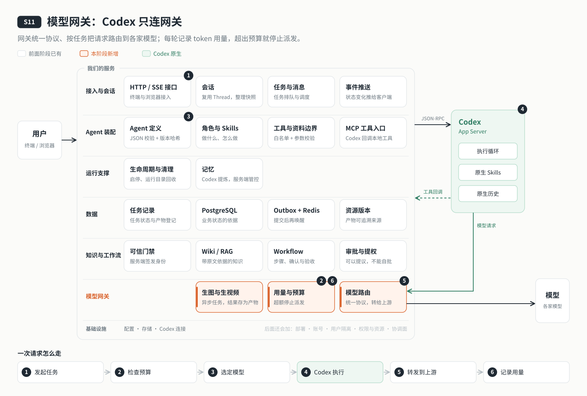

# s11: 模型网关 — Codex 只连网关，网关替它对接各家模型

[导论](../introduction.md) → [s00](../s00-sdk-quickstart/) → [s01](../s01-single-turn/) → [s02](../s02-multi-turn/) → [s03](../s03-service/) → [s04](../s04-events-messages/) → [s05](../s05-agent-assembly/) → [s06](../s06-tools/) → [s07](../s07-memory/) → [s08](../s08-data-layer/) → [s09](../s09-knowledge-layer/) → [s10](../s10-skill-workflow/) → `s11` → [app](../../app/)
> *"Codex 只认一个地址，换模型、加模型、管花费都在网关这一层"* — 线上的 Agent 不可能只跑一个模型：协议要统一，模型要协调，token 和花费要管住。
>
> **对应六个问题**：⑤ 能用什么？ ⑥ 谁说了算？

---



## 要回答的问题

到 s10 为止，我们的云端 Agent 直连一家模型：`.env` 里一个 API Key、一个 Base URL、一个模型名。讲原理够用了，但要长期在线服务，直连马上不够：

1. **一个模型不够用**：对话、向量（RAG）、生图、生视频，各要各的模型；就算都是语言模型，也各有所长，有的快而便宜，有的更强，有的上下文更长、能看图。
2. **各家协议不一样**：Codex 只说 OpenAI 的 Responses 接口。有的模型原生支持，有的只有 Chat Completions，智谱这类只有 Claude 格式。
3. **模型自带的能力怎么用上**：Kimi 自带联网搜索，怎么让 Codex 用上它？不支持的模型怎么办？
4. **一家出问题，整个服务就停**：余额用完、限流、宕机，都不该让 Agent 停摆。
5. **密钥交给了谁**：直连时，模型的 API Key 交给了 Codex。接了好几家以后，密钥放在哪里才安全？
6. **花了多少，谁来刹车**：每一轮用了多少 token、花了多少钱？超出预算时，谁来让它停下？

所以从 s11 开始，所有模型调用都经过一层**模型网关**。

---

## 核心概念

### 模型网关是什么

模型网关是夹在 Codex 和各家模型之间的一层服务。

- Codex 只连它一个地址，只拿一把网关访问密钥；
- 各家模型的密钥只交给网关；
- 网关负责把 Codex 的请求转成各家的协议、出错时改用备用模型、按 token 限流。

本项目用开源网关 [Bifrost](https://github.com/maximhq/bifrost)，作为一个容器运行。协议转换、备用切换、限流计数这些是通用的基础设施，交给成熟的开源项目；**"这一步该用哪个模型""这个 Agent 花了多少"这类和业务有关的判断，由我们自己写**，因为网关看不到任务的含义。

模型网关有三层作用，下面逐层讲。

### 第一层：统一协议，用上模型自带的能力

所有模型都登记在一份清单 `config/models.json` 里：

- `providers`：每家服务商的接口类型（openai、anthropic、deepseek……）、地址、密钥变量名；
- `models`：每个模型能做什么、上下文多长、能不能看图、自带哪些能力、价格。

Codex 永远只说 Responses 接口，网关按清单里的接口类型替它翻译：支持 Responses 的原样转发，只有 Chat Completions 的转成对话接口，Claude 格式的转成 Messages 接口。对 Codex 来说，换一家模型只是换一个模型名。

**模型自带的能力**也通过这套协议用上。以联网搜索为例：清单里给支持的模型写上 `"nativeTools": ["web_search"]`，服务启动时，默认模型支持就让 Codex 打开联网搜索，Codex 会在请求里带上搜索工具，网关把它交给模型自己去搜。这里有两个要点：

- **只能按会话开关**：Codex 只在开会话、恢复会话时接受配置，单轮不行。所以搜索开着的时候，路由给每一轮挑模型都会自动加上"要支持联网搜索"这个条件；场景里的候选都不支持时，启动时就报错。
- **协议统一不等于行为统一**：实测发现，Kimi 只有在请求格式和 Codex 发的完全一样时才会去搜；同样是搜索工具，DeepSeek 和 GLM 收到后不报错，但会直接忽略。所以清单里的能力声明以实测为准，项目提供了 `npm run gateway:check -- --search`，用和 Codex 一样的请求逐个模型实测。

### 第二层：协调多个模型

**挑模型看四件事：**

1. **用途**：对话、向量、重排序、生图、生视频、语音合成、语音识别。清单里每个模型写明它能做哪些用途；`routes` 按优先顺序列出每种用途的候选，第一个服务商已启用的就是默认。
2. **场景**：`scenes` 给一组候选起个名字，比如 `fast`（快而便宜）、`strong`（更强）。一个场景可以同时放对话、生图、生视频的模型，挑的时候先按用途过滤。写作 Agent 的"写文章"就是这么配的：定大纲用 fast，成稿用 strong；生图、生视频工具也可以选 `quality: "fast"` 或 `"strong"`。
3. **能力**：工作流步骤可以声明它需要什么（`needs`）：要看图、要多长的上下文。联网搜索开着时，每一轮还自动要求"支持联网搜索"。不满足的候选直接跳过；全都不满足时，报错说明每个候选为什么不行。
4. **推理档位**：步骤可以写 `effort`（如 `high`），只能是选中模型声明支持的档位。

**谁来指定**：工作流步骤写的 > 用户给这个任务指定的（终端里 `/model strong`，之后发的消息都用它）> 默认路由。每一轮实际用了哪个模型、为什么选它（比如"步骤指定：场景 strong""任务指定""默认路由"），都记在任务上，终端在这一轮开始时会显示出来。路由不再是个黑箱。

**策略协调：快超预算时自动降级**。设了 `AGENT_BUDGET_DOWNGRADE_AT=0.8`，今天或本月的用量到了预算的 80%，没有写死具体模型的任务就改用 `fast` 场景（可用 `AGENT_BUDGET_DOWNGRADE_SCENE` 换），来源记为"预算降级"。到 100% 才停派新任务。

**备用链**：每个模型可以写 `fallbacks`。主模型余额不足、限流、出故障时，网关自动改用下一个。注意分工：**"出错时改用谁"由网关在请求层面决定，"这一步该用哪个模型"由我们的路由决定。** 备用模型的能力可能不如主模型，比如 Kimi 会联网搜索，它的备用 DeepSeek 不会，切过去那一轮就没有搜索；服务启动时会把这类情况逐条提醒出来。

除了对话，其他用途也走同一个网关：

- **向量**：知识库的 RAG 经网关调用本地部署的 Ollama 向量模型，不花钱，也不出本机；
- **生图、生视频**：经网关调用火山方舟的 Seedream、Seedance。生视频要跑好几分钟，所以工具立即返回任务编号，由服务端在后台跟进，做完存进工作区。

### 第三层：管住 token 和花费

- **账本**：Codex 每次请求模型后都会上报用量（输入、缓存命中、输出、推理）。我们把它和这一轮属于哪个任务、实际用的哪个模型一起记进数据库。向量、生图、生视频的用量同样记账。
- **价格表**：清单里给模型填单价，用来估算花费。
- **预算**：设每日、每月的 token 或金额上限。超了就**停派新任务**：排队的任务留在队列里并说明原因，额度恢复后自动继续；正在执行的那一轮让它做完，不在半路打断。
- **网关兜底**：网关的访问密钥上再加一道按 token 计的每日限流。我们的预算出了问题，网关这一层也会拦住。

---

## 分工：Codex 做什么，我们做什么

这一章多了一个角色：网关。

| 事情 | Codex | 网关（Bifrost） | 我们的程序 |
|------|-------|---------------|----------|
| 协议 | 只说 Responses | 转成各家的协议 | 清单里写明每家的接口类型 |
| 密钥 | 只拿网关访问密钥 | 持有各家密钥 | 生成网关配置（不含密钥），启动 Codex 前去掉各家密钥 |
| 模型自带能力 | 按配置带上搜索工具 | 交给模型执行 | 按实测声明能力，按默认模型开关，自检 |
| 选模型 | 每轮用我们给的模型名和推理档位 | 出错时按备用链改用 | 按用途、场景、能力挑模型；步骤 > 任务 > 默认；记下选择来源；快超预算时降级 |
| 向量、生图、生视频 | — | 转发到对应服务商 | 工具层调用、保存产物、跟进视频任务 |
| 用量 | 每次请求后上报 | 按 token 限流兜底 | 记账、估算花费、超预算停派 |

---

## 跑起来看看

**准备**（需要 Docker：网关、数据库、Redis 都在容器里）：

```sh
cd stages/s11-model-gateway
npm ci
cp .env.example .env
# 编辑 .env：至少填一家模型的密钥（如 KIMI_API_KEY、DEEPSEEK_API_KEY），
#   CODEX_MODEL 写成“服务商/模型名”（如 deepseek/deepseek-flash），以及 AGENT_DB_PASSWORD
npm run gateway:key      # 生成网关访问密钥 AGENT_GATEWAY_KEY（sk-bf- 开头），写进 .env
npm run gateway:up       # 按模型清单生成网关配置，启动网关容器
npm run db:up            # PostgreSQL 与 Redis
npm run data:migrate && npm run agent:init
```

**先实测网关**：逐个模型发一次很短的对话；加 `--search` 再测一次联网搜索。会产生少量真实用量：

```sh
npm run gateway:check -- --search
```

**运行**（两个终端）：

```sh
npm run server           # 终端 1：127.0.0.1:4318，启动日志里能看到默认模型、是否开启联网搜索
npm run chat             # 终端 2
```

试试这些：

1. 默认模型声明了联网搜索时，问一个必须联网才能答的问题，比如“今天有什么国际新闻”；再把 `CODEX_MODEL` 换成不支持搜索的模型，重启服务，同样的问题它会说明自己没法搜索。
2. 输入 `/model` 看有哪些模型和场景、各用途现在默认用谁；输入 `/model strong` 后再发一条消息，终端会显示"模型：xxx（任务指定：场景 strong）"；`/model default` 恢复默认。
3. 用 `/workflow write-article 写一篇……` 写文章：定大纲那一步显示场景 fast 选中的模型，确认后成稿那一步换成场景 strong 选中的模型。
4. 聊几轮后输入 `/usage`，看今天用了多少 token，按模型、按来源怎么分。
5. 在 `.env` 里设 `AGENT_BUDGET_DAILY_TOKENS=1`，重启服务后连发两条消息：第一条照常执行（之前还没用量），第二条会停在队列里，原因写明“今日 token 已用 X，上限 1”。
6. 可选：`npm run ollama:up && npm run ollama:pull` 启用本地向量模型，知识库的 RAG 就经网关调用它；在火山方舟开通 Seedream / Seedance 并填上 `ARK_API_KEY`，Agent 就多了生图、生视频工具（会产生费用）。

**数据存在哪里**：

```text
.data/gateway/
├── config.json             # 网关配置：服务商、模型、备用链、限流。只写密钥的变量名，不含密钥
└── model-parameters.json   # 每个模型的上下文与输出上限，网关转换协议时要用
PostgreSQL agent_s11
├── agent_data.usage        # 用量账本：每次模型请求一条，带任务、模型、token、估算花费
└── agent_data.media_jobs   # 生视频任务：重启后从这里接着跟进
workspace/outputs/media/    # 生成的图片和视频，按版本保存，不覆盖
```

**离线实验**（不调用真实模型）：

```sh
npm run lesson -- list
npm run lesson -- s11-registry        # 一份清单登记所有模型：用途、能力、价格的校验，密钥只进网关
npm run lesson -- s11-routing         # 这一步该用哪个模型：用途、场景、能力、推理档位，谁说了算，快超预算时降级
npm run lesson -- s11-native-search   # 模型自带的搜索怎么开关：按默认模型开关，不能按轮切换
npm run lesson -- s11-budget          # 超预算为什么只停派、不打断
npm run lesson -- s11-media           # 生视频为什么不阻塞这一轮
npm run lesson -- s11-gateway --integration   # 真实网关（需要 Docker）：鉴权、备用链、token 限流
```

设计取舍与当前边界见 [s11 设计说明](docs/design.md) 和 [模型网关详解](docs/model-gateway.md)。

---

## 关键代码

**挑模型**（[`server/modules/gateway/router.mjs`](server/modules/gateway/router.mjs)）。联网搜索开着时先补上"要支持搜索"的条件；写了具体模型就用它，写了场景名就按用途过滤场景的候选再挑，都没写就按这个用途的路由表挑。每个候选都要过能力检查：

```javascript
  function resolve({ purpose = "chat", model = null, needs = {} } = {}) {
    if (!PURPOSES.includes(purpose)) throw new AppError(`未知的模型用途：${purpose}`, 400);
    if (purpose === "chat" && webSearch) needs = { ...needs, nativeTools: [...new Set([...(needs.nativeTools || []), "web_search"])] };
    if (model?.includes("/")) {
      if (!registry.models[model]) throw new AppError(`模型 ${model} 不在 config/models.json 里。`, 400, "MODEL_UNKNOWN");
      return pick([model], purpose, needs, `指定模型 ${model}`);
    }
    if (model) {
      if (!Object.hasOwn(registry.scenes || {}, model)) throw new AppError(`没有名为 ${model} 的场景（config/models.json 的 scenes）。`, 400, "MODEL_UNKNOWN");
      const candidates = registry.scenes[model].filter(id => registry.models[id].purposes.includes(purpose));
      if (!candidates.length) throw new AppError(`场景 ${model} 里没有能做${LABELS[purpose]}的模型。`, 400, "MODEL_UNAVAILABLE");
      return pick(candidates, purpose, needs, `场景 ${model}`);
    }
    // 对话的默认模型可以用 .env 的 CODEX_MODEL 覆盖（本机测试和服务器可以各用各的）。
    if (purpose === "chat" && override) return pick([override], purpose, needs, "CODEX_MODEL");
    return pick(registry.routes?.[purpose] || [], purpose, needs, `routes.${purpose}`);
  }
```

**联网搜索跟着默认模型走**（[`server/modules/codex/launch.mjs`](server/modules/codex/launch.mjs)）。服务启动时定一次，整个会话不变：

```javascript
  const searchMode = environment.AGENT_WEB_SEARCH?.trim() ?? "auto";
  if (!["auto", "off"].includes(searchMode)) throw new Error("AGENT_WEB_SEARCH 必须为 auto 或 off。");
  const chosen = router?.resolve();
  const webSearch = searchMode === "auto" && chosen?.spec.nativeTools?.includes("web_search") ? "live" : "disabled";
```

**备用链交给网关**（[`server/modules/gateway/index.mjs`](server/modules/gateway/index.mjs)）。每个写了 fallbacks 的模型生成一条网关路由规则，主模型失败时依次改用：

```javascript
    routingRules.push({ id: `fallback-${id.replace(/[^a-zA-Z0-9-]/g, "-")}`, name: `${id} 不可用时改用 ${fallbacks.join("、")}`, enabled: true,
      cel_expression: `provider == ${JSON.stringify(provider)} && model == ${JSON.stringify(model)}`,
      targets: [{ provider, model, weight: 1 }], fallbacks, scope: "global", priority: routingRules.length + 1 });
```

**记账与预算**（[`server/modules/usage/index.mjs`](server/modules/usage/index.mjs)、[`server/modules/messages/index.mjs`](server/modules/messages/index.mjs)）。Codex 每次请求后上报用量，累计值没增加的是重复通知，跳过；派发任务前先看预算，超了就不派，等额度恢复再试：

```javascript
  recordChat({ threadId, turnId, tokenUsage }, context) {
    const total = tokenUsage.total.totalTokens;
    if (this.threadTotals.has(threadId) && total <= this.threadTotals.get(threadId)) return this.pending;
    this.threadTotals.set(threadId, total);
    return this.record({ ...context, ...tokenUsage.last, threadId, turnId, source: 'chat' });
  }

    const budget = await this.usage?.budgetStatus();
    if (budget?.exceeded) {
      this.retryBudget(threadId, budget);
      await this.publish(threadId);
      return;
    }
```

---

## 小结

- 从 s11 开始，Codex 只连网关一个地址、只拿网关访问密钥；各家密钥只在网关里。
- 第一层统一协议：Codex 只说 Responses，网关替它翻译；模型自带的能力按实测声明、按会话开关。
- 第二层协调多个模型：按用途、场景、能力、推理档位挑模型，步骤 > 任务 > 默认，每次选择都看得见；快超预算时降级到便宜的场景，出错时走备用链；向量、生图、生视频也经网关。
- 第三层管住花费：每一轮的用量都记账，超预算就停派新任务，网关再兜一道。

---

## 下一章

云端 Agent 的能力已经齐了，但它还跑在你自己的电脑上。

s12 上云部署（规划中）→ 把 Agent、数据库、Redis、模型网关全部放进 Docker，一条命令部署到服务器，开机自启，用 SSH 隧道从本机连上去。完整项目 [app](../../app/README.md) 已经有了这套部署（见 [部署到服务器](../../app/deploy/README.md)）。

再往后的路线：s13 多用户（认证、按用户隔离运行环境、配额）→ s14 多 Agent 协作 → s15 多主机调度。
