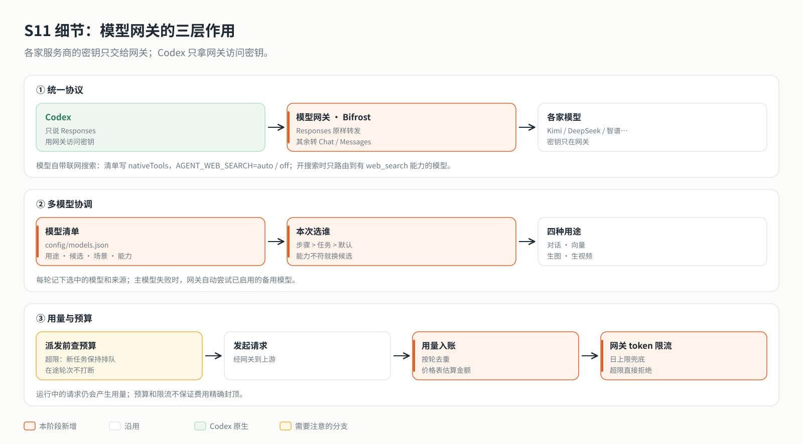

# s11 设计说明：模型网关

> 本文是设计说明，供深入阅读。章节入门见 [README](../README.md)；配置项、自检命令、各家模型的接入实测见 [模型网关详解](model-gateway.md)。

在 s10 之上，给云端 Agent 加一层模型网关：Codex 只连网关，网关替它对接各家模型。服务监听 `127.0.0.1:4318`，网关监听 `127.0.0.1:4330`。本阶段快照取自 2026-11-03 的 `app/`，不包含 Web 工作台、Docker 部署（属于 s08）和角色评估工具。



---

## 设计原理

到 s10 为止，Agent 直连一家模型。线上的 Agent 不可能只跑一个模型，s11 要解决三件事：协议统一、多模型协调、用量与花费。设计上守住三条：

**1. 通用的交给开源网关，和业务有关的自己写**：协议转换、出错改用备用、按 token 限流，是所有网关都要做的事，交给 [Bifrost](https://github.com/maximhq/bifrost)；"这一步该用哪个模型""这个 Agent 花了多少"要看任务语义，网关看不到，由我们自己写。

**2. 密钥只在网关**：各家密钥只传给网关容器；启动 Codex 前去掉所有 `*_API_KEY`，Codex 只拿网关访问密钥（`sk-bf-` 开头）。生成的网关配置只写密钥的变量名。

**3. 能力以实测为准，花费宁可停也不偷跑**：模型自带的能力（如联网搜索）按实测声明，不按服务商猜；超预算就停派新任务，记账失败就停止派发，不能带着不完整的账本继续花钱。

**设计要点：**

- **一份清单**：`config/models.json` 登记服务商（接口类型、地址、密钥变量）和模型（用途、上下文、能看什么、自带能力、价格、备用模型），路由表和场景也在里面。启动时严格校验，写错立即报错。
- **按会话开关的能力**：Codex 只在 `thread/start`、`thread/resume` 接受配置，`turn/start` 不接受，所以联网搜索随默认模型在启动时定下；开启后，每一轮的对话路由都自动要求"支持联网搜索"，场景里没有合适的候选时启动就报错。
- **选择有优先级、可追溯**：工作流步骤 > 任务指定 > 默认路由；每一轮选中的模型和来源写进任务记录。直连模式只有一个模型，步骤里的场景、能力要求和推理档位提醒后忽略，写死的具体模型报错。
- **策略协调**：用量到预算的一定比例时，没写死具体模型的任务降级到便宜的场景；到 100% 才停派。
- **选模型与改用备用分开**：我们的路由决定"这一步用哪个模型"，网关的备用链决定"它出错时改用谁"。
- **停派，不打断**：预算只在派发新任务前检查，正在执行的那一轮让它做完；网关的 token 限流是兜底。
- **不重复收费**：生视频提交结果不确定时不自动重提；完成时按任务 ID 记账去重。

## 架构改进

| 层 | 组成 | s11 的变化 |
|----|------|-----------|
| 模型清单 | `config/models.json` | 新增：providers、models（purposes、nativeTools、pricing、fallbacks）、routes、scenes、currency |
| 网关 | Bifrost 容器（compose 的 gateway 服务） | 新增：配置由 `scripts/gateway-config.mjs` 按清单生成，只启用填了密钥的服务商；备用链、按 token 限流 |
| 路由 | `server/modules/gateway/router.mjs` | 新增：按用途、场景（可跨用途）、能力（看图、上下文、原生工具）挑模型，推理档位按模型校验，挑不到时说明每个候选的原因；`GET /models`、终端 `/model` |
| 启动 | `server/modules/codex/launch.mjs` | Codex 的地址与密钥换成网关的；模型目录放所有可用的对话模型；联网搜索随默认模型开关 |
| 工具层 | 向量（RAG）、`generate_image`、`generate_video`、`media_status` | 向量经网关调用本地 Ollama；生图、生视频经网关调用火山方舟，视频任务后台跟进 |
| 用量 | `server/modules/usage/` | 新增：账本、价格估算、预算、`/usage` |
| 数据库 | 迁移 `006-usage.sql`、`007-media.sql`、`008-task-model-routing.sql` | 新增用量表、生视频任务表；任务记录用户指定的模型、实际选中的模型和选择来源 |

## 技术实现流程

1. **启动**：校验模型清单 → 按 `.env` 里填了哪些密钥决定启用哪些服务商 → 路由选出默认对话模型 → 决定联网搜索开关 → 校验工作流步骤的模型（存在、可用、搜索能力一致）→ 启动 Codex，地址指向网关。
2. **生成网关配置**（`npm run gateway:up`）：服务商、模型、备用链规则、虚拟密钥与限流写进 `.data/gateway/config.json`，模型的上下文与输出上限写进 `model-parameters.json`；重建网关容器。
3. **派发**：检查预算 → 超了就保持排队、定时重试 → 没超就确定选择（步骤 > 任务 > 默认；到降级比例时换成降级场景）→ 路由带上步骤的能力要求挑模型 → 把模型与来源写进任务 → 在 `turn/start` 里明确带上模型名和推理档位。
4. **执行**：Codex 用 Responses 请求网关；网关按服务商的接口类型转换协议，出错时按备用链改用；模型自带的搜索由模型自己执行。
5. **记账**：每次模型请求后，Codex 上报 `thread/tokenUsage/updated`，按累计值去重、记单次用量，带上任务与模型；向量、生图、生视频的用量由工具层记账。
6. **生视频**：提交后立即返回任务 ID → 后台每 10 秒查询一次 → 完成后下载、按版本保存、记账；服务重启后从数据库接着跟进。

## 核心代码

以下为伪代码，真实实现见 `server/modules/gateway/`、`server/modules/usage/index.mjs`、`server/modules/media/index.mjs` 与 `server/modules/messages/index.mjs`。

```text
resolve(purpose, model, needs):
  if model 是 "服务商/模型名": candidates = [model]
  else if model 是场景名: candidates = scenes[model]
  else if purpose 是对话且设置了 CODEX_MODEL: candidates = [CODEX_MODEL]
  else: candidates = routes[purpose]
  for id in candidates:
    if 用途不符 / 服务商没启用 / 不能看图 / 上下文不够: 记下原因，继续
    else: return id
  报错：没有可用的模型，并列出每个候选的原因

launch():
  default = resolve("chat")
  webSearch = AGENT_WEB_SEARCH != off 且 default 声明了 web_search ? live : disabled
  Codex 的地址与密钥 = 网关的；去掉各家 *_API_KEY

on thread/tokenUsage/updated(thread, turn, usage):
  if usage.total 没比上次大: 跳过（重复通知）
  record(chat, 这一轮的模型与任务, usage.last)

dispatch(job):
  budget = budgetStatus()
  if budget.exceeded: 保持排队，到额度恢复时再试；return
  selection = step.model 或 job.model 或 默认；source = 步骤指定 / 任务指定 / 默认路由
  if budget.downgraded 且 selection 不是具体模型: selection = 降级场景；source = 预算降级
  chosen = resolve("chat", selection, step.needs)     # 搜索开启时自动要求 web_search
  记录 job.selectedModel = chosen，job.modelSource = source
  turn/start(input, chosen, step.effort 或 模型默认档位)

generate_video(prompt):
  检查预算；model = resolve("video")
  保存任务（submitting）→ POST /v1/videos → 保存远端 ID（queued）→ 立即返回任务 ID
  后台轮询：完成 → 记账（按任务 ID 去重）→ 下载 → 按版本保存
           提交结果不确定 → 标记失败，不自动重提
```

## 限制说明

- **备用链触发后的计价**：Codex 上报的用量里没有网关最终用的是哪个模型，备用链触发后仍按提交给网关的模型估算花费。
- **网关限流计数会清零**：网关的配置库放在容器的临时目录里，网关容器重启后计数归零，所以它只是兜底，主要靠服务端的预算。
- **价格表需要自己填**：清单里没有填真实价格；不填时只计 token，不计金额。
- **能力声明靠实测维护**：服务商升级后，模型自带能力可能变化，用 `npm run gateway:check -- --search` 定期复查。
- **Web 工作台与部署**：本阶段没有 Web 工作台，也不讲 Docker 部署；它们分别在 `app/` 与后续的 s08 中。
