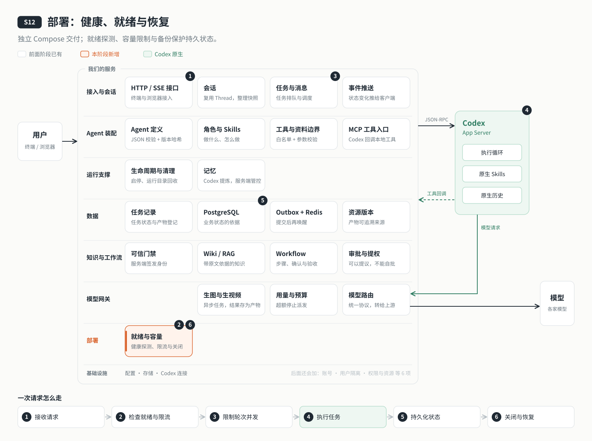

# s12: 上云部署 — 一台没人看着的服务器，也能自己起来、自己恢复

[导论](../introduction.md) → [s00](../s00-sdk-quickstart/) → [s01](../s01-single-turn/) → [s02](../s02-multi-turn/) → [s03](../s03-service/) → [s04](../s04-events-messages/) → [s05](../s05-agent-assembly/) → [s06](../s06-tools/) → [s07](../s07-memory/) → [s08](../s08-data-layer/) → [s09](../s09-knowledge-layer/) → [s10](../s10-skill-workflow/) → [s11](../s11-model-gateway/) → `s12` → [s13](../s13-auth/README.md) → [s14](../s14-isolation/README.md) → [s15](../s15-hub/README.md) → [s16](../s16-coordination/README.md) → [s17](../s17-sharding/README.md) → [s18](../s18-replication/README.md) → [app](../../app/)

> *"服务器上没有人替你按回车"* — 本机能跑，只说明代码对；交给服务器长期运行，还要回答：谁启动它，数据放哪，什么时候算能接活，接不过来怎么办，坏了怎么退回去。
>
> **对应六个问题**：③ 之前聊过什么？ ⑤ 能用什么？ ⑥ 谁说了算？

---



## 要回答的问题

上一章结束时，云端 Agent 的能力已经齐了：能聊、能干活、靠得住、守得住，还有一个模型网关管着各家模型。可它还跑在你自己的电脑上：电脑一合上，它就停了。

这一章把它交给一台服务器长期运行。服务器上没有人看着，所以它要能自己回答这些问题：

- 交出去的到底是什么？换一台机器，跑起来的还是同一个东西吗？
- 会话历史、任务记录、写好的文章放在哪里？重启、升级以后还在吗？
- 进程退出了，谁把它拉起来？什么时候才算"能接活"了？
- 同时来的请求太多，是排队、拒绝，还是全接下来然后一起变慢？
- 新版本有问题，能不能退回上一版？数据坏了，能不能从备份恢复？

本章只加一个单元：**部署**。Agent、工具、知识、工作流、模型网关都原样沿用，不引入账号，也不引入多台机器。

## 核心概念

### 交付物是镜像，不是一份代码

在你电脑上能跑，依赖的是你电脑上的 Node 版本、已经装好的依赖和系统工具。换一台机器，这些都可能不一样。所以交出去的不是代码，而是一个**镜像**：Node 版本、依赖锁文件、系统工具都固定在里面，在哪台机器上启动都是同一个东西。PostgreSQL、Redis 和模型网关也各用一个固定版本的镜像，写在同一份 `compose.yaml` 里，一起启动、一起停止。

### 代码和数据分开放

镜像随时可以重建、替换；数据不能丢。所以数据库和 Redis 的数据放在独立的数据卷，会话历史（`.data`）、运行目录（`.runs`）、资料与产物（`workspace`）和备份挂载在宿主机的固定目录上。升级就是换镜像，数据原地不动。

这里有一个容易踩的坑：Codex 的原生历史里记的是**绝对路径**。部署目录一旦换了位置，旧会话就恢复不了。所以部署路径是一份"持久化契约"：容器里的路径和宿主机上的路径必须一致，回滚也在同一个路径上替换代码。

密钥同样只放在宿主机上一个权限为 600 的 `.env` 里，镜像里不带。各个服务只拿自己需要的那几个：Agent 服务只拿网关访问密钥和自己的数据库口令，各家模型的密钥只在网关里。

### 活着，不等于能接活

服务器要知道什么时候可以把请求交给它，所以要分开问两件事：

- **健康（`/health`）**：进程还活着吗？
- **就绪（`/ready`）**：数据库连得上吗，网关好不好，模型目录加载了吗，调度能不能派任务？任何一项不满足就返回 503。

进程活着但数据库断了，这时它"健康"却不"就绪"。启动脚本、systemd 和后面几章的入口，都只把请求交给就绪的服务。

### 接不过来就明确拒绝

一台服务器的算力和内存是有限的。全都接下来，结果是所有人一起变慢，最后一起失败。所以每一层都定一个上限，超过就**明确拒绝**，并告诉客户端什么时候再来：

- 同时执行的轮次有上限（默认 2 个），多出来的按数据库里的顺序排队；
- 排队的任务也有上限（全局 200 条、单个会话 100 条），排满了返回 `429 QUEUE_FULL`；
- 每个来源每分钟的请求数、同时打开的事件流也有上限，超过返回 429 和 `Retry-After`。

这叫背压：让压力停在入口，不要传到 Codex 和模型那里。

### 关闭和恢复都要说得清

服务总会被关掉：升级、重启、机器维护。收到关闭信号时，顺序很重要：**先停止派发新任务，再把正在执行的轮次标成待核对，最后关闭连接**，整个过程不超过 30 秒。正在执行的那一轮到底有没有完成，服务自己说不清，所以不自动重发，交给人看过结果再决定。排队中的任务原样保留，下次启动接着做。

出了问题，有两种退路：

- **回滚**：服务器上保留上一版代码和镜像，一条命令换回去。回滚只换代码，不倒转数据。
- **备份与恢复**：备份时短暂停下 Agent 服务，导出数据库，打包会话历史和资料，生成带校验和的清单，只保留最近 7 份；恢复前先核对校验和，失败就保持停止，不带着坏数据启动。

## 分工：Codex 做什么，我们做什么

| Codex 做什么 | 我们做什么 |
|---|---|
| 照常执行每一轮，维护原生历史 | 把服务打包成镜像，交给 Compose 和 systemd 启动、重启 |
| 原生历史按绝对路径保存在 `.data` | 固定部署路径，数据卷和宿主目录与代码分开 |
| | 健康与就绪两种探测；并发、排队、请求和事件流的上限 |
| | 关闭时先停派发、再标待核对；备份、校验、恢复与回滚 |

运维的人也有自己的事：准备服务器和密钥，确认部署目录、数据盘和备份位置；遇到待核对的任务先看结果，不要直接重发。

## 跑起来看看

本机需要 Node.js 24+、Docker Engine 或 Docker Desktop、Compose v2。先进入本阶段目录：

```bash
npm ci
cp .env.example .env
npm run gateway:key
```

编辑 `.env`：填写一家服务商密钥，选择对应 CODEX_MODEL，AGENT_DB_PASSWORD 填随机十六进制密码（避免 URI 特殊字符），CONTAINER_APP_DIR 填 `pwd` 的结果。文件设置权限 `chmod 600 .env`。这些实际值只保存在你本机，不放进文档或提交。

```bash
docker compose build agent
bash deploy/configure.sh
docker compose up -d --wait postgres redis gateway
docker compose run --rm --no-deps -T agent npm run data:migrate
docker compose run --rm --no-deps -T agent npm run agent:init
docker compose up -d --wait agent
curl --fail http://127.0.0.1:4326/ready
```

预期 JSON 的 `status` 为 `ready`、`version` 为 `dev`，三个 checks 均为 true。Linux bind mount 若权限不匹配，先由管理员把 `.data`、`.runs`、`workspace`、`backups` 交给 uid 1000；`sudo bash deploy/configure.sh` 会做此初始化。本机 CLI 可运行 `npm run chat`，它读取挂载回宿主的 `.data/connection.json`。服务停止可用 `docker compose stop`，不要使用 `down -v` 删除数据卷。

离线实验不需要 Docker、网络或监听端口：

```bash
npm run test:deploy
npm run lesson -- list
npm run lesson -- s12-health
npm run lesson -- s12-queue
npm run lesson -- s12-protection
npm run lesson -- s12-backup
```

部署到一台使用 systemd 的 Linux 服务器。准备 Docker、Compose、rsync、flock、tar、gzip、sha256sum；SSH 用户需要管理 Docker 和安装 systemd 单元的权限。脚本教学默认使用具备 root 权限的 SSH 登录，主机名可用 SSH 配置别名。迁移和初始化仍在 agent 容器内执行。宿主运行时只需 Docker 与 Compose，不需要 Node/npm；Bash、flock、gzip/gunzip 等系统工具仍需可用。

```bash
export DEPLOY_HOST=example.com
bash deploy/remote.sh check
bash deploy/remote.sh init-env
bash deploy/remote.sh deploy
bash deploy/remote.sh status
bash deploy/remote.sh tunnel
```

`init-env` 用 Dockerfile 中固定版本的 Node 容器从本阶段 `.env` 取模型配置，经 SSH 写入服务器，重新生成数据库密码与网关密钥，已有文件拒绝覆盖。`deploy` 交付当前工作区，REVISION 包含 Git 基准短哈希与工作区部署时间；不执行 Git 提交。服务器保留上一版目录和 `previous` 镜像标签。首次部署没有上一版可回滚。

隧道在前台运行。在另一个终端用 curl 检查本机 4326 的 `/ready`；业务调用仍需要服务器 `.data/connection.json` 中的连接令牌。可用 SSH 把该 JSON 保存到本机私有文件供 CLI 读取，或设置 AGENT_SERVER_URL 与 AGENT_SERVER_TOKEN 环境变量；令牌不要写进进程参数或终端日志。不要覆盖本机正在使用的连接文件。本机若已有体验容器占用 4326，先停止它再开隧道。

```bash
bash deploy/remote.sh backup
bash deploy/remote.sh backup-download
# 也可以指定服务器输出的备份目录名
bash deploy/remote.sh backup-download 2026-01-01T00-00-00-000Z
bash deploy/remote.sh rollback
```

备份、下载、恢复的每一步细节，以及部署用到的全部默认值，见 [设计说明](docs/design.md#关键数值与实现细节)。完整的外部验收见 [验收步骤与交付差异](delivery.md)；域名、HTTPS 与访问口令见 [生产示例](docs/production.md)，不属于教学启动步骤。

运行之后，服务器上多了这些：`/opt` 下的部署目录（代码、`.env`、`.data`、`.runs`、`workspace`、`backups`），PostgreSQL 与 Redis 的两个数据卷，一个开机自启的 systemd 单元，以及上一版代码与镜像（供回滚）。

## 关键代码

`server/modules/deployment/index.mjs` 的四个默认值由同一配置函数校验：

```javascript
    maxConcurrentTurns: integer('AGENT_MAX_CONCURRENT_TURNS', 2),
    maxQueued: integer('AGENT_MAX_QUEUED', 200),
    rateLimit: integer('AGENT_RATE_LIMIT_PER_MINUTE', 120),
    maxSse: integer('AGENT_MAX_SSE', 20),
```

`server/modules/data/jobs.mjs` 在事务内先锁定实例，再检查全局与会话容量，所有进入 queued 的路径使用同一个门禁：

```javascript
    await client.query("SELECT pg_advisory_xact_lock(hashtextextended($1, 12))", [this.instanceId]);
```

关闭入口的顺序对应“先停止派发，再保存不确定状态，最后清理”：

```javascript
    stopDispatch();
    const deadline = timer(() => exit(1), 30000);
    try { await markUnconfirmed(); await close(); }
    finally { clear(deadline); }
```

## 小结

- 交出去的是镜像：版本、依赖、系统工具都固定，换一台机器还是同一个东西。
- 代码和数据分开：升级换镜像，数据原地不动；部署路径固定，原生历史才能恢复。
- 健康和就绪分开问：活着不等于能接活，只把请求交给就绪的服务。
- 接不过来就明确拒绝：并发、排队、请求、事件流都有上限，压力停在入口。
- 关闭先停派发、再标待核对；出了问题可以回滚代码，也可以从校验过的备份恢复数据。

## 下一章

服务器上的 Agent 自己能起来、能恢复了，可进得来的人只靠一个共享的连接令牌：拿到令牌的人都是"同一个用户"，会话、任务、知识库也都只属于这一个人。要让几个人共用它，第一步是知道每个请求是谁发的。

下一章：[s13 账号与认证](../s13-auth/README.md)。
