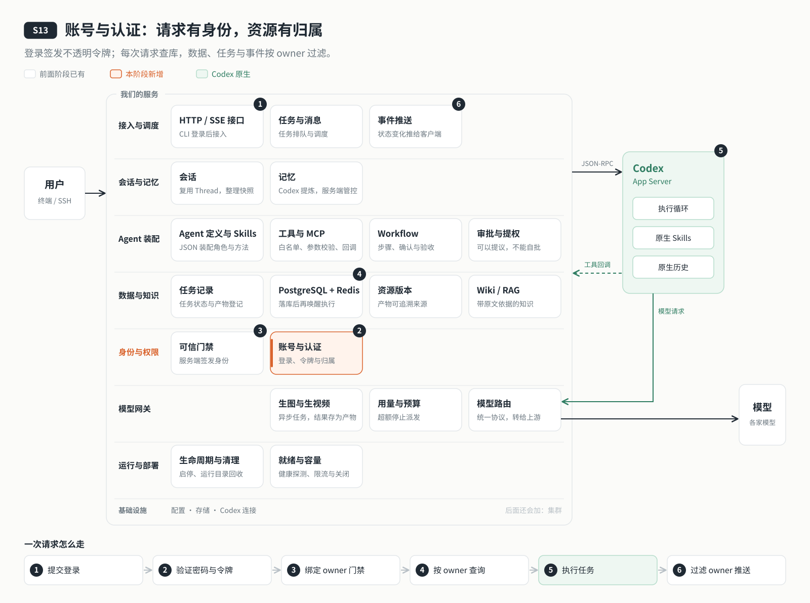

# s13: 账号与认证 — 身份由登录决定，资源各有归属

[导论](../introduction.md) → [s00](../s00-sdk-quickstart/) → [s01](../s01-single-turn/) → [s02](../s02-multi-turn/) → [s03](../s03-service/) → [s04](../s04-events-messages/) → [s05](../s05-agent-assembly/) → [s06](../s06-tools/) → [s07](../s07-memory/) → [s08](../s08-data-layer/) → [s09](../s09-knowledge-layer/) → [s10](../s10-skill-workflow/) → [s11](../s11-model-gateway/) → [s12](../s12-deploy/) → `s13` → [s14](../s14-isolation/README.md) → [s15](../s15-hub/README.md) → [s16](../s16-coordination/README.md) → [s17](../s17-sharding/README.md) → [s18](../s18-replication/README.md) → [app](../../app/)

> *"身份由服务端认定，不由请求自称"* — 每个用户登录自己的账号；会话、任务、知识库、事件都带着归属，别人的一律看不见。
>
> **对应六个问题**：① 我是谁？ ⑥ 谁说了算？

---



## 要回答的问题

上一章把云端 Agent 部署到了服务器上。可是进得来的人只靠一个共享的连接令牌：拿到令牌的人，在服务看来都是同一个人。所有会话、任务、知识库也都只有这一个主人。

几个人一起用，问题马上就来了：

- 这个请求是谁发的？凭什么相信他说的"我是 alice"？
- 会话、任务、知识库、用量分别归谁？
- bob 碰巧知道了 alice 一个会话的 ID，能不能读到它？
- 有人拿着一堆密码去试，怎么挡住？
- alice 换了密码，之前登录的那些地方还能用吗？

其实从 s08 起，数据就是按"归属者"建模的，s09 的门禁也按归属者判定，只是那时整个服务只有一个归属者，写在配置文件里。本章只加一个单元：**账号**。它只改一件事：归属者不再是进程里的一个常量，而是每个请求由登录决定。

## 核心概念

### 认证回答"你是谁"，归属回答"这是谁的"

这一章要分清两件事。**认证**是确认请求来自哪个用户：用户名和密码对上了，服务端发给他一个令牌，之后的请求都带上它。**归属**是每一份数据属于谁：会话、任务、知识库、事件、文件都记着自己的主人。

每个请求先认证，得到用户身份；之后读写任何数据，都要核对这份数据的归属是不是这个用户。两件事缺一不可：只有认证，任何登录的人都能看到所有数据；只有归属，谁都可以自称是别人。

### 密码只存"算出来的结果"，令牌可以随时作废

服务端不保存密码本身，只保存用一个故意很慢的算法（scrypt）加上随机盐算出来的结果。登录时把用户输入的密码再算一遍，比较两个结果。即使数据库泄露，也很难反推出密码。

登录成功后，服务端发一个随机生成的**不透明令牌**，数据库里只存它的摘要。每个请求都拿令牌查一次库，所以：登出、改密码、禁用账号时，把这个用户的令牌全部标记为作废，下一次请求就立刻失效。令牌有效期 7 天，闲置 12 小时也会失效。

这里不用 JWT。JWT 的好处是不查库也能验证，适合很多服务共同验证同一个身份；代价是签发出去就很难提前作废。我们只有一个服务、每次请求本来就要查库，用不透明令牌更简单，吊销也立即生效。

### 身份跟着任务走，不靠猜

请求通过认证以后，身份会一直跟着这次执行往下传：查数据库、调工具、写文件，用的都是这个身份。

后台的事情更要小心。任务排队以后，可能在几秒后由调度器取出来执行；工具回调可能在一轮的中途到达。这时已经没有"当前请求"了，身份只能从**任务和会话自己的记录**里取：这个任务是谁提交的，就以谁的名义执行。绝不能从"刚才是谁触发了调度"去猜。

### 看不见，就等于不存在

bob 去读 alice 的会话，返回什么？如果返回 403"无权访问"，等于告诉 bob：这个 ID 对应的会话确实存在。所以不属于你的东西，一律返回 **404 不存在**，和真的不存在完全一样。

事件推送和文件也按同一个原则处理：每个事件都必须带着归属者，缺了归属的事件直接丢弃，不能当成"大家都能看"；文件工具的根目录按用户分开，alice 和 bob 可以各有一篇同名的文章，互不干扰。

### 登录要防猜

登录接口会被人拿来一个个试密码。所以同一个用户名、同一个来源，15 分钟内最多失败 5 次；同一个来源最多试 20 次，超过就返回 429，并告诉他多久以后再试。用户名不存在时也照样算一遍密码，让"用户名错"和"密码错"花的时间一样、返回的提示一样，不泄露哪个用户名是真的。

## 分工：Codex 做什么，我们做什么

| Codex 做什么 | 我们做什么 |
|---|---|
| 照常处理 Thread、Turn、模型调用和上下文 | 账号命令、密码校验、令牌的签发与吊销 |
| 不参与身份判断，模型也不能决定"这次以谁的名义" | 让身份随请求和后台任务一路传递 |
| | 数据、文件、任务、事件推送的归属检查；不属于你的一律 404 |
| | 登录限流 |

管理员负责用命令创建账号、交互设置密码；上线前要用两个真实账号互相验证：看不到对方，读不到对方。

## 跑起来看看

先进入本阶段目录，在本机安装相同依赖并准备服务端配置。默认 `AGENT_PORT=4327`，Compose 项目名为 `codex-harness-s13`，远程目录为 `/opt/s13-auth`。

```bash
cd stages/s13-auth  # 从仓库根进入
npm ci
cp .env.example .env
# 编辑 .env，明确设置 AGENT_MEMORY_ENABLED=false，并填写模型服务密钥
export DEPLOY_HOST=example.com  # 替换为服务器 SSH 地址或别名
bash deploy/remote.sh check
bash deploy/remote.sh init-env
bash deploy/remote.sh deploy
# 首次部署成功退出并提示：账号尚未初始化：运行 DEPLOY_HOST=example.com bash deploy/remote.sh auth-init
bash deploy/remote.sh auth-init
# 交互输入首个用户名（例如 alice）与密码；密码隐藏，随后启动 agent 并输出 /ready JSON
bash deploy/remote.sh user -- add bob
bash deploy/remote.sh user -- list
bash deploy/remote.sh tunnel
```

首次部署时还没有账号，所以只准备好数据库和网关、不启动 Agent 服务；`auth-init` 创建第一个管理员之后才启动。原来单用户时代的会话和知识库都归到这个管理员名下，一条也不丢。细节见 [设计说明](docs/design.md#首次部署与账号初始化)。

密码只在交互提示中输入，不写成参数。维护远程账号使用（名称只接受 1–64 位小写字母、数字、下划线、点、连字符）：

```bash
bash deploy/remote.sh user -- passwd bob
bash deploy/remote.sh user -- disable bob
```

隧道终端保持打开，另开一个本机终端进入本阶段目录后登录：

```bash
export AGENT_SERVER_URL=http://127.0.0.1:4327
npm run login
npm run chat
```

客户端 `.data/credentials.json` 权限为 0600；`.data/connection.json` 只保存服务地址。用两个独立客户端工作副本分别登录 alice 和 bob，避免共用同一个 credentials.json。令牌失效时客户端提示运行 `npm run login`。

在 alice 客户端创建会话并记下 ID。在 bob 客户端列出会话，应看不到它；尝试恢复 alice 的 ID，应得到 404 NOT_FOUND。alice 拥有的知识库不会出现在 bob 的列表中，按 kbId 读取也返回 404。本章沿用实例内唯一的知识库 ID，不为新账号复制别人的知识库。两个用户可以分别生成同名产物，它们落在不同用户目录。

执行 `npm run logout` 后，该账号的其他已登录客户端下一次请求也应为 401。外部自动验收用 `npm run test:auth:integration`，其专用数据库地址从 `DATA_TEST_DATABASE_URL` 读取。

离线先运行四个实验，无需端口、数据库或模型：

```bash
npm run lesson -- hash
npm run lesson -- logout
npm run lesson -- ownership
npm run lesson -- events
npm run test:offline
```

完整 `npm test` 包含端口测试，应在沙箱外运行；端口部分可单独运行 `npm run test:ports`。真实数据库与服务器步骤见 [交付验收](docs/design.md#验证)，部署配置见 [production.md](docs/production.md)。

运行之后多了这些：数据库里的用户表和登录会话表（只存令牌摘要），服务端 `workspace/users/<用户 ID>/` 下每人一个资料目录，客户端本机一份权限 0600 的 `.data/credentials.json`。

## 关键代码

[password.mjs](server/modules/accounts/password.mjs) 中，盐随机生成，成本固定，数据库保存派生结果而不是密码：

```javascript
  const salt = randomBytes(16);
  const hash = await derive(password, salt, 64, SCRYPT_OPTIONS);
  return `scrypt$32768$8$1$${salt.toString('hex')}$${hash.toString('hex')}`;
```

[accounts/index.mjs](server/modules/accounts/index.mjs) 对未知账号使用哑哈希，仍执行同一个密码验证函数；失败分支不透露账号是否存在：

```javascript
      const user = await this.store.byUsername(normalizeUsername(username));
      const valid = await this.verify(password, user?.password_hash || DUMMY_HASH);
      if (!valid || !user || user.disabled_at) throw new AppError('用户名或密码错误。', 401, 'LOGIN_FAILED');
```

[events/index.mjs](server/modules/events/index.mjs) 在事件进入缓冲区之前拒绝缺少 ownerId 的事件。不能把没有归属误当成所有人都可见：

```javascript
  publish(type, data, threadId = null, ownerId) {
    if (!ownerId) { this.warn("丢弃缺少 ownerId 的事件。"); return null; }
    const event = { sequence: ++this.sequence, type, threadId, ownerId, data };
```

## 限制

所有用户仍共用**一个 Codex 进程、一个 CODEX_HOME、一个 workspace**。API 层看不到别人的数据，但原生记忆和 workspace 文件在底层仍共享；s14 处理用户运行隔离。

启用账号数达到 **2 个**时，必须显式设置 `AGENT_MEMORY_ENABLED=false`，否则拒绝启动。运行中添加第二个启用账号也会被同样的守卫拒绝；原生记忆可能把 A 的内容提炼给 B。关闭后 API 不返回先前保留的共享摘要，底层旧文件仍保留。

文件工具按用户分目录，原生文件能力保持关闭，文件通过我们的工具层访问。目录与门禁不是 OS 沙箱，不能抵御同机管理员或恶意插件。原生 Thread 内已有的上下文也不会因为关闭记忆而被清空。

全局并发 **2 轮**由所有用户共享，没有按用户的配额，留到 s15。登录失败窗口保存在当前进程，重启会清空；单服务的每请求查库令牌机制不等于分布式认证系统。

本章不包含注册、邮件、OAuth/SSO、JWT、refresh、按用户的 Codex 进程、资源权益、配额计费或 Web 登录页。离线夹具不证明实际 PostgreSQL、网络或服务器已验收。

## 小结

- 认证回答"你是谁"，归属回答"这是谁的"；每次读写都要两样都核对。
- 密码只存算出来的结果；令牌是不透明的，每次请求查库，所以登出、改密码、禁用都能立即生效。
- 身份跟着任务走：后台执行和工具回调从任务记录里取身份，不靠猜。
- 不属于你的东西一律返回 404；没有归属的事件不推送。
- 检验账号系统，不能只看"能登录"，还要用别人的 ID、作废的令牌、缺归属的事件去验证它会拒绝。

## 下一章

API 这一层，alice 和 bob 已经互相看不见了。可在底层，他们仍然共用同一个 Codex 进程、同一个 CODEX_HOME：原生历史、索引和记忆都放在一起，只要绕过 API，就谈不上隔离。本章只能靠关掉原生记忆来避免串话。下一章让隔离一直落到进程和文件：

下一章：[s14 用户隔离](../s14-isolation/README.md)。
