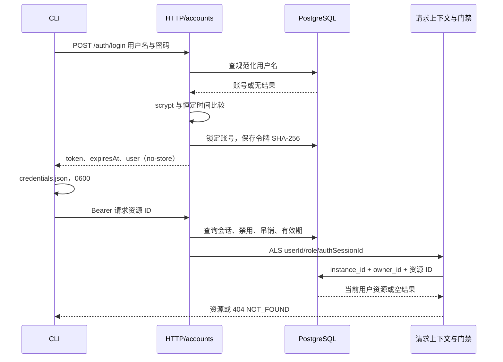
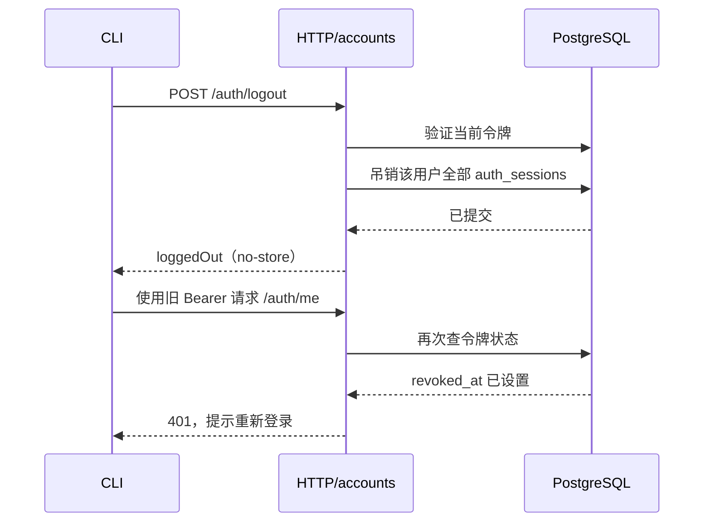

# s13 账号与认证设计

## 设计原理

本章要让 owner 成为经过认证的执行身份。登录账号决定 HTTP 请求的 owner，数据库、缓存和文件访问不得自行退回 identity.json 的原 owner。后台执行没有用户请求可供推断，因此使用持久化任务或会话的 owner。identity.json 继续标识实例，并用于初始化原数据的首个 admin。

账号只有 admin/user 两种技术角色；角色不扩大资源归属。不存在和跨用户访问统一 404 NOT_FOUND。SSE 缺少 ownerId 默认拒绝；文件 locator 不携带用户根，由可信 owner 解析物理目录。

## 架构改进

accounts 包含密码派生、令牌查询与吊销、登录限流、请求上下文、管理事务、记忆守卫和用户工作区适配。其他模块沿用原有职责，通过 scope 的 owner getter 或任务绑定获得身份。依赖完全不变。

密码采用内置 scrypt（N=2^15、r=8、p=1、16 字节盐），验证用 timingSafeEqual。未知用户使用同参数哑哈希。令牌由 randomBytes(32) 生成并以 base64url 交付；数据库只存 SHA-256，绝对 7 天、闲置 12 小时失效，last_seen_at 每分钟最多更新一次。

010-accounts.sql 为 users 增加规范化用户名、密码哈希、admin/user 角色约束、禁用时间与创建时间，创建 auth_sessions。沿用数据库的 instance_id 作用域，因此用户名在实例内唯一。资源的唯一键加入 owner_id，支持不同用户相同的相对 locator，不改写已有记录。迁移登记到原有校验清单，不能修改旧迁移。

知识库 ID 仍在实例内唯一。首个 admin 保留原库，新账号列表过滤其他 owner 的库；本章不复制知识库，也不实现共享知识权限。资源范围与权益留到 s15。

## 技术实现流程

登录到资源门禁的泳道：



吊销立即影响下一次请求的泳道：



改密码和禁用在数据库事务内更新账号并吊销会话；登录创建会话前锁定账号、重新检查哈希和禁用状态，防止旧密码校验与管理操作并发签出凭证。登录限流在 scrypt 前预占，失败保留、成功释放，避免并发校验绕过次数限制。窗口为用户名+来源 5 次失败/15 分钟、来源 20 次/15 分钟。业务请求按 userId 每分钟 120 次，未认证按 socket 来源，不信任 X-Forwarded-For。

HTTP 完成认证后进入 AsyncLocalStorage。会话缓存命中之前仍查归属；SSE 订阅、实时事件与补发均比较 ownerId。未知 owner 事件丢弃并警告。outbox 与调度维护可扫描实例任务，但派发每个任务前明确绑定其记录 owner；媒体和知识索引 worker 也从持久记录取得 owner。延迟写入用量在入链时捕获 owner。

工具根按需创建为 workspace/users/ownerId，权限 0700，原有路径校验继续拒绝越界、符号链接与不允许的文件类型。Codex 的 cwd 仍是共享 workspace，原生文件能力保持关闭。

首次远程启动顺序为 **check → init-env → deploy（提示 auth-init）→ auth-init → user add → tunnel → login**。在本机阶段目录设置 `DEPLOY_HOST`，依次运行：

```bash
bash deploy/remote.sh check
bash deploy/remote.sh init-env
bash deploy/remote.sh deploy
bash deploy/remote.sh auth-init
bash deploy/remote.sh user -- add bob
bash deploy/remote.sh tunnel
# 保持隧道，另开本机终端：
export AGENT_SERVER_URL=http://127.0.0.1:4327
npm run login
```

`deploy` 先等待 postgres、redis、gateway 健康，再用 agent 镜像一次性容器执行迁移和 agent:init；`node scripts/accounts.mjs status` 只读查询当前实例的启用账号数，输出 initialized/uninitialized，两种状态都退出 0。未初始化时不启动 agent，也不注册会自动启动 agent 的 systemd 服务；打印 auth-init 命令并退出 0，remote.sh 删除 `.deploy-pending`。已初始化才等待 agent 健康并输出 `/ready`。`configure.sh` 只用临时容器生成配置，不启动 agent 服务。

`remote.sh auth-init` 使用独立于 heredoc 的 `ssh -t`，容器命令不加 `-T`，保证密码隐藏。初始化成功后执行 `docker compose up -d --wait agent`、注册开机启动并输出 `/ready`。重复初始化在询问密码和获取运行锁之前拒绝，以专用退出码 3 表示，远程命令仍确保 agent 启动；其他失败原样阻止启动。`remote.sh user -- add|passwd|disable <name>` 与 `user -- list` 同样用 TTY；名称在跨 SSH shell 前以 `^[a-z0-9_.-]{1,64}$` 校验。部署与回滚 heredoc 内的 docker compose / bash 调用继续使用 `</dev/null`，避免吞掉剩余脚本。

auth:init 停服执行：保留原 owner UUID，创建首个 admin，移动旧 inputs/research/drafts/outputs。已初始化拒绝再次执行；文件移动中断后的重试不覆盖已经移动的资料。数据库和文件系统不能原子提交，须保留备份并在冲突时核对目录。

启动检查与 user:add 使用数据库锁串行核对启用账号数量。未显式关闭记忆的运行实例持有记忆锁；管理命令即使临时设置 false，也不能绕过尚未重启的服务。启用账号达到 2 个且 AGENT_MEMORY_ENABLED 不为 false 时，两处使用相同提示拒绝。

## 核心代码

以下为伪代码；可运行源码与逐行摘录见 [README](../README.md)。

```text
登录：
  限流预占（规范化用户名，实际来源）
  查账号；没有账号则使用同参数哑哈希
  执行 scrypt + timingSafeEqual
  失败 → 统一 401
  锁定账号再次核验 → 保存 randomBytes(32) 令牌的 SHA-256
  返回原始令牌一次，Cache-Control: no-store

资源请求：
  查令牌，检查账号禁用、吊销、绝对与闲置期限
  ALS.run({ userId, role, authSessionId })
    按 owner 查询资源；不存在 → 404 NOT_FOUND

后台任务：
  从任务记录读 owner
  runOwner(owner) → 派发、工具、用量、带 ownerId 的事件
```

## 验证

`npm run test:offline` 不监听端口或连接数据库，覆盖认证、请求拒绝、会话缓存、工具路径、事件过滤、管理事务调用和迁移登记。`npm run test:ports` 检查实际 HTTP/SSE、CLI 与 MCP。`npm run test:auth:integration` 使用专用 DATA_TEST_DATABASE_URL，重复运行迁移 SQL，验证真实事务、约束、记忆锁与资源隔离。`npm run test:data` 启动外部 PostgreSQL/Redis 和模拟模型回归。当前环境只可执行离线部分；具体结果见 [交付验收](../../verification.json)。

## 限制说明

所有用户仍共用一个 Codex 进程、一个 CODEX_HOME、一个 workspace。API 归属过滤与工具分目录不等于底层运行隔离。启用账号达到 2 个必须 AGENT_MEMORY_ENABLED=false；共享原生记忆可能泄露内容，已有 Thread 上下文不会自动清空。全局并发 2 轮共享，无按用户配额。s14 解决用户隔离，s15 处理资源权益与配额。

没有注册、邮件、OAuth/SSO、JWT、refresh 或 Web 登录。带 Origin 的请求仍拒绝。登录限流在进程内，服务重启清空失败窗口。已经建立的 SSE 不逐帧重新验证令牌；吊销保证下一次请求失败，当前订阅始终只能接收该用户事件。

## 机制实验

[四个离线实验](../lessons/README.md) 分别观察哈希验证、登出后的 401、跨用户 404，以及缺少 ownerId 的事件不推送。实验运行实际断言，不把预期输出当成通过记录。

## 关键数值与实现细节

章节 README 只讲概念；账号、令牌、限流的具体数值与实现细节集中在这里。

**账号与角色。** 管理员通过本机命令创建账号，没有注册、邮箱、找回密码或 Web 登录页。用户名规范化为小写，技术角色只有 `admin` / `user`。admin 也不能读取其他用户的资源；资源范围与权益留到 s15。

**密码与令牌分开。** 密码使用 Node 内置 scrypt：`N=2^15, r=8, p=1`，每次生成 16 字节盐，验证使用恒定时间比较。未知用户名也执行一次 scrypt，登录失败统一返回“用户名或密码错误”。不添加依赖，不实现 JWT。

登录成功后返回 `randomBytes(32)` 生成的 base64url 不透明令牌，数据库只存它的 SHA-256。令牌绝对有效期为 **7 天**，闲置 **12 小时**失效；每次请求最多每 **1 分钟**更新一次 last_seen_at。没有 refresh。登出、改密码、禁用账号都会吊销该用户的**全部令牌**，下一次请求查库时立即生效。

**身份随执行传递。** HTTP 验证令牌后，AsyncLocalStorage 携带 `{ userId, role, authSessionId }`。数据库查询按当前 owner 过滤，缓存命中也要核对归属。后台 outbox、worker 和工具回调从任务或会话记录取得 owner，不从触发调度的请求猜身份。资源不存在与不属于当前用户统一返回 **404 NOT_FOUND**。

**事件与文件也要有归属。** SSE 订阅绑定用户，事件必须带 ownerId；缺少 ownerId 就丢弃并警告。实时推送和断线补发都过滤 owner。文件工具的物理根是 `workspace/users/<ownerId>/`，目录按需创建、权限 0700；数据库 locator 仍是相对路径，同名路径可以分别属于不同用户。Codex 进程 cwd 不变。

**限流。** 登录接口按“用户名+实际来源”限制 **5 次失败/15 分钟**，按来源限制 **20 次/15 分钟**；超出返回 429 和 Retry-After。已登录业务请求按 userId 限制 **120 次/分钟**，未认证请求按来源。`/health`、`/ready` 免认证；带 Origin 的请求仍拒绝。认证响应使用 `Cache-Control: no-store`。

### 首次部署与账号初始化

首次 `deploy` 只启动 PostgreSQL、Redis 和 gateway，用 agent 镜像的一次性容器迁移数据库、准备目录并查询账号状态。没有启用账号时不启动 agent，以 0 退出并清除 `.deploy-pending`，此时尚无 `/ready`。`auth-init` 成功后才启动 agent 并注册开机启动，输出包含 `"status":"ready"` 的 JSON。后续 `deploy` 检测到启用账号后会正常启动 agent 并检查 `/ready`。

`auth-init` 通过 SSH TTY 在一次性容器里运行 `npm run auth:init`，把 identity.json 中原 owner 设为第一个 admin。旧会话与知识库归属不变，顶层 inputs/research/drafts/outputs 移入该 admin 的用户目录。已初始化时拒绝重入，远程命令仍确保 agent 已启动并输出 `/ready`；其他错误不会忽略。已有数据升级时，先停服、备份，再执行迁移与初始化；不要先在目标用户目录填入同名资料。
