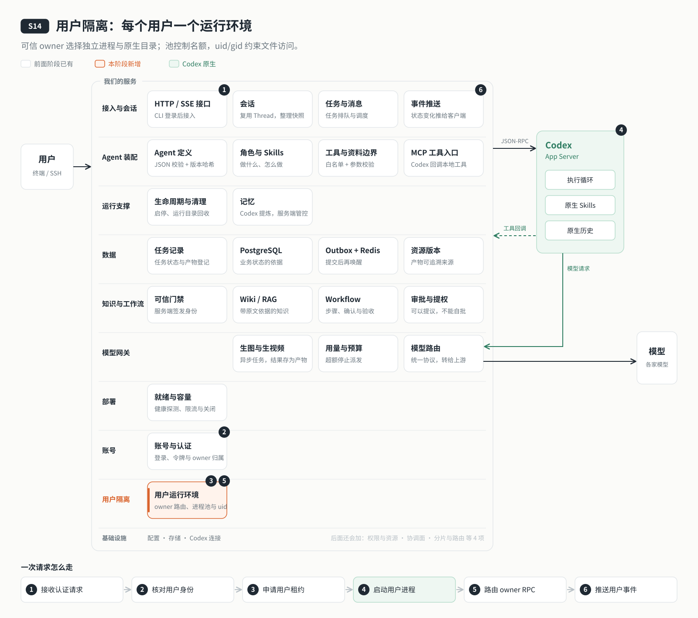

# s14: 用户隔离 — 每个用户一个运行环境，在底层也互不可见

[导论](../introduction.md) → [s00](../s00-sdk-quickstart/) → [s01](../s01-single-turn/) → [s02](../s02-multi-turn/) → [s03](../s03-service/) → [s04](../s04-events-messages/) → [s05](../s05-agent-assembly/) → [s06](../s06-tools/) → [s07](../s07-memory/) → [s08](../s08-data-layer/) → [s09](../s09-knowledge-layer/) → [s10](../s10-skill-workflow/) → [s11](../s11-model-gateway/) → [s12](../s12-deploy/) → [s13](../s13-auth/README.md) → `s14` → [s15](../s15-hub/README.md) → [s16](../s16-coordination/README.md) → [s17](../s17-sharding/README.md) → [s18](../s18-replication/README.md) → [app](../../app/)

> *"接口隔离之外，进程和文件也要隔离"* — 每个用户一个独立的 Codex 进程、一份 CODEX_HOME、一个系统账号；操作系统的权限位替我们兜底。
>
> **对应六个问题**：③ 之前聊过什么？ ⑥ 谁说了算？

---



## 要回答的问题

上一章之后，alice 和 bob 在 API 这一层已经互相看不见了。可是底层仍然只有一个 Codex 进程、一个 CODEX_HOME：两个人的原生历史、会话索引、Skill 副本和记忆都放在同一个目录里，由同一个进程读写。只要绕过我们的 API，比如模型调了一个能读文件的工具，或者原生记忆把 alice 的内容提炼进了公共摘要，隔离就破了。上一章只能靠关掉原生记忆来避免串话。

这一章要回答：

- 每个用户的原生历史、索引和记忆放在哪里？哪个进程能读到它们？
- 如果我们自己的代码有漏洞，有没有第二道防线？
- 用户多了，每人一个进程，机器扛得住吗？
- 一个用户的 Codex 进程崩了，会不会连累别人？

本章只加一个单元：**用户运行环境**。

## 核心概念

### 接口挡得住请求，挡不住底层文件

到上一章为止，隔离全靠我们的代码在每个接口上核对归属。这道防线只管住了"经过接口的访问"。Codex 进程自己读写的那些文件（原生历史、状态库、记忆），从来不经过我们的接口。只要它们还放在一起、由同一个进程打开，一个用户的内容就有机会出现在另一个用户的会话里。

所以隔离要一直落到底层：**不同用户的原生状态放在不同目录，由不同进程打开。**

### 一个用户，一个运行环境

每个用户有自己的**运行环境**：一个独立的 Codex App Server 进程，一份独立的 CODEX_HOME（原生历史、索引、记忆、Skill 副本都在这里），一个独立的工作目录。服务端收到请求，先确定是哪个用户，再把请求交给这个用户自己的进程。

后台任务、工具回调也一样：任务记录里写着是谁的，就交给谁的进程；工具回调到达时，要同时核对"这个进程属于谁"和"这个任务属于谁"，两者不一致就拒绝。

### 操作系统兜底：每人一个系统账号

如果只是分了目录，我们代码里一个路径拼错，照样能读到别人的文件。所以再加一道不依赖我们代码的防线：**每个用户的 Codex 进程以他自己的系统用户（uid）运行**，他的目录也只属于这个 uid。操作系统的权限位决定谁能读：alice 的进程读不到 bob 的目录，哪怕路径写对了也不行。

服务进程本身也只拿最少的权限：它能切换身份去启动用户进程、能调整目录归属，但没有"无视权限位"的能力，自己读写文件同样受权限位约束。用户进程启动时，只继承一份白名单里的环境变量（网关地址、访问密钥、CODEX_HOME 等），数据库口令、各家模型的密钥都不会传给它。

### 进程是有限的：按需启动，空闲回收

每人一个进程，机器上的进程数就会随用户数增长。所以运行环境是**按需**的：用户第一次发请求时才启动；同一个用户同时来几个请求，共用同一次启动。闲置 10 分钟、没有执行中和排队中的任务，就关掉它，下次再启动，历史从 CODEX_HOME 恢复。

同时最多运行 4 个进程。满了，先回收最久没用、又空闲的那个；全都忙着，就返回 503 和"10 秒后再试"，而不是硬塞进去拖垮整台机器。这和 s12 的背压是同一个思路。

### 故障只影响一个人

一个用户的进程崩溃了，只有他执行中的任务被标成待核对（s08 的语义：结果不确定，不自动重发），其他用户照常工作；他的下一次请求会重新拉起进程。禁用一个账号，也会立即关掉这个用户的进程。

## 分工：Codex 做什么，我们做什么

| Codex 做什么 | 我们做什么 |
|---|---|
| 在每个用户自己的进程里，管理原生会话、轮次、历史、Skill 发现和记忆 | 为每个用户分配系统账号、CODEX_HOME 与工作目录 |
| 按 CODEX_HOME 保存和恢复原生状态 | 按用户把请求、后台任务、工具回调路由到正确的进程，并双重核对归属 |
| | 进程池：按需启动、空闲回收、繁忙拒绝；崩溃只影响该用户 |
| | 用户进程只拿白名单环境变量；服务进程只拿最少的系统权限 |

参数里"自称"的用户身份，永远不参与授权；全局同时执行的轮次仍然最多 2 个，按用户的配额留到下一章。

## 跑起来看看

需要 Node.js 24。离线实验不需要 PostgreSQL、Docker、监听端口、模型或 root：

```bash
npm ci
npm test
npm run lesson -- routing
npm run lesson -- pool
npm run lesson -- crash
```

在可运行 PostgreSQL、Redis 的本机准备 `.env` 后，执行：

```bash
npm run data:migrate
npm run agent:init
npm run auth:init
npm run user:add -- bob
npm run server
```

另开终端运行 `npm run login` 和 `npm run chat`。默认端口为 `4328`。非 root 本机运行会打印“本机开发模式：未启用系统用户隔离”：仍有各用户的进程和目录，但所有子进程使用当前系统用户。容器内无法切换 uid 会拒绝启动。

容器、PG 与真实模型验收见 [用户运行环境验收](docs/isolation-acceptance.md)。部署示例域名为 `example.com`，默认目录为 `/opt/s14-isolation`，compose 项目及 systemd 单元均为 `codex-harness-s14`，数据库为 `agent_s14`。运行环境按需启动，因此 `/ready` 不代表每个用户已经完成 Codex 核验；首次请求会实际启动并核验。

运行之后多了这些：每个用户一份 `.data/users/<用户 ID>/codex`（第一个管理员沿用原来的 `.data/codex`，因为原生历史记着绝对路径），每人一个 `workspace/users/<用户 ID>/` 与 `.runs/users/<用户 ID>/`；数据库里一张把用户映射到系统账号和 CODEX_HOME 的表。

## 关键代码

### 1. 固定容量与时间边界

摘自 [runtimes/pool.mjs](server/modules/runtimes/pool.mjs)：

```javascript
export const RUNTIME_LIMIT = 4;
export const IDLE_MS = 10 * 60 * 1000;
export const START_TIMEOUT_MS = 30 * 1000;
export const busyError = () => Object.assign(new AppError('用户运行环境繁忙，请稍后重试。', 503, 'RUNTIME_BUSY'), { retryAfter: 10 });
```

启动占位先进入池，并发请求等待同一个 promise；请求结束释放租约。容量判断同时检查租约、轮次与持久化队列，回收结束才释放名额。

### 2. 工具回调验证两个身份来源

摘自 [runtimes/router.mjs](server/modules/runtimes/router.mjs)：

```javascript
export function assertToolOwner(connectionOwner, task, session) {
  if (!task || task.userId !== connectionOwner || session?.ownerId !== connectionOwner)
    throw new AppError('工具回调的连接用户与任务 owner 不一致。', 403, 'RUNTIME_OWNER_MISMATCH');
}
```

连接 owner 在进程启动时绑定，任务 owner 来自数据库。核对通过后仍须满足执行中轮次与 PermissionGate 的范围检查。

### 3. 最终 spawn 使用固定 umask

摘自 [codex/launch.mjs](server/modules/codex/launch.mjs)：

```javascript
export function userSpawn(executable, args, { uid, gid, isolated }) {
  return {
    command: '/bin/sh',
    args: ['-c', 'umask 0007 && exec "$0" "$@"', executable, ...args],
    options: isolated ? { uid, gid } : {},
  };
}
```

可执行文件与参数逐项传递，不拼进 shell 脚本。环境仅保留网关地址和访问密钥、CODEX_HOME、CODEX_SQLITE_HOME、PATH、HOME=CODEX_HOME、LANG，不继承数据库、Redis、服务商凭据或 Node 注入变量。

## 限制

第一个 admin 被禁用后，`.data/codex` 映射不转移，这是已知边界。`secureTree` 使用 fd 校验和修改条目，但遍历仍依赖目录所在路径，存在父目录被替换的残余竞态；权限修复应在用户进程停止后执行。

所有用户进程仍在同一个容器、同一个内核下运行。每用户独立 uid 提供文件级隔离，但不隔离 CPU、内存和网络；按用户容器或虚拟机属于生产加固，不在本章范围。

全局并发与模型预算仍由所有用户共享；s15 处理配额与权益。系统仍是单机，s16 处理多主机。文件的 API 归属校验和工具权限仍然必需，独立 uid 不替代这些检查。本机开发模式没有系统用户隔离。

记忆已物理分开，但开启不代表生成成功：固定版本下禁用原生写工具时，后台合并仍不能写出最终摘要。知识库挂载策略对记忆的限制继续生效。进程崩溃只意味着结果不确定，必须核对原生历史与任务状态。

## 小结

- 接口隔离挡不住底层文件：不同用户的原生状态要放在不同目录、由不同进程打开。
- 一个用户一个运行环境：独立的 Codex 进程、CODEX_HOME 和工作目录，请求和回调都按用户路由。
- 操作系统兜底：每人一个系统账号，权限位决定谁能读，不依赖我们的代码写对。
- 进程按需启动、空闲回收、满了就明确拒绝；一个人的故障不连累别人。

## 下一章

现在每个用户都有了自己的一份天地。可真实的团队还需要"一起用"：alice 想把自己整理的知识库分享给 bob，但不想让 dave 看到；有人只能用写作 Agent，有人可以用全部工具；一个人用完了今天的 token，不该连累其他人。谁能用、谁能改、能分享给谁、能用多少，需要一个地方统一说了算。

下一章：[s15 权限与资源 Hub](../s15-hub/README.md)。
