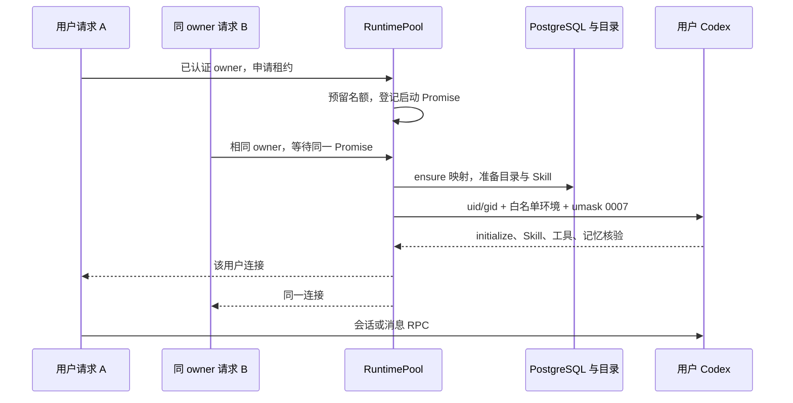
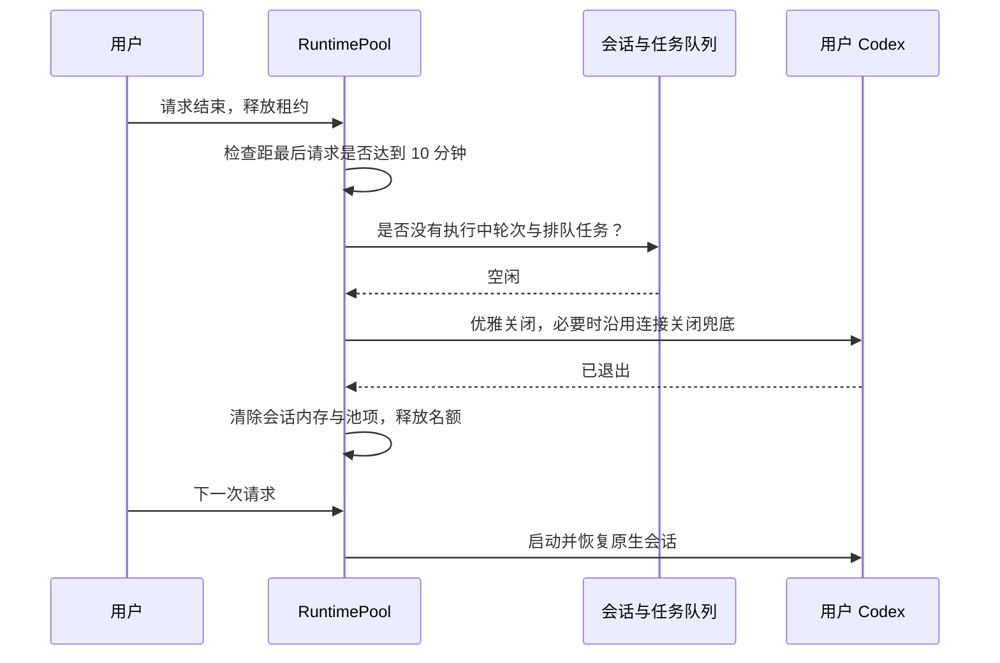

# 用户运行环境设计

## 设计原理

可信 owner 贯穿登录请求、会话、任务、Codex 连接和工具回调。一个 owner 对应一个独立 CODEX_HOME 与一个按需启动的 App Server；全局业务队列和模型预算保持共享。

用户 uid/gid 从 10001 分配并持久化。第一个 admin 使用原 `.data/codex`，迁移只变更属主与权限，不搬移、不改写原生文件内容。用户状态、工作区和运行目录采用 uid:1000 / 2770。父目录开放穿越，用户根不向其他 uid 开放。

## 架构改进

新增 `server/modules/runtimes/`，包含池、owner 路由、身份映射、目录和组装模块。复用 `codex/connection.mjs` 与 `launch.mjs`；其他业务模块继续负责原有领域。

| 模块 | 责任 |
| --- | --- |
| RuntimeStore | 事务锁内顺序分配 uid，保持映射幂等；LISTEN 接收禁用通知 |
| RuntimePool | 4 个名额，single-flight、30 秒启动期限、请求租约和 10 分钟空闲回收 |
| RuntimeRouter | 认证上下文或持久化 owner 选择连接；隔离通知；禁止无主 RPC |
| SessionService / MessageService | 会话与任务归属、全局 2 轮派发、仅 owner 的待核对恢复 |
| CodexConnection | stdio JSON-RPC、固定 umask 包装、uid/gid 和最终环境白名单 |

工具目录是服务配置；Skill 已安装路径、核验结果与记忆对象属于各用户。兼容描述符使用稳定的包标识与既有 admin Skill 路径，真正的 Skill 输入和会话 cwd 使用当前用户目录，避免用户切换污染其他用户指纹。

## 技术实现流程

### 首次请求与 single-flight



### 空闲回收



第五个用户到来时无需等待空闲期限：从没有租约、没有执行中轮次、没有排队任务的进程中选最久未用者。全忙返回 503 `RUNTIME_BUSY` 和 `Retry-After: 10`，不受理消息。

崩溃先关闭连接，再在 owner 上下文调用 `recoverOwner`：starting/running/steering 变为 unconfirmed，相关会话暂停；queued 不重发已执行轮次。完成恢复后清除该用户会话缓存，下次访问从其原生历史恢复。其他用户的 failure、连接与任务不变。

容器不增加 KILL capability。关闭时用 SETUID/SETGID 启动同 uid/gid 的短命信号发送器；连接直接 exec 官方平台包中的原生 Codex，避免杀掉包装器后留下孙进程。

禁用账号的数据库事务同时吊销令牌并发出通知。通知到达即关闭对应进程和启动过程；每次获取运行环境及工具调用仍查账号状态，补上通知与请求交叉的窗口。通知连接丢失会停止整个执行器，避免继续使用无法及时吊销的进程。

## 核心代码

伪代码描述请求与生命周期边界：

```text
withOwner(owner, operation):
  串行检查账号与池名额
  已有 ready/starting 项则增加租约；没有则选空闲者回收或返回 RUNTIME_BUSY
  新项在启动前占位；等待同一个启动 Promise（30 秒）
  在 owner + runtime 上下文执行 operation
  finally 释放租约并记录最后请求时间

onTool(connectionOwner, thread, turn):
  查询当前任务记录
  要求 connectionOwner == task.owner == session.owner
  要求账号启用、turn 执行中、PermissionGate 有效
  调用原有服务端工具
```

## 验证

`npm test` 为离线部分。`npm run test:ports` 单独运行需要监听端口的继承回归。`npm run test:runtimes:pg` 核对真实迁移、并发 uid 分配、数据库通知与 owner 恢复。`npm run test:runtimes:uid` 在指定能力的 Linux 容器中检查真实 uid、私有组、文件不可跨读、umask、白名单和权限。

这些外部测试的命令与预期见 [验收说明](isolation-acceptance.md)。离线模拟连接不能证明 OS 权限，静态 compose 检查也不等同于 Docker 已执行。

## 限制说明

用户进程共享容器与内核，独立 uid 只提供文件隔离，不隔离 CPU、内存、网络。全局并发 2 轮和模型预算共享，s15 才处理配额与资源 Hub。系统为单机，s16 才涉及多主机。本机非 root 模式明确警告而不声称系统隔离；容器内切换失败拒绝启动。

## 机制实验

运行 `npm run lesson -- list`。三个离线实验分别检验 owner 路由（包括后台通知）、第 5 个运行环境的回收与全忙 503、用户进程崩溃隔离。实验执行实际测试并以退出码判断，模拟部分和外部验收边界写在每个实验中。

## 关键数值与实现细节

章节 README 只讲概念；用户运行环境的具体约定集中在这里。

| 概念 | 本章约定 |
| --- | --- |
| 身份映射 | `user_runtimes` 保存 user_id、uid、codex_home、created_at；以 instance_id 区分数据实例 |
| 系统用户 | uid 从 10001 顺序分配，gid 与 uid 同号；不依赖 `/etc/passwd` |
| 原生状态 | 新用户 `.data/users/<id>/codex`；第一个 admin 保留 `.data/codex` 的绝对路径 |
| 工作区与日志 | `workspace/users/<id>`、`.runs/users/<id>/app-server-*` |
| 文件边界 | 用户目录为该用户 uid 所有，服务共享组 gid 1000，模式 2770；用户子进程不加入共享组 |
| 池容量 | 最多 4 个进程，启动中的进程也占名额 |
| 空闲 | 没有执行中轮次、没有排队任务，且 10 分钟无请求；处理中请求持有租约 |
| 容量不足 | 回收最久未用且空闲的进程；全部忙则 503 `RUNTIME_BUSY`，`Retry-After: 10` |
| 启动与失败 | 同一用户 single-flight，启动超时 30 秒；失败不成为可用连接 |
| 故障处理 | 崩溃或禁用只关闭该用户进程，其执行中任务待核对；不自动重发 |

`2770` 中的 setgid 使新文件继承服务共享组。容器服务以 `0:1000` 运行，删除全部 capability 后只加回 SETUID、SETGID、CHOWN、FOWNER，并设置 no-new-privileges。没有 DAC_OVERRIDE，服务读写仍须满足权限位。系统父目录只开放穿越，用户边界目录不开放其他用户访问。
