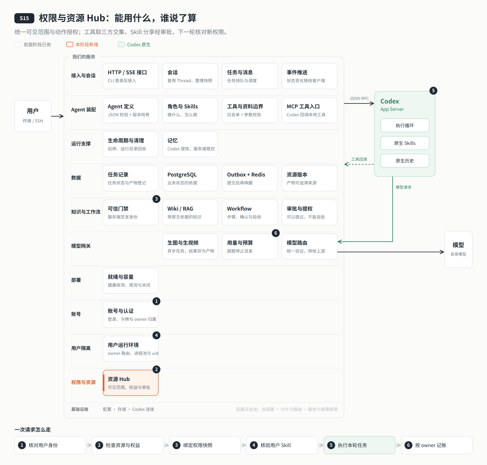

# s15: 权限与资源 Hub — 谁能用、谁能改，只在一个地方判定

[导论](../introduction.md) → [s00](../s00-sdk-quickstart/) → [s01](../s01-single-turn/) → [s02](../s02-multi-turn/) → [s03](../s03-service/) → [s04](../s04-events-messages/) → [s05](../s05-agent-assembly/) → [s06](../s06-tools/) → [s07](../s07-memory/) → [s08](../s08-data-layer/) → [s09](../s09-knowledge-layer/) → [s10](../s10-skill-workflow/) → [s11](../s11-model-gateway/) → [s12](../s12-deploy/) → [s13](../s13-auth/README.md) → [s14](../s14-isolation/README.md) → `s15` → [s16](../s16-coordination/README.md) → [s17](../s17-sharding/README.md) → [s18](../s18-replication/README.md) → [app](../../app/)

> *"谁能用、谁能改，只在一个地方判定"* — 知识库、Skill、工具、Agent 都有资源范围；可以分享给指定的人；能用多少由权益决定；每一次授权变更都留下审计。
>
> **对应六个问题**：⑤ 能用什么？ ⑥ 谁说了算？

---



## 要回答的问题

到上一章，每个用户都有了自己的账号和运行环境，彼此看不见。可团队里的人还需要"一起用"：

- alice 整理了一个知识库，想给 bob 用，但不想让 dave 看到。bob 能用，能不能改？alice 收回授权以后，什么时候生效？
- 有人只该用写作 Agent 和基本工具，有人可以用全部；这些规定写在哪里？
- 用户能不能上传自己的 Skill？想分享给别人，要不要有人把关？
- 一个用户用完了今天的 token，其他人还能继续吗？

这些判断如果散在各个模块里，工具管工具的，知识库管知识库的，迟早会出现一个地方放行、另一个地方拦截的情况。本章只加一个单元：**权限与资源 Hub**。所有"能不能"的判断都交给它。

## 核心概念

### 一个地方回答"能不能"

Hub 只回答一个问题：**这个用户，能不能对这个资源做这个动作？**动作有五种：使用、读取、修改、分享、删除。工具、知识库、Skill、Agent、配额，所有模块都来问它，不再各自判断。

回答也有讲究，和 s13 一样：看不见的资源返回 404，当它不存在；看得见但没有这个权限，比如被分享者想修改，返回 403。

### 资源范围：私有、分享、系统

每个资源都有一个**范围**：

| 范围 | 谁能用 | 谁能改 |
|---|---|---|
| 私有 | 只有所有者 | 所有者、管理员 |
| 分享 | 所有者，以及他指定的人 | 所有者、管理员 |
| 系统 | 所有用户，受权益限制 | 只有管理员 |

分享是**给指定的人**，不是公开：所有者把知识库授权给 bob，bob 只能读和用，不能改、不能删、不能再转给别人。收回最后一个授权，资源就回到私有。

### 权益决定能用多少

每个用户有一份**权益**：能用哪些 Agent、哪些工具组，每天多少 token，同时跑几轮，能建几个知识库、几个私有 Skill。内置两档：basic 和 pro，新用户默认 basic，由管理员调整。

一个用户最终能用的工具，是三份清单的交集：**Agent 允许的工具 ∩ 权益里的工具组 ∩ 这个工具组对他是否可见**。s06 埋下的白名单，到这里和用户的权益接上了。

一个用户用完了当天的 token，只停派他自己的新任务，排队的任务保留到第二天；正在执行的那一轮照样做完。其他人不受影响。

### 用户的 Skill：可以提议，不能自批

用户可以上传自己的 Skill（只能是指令文本，不能带代码），默认只装进他自己的 CODEX_HOME。想分享给别人，要提一个申请，由**另一位**管理员审阅正文后批准。这是 s10"可以提议，不能自批"在用户之间的延续：Skill 会改变别人的 Agent 怎么工作，不能由提议者自己说了算。分享自己的知识库不需要审批，因为那是他自己的资料。

### 权限在轮次边界生效，变更留下审计

权限会变：授权被收回，权益被降级。可一轮执行到一半，突然换掉它的权限，结果就说不清了。所以**每一轮开始时拍一张权限快照**，这一轮都按快照执行；变化从下一轮开始生效。

每一次分享、收回、发布、调整权益、审批 Skill，都写一条只能追加、不能修改的审计记录：谁，对什么，从什么改成什么，什么时候。

## 分工：Codex 做什么，我们做什么

| Codex 做什么 | 我们做什么 |
|---|---|
| 在每个用户的运行环境里发现并使用 Skill | Hub：资源范围、指定授权、权益与配额、Skill 审批、审计 |
| 调用工具、读取挂载的知识 | 每轮开始拍权限快照；工具回调时按快照再判一次 |
| | 授权的 Skill 装进被授权者的 CODEX_HOME，收回时移除 |
| | 超额只停派新任务，不打断正在执行的一轮 |

## 跑起来看看

需要 Node.js ≥24；依赖与上一阶段完全一致。复制 `.env.example` 为 `.env`，配置数据库、Redis 和模型，再执行：

```bash
npm ci
npm run db:up
npm run data:migrate
npm run agent:init
npm run auth:init
npm run user:add -- bob
npm run user:add -- carol
npm run user:add -- dave
npm run server
```

另开终端 `npm run login`，使用自己的账号。默认端口 `4329`，数据库 `agent_s15`，compose 项目和 systemd 单元 `codex-harness-s15`，部署目录 `APP_DIR=/opt/s15-hub`，示例域名 `example.com`。

```bash
npm run hub -- hub
npm run hub -- plan
# 使用已登录的 admin 身份，经 HTTP 分配；CLI 不直接改数据库
npm run plan:assign -- bob pro
npm run hub -- share general carol
npm run hub -- grants general
npm run hub -- unshare general carol
# admin 发布与取消发布
npm run hub -- publish general
npm run hub -- unpublish general
```

普通用户也可以自己建知识库，例如 `npm run knowledge -- create my-notes "我的资料"`；建好时是私有的，数量受权益限制。上传一份只含指令文本的 Skill，再申请分享给别人：

```bash
npm run hub -- skill:upload notes ./examples/private-skill
# 返回 id 后，所有者提交申请
npm run hub -- skill:share <id> carol
# 另一位 admin 登录后先审阅正文，再审批；不能自己提议自己批准
npm run hub -- skill:read <id>
npm run hub -- skill:approve <id>
npm run hub -- skill:reject <id>
# 所有者撤销，无需审批
npm run hub -- skill:unshare <id> carol
```

`POST /sessions` 可带 `{agent:"writing-assistant"}`，只能选择当前部署的已授权 Agent；其他 Agent 使用各自部署配置。本章不引入动态 Agent 上传。

知识库数量上限、删除流程、Skill 的格式要求，以及全部命令与接口的对照，见 [设计说明](docs/design.md#关键数值与实现细节)。

```bash
npm test
npm run lesson -- list
npm run lesson -- intersection
npm run lesson -- scope
npm run lesson -- skill-approval
npm run lesson -- quota
npm run lesson -- revocation
```

离线实验不需要端口、PostgreSQL、docker 或 uid 切换。真实约束、端口和容器验收见 [hub-acceptance.md](docs/hub-acceptance.md)；未执行的集成测试不能计为通过。

运行之后多了这些：数据库里的权益表（`plans`）、授权表（`resource_grants`）和只追加的权限事件表（`permission_events`）；被授权的 Skill 会安装进被授权者自己的 CODEX_HOME。

## 关键代码

第一段：工具权限由三个集合共同决定，工具回调仍在可信轮次上下文内重新执行同一判定。

```javascript
export function effectiveTools(user, agent, groups) {
  return [...new Set(groups.filter(group => decision(user, 'use', { ...group, type: 'tool_group' }) === 200)
    .flatMap(group => group.tools).filter(name => agent.tools.allow.includes(name)))];
}
```

第二段：新轮次在执行边界获取最新快照；`gate.start` 把它绑定到轮次，之后的撤销不改变这份快照。

```javascript
  atBoundary(operation, options) {
    const fresh = () => this.permissionHub ? this.permissionHub.withUser(currentIdentity().userId, operation) : operation();
    const run = () => this.boundary ? this.boundary.run(fresh, options) : fresh();
    return this.rpc.pool ? this.rpc.pool.withOwner(currentIdentity().userId, run) : run();
  }
```

第三段：超额只停派新轮次，任务保持 queued，已有轮次仍继续完成；定时唤醒按预算时区再次检查。

```javascript
    const entitlement = await this.permissionHub?.plan(job.userId, ownedRunning.size);
    if (entitlement?.concurrencyBlocked) return;
    const legacyBudget = await this.usage?.budgetStatus();
    const budget = entitlement?.exceeded ? entitlement : legacyBudget;
    if (budget?.exceeded) {
      this.retryBudget(threadId, budget);
      await this.publish(threadId);
      return;
    }
```

完整实现见 [Hub](server/modules/hub/index.mjs)、[门禁](server/modules/permissions/index.mjs)、[调度](server/modules/messages/index.mjs)。

## 限制

只支持指定用户名，没有小组、组织、计费、支付或 Skill 市场。权益由 admin 手动分配。用户 Skill 只能提供指令文本，执行能力仍来自服务端可信工具。授权与审批按实例事务串行，当前服务仍是单主机单执行器。

数据库授权与文件同步不能组成同一事务。同步失败时权限已按数据库提交，接口报错；重试撤销会再次清理副本。下一次用户进程启动会完整对账，在核验完成前不会执行新轮次。共享原文若已变化但所有者尚未登记新版本，返回 `SOURCE_STALE`，不返回旧内容。

本机非 root 模式不具备系统 uid 隔离；容器内不能切 uid 则拒绝启动。生产服务进程不进入用户 CODEX_HOME 内部；安装、移除和读取均交给同 uid 辅助进程。已经提供给模型的正文不会因撤销而从当前轮次记忆中消失；下一轮重新检查挂载权限。

## 小结

- 所有"能不能"都交给 Hub 一处判定：看不见返回 404，看得见不能做返回 403。
- 资源分私有、分享、系统三种范围；分享只给指定的人，只能读和用。
- 权益决定能用哪些 Agent、工具，能用多少；能用的工具是三份清单的交集。
- 用户上传的 Skill 可以提议分享，要由另一位管理员批准。
- 权限按轮次快照执行，变化从下一轮生效；每次变更都留下只追加的审计。

## 下一章

到这里，一台服务器上的云端 Agent 已经能让多个用户各用各的、按权限共享。可它终究只有一台：这台机器停了，所有人一起停；用户越来越多，一台机器也装不下。要扩展到多台机器，第一个要回答的问题是：几台机器之间，怎么知道谁还活着、谁说了算？

下一章：[s16 协调面](../s16-coordination/README.md)。
