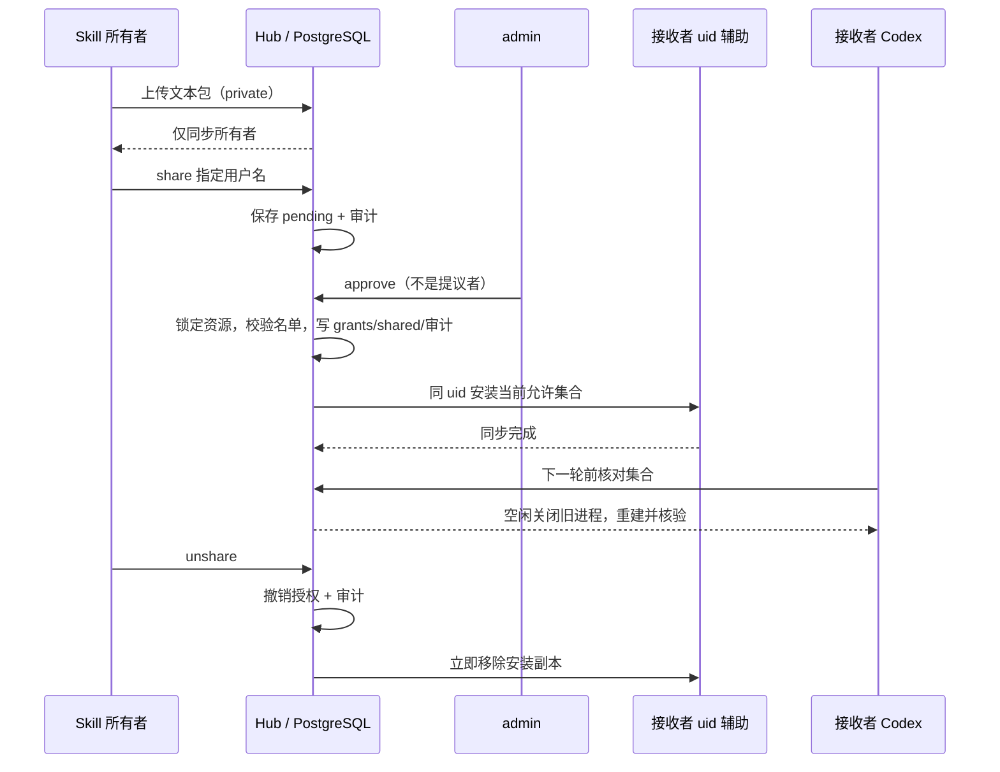
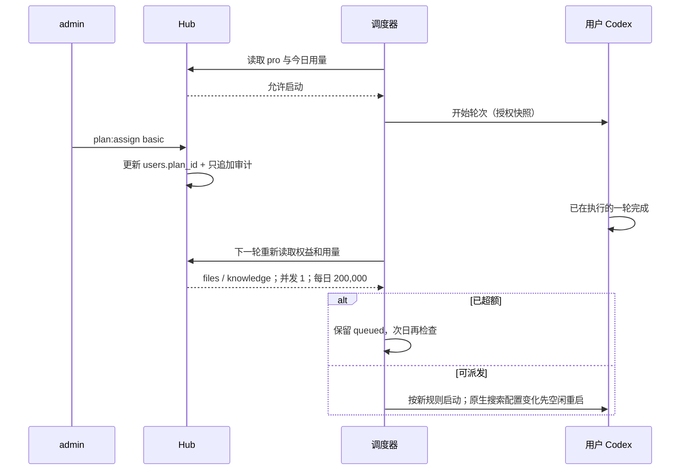

# 权限与资源 Hub 设计

## 职责与决策

Hub 负责统一授权与可见列表。资源类型为 Agent、工具组、知识库、Skill；动作固定为 use、read、modify、share、delete。知识库和用户 Skill 可 private/shared/system；工具组、Agent 和随代码交付的 Skill 为 system。工具实现与 Agent 定义仍由部署者提供。

basic：writing；files、knowledge；每日 200,000 token；并发 1；知识库 3；私有 Skill 3。pro：全部系统 Agent 与工具组；每日 1,000,000 token；并发 2；知识库 20；私有 Skill 20。admin 豁免权益限制；全局 2 轮约束仍有效。`plans` 的 `*` 是全系统集合选择器，运行时按可信目录展开，没有第三档权益。

权限内核在 `hub/policy.mjs`。调用时 `user` 来自认证或持久化任务 owner，不接受模型参数中的身份。personal 表示原有会话/文件隔离边界，不进入 Hub 可分享目录。Agent 白名单、workflow 授权、可写目录继续作为执行约束，不能扩大 Hub 给出的权限。

## 数据与一致性

- `users.plan_id` 默认 basic；首次迁移把已有用户接入 basic，admin 由角色豁免。已有知识库统一为 private。
- `resource_grants` 以实例、类型、资源、被授权者唯一。触发器锁定资源行后校验 20 人上限、所有者、自授权、目标状态。禁用保留授权记录，但身份加载失败。
- scope 随授权插入/删除变为 shared/private；scope 校验触发器拒绝与授权不一致的值。system 无授权记录。发布先撤销已有指定授权，取消发布为 private。
- `hub_skills` 保存服务端文本包和内容版本；`skill_share_requests` 保存 pending/approved/rejected、提议者、审批者和名单。只有所有者提议，另一位 admin 审核。审批时再次验证目标状态和剩余名额；审批、授权与审计同一事务提交。
- `permission_events` 保存 actor、动作、资源、before/after 与时间。UPDATE、DELETE、TRUNCATE 触发器均拒绝；这里防止的是正常数据库写接口篡改，数据库超级管理员仍拥有管理能力。
- 迁移由版本/校验和登记，`013-hub.sql` 本身另有事务内哨兵；重复运行不重置已分配权益或授权。旧迁移文件未修改。

## 运行边界

HTTP 普通请求取得最新的可见资源快照。新会话在 Hub 校验 Agent 后创建，并持久化当时实际可挂载的知识库 ID。每次新轮次在 ExecutionBoundary 内重新取快照，检查 Agent、Skill 和会话已挂载知识库，然后把快照放入 gate 的可信轮次上下文。工具、Wiki、来源引用与 RAG 均使用该快照；正在执行的一轮不因降级或撤销中断。

知识库读取先通过 Hub，再通过 Agent mount 与 workflow 限制，最后验证原文版本、Wiki 或 RAG 索引。RAG 在授权库内查询，以知识库 owner、kbId、indexRevision 过滤向量候选；返回前重新检查来源和权限。后台索引从持久化 KB 读取 owner，经 Hub 和对应用户运行环境执行。普通文件 ID 读取以及上游依赖也走 Hub，不能绕过共享范围。

共享原文按登记 owner 的 workspace 定位，以 `readAsUser` 在原 uid 下读取，检查独立普通文件、路径和大小；不会将请求身份切换成 owner，也不会读取其 CODEX_HOME。共享源正文必须与登记版本哈希一致。导入原文由 Hub 校验 modify，保存到该知识库 owner 的工作区，并登记相同 owner 的版本。

## Skill 同步

HTTP 上传使用 JSON 文本文件映射，不解压归档。只接受 SKILL.md 与 references/ 下的 .md/.txt，最多 50 个文件，合计 128 KiB。CLI 同样检查路径、符号链接、硬链接和大小。Codex 负责 frontmatter 解析和原生发现；服务负责允许集合核验。

所有者上传、admin 批准、所有者撤销后均立即对对应用户执行安装集合对账。Linux 生产运行通过已有同 uid 文件辅助进程完成，服务进程不进入用户 CODEX_HOME。每个 owner 的冷启动和同步共享串行边界，避免批准/撤销与进程冷启动交错后写回旧副本。只删除本服务 manifest 管理的 Skill，不触碰 `.system` 或其他目录。

活动轮次保留已批准的内容快照；撤销会立刻移除接收者安装副本。新的轮次若发现集合不同，等待活动轮次结束，在下一次空闲租约关闭旧进程并启动新进程，再核验 Skill 集合。指纹不兼容的旧会话按现有规则要求新建；原历史保留。

## 配额与降级

使用 s11 账本的 owner_id 汇总 token，时区沿用 AGENT_BUDGET_TIMEZONE。派发前等待账本写入链，达到上限保留 queued；定时检查直到该时区的次日恢复。进行中轮次和当前轮次的追加继续完成。并发按执行任务与活动会话去重计数，先受全局 2 轮限制，再受用户权益限制。用量写入失败保持 fail-closed。

## 验证与边界

离线测试覆盖策略内核、真实业务方法和调度器，通过测试夹具驱动；它不证明 PostgreSQL 触发器或 uid capability。外部 PG 测试真实执行重复迁移、21 个并发授权争夺 20 个名额、审批、scope 以及审计 UPDATE/DELETE/TRUNCATE 拒绝。Linux uid 测试执行真正的文件辅助进程与跨用户读取拒绝；服务器步骤验证 HTTP、运行中轮次与下一轮权限。

授权只针对指定用户，没有组织、小组、支付、Skill 市场或多主机。数据库与文件系统没有分布式事务；失败由报错、可重试对账与下一轮前核验收敛。已经送进模型上下文的资料不会被远程抹除。下一章的主题是 s16 多主机调度。
