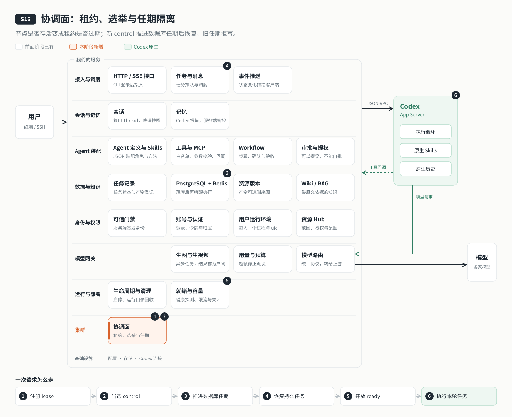

# s16: 协调面 — 租约判断谁活着，任期决定谁说了算

[导论](../introduction.md) → [s00](../s00-sdk-quickstart/) → [s01](../s01-single-turn/) → [s02](../s02-multi-turn/) → [s03](../s03-service/) → [s04](../s04-events-messages/) → [s05](../s05-agent-assembly/) → [s06](../s06-tools/) → [s07](../s07-memory/) → [s08](../s08-data-layer/) → [s09](../s09-knowledge-layer/) → [s10](../s10-skill-workflow/) → [s11](../s11-model-gateway/) → [s12](../s12-deploy/) → [s13](../s13-auth/README.md) → [s14](../s14-isolation/README.md) → [s15](../s15-hub/README.md) → `s16` → [s17](../s17-sharding/README.md) → [s18](../s18-replication/README.md) → [app](../../app/)

> *"节点是否存活，看租约是否过期"* — 多台机器之间，不靠猜测对方的状态：按时续约才算活着，选举决定谁是 control，任期号让醒来的旧主写不进去。
>
> **对应六个问题**：⑥ 谁说了算？

---



## 要回答的问题

到上一章，云端 Agent 已经能让多个用户安全地共用。可它只有一台机器：这台机器停了，所有人一起停。要扩展到多台机器，最先遇到的不是"数据怎么分"，而是一个更基础的问题：**几台机器之间，怎么就"谁还活着、谁说了算"达成一致？**

- 一台机器很久没有响应，它是挂了，还是只是网络慢？
- 原来的主节点卡住了十几秒，别人已经选出了新的主；它醒过来，以为自己还是主，接着写数据，怎么办？
- 正常下线和突然断电，别的机器分别多久能知道？

本章先用最简单的方式让多台机器协同：**主备**。三个节点里只有一个当 control 对外服务，另外两个热备；control 坏了，热备接任。本章只加一个单元：**协调面**，用 etcd 来做。用户隔离、Hub 权限都原样沿用。

## 核心概念

### 分布式里最难的，是分不清"慢"和"死"

一台机器没回应，你永远没法确定它是挂了，还是只是慢。如果别人判断它挂了、选出新主，而它其实还活着，就会出现两个"主"同时写数据，也就是**脑裂**。所以判断存活不能靠"ping 一下通不通"，要换一个所有人都认的规则。

### 租约：按时续约才算活着

每个节点加入集群时，向 etcd 申请一份**租约**（本章 TTL 10 秒），把自己的注册信息挂在租约上，然后每隔几秒续约一次。只要续约成功，它就算活着；超过 10 秒没续上，etcd 自动删掉它的注册信息，它就离开了集群。

这样，"它还活着吗"就变成了一个所有节点都能查到、答案一致的事实：**它的租约还在不在**。正常下线的节点会主动撤销租约，注册信息立刻消失，不用等 10 秒。

其他节点通过 **Watch** 订阅这些注册信息：有人加入、有人离开，etcd 马上推送过来。为了防止漏掉推送，每个节点还会每 5 秒对一次账。

### 选举与任期号：旧主醒来也写不进去

谁当 control，由 etcd 的**选举**决定：所有节点竞选同一个位置，当选者的选举记录也挂在自己的租约上。control 的租约一过期，记录消失，下一个候选者自动接任。

难点在"醒来的旧主"。它暂停了 15 秒，租约过期，新的 control 已经当选；它醒来时并不知道这些，还会尝试写入。所以每一任 control 都有一个**任期号**，由 etcd 分配、只增不减。

- control 写协调信息时，用事务附带一个条件："只有我的任期还是当前任期才写入"。旧主的任期已经过时，写入必然失败。
- 业务数据库也认任期：新 control 接任时把任期写进 PostgreSQL，之后每一条写入都要带上当前任期，带旧任期的写入被数据库直接拒绝。

不需要旧主"自觉"，它的写入在 etcd 和数据库两边都会被挡住。这个号码在分布式系统里叫 fencing token。

### 自我隔离：续不上约，就自己停下

节点发现自己续约失败、超过了 TTL，不等别人来通知，**立刻自己停下**：不再接新请求，就绪检查改成 503，正在执行的轮次标为待核对（s08 的语义），关掉用户进程。确认都停干净以后，再用一份新租约重新加入，从热备做起。

### 主备与入口

本章还没有把用户分到不同机器，所以只有 control 运行完整的业务和用户进程，热备只保持协调、随时准备接任。入口（Caddy）按 s12 的就绪检查只把请求转给 control：热备和正在恢复的新 control 都返回 503。新 control 先确认任期、把它写进数据库、完成 s08 的恢复（执行中的轮次待核对，排队的任务重新唤醒），之后才算就绪。

单机模拟时三个节点挂着同一块数据卷，所以换了 control 也能接着服务。真正的多台机器之间没有共享磁盘，这个问题留给 s17 和 s18。

## 分工：Codex 做什么，我们做什么

| Codex 做什么 | 我们做什么 |
|---|---|
| 在 control 节点的用户进程里照常执行 | 成员租约与续约、Watch 与对账、control 选举 |
| 被隔离时由我们关闭，执行中的轮次交由 s08 语义处理 | 任期号：etcd 事务和数据库两边都拒绝旧任期的写入 |
| | 续约失败时自我隔离，停干净后重新加入 |
| | 入口只转发给就绪的 control；新 control 恢复完成才就绪 |

etcd 只存这些**协调信息**（成员、control 与任期），会话、任务、知识库等业务数据仍在 PostgreSQL。

## 跑起来看看

需要 Node.js ≥24、Docker Compose。三个 agent 默认各 768 MiB（`AGENT_MEMORY_LIMIT` 可覆盖），etcd 128 MiB、Caddy 64 MiB、PG 256 MiB、Redis 128 MiB、网关 256 MiB，容器上限合计约 3.1 GiB。服务器还需要系统、镜像构建和文件缓存余量，建议至少 4 GiB，实际模型和工作负载需要实测。

```bash
cd stages/s16-coordination
cp .env.example .env
# 填数据库、etcd root/health/三个节点、Redis、网关密码与模型配置。
# 服务器 remote.sh init-env 会随机生成这些密码并写服务器 .env（0600）。
# CONTAINER_APP_DIR 必须等于固定部署绝对路径。
npm ci
# 本机：先填三个节点独立数据库密码，再准备数据；服务器可直接用 remote.sh。
docker compose build node-a node-b node-c
bash deploy/configure.sh
docker compose up -d etcd
docker compose stop node-a node-b node-c
docker compose run --rm --no-deps -T etcd-init
docker compose up -d --wait etcd postgres redis gateway
docker compose run --rm --no-deps --user 0 -T -v "$PWD/.env:$PWD/.env:ro" node-a node scripts/cluster-migrate.mjs
docker compose run --rm --no-deps node-a npm run agent:init
# 首次初始化，交互输入 admin 用户名与密码：
docker compose run --rm --no-deps -v "$PWD/.env:$PWD/.env:ro" node-a node scripts/maintenance.mjs accounts init
docker compose up -d --wait node-a node-b node-c caddy
bash deploy/cluster-ready.sh
export AGENT_SERVER_URL=http://127.0.0.1:4334
npm run login
npm run cluster -- status
```

入口仅发布 `127.0.0.1:4334`，节点内部端口是 `4340–4342`，不占宿主 4330/4331。数据库 `agent_s16`，Compose 项目及 systemd 单元 `codex-harness-s16`，服务器目录 `APP_DIR=/opt/s16-coordination`，示例域名 `example.com`。CLI 经 Caddy 登录和查询；热备直连 `/ready` 返回 503，`/health` 返回 200。容器健康检查采用 `/health`，因此 `compose --wait` 不会把热备当故障；入口健康检查仍采用 `/ready`。

etcd 的健康检查账号、已有服务器升级时要补的密码，以及各模块的职责划分，见 [设计说明](docs/design.md#关键数值与实现细节)。

`cluster status` 中的 `control.nodeId` 告诉你下一条命令该填写哪个节点。以下用 node-a 示意，每次故障前重新查询当前 control。

```bash
# 硬退出：成员约 TTL 10 秒后消失，另一节点当选；Caddy 切换后继续对话。
docker kill "$(docker compose ps -q node-a)"
npm run cluster -- status

# 假死：暂停旧 control 超过 TTL；恢复后旧任期不得写，入口仍指向新 control。
docker pause "$(docker compose ps -q node-a)"
sleep 15
docker unpause "$(docker compose ps -q node-a)"
npm run cluster -- status

# 正常退出：先关闭业务，再 resign / revoke，注册键立即消失。
docker stop "$(docker compose ps -q node-a)"
npm run cluster -- status

# 分区：对当前 control 执行，再接回；超过 TTL 自我隔离。
docker network disconnect codex-harness-s16_default "$(docker compose ps -q node-a)"
sleep 15
docker network connect codex-harness-s16_default "$(docker compose ps -q node-a)"
# 无需重启：旧服务和用户进程停止后，以新 lease 自动重新加入和竞选。
```

`restart: unless-stopped` 可能让 kill 后的节点自动回归；观察成员的 lease 和新任期，不把容器重启误当成原任期恢复。演示时先让三个节点都加入，再发会话请求；待核对轮次需人工查看历史，不自动重跑可能有副作用的工具。

```bash
npm test
npm run lesson -- list
npm run lesson -- lease
npm run lesson -- watch
npm run lesson -- election
npm run lesson -- fencing
npm run lesson -- isolation
# 独立、空的 etcd；不要指向正在运行的教学集群：
# 先对独立实例运行 scripts/etcd-init.mjs；不要复用业务集群。
# init 需要 ETCD_ENDPOINT、ETCD_ROOT_PASSWORD、ETCD_NODE_A/B/C_PASSWORD。
ETCD_TEST_ENDPOINT=http://127.0.0.1:2379 \
ETCD_TEST_NODE_A_PASSWORD="$ETCD_NODE_A_PASSWORD" \
ETCD_TEST_NODE_B_PASSWORD="$ETCD_NODE_B_PASSWORD" \
ETCD_TEST_NODE_C_PASSWORD="$ETCD_NODE_C_PASSWORD" npm run test:coordination
# 本机需 initdb、pg_ctl、redis-server；创建并清理独立临时数据库：
npm run test:data
# 预期：旧任期及缺任期写入 CT001；节点维护绕过 42501；新任期成功。
```

远程部署沿用 `DEPLOY_HOST=example.com bash deploy/remote.sh check|init-env|deploy|auth-init|status|tunnel`。备份、恢复与升级会停三个节点，不能只停 control 后让热备接手写盘。隧道本地端口为 4334，转发服务器 Caddy 回环入口。服务器首次部署流程需要安装 systemd；只在本机试跑可先按 `deploy/server-setup.sh` 的 Compose 步骤操作，跳过 `enable-service.sh`。

运行之后多了这些：一个开启了认证的 etcd（三个节点各有独立账号，只能读写 `/codex/` 下的键），数据库里一张记录当前任期的表，以及入口 Caddy。`npm run cluster -- status` 能看到每个成员租约的剩余时间、当前 control 和任期。

## 关键代码

注册键绑定自动续约的 lease：

```javascript
    const lease = this.client.lease(TTL); // automatic KeepAlive, TTL/3, owned by etcd3
```

任期保护写入：

```javascript
  async guardedPut(key, value) {
    this.assertController();
    const epoch = this.generation;
    const result = await this.client.if(this.electionKey, 'Create', '==', this.ownTerm)
      .then(this.client.put(key).value(typeof value === 'string' ? value : JSON.stringify(value))).commit();
    if (epoch !== this.generation) throw notController();
    if (!result.succeeded) { this.isolate('stale-term'); throw notController(); }
    this.assertController();
  }
```

同步隔离后再交给关闭流程：

```javascript
  isolate(reason) {
    if (!this.alive && !this.controller) return;
    this.alive = false; this.controller = false; this.generation++;
    clearInterval(this.reconcileTimer); clearTimeout(this.watchRetry);
    clearTimeout(this.timer);
    this.lease?.release(); // no more automatic renewals after local fencing
    this.record('isolated', { nodeId: this.nodeId, reason });
    this.emit('lost', reason); // synchronous admission/result fence before any await
  }
```

接口适配见 [etcd.mjs](server/modules/coordination/etcd.mjs)，切换见 [service.mjs](server/modules/coordination/service.mjs)，设计与边界见 [design.md](docs/design.md)。

## 限制

- PostgreSQL、Redis、模型网关仍是单实例，etcd 在教程里也是单节点；control 能接任，不代表这些依赖也高可用。三节点 etcd、TLS、监控属于生产部署，见 [生产部署](docs/production.md)。
- 任期号挡住的是**数据库写入**。旧主暂停期间已经发出的模型调用、工具调用撤不回；在共享卷上写的文件也不受数据库约束。共享卷只用于单机模拟，s17、s18 改为每个节点独立磁盘。
- etcd、PostgreSQL 和外部工具之间没有跨系统的原子事务。
- 被隔离的节点不会自动切回原来的位置；它以新身份重新加入，等待下一次选举。

数据库任期触发器、运维账号、依赖 etcd3 内部调用顺序的适配等完整说明，见 [设计说明](docs/design.md#限制的完整说明)。

## 小结

- 分布式里分不清"慢"和"死"，所以存活由租约决定：按时续约才算活着，过期就自动离开。
- Watch 让所有节点马上知道成员变化，定时对账防止漏掉。
- 选举决定谁是 control；任期号只增不减，etcd 和数据库都拒绝旧任期的写入，醒来的旧主写不进去。
- 续约失败就自我隔离，停干净再以新身份加入。
- 本章是主备：只有 control 服务，入口只转给就绪的 control。

## 下一章

主备解决了"一台坏了有人接任"，但没有解决"一台装不下"：所有用户仍然挤在 control 一台机器上，热备的算力都闲着。要让每台机器都干活，就得把用户分到不同的机器上。分出去以后，又要回答：一个请求从入口进来，怎么知道这个用户在哪台机器上？

下一章：[s17 分片与路由](../s17-sharding/README.md)。
