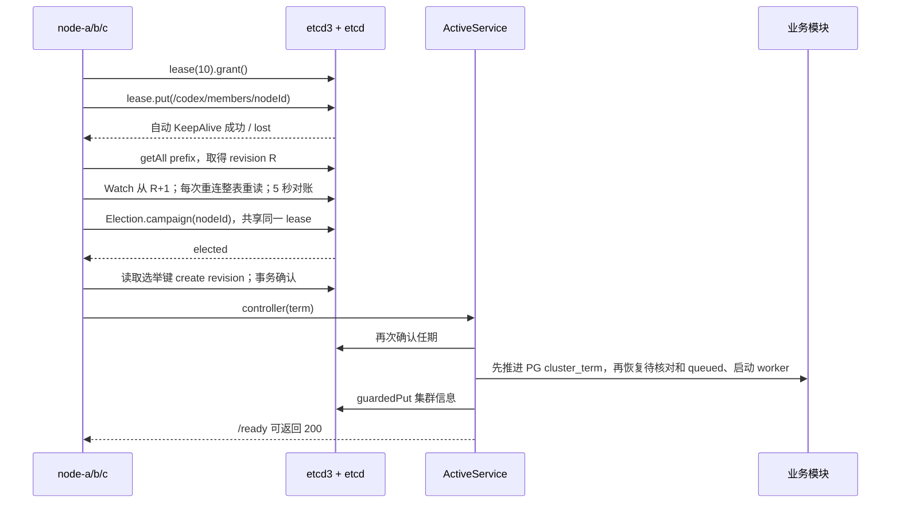
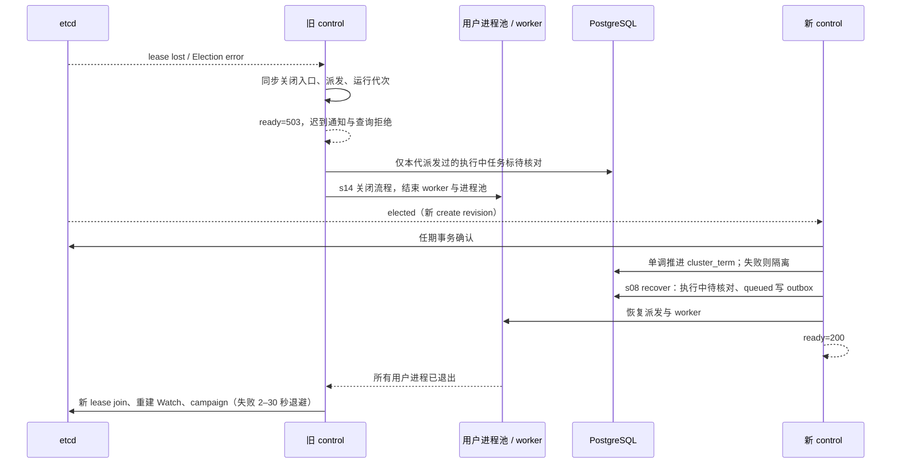

# 协调面设计

本章仅增加 coordination。固定 TTL 10 秒、etcd3 自动 TTL/3 KeepAlive、`/codex/` 前缀和三个节点。业务数据仍在 PG，Redis 负责唤醒；用户进程、uid 与 Hub 判定沿用既有实现。

## 注册、观察与选举

成员快照记录地址、REVISION、Agent 定义与指令内容哈希、进程池容量 4、加入时间；lease ID 来自 etcd KV 元信息。TTL 用 etcd3 的 `leaseClient.leaseTimeToLive` 查询，不能用加入时间推测。Watch 使用公开 builder / watcher；每次建立或重连后整前缀重读替换缓存，5 秒对账修正成员和 control/任期；compact_revision 或压缩错误触发重建 Watch。坏 JSON 记录事件并忽略。

etcd3 1.1.2 的 Election 默认建立自己的 lease，并添加 `election/` 命名空间。本章把公开 Namespace 接口适配到 `/codex/controller/`，让其 `lease()` 返回已经 grant 的成员 lease，再交给库的 Election。没有读取私有字段、修改库源码、实现 RPC 或自行决定选举结果。需通过真实 etcd 测试核对两个键的 lease ID 相同。

任期只取选举键 `create_revision`，不用当前全局 revision 或时间戳。所有协调写事务均比较该键 `Create == term`，失败抛 409 `NOT_CONTROLLER`，并同步隔离。`cluster/info` 不绑定成员 lease，保留最近一次控制信息；`GET /cluster` 的实时 control 则通过整读选举前缀并按 create_revision 取最早候选查询，不把陈旧 info 当真。

## 失权与接任

`ActiveService` 的每代 generation 捕获任期，失权同步将其 active 清零。检查单调时钟可在长暂停恢复后、定时器还未运行时拒绝请求和回调；延迟 KeepAlive 成功不能重新激活该代。Query/COMMIT 门禁覆盖 PG Pool 与借出的 Client；ROLLBACK、UNLISTEN、连接释放仍可执行。所有业务 SQL（含独立 pool.query）都在事务里 SET LOCAL app.term，触发器持有任期共享锁到提交；新 control 先推进任期再恢复。CT001 立即隔离。隔离清理使用捕获的旧任期，同样经过数据库触发器：仅本代已派发任务 ID 且仍处于 starting/running/steering 时改为 unconfirmed。若新任期已接手，旧代清理也会被拒，由新 control 的 s08 恢复负责标记。不能用旧 control 的全局 recover 把新 control 的任务错误标记。

业务栈整体由当选事件启动，热备没有 PG 业务连接、Redis worker、用户进程与工作目录维护器。集群入口不使用本机 PID 锁或 PG 单执行器 advisory lock，因为容器 PID 不能跨节点判断，暂停旧主还会阻塞接任；事务内部的配额锁、uid 分配锁等原有机制保留。直接测试业务栈的单机入口仍保留原锁。

正常停机先关闭业务栈（防止共享文件并发），再 Campaign.resign，最后显式 Lease.revoke 和 Watch.cancel。共享 lease 意味着 resign 本身已经撤销成员键，重复 revoke 为幂等。发生分区时释放本地 KeepAlive，等 etcd 到期；不把无法送达的撤销当作已完成。

## HTTP 与数据边界

Caddy 入口 127.0.0.1:4334；三个后端分别为 node-a:4340、node-b:4341、node-c:4342。`/health` 仅存活；`/ready` 先验证 control 与任期，再沿用数据库、网关、模型与队列检查。其他 HTTP 也经过入口门禁，不能靠 Caddy 健康缓存防止旧节点服务。SSE 不缓冲，关闭业务栈时断开，客户端重新连接新 control。

`/cluster` 是 admin 接口，查询本身不启动用户进程。成员/选举事件最多 20 条，Watch 连断、快照、当选、隔离和选举观察均记录在内存。CLI 使用现有令牌存储和 HTTP 客户端，不直接访问 etcd。

单机共享四个数据目录，绝对路径保持固定。PG、Redis、模型网关和 etcd 单实例是明确限制；多机磁盘、分片、复制和跨系统原子事务不属于本章。docker pause 解冻后子进程仍可立即写共享卷；s17/s18 改为每节点独立磁盘。

## 验证

`tests/coordination.test.mjs` 通过注入 etcd3 接口替身验证分支；替身的 elected 由测试显式发送，不运行候选排序算法。`tests/coordination.integration.mjs` 必须连接独立的空 etcd，验证三成员唯一 control、同 lease、撤销后 12 秒内接任以及旧任期真实事务拒绝。`npm test` 运行离线测试；Docker、PG、Redis、端口、Linux uid、真实 etcd 和模型验收需在支持这些服务的环境执行，不能用替身结果代替。`npm run test:data` 包含 coordination-pg 集成测试，预期旧任期 CT001、节点运维绕过 42501，推进等待旧事务提交；认证 etcd 集成测试另要求 ETCD_TEST_NODE_A/B/C_PASSWORD，并验证前缀外写入被拒。

## 关键数值与实现细节

章节 README 只讲概念；协调面的机制细节、模块职责与部署细节集中在这里。

租约是存活的确定性判断：节点是否仍属于集群，以 etcd 中 TTL 10 秒的 lease 是否有效为准，不根据一次 ping 猜测进程状态。etcd3 自动按 TTL/3 发送 KeepAlive；成员键与选举键绑定同一个 lease。租约到期，etcd 删除这些键；正常退出主动撤销，无需等到期。

Watch 先整前缀读取并记录 revision，再从 revision + 1 接收增量。每次（重新）连接后都整前缀重读并替换缓存；每 5 秒再核对成员与当前 control/任期，纠正差异并记录事件。压缩既检查 compact_revision 字段，也检查错误文本。revision 用字符串和 BigInt 计算，避免大整数精度丢失。

Election 决定谁是 control。任期等于该节点选举键的 create revision，是单调增长的隔离令牌。`guardedPut` 用事务比较旧选举键的 create revision；键已经删除或重建时，旧任期写入返回 409 `NOT_CONTROLLER`。`/codex/cluster/info` 的成员数、任期和时间是这个机制的演示。

自我隔离先同步关闭接收入口和派发开关：lease 丢失，或自上次成功 KeepAlive 起超过 TTL，立即使 `/ready` 返回 503。随后把本代已经派发的轮次标为 `unconfirmed`（待核对），关闭 worker、用户进程池和业务连接。旧代的通知、数据库查询与事务提交不能因为后续当选而复活。暂停恢复时，每个入口也会检查单调时钟，不能只等定时器回调。

本章采用主备，因为还没有按用户分片。只有 control 启动完整业务栈、派发和 worker；两个热备不启动用户进程。新 control 先确认 etcd 任期，再推进 PostgreSQL 的 `agent_data.cluster_term`，成功后才执行 s08 恢复：执行中的轮次待核对，不自动重发；queued 由持久 outbox 重新唤醒。恢复完成后才就绪。

三个容器共享 `.data`、`workspace`、`.runs`、`backups`，仅用于单机模拟。s17/s18 改为每节点独立磁盘；本章不实现分片、路由和复制。

### 模块职责

| 单元 | 职责 |
| --- | --- |
| coordination | lease、成员 Watch、Election、任期校验、主备生命周期、集群状态 |
| Caddy | 对三个节点执行 `health_uri /ready`，只转发到健康 control |
| messages / data | s08 的待核对、queued 恢复、PG 业务记录与 Redis 唤醒 |
| runtimes | s14 的四进程容量、每用户 uid / CODEX_HOME、关闭期限与隔离 |
| Hub | 资源可见性、分享、权益、配额、审计，在所有 control 上一致 |
| etcd | 只存 `/codex/` 下的协调元数据，不存业务会话和任务 |

代码版本从 `REVISION` 读取；成员同时报告 Agent 定义哈希、容量、地址和加入时间。节点名固定为 `AGENT_NODE_ID=node-a/b/c`，地址使用 Compose 服务名。`GET /cluster` 复用登录令牌且要求 admin，包含成员 lease 剩余 TTL、control 与任期、最近 20 条成员和选举事件。

### etcd 健康检查账号与升级

etcd 使用独立的 `health` 用户和同名角色，**只能读取精确的 `health` 键**，不能写入，也不能读取 `/codex/` 或其他键。`init-env` 随机生成 `ETCD_HEALTH_PASSWORD`，Compose 将其直接代入 `etcdctl --user health:… endpoint health`，不依赖镜像内的 shell。先启动 etcd（不等待健康），再运行 `etcd-init`，最后等待 etcd 和其余服务健康；初始化遇到连接失败会重试，最多 60 秒，并支持已有用户、角色及已开启认证的数据卷。

已有服务器升级时，保留 `.env` 中原有的 root、节点、数据库等密码，只补充随机的 `ETCD_HEALTH_PASSWORD`（例如用 `openssl rand -hex 24` 生成后写入 `.env`）。不要重新生成整份 `.env`。按上述流程或 `remote.sh deploy` 重新部署后，初始化脚本使用原 root 凭据补建 health 用户和角色，随后健康检查通过；数据卷无需删除，认证无需关闭。

### 限制的完整说明

PostgreSQL、Redis、模型网关仍为单实例；etcd 教程也是单节点。control 高可用不代表这些依赖高可用。Compose 不发布 etcd 宿主端口；etcd 已开启认证，node-a/b/c 各有独立用户与角色，只允许 `/codex/` 前缀 readwrite。Redis 启用 requirepass。生产仍需独立故障域、TLS、备份和监控；见 [生产部署](production.md)。网关密钥仍由三个节点共用，尚未按节点区分网关身份。

PostgreSQL 迁移 015 为 agent_data 下除 migrations、cluster_term 外的所有业务表建立 BEFORE INSERT/UPDATE/DELETE 触发器。连接包装器把独立语句也放入事务，执行 `SET LOCAL app.term`；触发器对任期行持有共享锁到事务结束，任期推进等待旧事务完成。新任期推进成功后，缺任期或旧任期写入返回 `CT001`，写入方立即隔离。推进只允许增加或保持当前值，遇到数据库更高任期也立即隔离。这里仍不提供 etcd、PG、外部工具之间的跨系统原子事务，不能撤销外部副作用。

运维命令明确使用 `app.maintenance=on`，触发器同时检查 `current_user` 必须为超级用户（部署中为 `agent`，临时集成测试为 `agent_test`）。PostgreSQL 自定义会话变量不能用普通 GRANT 禁止 SET；节点即使设置这个变量，业务写入仍被 42501 拒绝。节点角色无超级用户、建库、建角色权限，也不能直接写 cluster_term 或 migrations；只获准调用固定 search_path 的单调任期推进函数。账号初始化/修改、迁移和导入用一次性运维容器加载服务器 `.env`，长期节点只拿自己的 PG 与 etcd 凭据。新增业务表的后续迁移必须同时添加任期触发器。

`docker pause` 会冻结整个容器，包括用户 Codex 子进程；解冻后子进程会立即继续写共享卷。旧任期结果已被 PG 拦截，执行轮次由新 control 标为待核对，但文件写入不受数据库触发器保护。共享卷只用于单机模拟，s17/s18 改为每节点独立磁盘。本章不另做文件级锁。

`sharedLeaseElection` 依赖锁定的 etcd3 **1.1.2 内部调用顺序**：Campaign 构造时取得 namespace.lease，start 调用 grant，再以 lease ID 事务写入选举键。竞选错误和 resign 都可能撤销共享 lease，成员键也会随之消失。不能把这一适配当成稳定公开的 shared-lease API；升级依赖必须重跑认证集成测试。

隔离后不退出进程：等 service.stop 完成、用户 Codex 进程确认退出，再用新 lease join → Watch → campaign；失败按 2、4、8、16、30 秒指数退避，之后保持 30 秒。重新加入及新 control 恢复完成前 `/ready` 始终 503。旧 generation 的 lease、Watch、竞选和异步确认回调均失效。若无法确认旧进程退出，保持隔离，不创建新进程池。没有自动切回首选节点。事件缓冲不是持久审计，故障时可看容器日志与认证后的 etcdctl。
