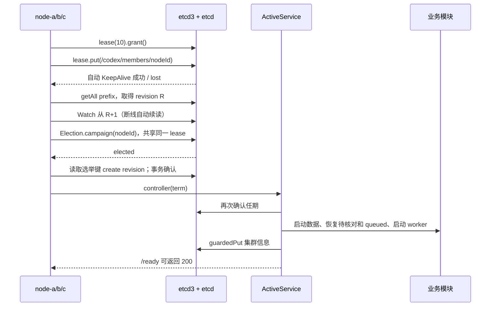
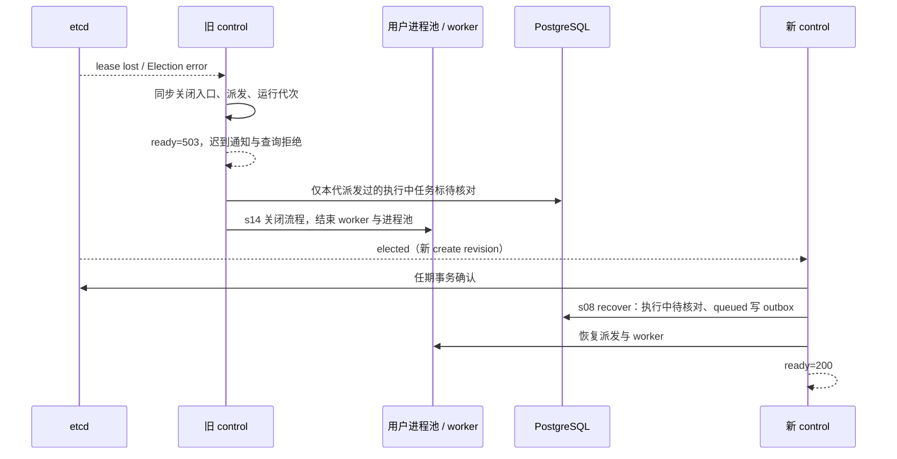

# 协调面设计

本章仅增加 coordination。固定 TTL 10 秒、etcd3 自动 TTL/3 KeepAlive、`/codex/` 前缀和三个节点。业务数据仍在 PG，Redis 负责唤醒；用户进程、uid 与 Hub 判定沿用既有实现。

## 注册、观察与选举

成员快照记录地址、REVISION、Agent 定义与指令内容哈希、进程池容量 4、加入时间；lease ID 来自 etcd KV 元信息。TTL 用 etcd3 的 `leaseClient.leaseTimeToLive` 查询，不能用加入时间推测。Watch 使用公开 builder / watcher；传输重连由客户端维护续读 revision，压缩错误触发全前缀重读。

etcd3 1.1.2 的 Election 默认建立自己的 lease，并添加 `election/` 命名空间。本章把公开 Namespace 接口适配到 `/codex/controller/`，让其 `lease()` 返回已经 grant 的成员 lease，再交给库的 Election。没有读取私有字段、修改库源码、实现 RPC 或自行决定选举结果。需通过真实 etcd 测试核对两个键的 lease ID 相同。

任期只取选举键 `create_revision`，不用当前全局 revision 或时间戳。所有协调写事务均比较该键 `Create == term`，失败抛 409 `NOT_CONTROLLER`，并同步隔离。`cluster/info` 不绑定成员 lease，保留最近一次控制信息；`GET /cluster` 的实时 control 则通过 Election.leader 与该成员对应选举键查询，不把陈旧 info 当真。

## 失权与接任

`ActiveService` 的每代 generation 捕获任期，失权同步将其 active 清零。检查单调时钟可在长暂停恢复后、定时器还未运行时拒绝请求和回调；延迟 KeepAlive 成功不能重新激活该代。Query/COMMIT 门禁覆盖 PG Pool 与借出的 Client；ROLLBACK、UNLISTEN、连接释放仍可执行。隔离清理由 rawPool 进行唯一的例外写入：仅本代已派发任务 ID 且仍处于 starting/running/steering 时改为 unconfirmed。不能用旧 control 的全局 recover 把新 control 的任务错误标记。

业务栈整体由当选事件启动，热备没有 PG 业务连接、Redis worker、用户进程与工作目录维护器。集群入口不使用本机 PID 锁或 PG 单执行器 advisory lock，因为容器 PID 不能跨节点判断，暂停旧主还会阻塞接任；事务内部的配额锁、uid 分配锁等原有机制保留。直接测试业务栈的单机入口仍保留原锁。

正常停机先关闭业务栈（防止共享文件并发），再 Campaign.resign，最后显式 Lease.revoke 和 Watch.cancel。共享 lease 意味着 resign 本身已经撤销成员键，重复 revoke 为幂等。发生分区时释放本地 KeepAlive，等 etcd 到期；不把无法送达的撤销当作已完成。

## HTTP 与数据边界

Caddy 入口 127.0.0.1:4334；三个后端分别为 node-a:4340、node-b:4341、node-c:4342。`/health` 仅存活；`/ready` 先验证 control 与任期，再沿用数据库、网关、模型与队列检查。其他 HTTP 也经过入口门禁，不能靠 Caddy 健康缓存防止旧节点服务。SSE 不缓冲，关闭业务栈时断开，客户端重新连接新 control。

`/cluster` 是 admin 接口，查询本身不启动用户进程。成员/选举事件最多 20 条，Watch 连断、快照、当选、隔离和选举观察均记录在内存。CLI 使用现有令牌存储和 HTTP 客户端，不直接访问 etcd。

单机共享四个数据目录，绝对路径保持固定。PG、Redis、模型网关和 etcd 单实例是明确限制；多机磁盘、分片、复制和跨系统业务 fencing 不属于本章。

## 验证

`tests/coordination.test.mjs` 通过注入 etcd3 接口替身验证分支；替身的 elected 由测试显式发送，不运行候选排序算法。`tests/coordination.integration.mjs` 必须连接独立的空 etcd，验证三成员唯一 control、同 lease、撤销后 12 秒内接任以及旧任期真实事务拒绝。`npm test` 运行离线测试；Docker、PG、Redis、端口、Linux uid、真实 etcd 和模型验收需在外部执行，不能用替身结果代替。
