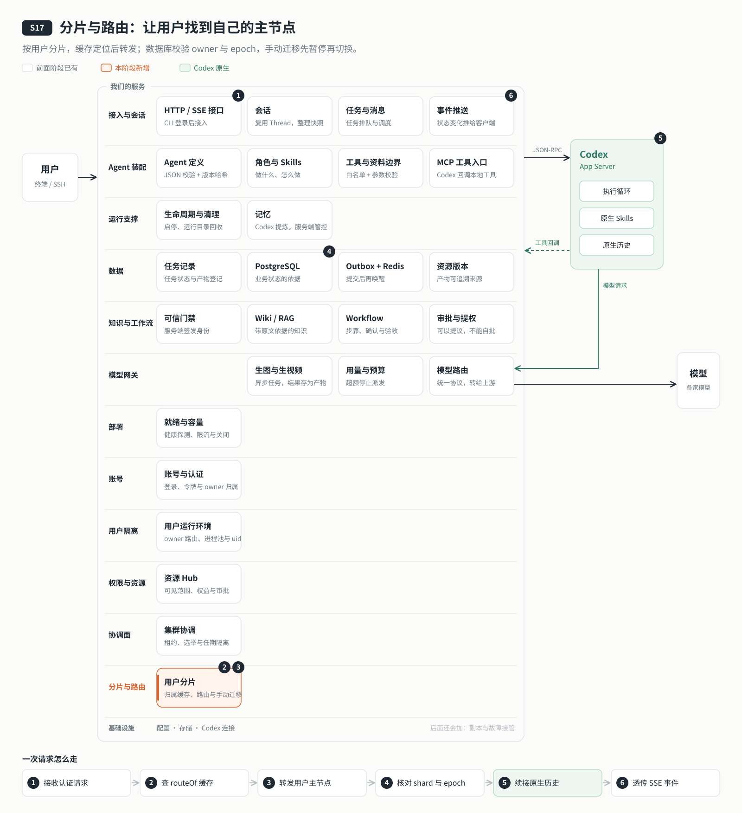

# s17: 分片与路由 — 按用户分到不同节点，从任意入口都能找到他

[导论](../introduction.md) → [s00](../s00-sdk-quickstart/) → [s01](../s01-single-turn/) → [s02](../s02-multi-turn/) → [s03](../s03-service/) → [s04](../s04-events-messages/) → [s05](../s05-agent-assembly/) → [s06](../s06-tools/) → [s07](../s07-memory/) → [s08](../s08-data-layer/) → [s09](../s09-knowledge-layer/) → [s10](../s10-skill-workflow/) → [s11](../s11-model-gateway/) → [s12](../s12-deploy/) → [s13](../s13-auth/README.md) → [s14](../s14-isolation/README.md) → [s15](../s15-hub/README.md) → [s16](../s16-coordination/README.md) → `s17` → [s18](../s18-replication/README.md) → [app](../../app/)

> *"按用户分片，从任意入口都能找到他"* — 用户的历史跟着用户落在一台主节点上；路由表由 control 发布，各节点缓存并订阅变化，缓存过期就刷新重试。
>
> **对应六个问题**：③ 之前聊过什么？ ⑥ 谁说了算？

---



## 要回答的问题

上一章的三个节点是主备：只有 control 干活，所有用户挤在一台机器上，另外两台的算力闲着。用户再多，一台机器总会装不下。

这一章让每台机器都干活：把用户分到不同的节点上。分出去以后，有一串问题要回答：

- 按什么分？按用户、按会话，还是按每一条消息？
- 一个请求从入口进来，怎么知道这个用户在哪台机器上？
- "哪个用户在哪台机器"这张表变了，所有节点怎么同时知道？某个节点没及时知道怎么办？
- alice 分享给 bob 的知识库，在另一台机器上，bob 怎么读到？
- 想把一个用户从一台机器搬到另一台，怎么搬才不丢数据？

本章只加一个单元：**分片**。s16 的租约、选举、任期，s14 的用户运行环境，s15 的 Hub 权限都原样沿用。三个节点从这一章起**各用各的磁盘**，不再共享数据卷。

## 核心概念

### 分片键是用户，不是消息

从 s14 起，每个用户有自己的 Codex 进程和 CODEX_HOME，原生历史、状态库、记忆都在里面。如果按消息分，同一个用户的第一轮在 A 机器、第二轮在 B 机器，B 上的 Codex 根本看不到第一轮聊了什么。所以**分片键是用户 ID**：一个用户的全部数据跟着他落在同一台主节点上。

### "用户属于哪个分片"和"分片在哪台机器"分开

分片分成两步：

1. **用户 → 分片**：由分配策略决定。默认把用户 ID 哈希到 64 个槽，槽再归到 3 个分片；另有一个按 ID 前缀划范围的策略作对照（直观，但容易冷热不均）。
2. **分片 → 节点**：由 control 决定每个分片的主节点是谁，记在 etcd 的**分片归属表**里，只有 control 能写（带着 s16 的任期检查）。

两步分开，换机器只需改第二步，不用重新计算每个用户的归属。个别用户还可以有一条**例外**记录，把他单独放到指定分片，手动迁移就是这样实现的。

### 路由表：每个节点缓存一份，订阅变化

每个请求都去 etcd 查一次太慢。所以每个节点启动时整表读一次，记下版本号（revision），之后用 Watch 订阅变化、增量更新本地缓存；断线或者版本被压缩了，就整表重读；每 5 秒还对一次账。

缓存总有可能慢一步。所以入口可以是**任意一个就绪的节点**：它认证用户以后，按缓存找到这个用户的主节点，把请求连同自己缓存的版本号一起转发过去。主节点再核对一遍："我真的是这个用户的主节点吗？你的版本号不比我的旧吧？"对不上就返回 409 `STALE_ROUTE`，转发方刷新缓存后**重试一次**。主节点不信任转发方的缓存，只信自己。

### 数据库按分片隔离写入

s16 的任期号保护的是 control 写的协调信息。分片以后，业务数据也要防"旧主"：一个用户被迁走了，原来的节点不能再替他写。所以每个分片也有自己的任期号（epoch），每一次业务写入都带上"我是哪个节点、我认为的 epoch 是多少"，数据库按用户追溯到他所在的分片，节点或 epoch 对不上就拒绝（SH001）。

### 共享知识库只有一份

alice 把知识库分享给 bob，可他们可能在不同的机器上。我们不复制一份给 bob，而是让 **alice 的主节点提供只读接口**：bob 的节点先按 s15 的 Hub 判断一次，再带着 bob 的登录令牌去问 alice 的节点；alice 的节点重新认证 bob、再查一次授权，才把内容交给他。判断做两次，中途撤销授权也不会被放行。

### 迁移：先停写，再搬家

把一个用户从一台机器搬到另一台，关键是搬的时候数据不能还在变：

1. 暂停这个用户的新任务派发；
2. 等执行中的轮次做完，关掉他的进程；
3. 把他的 CODEX_HOME 和工作目录完整拷到目标节点，保留系统账号的数值属主；
4. control 先在数据库里改归属，再在 etcd 里发布例外记录；
5. 恢复派发，之后的请求都去新的主节点。

中途失败就保持暂停，等人核对，不自动回退、不自动重来。

### 一台坏了，只影响它那一片

分片以后，一个节点停了，只有它负责的那个分片暂时不可用（返回 503 和原因），其他分片照常服务。可这一片的用户只能等它恢复，因为他们的数据只在那台机器的磁盘上。让别的节点接手，是下一章的事。

## 分工：Codex 做什么，我们做什么

| Codex 做什么 | 我们做什么 |
|---|---|
| 在用户所在的主节点上照常执行，历史留在他自己的 CODEX_HOME | 分配策略、分片归属表与例外记录（只有 control 能写） |
| | 每个节点的路由缓存：整表读取、Watch 增量、定时对账 |
| | 任意入口转发到主节点；过期就 409，刷新后重试一次 |
| | 数据库按分片和 epoch 拒绝越界写入；跨分片只读共享知识 |
| | 手动迁移：停写、拷贝、切换归属、恢复 |

## 跑起来看看

先完成离线实验（Node 24，不调用模型、不监听端口）：

```bash
cd stages/s17-sharding
npm ci
npm test
npm run lesson -- list
npm run lesson -- strategies
npm run lesson -- stale-route
npm run lesson -- shard-fence
npm run lesson -- move
```

真实单机演示需要 Docker、Linux uid 隔离和可用模型网关；这些命令不属于离线测试。在本阶段复制 `.env.example` 为 `.env` 并填写模型服务商配置。生成独立的实验凭据，禁止把输出贴到日志：

```bash
node scripts/deploy-env.mjs "$PWD" > .env.generated
mv .env.generated .env
chmod 600 .env
docker compose build node-a node-b node-c
bash deploy/configure.sh
docker compose up -d etcd
docker compose stop node-a node-b node-c
docker compose run --rm --no-deps -T etcd-init
docker compose up -d --wait etcd postgres redis gateway
docker compose run --rm --no-deps --user 0 -T -v "$PWD/.env:$PWD/.env:ro" node-a node scripts/cluster-migrate.mjs
docker compose run --rm --no-deps -T node-a npm run -s agent:init
# 只同步部署身份，不同步用户数据目录。
cp nodes/node-a/.data/identity.json nodes/node-b/.data/identity.json
cp nodes/node-a/.data/identity.json nodes/node-c/.data/identity.json
docker compose run --rm --no-deps -v "$PWD/.env:$PWD/.env:ro" node-a node scripts/maintenance.mjs accounts init
docker compose up -d --wait node-a node-b node-c caddy
export AGENT_SERVER_URL=http://127.0.0.1:4335
npm run login
npm run cluster -- status
```

入口只发布 `127.0.0.1:4335`，节点内部端口 `4340–4342`，不同 Compose 项目的网络隔离。数据库 `agent_s17`，项目与 systemd 单元 `codex-harness-s17`，服务器固定目录 `APP_DIR=/opt/s17-sharding`，示例域名 `example.com`。镜像 digest 沿用上一章已核实值。

可以按这个顺序观察：多建几个用户，看他们分布到不同分片；从三个节点分别进入，请求都会到同一个主节点；让 bob 把知识库分享给 carol，二者分在不同节点时 carol 也能读，dave 读不到；停掉一个节点，只有它那一片不可用；最后把 bob 迁到另一个分片，历史、记忆、知识库都完整。每一步的具体命令、外部验收、路由诊断接口与远程部署，见 [设计说明](docs/design.md#关键数值与实现细节)。

运行之后多了这些：etcd 里的分片归属表、槽表和例外记录；数据库里的用户—分片映射、分片—主节点与 epoch，以及迁移操作单；三个节点各自的 `nodes/node-a|b|c` 目录，各有一份 `.data`、`workspace`、`.runs`。

## 关键代码

[策略](server/modules/sharding/strategy.mjs)将用户与节点解耦：

```javascript
export const slotOf = id => createHash('sha256').update(String(id)).digest().readUInt32BE(0) % SLOT_COUNT;
```

[缓存](server/modules/sharding/cache.mjs)统一暴露路由，override 优先：

```javascript
  routeOf(userId) {
    // Older controls wrote bare 0/1/2: JSON.parse turns those bytes into numbers.
    // Keep the raw override for diagnostics, but all routing/PG comparisons use text IDs.
    const raw = this.overrides[userId] ?? this.strategy.shardOf(userId, this);
    const shardId = ['string', 'number'].includes(typeof raw) && SHARDS.includes(String(raw)) ? String(raw) : null;
    const owner = this.shards[shardId];
    return { shardId, primary: owner?.primary ?? null, epoch: owner?.epoch ?? null, revision: this.revision };
  }
```

[主节点](server/modules/sharding/routing.mjs)不会信任转发方的缓存：

```javascript
export function validateRoute(cache, userId, nodeId, revision) {
  if (!/^\d+$/.test(String(revision)) || cache.routeOf(userId).primary !== nodeId || BigInt(cache.revision) < BigInt(revision)) throw staleRoute();
}
```

数据库行触发器在 [016-sharding.sql](server/modules/data/migrations/016-sharding.sql)，最终 check_shard、操作单与列级权限在 [018-move-security.sql](server/modules/data/migrations/018-move-security.sql)，事务边界在 [write.mjs](server/modules/data/write.mjs)，迁移编排在 [move.mjs](server/modules/sharding/move.mjs)。

## 限制

- 节点坏了，它的分片就不可用：本章没有副本，也没有自动接管和自动再平衡。
- PostgreSQL、Redis、模型网关仍是单实例，教学用的 etcd 也是单节点。
- etcd 与 PostgreSQL 之间没有跨库的原子提交：迁移时先在数据库提交归属，再发布 etcd；发布失败就保持暂停，等人核对。
- 节点之间用各自独立的节点密钥互相认证，但没有 mTLS 和传输加密，只能放在可信网络里。
- 手动迁移要求源和目标都在线、部署路径一致；单次传输有大小上限，它不是磁盘损坏的恢复工具。

节点密钥与数据库列级权限、跨分片读取的令牌处理、传输上限与 SSE 序号等完整说明，见 [设计说明](docs/design.md#限制的完整说明)。

## 小结

- 分片键是用户：一个用户的历史、状态、记忆都跟着他落在同一台主节点。
- 用户 → 分片由策略决定，分片 → 节点由 control 发布；两步分开，个别用户可以有例外。
- 每个节点缓存路由表并订阅变化；主节点不信任转发方的缓存，过期就 409，刷新后重试一次。
- 数据库按分片和 epoch 拒绝越界写入；共享知识库只有一份，由所有者的主节点提供只读接口。
- 迁移先停写再搬家；一台坏了只影响它那一片。

## 下一章

分片让每台机器都干活了，可也带来了新的风险：每个用户的数据只在一台机器的磁盘上。这台机器坏了，它那一片的用户就只能干等。要让别的节点接手，就得提前把数据复制过去；复制总会慢一步，主节点突然坏掉时，最后那一点没来得及复制的内容怎么办，也要说清楚。

下一章：[s18 副本与故障接管](../s18-replication/README.md)。
