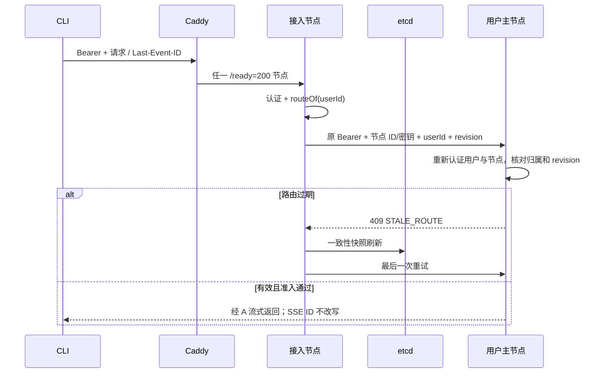
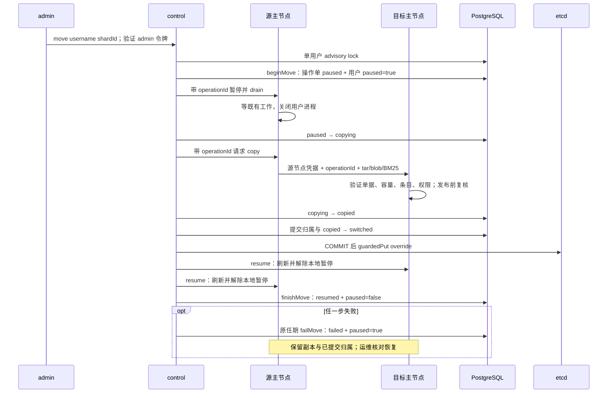

# s17 分片与路由设计

本章唯一新增单元是 `server/modules/sharding/`。数据库、HTTP、后台 worker、uid 目录和部署脚本是该单元的接入点。成员 TTL=10 秒；客户端自动续租约 TTL/3；对账=5 秒；3 节点、3 分片、64 槽；普通转发=30 秒；STALE_ROUTE 最多重试一次；SSE 无总时限。

## 请求与缓存



读取 `/codex/` 的单次快照给三张表一个 MVCC revision；同一整前缀 Watch 覆盖 shards、slots、overrides，apply 只处理路由键。revision 使用十进制字符串与 BigInt，避免超过 Number 精度。快照和 Watch 交错时重放比快照新的后缀。断线/压缩后整表刷新，从新 revision+1 监听；5 秒对账兜底。

主归属独立于 control 身份；所有存活成员启动自己的业务栈。Redis ready key 带 nodeId，任务扫描、恢复、运行目录初始化、媒体轮询、知识索引都过滤本节点用户。`canDispatch` 在异步查询 PG 前后核对租约、缓存主归属和本地暂停，再比较 PG 的 paused 与 shard_id。成员代次失效后停止进程池，等待旧进程退出后重新加入。

每个运行容器只有自己的 `AGENT_NODE_KEY_A/B/C` 明文密钥和三个节点的 SHA-256 验证哈希。`authenticateNode` 以 `x-node-id` 选择预置哈希，校验 `x-node-key` 的哈希后才承认调用节点。自报身份不构成凭据；节点认证也不能代替用户或管理员授权。内部 HTTP 无传输加密，部署须位于可信网络；节点仍共享业务数据库和控制面信任，不是恶意租户之间的隔离边界。

外部请求先认证，目标主节点再次认证 Bearer，并从资源/用户记录计算路由用户；不能信任客户端自报 `x-route-user`。转发过滤来路中的节点和路由头，再写入本节点可信值。目标只来自 etcd 成员地址，HTTP 绝对形式 URL 也仅取 pathname 与 query。未知主或离线主返回 SHARD_UNAVAILABLE，不向另一台机器试探数据。只有带 STALE_ROUTE 标识的 409 触发一次刷新重试，普通业务冲突不重试。

## 元数据与事务

| 数据 | 权威位置 | 写规则 |
|---|---|---|
| members、controller | etcd lease/Election | coordination 管理 |
| shards、slots、overrides | etcd | control.guardedPut，比较选举键 create revision |
| cluster_term | PG | advance_cluster_term，节点不可直接 UPDATE |
| shard_owners、user_shards | PG | control.locked、CT001 事务触发器；pause 与映射同表 |
| move_operations | PG | control 任期保护的状态转换；绑定用户、节点、分片及有效期 |
| 用户业务数据 | PG + 所属节点磁盘 | shard owner、epoch、迁移状态；uid 文件访问 |

control 初始化按当前成员排序，每个节点一个分片；没有成员时保留 null 主和 epoch=0，首次放置推进为 1。成员离开不改变原主与 epoch；新成员只能填 null 主，不能抢走已分配分片。本章不自动提升或重平衡。

分片放置的 `place` 在 PG 事务中锁定 cluster_term，写 shard_owners 并 guardedPut 分片记录，再确认任期并提交。这不是 PG 与 etcd 的原子事务；缓存与 SQL 的短暂分歧仍由准入和 SH001 限制，后续对账核对分片归属。

用户迁移的 `switchUser(userId, shardId, operationId)` 有明确的提交顺序：先在任期保护的 PG 事务核对操作单与源分片，更新 user_shards 并将 copied 推进为 switched；COMMIT 完成后才发布 etcd override。这样不会先把路由发布为目标、PG 却仍停在源归属。PG 已提交而 etcd 未发布仍是可能的失败窗口：用户保持暂停，失败记录为 failed，不自动恢复旧副本。对账只采纳最新操作单为 switched/resumed 且目标匹配的 override，并只更新暂停用户；缺单、未完成复制或 failed 的 override 记录后忽略，不用于修复 PG。

etcd RBAC 将候选节点限制到 `/codex/`，动态“仅 control 写”在受信任节点的 guardedPut API 中实施。静态角色不能基于 Election 自动授予写权限；节点凭据不能交给最终用户。集成测试区分 API 的任期拒绝和原始凭据的键空间 ACL。

## 数据库逐行隔离

所有生产业务连接经 `fencePool`。普通 query 自动包事务，显式 BEGIN 连接在事务起点设置 `app.node`、`app.shard_epoch`。cleanup 的 ROLLBACK/UNLISTEN 仍允许失效代次执行。身份来自认证 AsyncLocalStorage 或任务持久化 owner；资源管理请求使用单独 shard 上下文，保留 actor 授权身份，同时设置目标 owner 的 epoch。

`require_shard_owner` 对 UPDATE 同时检查 OLD 和 NEW。最终生效的 `check_shard` 定义在 [018-move-security.sql](../server/modules/data/migrations/018-move-security.sql)：锁住 user_shards 与 shard_owners 对应行直到 COMMIT，校验真实 SQL 角色、app.node 和 epoch。即使伪造事务变量，也不能使用 node-b 角色写 node-a 分片。用户暂停且操作单为 copying、copied、switched 或 failed 时拒绝业务写入；paused 状态允许已进入执行的轮次收尾，drain 完成后才推进 copying。

| 业务表 / 写入点 | owner 解析 / 隔离方式 |
|---|---|
| conversations、preferences、resources、usage、media_jobs、hub_skills、knowledge_bases | 行 owner_id |
| user_runtimes | 行 user_id；uid 全库唯一，分配持有 advisory lock |
| tasks、outbox、notifications、artifacts | thread_id → conversations.owner_id |
| knowledge_mounts、wiki_pages、wiki_versions、knowledge_indexes、knowledge_jobs | kb_id → knowledge_bases.owner_id |
| resource_versions | resource_id → resources.owner_id |
| dependencies | derived_id → resources.owner_id；来源读取仍须 Hub 授权 |
| resource_grants、skill_share_requests | 授权资源 / skill → owner；跨节点 admin 也去资源主节点 |
| permission_events | 知识/Skill owner；删除后从 before_state 取 owner；账号权益操作用 actor，保留 append-only 触发器 |

全局表不归单个用户，但不能凭节点身份任意写入。节点角色对 users 仅有 UPDATE(plan_id)，无建号、改用户名/角色/密码/禁用权限；auth_sessions 仅有 INSERT 和 UPDATE(last_seen_at, revoked_at)，无 DELETE；agent_versions 只允许 INSERT。全局触发器还要求真实 SQL 角色与 app.node 一致。账号 CLI、plans、imports 由 maintenance 运维连接管理。migrations、cluster_term 的直接 DML 对节点撤销。maintenance 绕过要求超级用户与显式 app.maintenance=on 同时成立，普通节点设置开关无效。018 迁移和角色 provision 都执行上述列级授权。

SH001 诊断以错误中实际被拒行的 owner 为准。刷新前自认为主、刷新后确认用户已移走时，仅当前请求失败，其他分片继续服务；刷新后仍认为自己是主或刷新失败时隔离当前代次。CT001 保护 control 任期。SQL 无法撤销已发生的文件写入、外部工具或模型副作用，因此迁移仍需停写边界。

## 共享知识读取

被授权者节点的 KnowledgeService / Resources 先做 kb、mount、Hub 判断，再携带节点凭据与终端用户 Authorization 请求所有者节点 `/internal/knowledge`。只允许 read/search/pages/resource。所有者拒绝正文中的 requester，使用全局账号和会话表重新认证令牌，按认证得到的用户取得新的 Hub 快照，再核对归属、暂停与授权后读盘。节点密钥或自报用户 ID 都不能替代终端令牌；不能切成 owner 身份绕过权限。

后续工具调用可复用本节点内存中该用户最近认证的令牌，不持久化到任务、磁盘或操作单。重启或用户迁到新节点后，需要新的已认证请求；缺令牌时拒绝跨分片读取。会话撤销、用户禁用和 Hub 撤销均需通过所有者端检查。未授权资源按 Hub 返回 404，失效来源和未挂载知识库仍拒绝。

数据从所有者 workspace 或不可变 blob 读取，私有文件仍以数值 uid 辅助进程访问。跨分片 RAG 查询在请求者节点生成 query embedding 并按请求者计费，权威内容读取仍发生在所有者主节点。

## 手动迁移



`beginMove` 拒绝已暂停用户；未暂停且目标已是当前分片时返回 unchanged。操作单最长有效 30 分钟，绑定用户、control、源节点、目标节点和源/目标分片。pause、drain、copy、resume 要求调用者是单据 control；transfer、content 要求源节点调用目标节点。六个接口核对用户、接收节点、步骤状态和可选目标。暂停/drain 仅在 paused，复制/传输仅在 copying，resume 仅在 switched。目录与正文发布前再次验证单据和暂停，目录还拒绝覆盖已经开始负责该用户的节点。

PG 持久暂停与源节点本地暂停共同阻止新入场；暂停时关闭用户 SSE。starting/running/steering 轮次允许完成。drain 等待在途 HTTP、进程引用、任务、索引和已开始的媒体轮询，再关闭用户进程。媒体 `tick` 每次 poll 前调用 canDispatch，暂停期间不启动新 poll；pollingOwners 在异步准入完成前登记，waitOwner 因此也覆盖正在查询 PG 的轮询。不会为了迁移重提远端媒体任务或自动重跑轮次。

内部状态查询有 30 秒超时，admin 编排和 CLI 没有整体 15 秒超时；操作单的 30 分钟有效期仍约束后续步骤。等待过久需核对工作与操作单，不能忽略过期后恢复。

CODEX_HOME 由用户 uid/gid 导出，workspace 由服务身份导出，保留合法数值属主；源目标必须有同一 uid 映射和固定绝对部署目录。仅跳过 CODEX_HOME 顶层 tmp，workspace 不套用此规则。辅助进程使用最小环境，不继承数据库、etcd 或网关密钥。导出检查拒绝链接、特殊文件和不匹配属主；系统 tar 列举后再校验类型、路径、重复条目、数值 owner/group，并拒绝 setuid。

tar、正文 blob、BM25 每次接收上限均为 **1 GiB**；`AGENT_TRANSFER_MAX_BYTES` 只能下调。创建文件前检查目标卷至少有两倍配置上限的可用空间，tar 同时检查临时归档所在卷；不足返回 507。流式计数超限返回 413，失败清理临时文件。提取使用目标目录同挂载的暂存目录，避免 rename 跨设备；按清单自底向上恢复属主与权限。`restoredMode` 对普通文件清除全部特殊权限位，目录仅保留 setgid。发布不混合旧 SQLite 文件，旧目标副本保留待运维清理。

关联 blob 由 PG 用户关系选择，BM25 按用户知识库索引选择并校验摘要，不复制其他用户数据。外部向量库仍是单实例，`.runs` 仅为节点日志。全部目录与辅助内容成功后才推进 copied 和切换；每次目录传输超过 30 秒会失败。

任一步失败都尝试以原任期执行 failMove，记录 failed 并持久暂停，不自动补偿 PG 或 etcd 为源归属。切换或 finishMove 的 COMMIT 回复丢失时，保留已提交状态和两份磁盘；目标可能已派发，不能盲目启用源。failMove 不推进任期，较新 control 取得 PG fence 后旧 control 无权继续记录；记录失败会标记 rollbackFailed，运维须核对真实状态。重复 move 会拒绝暂停用户，不能充当失败操作单的自动恢复。

## 验证边界

离线：`npm test` 与四个 lessons，覆盖策略、override、缓存竞态、一次重试、503、SSE 字节透传、SH001 诊断、节点身份、操作单授权、双重授权、传输上限、权限掩码、媒体暂停及迁移顺序和失败保留。

外部：`test:data` 的真实 PG 触发器、列级权限和事务互锁；`test:sharding:etcd` 的认证 Watch 和选举任期；`test:ports` 的真实 HTTP/SSE；Linux uid/tar、跨节点迁移及模型会话续聊。离线替身不能证明实际 SQL 权限、文件属主或 etcd 传播时延。

没有副本、复制位点、自动提升或故障切换。主磁盘丢失意味着对应分片不可用，PG 会话索引不能凭空恢复 Codex 原生历史。PG、Redis、模型网关与教学 etcd 仍为单实例。

## 关键数值与实现细节

章节 README 只讲概念；分片与路由的机制细节、部署细节、完整演示步骤与外部验收集中在这里。

**分片键是用户 ID，不是消息。** Codex 的原生历史、SQLite 状态和记忆保存在该用户的 CODEX_HOME。同一用户的不同消息若分到不同机器，后续轮次就看不到完整历史。数据库用户 UUID 同时用于分片与 s14 的运行目录映射，用户名只用于 CLI 查找。

**策略和节点归属分开。** `strategy.shardOf(userId, map)` 只回答用户属于哪个分片。默认 `AGENT_SHARD_STRATEGY=slots`：SHA-256 的前 32 位无符号整数取模 **64**，64 个槽按 `slot % 3` 分到 `0/1/2`，槽数分别为 22/21/21。`range` 用用户 ID 去连字符后的首字节：`00–54`、`55–a9`、`aa–ff` 分别映射 `0/1/2`。范围策略直观，但用户 ID 分布不均时会产生热点。所有节点配置必须一致；已有数据不能通过改环境变量迁移策略。

**归属只有 control 能修改。** etcd 存 `/codex/shards/<id> = {primary, epoch}`、`/codex/slots`、`/codex/overrides/<userId>`。override 优先于两种策略。control 以 s16 `guardedPut` 的选举任期事务发布；初次把三个分片分别放到三个成员，新增成员只填无主分片。节点离开仍保留原 primary，状态成为 `unavailable`，不自动重平衡、不故障切换。

**本地缓存不等于永远正确。** 启动对 `/codex/` 做一次一致性快照并记 revision，再从 revision + 1 Watch。一个整前缀 Watch 同时覆盖 shards、slots、overrides，避免多个 Watch 的进度无法比较。断线、压缩后整表重读；每 **5 秒**对账。读快照期间发生的新事件会重放，不允许 revision 倒退。

**任意健康节点可接入。** Caddy 按 `/ready` 检查，所有已加入且业务栈完成本分片恢复的节点都可返回 200。节点先认证用户，再用 `routeOf` 找主节点；非主保留终端 Bearer，带本节点 ID/独立密钥、用户 ID、路由 revision 转发。主重新认证用户与调用节点，核验归属和自己的 revision 不落后，失败返回 **409 STALE_ROUTE**；转发方刷新并且只重试 **1 次**。无主或主节点离线返回 **503 SHARD_UNAVAILABLE** 和原因。普通转发 **30 秒**超时；SSE 不设时限、保持背压与断开传播。事件只在用户主节点产生，代理不重编 Last-Event-ID。

**数据库隔离按分片。** `user_shards` 将用户映射到分片，`shard_owners` 保存节点和 epoch。每个业务事务设置 `SET LOCAL app.node`、`app.shard_epoch`（代码用事务局部 `set_config(..., true)` 参数化），行触发器从 owner/user 或关联会话、知识库、资源追溯到用户，核对节点角色、owner 与 epoch，否则 **SH001**。同时锁住两张映射表的对应行到提交，迁移不能越过旧事务。最终的 check_shard 还检查迁移操作单：paused 阶段允许在途轮次收尾，用户暂停且单据为 copying、copied、switched 或 failed 时拒写。收到 SH001 按被拒行 owner 诊断；刷新前自认为主且刷新后仍如此或刷新失败时隔离，确认用户已移走则只拒绝当前请求。`cluster_term` 继续保护 control 的元数据写入。全局表规则见 [design.md](design.md)。

**共享知识库只有一份。** 被授权者的主节点先按 s15 Hub 判断，再带节点身份、密钥和终端用户 Authorization 向所有者主节点发内部只读请求。所有者主节点重新认证用户令牌、读取授权表并判断，最后读自己磁盘上的内容。撤销授权即使发生在两次判断之间也不会放行；未授权者看到 404。

**手动迁移要经过停写边界。** admin 执行 `npm run cluster -- move <username> <shardId>`，请求交给 control：创建 30 分钟有效的操作单并持久化暂停 → 源节点停止新派发与新媒体轮询 → 等执行中的轮次、索引和已开始的媒体轮询结束 → 关闭用户进程 → 内部 HTTP 流式 tar 复制 CODEX_HOME 与 `workspace/users/<id>`，保留数值 uid/gid → 搬运关联正文和本地索引 → control 事务提交 `user_shards` 与操作单 switched，再发布 override → 刷新并恢复派发。源副本暂留供运维核对，不参与服务。失败将操作单标为 failed 并保持暂停；保留磁盘与已提交的 PG 归属，运维核对副本和操作单后恢复，不自动回退或重放失败操作。没有 SSH 数据传输或后台复制。媒体 tick 在异步准入前登记 pollingOwners，每次 poll 前执行 canDispatch；暂停期间跳过新轮询，drain 的 waitOwner 等待已开始的轮询和准入检查。

### 各层职责

| 层 | 本章职责 |
|---|---|
| coordination | TTL **10 秒**、etcd3 自动 KeepAlive（约 TTL/3）、Election、create revision 任期、失联隔离与 Rejoin |
| sharding | 64 槽 / 范围策略、归属缓存、控制放置、路由、双重授权读、手动迁移 |
| PostgreSQL | 全局账号和 Hub 授权；业务行按用户分片隔离；任务与迁移暂停状态持久化 |
| Redis | 各节点自己的唤醒集合；PG 仍决定归属、任务次序和派发 |
| Caddy | 任一健康节点接入；节点再按用户路由 |
| 节点磁盘 | 各自独立的 `.data`、`workspace`、`.runs`；`backups/node-a|b|c` 分开备份 |

s16 的共享卷在本章改为独立磁盘。三个节点只有部署 identity UUID 相同；文件内容没有共享挂载。节点坏了，它负责的分片就不可用，其他分片照常工作。**s18 才解决副本与故障接管。**

### 网关目录与 etcd 健康检查账号

三个节点挂载共享的 `.data/gateway` 目录，运行时只读取服务商清单；`deploy/configure.sh` 的一次性生成器通过该目录写入配置。目录挂载保持可写，避免生成清单时触发只读单文件挂载的 EROFS。

etcd 使用独立的 `health` 用户和同名角色，**只能读取精确的 `health` 键**，不能写入，也不能读取 `/codex/` 或其他键。`init-env` 随机生成 `ETCD_HEALTH_PASSWORD`，Compose 将其直接代入 `etcdctl --user health:… endpoint health`，不依赖镜像内的 shell。先启动 etcd（不等待健康），再运行 `etcd-init`，最后等待 etcd 和其余服务健康；初始化遇到连接失败会重试，最多 60 秒，并支持已有用户、角色及已开启认证的数据卷。

已有服务器升级时，保留 `.env` 中原有的 root、节点、数据库等密码，只补充随机的 `ETCD_HEALTH_PASSWORD`（例如用 `openssl rand -hex 24` 生成后写入 `.env`）。不要重新生成整份 `.env`。按上述流程或 `remote.sh deploy` 重新部署后，初始化脚本使用原 root 凭据补建 health 用户和角色，随后健康检查通过；数据卷无需删除，认证无需关闭。

### 完整演示步骤

1. **新用户分布**：重复执行下面命令创建几个示例账号，control 在 5 秒内分配，首次认证业务请求也会要求 control 补齐映射。用 `cluster status` 观察分片、槽数、每节点用户数和路由 revision。随机 UUID 不保证三个样本恰好各占一个分片，多建几个观察即可。

   ```bash
   docker compose run --rm --no-deps -v "$PWD/.env:$PWD/.env:ro" node-a node scripts/maintenance.mjs accounts add alice
   docker compose run --rm --no-deps -v "$PWD/.env:$PWD/.env:ro" node-a node scripts/maintenance.mjs accounts add bob
   docker compose run --rm --no-deps -v "$PWD/.env:$PWD/.env:ro" node-a node scripts/maintenance.mjs accounts add carol
   ```

2. **从任意节点进入**：用 Caddy 登录并聊天。另在容器网络内分别从 `http://node-a:4340`、`http://node-b:4341`、`http://node-c:4342` 请求同一用户会话，应到同一主节点。使用 [端口集成测试](../tests/sharding-http.integration.mjs) 检查 HTTP 转发、SSE 和 STALE_ROUTE；不要把节点端口发布到公网。
3. **共享知识**：bob 创建知识库并授予 carol；将二者放到不同主节点，carol 的 `kb_read`/`kb_search` 成功，未授权 dave 返回 404。撤销后再次读也应 404。正文只来自 bob 的主节点。
4. **节点故障**：先在状态中确认 node-b 所有的分片，然后执行 `docker compose kill node-b`。租约至多约 10 秒后成员消失；它的分片 503，另外两个分片仍可对话。`docker compose up -d node-b` 后原主恢复并将未确认轮次标为待核对，不自动重跑。也可用 `docker compose pause node-b`，等待 15 秒再 `docker compose unpause node-b`，观察旧代次隔离并重新加入；用 `docker network disconnect codex-harness-s17_default "$(docker compose ps -q node-b)"` 模拟分区，再用 `docker network connect --alias node-b ...` 恢复网络。
5. **迁移**：确认源、目标都在线，**在客户端**设置 `AGENT_SERVER_URL` 指向 SSH 隧道入口（例如 `http://127.0.0.1:4335`），运行 `npm run login` 并使用 admin 账号登录，然后执行 `npm run cluster -- move <user> <shard>`，例如 `npm run cluster -- move bob 2`。若 bob 已在 2，选择其他分片。源节点不接新派发，等正在执行的轮次结束才拷贝。重新查询会话、原生历史、记忆和知识库，应与迁移前一致；用 `stat -c '%u:%g'` 比较两端目录和原生文件，数值属主不变。CODEX_HOME 的顶层 `tmp/` 是 Codex 运行时临时目录，不复制；workspace 由服务身份通过组 1000 读写，保留 root 或用户 uid 的数值属主。若中途失败，核对操作单、PG 暂停与归属、etcd override 及两端副本；beginMove 拒绝已暂停用户，重复 move 不会自动恢复失败操作，不要手工只修改 etcd 键。

### 外部验收与路由诊断

外部验收（需相应服务，沙箱未执行）：

```bash
npm run test:data              # 临时真实 PG + Redis；含 sharding-pg.integration.mjs
npm run test:ports             # 监听回环端口的 HTTP/CLI/SSE 测试
npm run test:runtimes:uid      # Linux 0:1000 + 专用 PG/Redis；含双节点迁移、模拟模型续聊与旧主 SH001
npm run test:hub:pg
npm run test:hub:uid
# 使用独立、带认证的测试 etcd，不指向正在服务的 /codex/。
ETCD_TEST_ENDPOINT=http://127.0.0.1:2379 \
ETCD_TEST_NODE_A_PASSWORD="$TEST_NODE_A_PASSWORD" \
ETCD_TEST_NODE_B_PASSWORD="$TEST_NODE_B_PASSWORD" \
ETCD_TEST_NODE_C_PASSWORD="$TEST_NODE_C_PASSWORD" \
DATA_TEST_DATABASE_URL="$TEST_DATABASE_URL" \
DATA_TEST_REDIS_URL="$TEST_REDIS_URL" npm run test:sharding:etcd
npm run test:coordination     # 同样需要上述 ETCD_TEST_*；使用空测试实例
```

etcd 集成测试验证 `guardedPut` 的动态 control 权限、1 秒内 Watch、错误凭据及 `/codex/` 外 ACL 拒绝。节点均可参加选举，静态 etcd RBAC 无法表达“当前 elected”；它限定凭据的键空间，**应用写入口**实施任期检查。拥有节点密钥/数据库角色的节点属于可信服务端，不能将其发给最终用户。

配置上述全部测试变量时，还会启动三个独立目录的节点，共用测试 PG/Redis 和带认证 etcd，经过固定转发到非目标 node-c 的 HTTP 入口迁移 dave，再立即请求 `/sessions`，要求 200。缺少变量时该用例明确跳过；测试 PG 的任期不能超前于测试 etcd 的选举 revision。入口由测试内置反向代理提供，无需安装 Caddy。

运维可用 admin token 请求 `GET /cluster/route?username=dave`。响应按节点列出 `routeOf`、原始 `override` 及类型、`localPaused`、PG `user_shards` 行、`owns`、`shardMatches` 和 `canDispatch`；无法联系的节点单独返回 `error`。诊断不会刷新缓存，保留 Watch 延迟现场，各节点结果是独立采样。override 写入 JSON 字符串；旧的数字值仍可读取，路由统一为字符串分片 ID，以便与 PG 严格比较。

### 远程部署、备份与恢复

远程操作：`DEPLOY_HOST=example.com bash deploy/remote.sh check|init-env|deploy|auth-init|status|tunnel`。服务器 deploy 自动核对并分发相同 identity，安装 `codex-harness-s17.service`。`bash deploy/backup.sh` 停三个节点、逐节点备份；`bash deploy/restore.sh <timestamp> --yes` 校验三份备份后恢复。下载保留 `backups/node-a|b|c` 层级。PG 恢复后还需核对 etcd override 与磁盘备份属于同一业务时点，不能把单个分片的旧磁盘直接接到新路由上。

### 限制的完整说明

- 节点使用独立的 `AGENT_NODE_KEY_A/B/C`（`init-env` 生成）；每个运行容器只有自己的明文密钥和三个节点的 SHA-256 验证哈希。内部请求以 `x-node-id` 和该节点密钥确定调用节点；迁移六个接口还必须提供 30 分钟有效的 `move_operations` 操作单，校验 control/源/目标角色、用户、接收节点和步骤状态。节点仍共享业务数据库与控制面信任，不能把被攻陷的节点当作隔离租户；这仍是教学级部署，没有 mTLS，内部 HTTP 不提供传输加密，须限制在可信网络。
- 全局账号表对节点只开放 `UPDATE(plan_id)`，不授予建号、改用户名/角色/密码或禁用权限；`auth:init` 与 CLI `user:add/passwd/disable` 使用 maintenance 运维连接。`auth_sessions` 仅允许 INSERT 和 UPDATE(last_seen_at, revoked_at)，无 DELETE；`agent_versions` 允许 INSERT，不允许修改或删除。已有安装通过 018 迁移收紧权限，部署仍需执行节点角色 provision。
- 跨分片知识读取携带终端用户 Authorization；所有者节点通过全局账号/会话表重新认证，再取新的 Hub 权限快照。同一节点后续工具调用只复用内存中该用户最近已认证的终端令牌，不写入任务、磁盘或操作单；节点重启或迁移后须先收到新的已认证请求，缺令牌时拒绝跨分片读取。请求正文中的 requester 一律拒绝；无有效终端令牌、会话撤销或用户禁用均不能以节点密钥代替授权。

- 节点坏了，其分片不可用；本章无副本、复制位点、自动接管或自动再平衡。
- PostgreSQL、Redis、模型网关仍为单实例；教学 etcd 也是单节点，控制存储存在单点。control 进程可重新选举，这不能消除单节点 etcd 的故障点。etcd 不可用时超过 TTL 会停止服务；生产升级见 [production.md](production.md)。
- etcd 与 PG 没有跨库原子提交。control 持有 PG 任期锁，先提交映射与操作单 switched，再发布 etcd override；映射锁阻止越过切换的旧写入。etcd 发布失败会报警、将操作单标为 failed 并保持暂停，不把旧副本恢复为主。对账仅采纳有 switched/resumed 操作单的目标 override；无操作单、未复制完成或 failed 的 override 会被记录并忽略。不要把此流程称为分布式原子事务。
- 手动迁移要求源和目标在线、同一固定绝对 APP_DIR、同一数值 uid 映射。tar 拒绝链接、设备文件、路径穿越、不匹配属主和 setuid；普通文件清除全部特殊权限位，目录只保留 setgid。tar、正文和索引的单次接收上限为 1 GiB，`AGENT_TRANSFER_MAX_BYTES` 只可下调；超限中止并删除临时文件，写入前目标卷须有至少两倍上限的可用空间，否则返回 507；一次目录拷贝超过 30 秒会失败并保留源。迁移不是损坏磁盘恢复工具。
- SSE 序号在当前主节点进程内连续；迁移或重启之后新事件代次让客户端回到快照，不承诺跨主节点的永久全局序号。
- s16 使用的 etcd3 **1.1.2** Election 共享 lease 适配依赖固定版本内部调用顺序；升级必须重跑认证集成测试。依赖与 s16 完全一致，未增加库。
