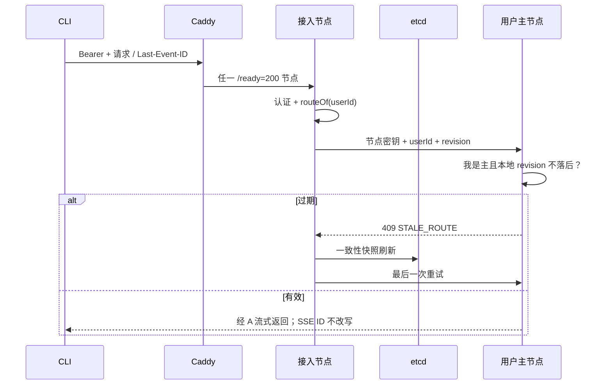
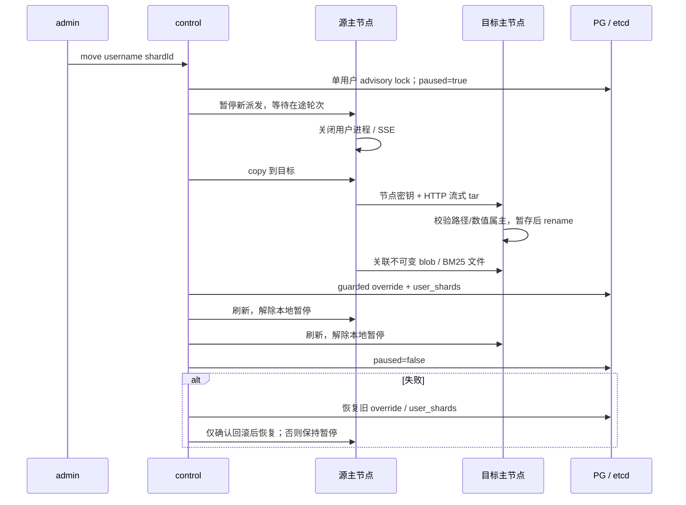

# s17 分片与路由设计

本章唯一新增单元是 `server/modules/sharding/`。数据库、HTTP、后台 worker、uid 目录和部署脚本的修改是该单元的接入点。成员 TTL=10 秒；客户端自动续租约 TTL/3；对账=5 秒；3 节点、3 分片、64 槽；普通转发=30 秒；STALE_ROUTE 最多重试一次；SSE 无时限。

## 请求与缓存

读取 `/codex/` 的单次快照给三张表一个 MVCC revision；Watch 同一整前缀，路由 apply 只处理 shards/、slots 精确键和 overrides/。revision 使用十进制字符串与 BigInt，避免超过 Number 精度。快照和 Watch 交错时重放比快照新的后缀。断线/压缩整表刷新后从新 revision+1 监听；5 秒对账兜底。这个整前缀策略比三个单独 Watch 更容易解释跨表进度。

主归属判断独立于 control 身份；所有存活成员启动自己的业务栈。Redis ready key 带 nodeId；任务扫描、恢复、运行目录初始化、媒体轮询、知识索引都过滤本节点用户。恢复只改本节点负责的用户，成员代次失效后停止进程池并按 s16 Rejoin 规则先等旧进程退出再重新加入。

外部请求先认证，内部节点密钥不能代替 Bearer。转发主节点重新认证并从资源/用户记录计算路由用户，不能信任客户端伪造 `x-route-user`。未知主或离线主返回 SHARD_UNAVAILABLE，不向另一台机器试探数据。HTTP 绝对形式的请求 URL 也只能代理到 etcd 中选择的成员地址，避免把节点密钥发向外部域名。

## 元数据与事务

| 数据 | 权威位置 | 写规则 |
|---|---|---|
| members、controller | etcd lease/Election | s16 协调模块 |
| shards、slots、overrides | etcd | control.guardedPut，选举键 create revision 比较 |
| cluster_term | PG | advance_cluster_term，节点不可直接 UPDATE |
| shard_owners、user_shards | PG | control.locked，CT001 事务触发器；pause 与映射同表 |
| 用户业务数据 | PG + 所属节点磁盘 | 对应 shard owner 与 epoch；s14 uid 文件访问 |

control 初始化按当前成员排序，每个节点一个分片；没有成员时保留 null 主。成员离开不改变原主与 epoch；新成员只能填 null 主，不能抢走已分配分片。epoch 初始化为 1，本章没有自动故障接管导致的 epoch 递增。

control 在事务中推进/锁定 cluster_term，先写 shard_owners，guardedPut 后再确认选举任期并提交。PG 与 etcd 不是原子资源：故障窗口可能让缓存领先 SQL，此时 SQL 的 SH001 阻止错误写入。后续 control 对账以 etcd 分片归属修复 SQL。手动迁移的 user_shards 在全过程保持 paused；override 已发布但 SQL 未提交时，下任 control 对账只修复暂停用户，不自动恢复派发。

etcd RBAC 将每个候选节点限制到 `/codex/`，动态“仅 control 写”在受信任节点的 guardedPut API 中实现。静态 etcd 角色不能基于 Election 自动授予写权限；本章不引入 root 凭据的动态角色管理。直接盗用一个节点凭据执行任意 etcd 原始 put 不在此威胁模型内，集成测试明确区分 API 拒绝和键空间 ACL。

## 数据库逐行隔离

所有生产业务连接经 `fencePool`。普通 query 自动包事务，显式 BEGIN 连接在事务起点设置 `app.node`、`app.shard_epoch`。cleanup 的 ROLLBACK/UNLISTEN 仍允许失效代次执行。身份来自认证 AsyncLocalStorage 或后台任务的持久化 owner；资源管理请求可使用单独 shard 上下文，在保持 actor 授权身份的同时设置目标 owner 的 epoch。

`require_shard_owner` 对 UPDATE 同时检查 OLD 和 NEW，防止借修改 owner 将行搬到另一分片。`check_shard` 对 user_shards 与 shard_owners 行持有 SHARE 锁到 COMMIT，并校验当前 SQL 角色确实对应 app.node。即使伪造 SET LOCAL node，也不能使用 node-b 的数据库角色写 node-a 分片。旧主在 user_shards 切换之后写入必定 SH001。

| 业务表 / 写入点 | owner 解析 / 隔离方式 |
|---|---|
| conversations、preferences、resources、usage、media_jobs、hub_skills、knowledge_bases | 行 owner_id |
| user_runtimes | 行 user_id；uid 全库唯一，分配继续持有 s14 advisory lock |
| tasks、outbox、notifications、artifacts | thread_id → conversations.owner_id |
| knowledge_mounts、wiki_pages、wiki_versions、knowledge_indexes、knowledge_jobs | kb_id → knowledge_bases.owner_id |
| resource_versions | resource_id → resources.owner_id |
| dependencies | derived_id → resources.owner_id；来源读取仍须 Hub 授权 |
| resource_grants、skill_share_requests | 授权资源 / skill → owner；跨节点 admin 也去资源主节点 |
| permission_events | 知识/Skill 资源 owner；删除后从 before_state 取 owner；账号权益操作用 actor。保留 append-only 触发器 |

全局表不假装属于某个用户：users、auth_sessions 在任一节点处理登录、令牌触碰和注销，要求实际节点 SQL 角色与 app.node 一致；账号 CLI 为显式管理员运维连接。agent_versions 允许节点幂等 INSERT，不允许节点 UPDATE/DELETE。plans、imports 仅允许显式超级用户维护。migrations 仅迁移工具写，运行角色撤销 DML 权限。cluster_term 的直接 DML 同样被权限撤销。maintenance 必须同时是超级用户且显式设置 app.maintenance=on；节点不能自行设置开关绕过。

SH001 记录原始调用位置。先刷新路由；用户已移到别处时返回错误但保留本节点其他分片；仍认为自己是主或无法刷新时自我隔离。CT001 继续用于 control 任期失败。

## 共享知识读取

被授权者节点上的 KnowledgeService / Resources 先走原有 kb、mount、Hub 判定，再请求所有者节点 `/internal/knowledge`。内部只允许 read/search/pages/resource 四种动作。所有者使用 requester 的新 Hub 快照复核；用户 ID 只解释可信节点传来的已认证身份。不能用 owner 身份替代 requester 授权。数据从所有者 workspace 或不可变 blob 读取；读共享原文仍使用 s14 的数值 uid 辅助进程，根服务不读取私有 CODEX_HOME。权限撤销、失效来源、未挂载知识库仍按 s15 返回拒绝。

## 手动迁移

暂停是 PG 持久状态，同时在源设置本地入场门。任务的执行边界重新查暂停，已进 starting/running/steering 的轮次允许完成。迁移等待用户在途 HTTP、进程引用、执行中任务、索引和媒体全部结束，不自动中断/重跑。每次内部查询小于 30 秒，admin 编排可以等待长轮次；迁移 CLI 显式不设整体 15 秒超时。

tar 来自系统工具，没有实现 tar/etcd/PG 的替代库。导出先以对应 uid 逐项拒绝符号链接、硬链接、特殊文件和异属主，再运行 tar，不继承数据库/etcd/网关密钥。接收先流式落临时 tar，用系统 tar 列举并验证所有条目类型、数值 owner/group 与路径，然后提取到独立暂存目录，最后重命名。两个用户目录分别发布，override 在全部内容成功之后才切换。失败目标目录不参与路由，源数据保留；旧目标备份由运维核对后清理。

辅助 blob 通过 PG 的用户关联查询选择文件，不复制其他用户的数据；BM25 文件按用户知识库索引选择。RAG 的外部向量库仍是既有单实例，不在节点间复制。`.runs` 是节点本地运行日志，不作为迁移后的历史来源。

## 验证边界

离线：`npm test`、四个 lessons，覆盖两种策略、override、缓存重读/竞态、409 一次重试、503、SSE 字节透传、SH001 处理、分片放置、双重授权、迁移顺序与回滚、集群状态。原有 uid、hub、coordination 单元测试全部保留。

外部：`test:data` 内的真实 PG 触发器与事务互锁；`test:sharding:etcd` 的带认证 etcd Watch 和选举任期；`test:ports` 的真实监听 HTTP/SSE；Linux root 的 uid/tar 与真实模型会话验收。离线替身不能证明 PG SQL 执行或 etcd 1 秒传播。

没有实现 s18 的 replica 字段、异步复制、复制位点、自动提升、旧主改从和故障切换。主节点磁盘丢失意味着对应分片不可用，不能从 PG 会话索引凭空恢复 Codex 原生历史。

恢复派发的 COMMIT 回复丢失是特殊的不确定窗口：目标可能已派发，不能再盲目启用旧磁盘。实现重新持久化暂停并保留目标归属，要求 admin 核对并重试；切换阶段的 COMMIT 回复丢失则在暂停期间同时补偿 PG 映射与 override。
