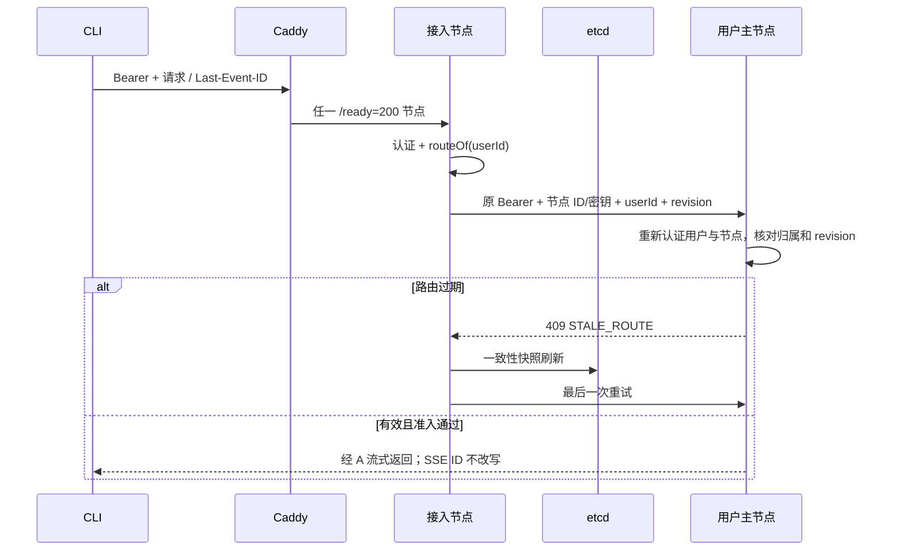

# s17 分片与路由设计

本章唯一新增单元是 `server/modules/sharding/`。数据库、HTTP、后台 worker、uid 目录和部署脚本是该单元的接入点。成员 TTL=10 秒；客户端自动续租约 TTL/3；对账=5 秒；3 节点、3 分片、64 槽；普通转发=30 秒；STALE_ROUTE 最多重试一次；SSE 无总时限。

## 请求与缓存

读取 `/codex/` 的单次快照给三张表一个 MVCC revision；同一整前缀 Watch 覆盖 shards、slots、overrides，apply 只处理路由键。revision 使用十进制字符串与 BigInt，避免超过 Number 精度。快照和 Watch 交错时重放比快照新的后缀。断线/压缩后整表刷新，从新 revision+1 监听；5 秒对账兜底。

主归属独立于 control 身份；所有存活成员启动自己的业务栈。Redis ready key 带 nodeId，任务扫描、恢复、运行目录初始化、媒体轮询、知识索引都过滤本节点用户。`canDispatch` 在异步查询 PG 前后核对租约、缓存主归属和本地暂停，再比较 PG 的 paused 与 shard_id。成员代次失效后停止进程池，等待旧进程退出后重新加入。

每个运行容器只有自己的 `AGENT_NODE_KEY_A/B/C` 明文密钥和三个节点的 SHA-256 验证哈希。`authenticateNode` 以 `x-node-id` 选择预置哈希，校验 `x-node-key` 的哈希后才承认调用节点。自报身份不构成凭据；节点认证也不能代替用户或管理员授权。内部 HTTP 无传输加密，部署须位于可信网络；节点仍共享业务数据库和控制面信任，不是恶意租户之间的隔离边界。

外部请求先认证，目标主节点再次认证 Bearer，并从资源/用户记录计算路由用户；不能信任客户端自报 `x-route-user`。转发过滤来路中的节点和路由头，再写入本节点可信值。目标只来自 etcd 成员地址，HTTP 绝对形式 URL 也仅取 pathname 与 query。未知主或离线主返回 SHARD_UNAVAILABLE，不向另一台机器试探数据。只有带 STALE_ROUTE 标识的 409 触发一次刷新重试，普通业务冲突不重试。

## 元数据与事务

| 数据 | 权威位置 | 写规则 |
|---|---|---|
| members、controller | etcd lease/Election | coordination 管理 |
| shards、slots、overrides | etcd | control.guardedPut，比较选举键 create revision |
| cluster_term | PG | advance_cluster_term，节点不可直接 UPDATE |
| shard_owners、user_shards | PG | control.locked、CT001 事务触发器；pause 与映射同表 |
| move_operations | PG | control 任期保护的状态转换；绑定用户、节点、分片及有效期 |
| 用户业务数据 | PG + 所属节点磁盘 | shard owner、epoch、迁移状态；uid 文件访问 |

control 初始化按当前成员排序，每个节点一个分片；没有成员时保留 null 主和 epoch=0，首次放置推进为 1。成员离开不改变原主与 epoch；新成员只能填 null 主，不能抢走已分配分片。本章不自动提升或重平衡。

分片放置的 `place` 在 PG 事务中锁定 cluster_term，写 shard_owners 并 guardedPut 分片记录，再确认任期并提交。这不是 PG 与 etcd 的原子事务；缓存与 SQL 的短暂分歧仍由准入和 SH001 限制，后续对账核对分片归属。

用户迁移的 `switchUser(userId, shardId, operationId)` 有明确的提交顺序：先在任期保护的 PG 事务核对操作单与源分片，更新 user_shards 并将 copied 推进为 switched；COMMIT 完成后才发布 etcd override。这样不会先把路由发布为目标、PG 却仍停在源归属。PG 已提交而 etcd 未发布仍是可能的失败窗口：用户保持暂停，失败记录为 failed，不自动恢复旧副本。对账只采纳最新操作单为 switched/resumed 且目标匹配的 override，并只更新暂停用户；缺单、未完成复制或 failed 的 override 记录后忽略，不用于修复 PG。

etcd RBAC 将候选节点限制到 `/codex/`，动态“仅 control 写”在受信任节点的 guardedPut API 中实施。静态角色不能基于 Election 自动授予写权限；节点凭据不能交给最终用户。集成测试区分 API 的任期拒绝和原始凭据的键空间 ACL。

## 数据库逐行隔离

所有生产业务连接经 `fencePool`。普通 query 自动包事务，显式 BEGIN 连接在事务起点设置 `app.node`、`app.shard_epoch`。cleanup 的 ROLLBACK/UNLISTEN 仍允许失效代次执行。身份来自认证 AsyncLocalStorage 或任务持久化 owner；资源管理请求使用单独 shard 上下文，保留 actor 授权身份，同时设置目标 owner 的 epoch。

`require_shard_owner` 对 UPDATE 同时检查 OLD 和 NEW。最终生效的 `check_shard` 定义在 [018-move-security.sql](../server/modules/data/migrations/018-move-security.sql)：锁住 user_shards 与 shard_owners 对应行直到 COMMIT，校验真实 SQL 角色、app.node 和 epoch。即使伪造事务变量，也不能使用 node-b 角色写 node-a 分片。用户暂停且操作单为 copying、copied、switched 或 failed 时拒绝业务写入；paused 状态允许已进入执行的轮次收尾，drain 完成后才推进 copying。

| 业务表 / 写入点 | owner 解析 / 隔离方式 |
|---|---|
| conversations、preferences、resources、usage、media_jobs、hub_skills、knowledge_bases | 行 owner_id |
| user_runtimes | 行 user_id；uid 全库唯一，分配持有 advisory lock |
| tasks、outbox、notifications、artifacts | thread_id → conversations.owner_id |
| knowledge_mounts、wiki_pages、wiki_versions、knowledge_indexes、knowledge_jobs | kb_id → knowledge_bases.owner_id |
| resource_versions | resource_id → resources.owner_id |
| dependencies | derived_id → resources.owner_id；来源读取仍须 Hub 授权 |
| resource_grants、skill_share_requests | 授权资源 / skill → owner；跨节点 admin 也去资源主节点 |
| permission_events | 知识/Skill owner；删除后从 before_state 取 owner；账号权益操作用 actor，保留 append-only 触发器 |

全局表不归单个用户，但不能凭节点身份任意写入。节点角色对 users 仅有 UPDATE(plan_id)，无建号、改用户名/角色/密码/禁用权限；auth_sessions 仅有 INSERT 和 UPDATE(last_seen_at, revoked_at)，无 DELETE；agent_versions 只允许 INSERT。全局触发器还要求真实 SQL 角色与 app.node 一致。账号 CLI、plans、imports 由 maintenance 运维连接管理。migrations、cluster_term 的直接 DML 对节点撤销。maintenance 绕过要求超级用户与显式 app.maintenance=on 同时成立，普通节点设置开关无效。018 迁移和角色 provision 都执行上述列级授权。

SH001 诊断以错误中实际被拒行的 owner 为准。刷新前自认为主、刷新后确认用户已移走时，仅当前请求失败，其他分片继续服务；刷新后仍认为自己是主或刷新失败时隔离当前代次。CT001 保护 control 任期。SQL 无法撤销已发生的文件写入、外部工具或模型副作用，因此迁移仍需停写边界。

## 共享知识读取

被授权者节点的 KnowledgeService / Resources 先做 kb、mount、Hub 判断，再携带节点凭据与终端用户 Authorization 请求所有者节点 `/internal/knowledge`。只允许 read/search/pages/resource。所有者拒绝正文中的 requester，使用全局账号和会话表重新认证令牌，按认证得到的用户取得新的 Hub 快照，再核对归属、暂停与授权后读盘。节点密钥或自报用户 ID 都不能替代终端令牌；不能切成 owner 身份绕过权限。

后续工具调用可复用本节点内存中该用户最近认证的令牌，不持久化到任务、磁盘或操作单。重启或用户迁到新节点后，需要新的已认证请求；缺令牌时拒绝跨分片读取。会话撤销、用户禁用和 Hub 撤销均需通过所有者端检查。未授权资源按 Hub 返回 404，失效来源和未挂载知识库仍拒绝。

数据从所有者 workspace 或不可变 blob 读取，私有文件仍以数值 uid 辅助进程访问。跨分片 RAG 查询在请求者节点生成 query embedding 并按请求者计费，权威内容读取仍发生在所有者主节点。

## 手动迁移

```mermaid
sequenceDiagram
  participant A as admin
  participant C as control
  participant S as 源主节点
  participant T as 目标主节点
  participant P as PostgreSQL
  participant E as etcd
  A->>C: move username shardId；验证 admin 令牌
  C->>P: 单用户 advisory lock
  C->>P: beginMove：操作单 paused + 用户 paused=true
  C->>S: 带 operationId 暂停并 drain
  S->>S: 等既有工作，关闭用户进程
  C->>P: paused → copying
  C->>S: 带 operationId 请求 copy
  S->>T: 源节点凭据 + operationId + tar/blob/BM25
  T->>T: 验证单据、容量、条目、权限；发布前复核
  C->>P: copying → copied
  C->>P: 提交归属与 copied → switched
  C->>E: COMMIT 后 guardedPut override
  C->>T: resume：刷新并解除本地暂停
  C->>S: resume：刷新并解除本地暂停
  C->>P: finishMove：resumed + paused=false
  opt 任一步失败
    C->>P: 原任期 failMove：failed + paused=true
    Note over S,T: 保留副本与已提交归属；运维核对恢复
  end
```

`beginMove` 拒绝已暂停用户；未暂停且目标已是当前分片时返回 unchanged。操作单最长有效 30 分钟，绑定用户、control、源节点、目标节点和源/目标分片。pause、drain、copy、resume 要求调用者是单据 control；transfer、content 要求源节点调用目标节点。六个接口核对用户、接收节点、步骤状态和可选目标。暂停/drain 仅在 paused，复制/传输仅在 copying，resume 仅在 switched。目录与正文发布前再次验证单据和暂停，目录还拒绝覆盖已经开始负责该用户的节点。

PG 持久暂停与源节点本地暂停共同阻止新入场；暂停时关闭用户 SSE。starting/running/steering 轮次允许完成。drain 等待在途 HTTP、进程引用、任务、索引和已开始的媒体轮询，再关闭用户进程。媒体 `tick` 每次 poll 前调用 canDispatch，暂停期间不启动新 poll；pollingOwners 在异步准入完成前登记，waitOwner 因此也覆盖正在查询 PG 的轮询。不会为了迁移重提远端媒体任务或自动重跑轮次。

内部状态查询有 30 秒超时，admin 编排和 CLI 没有整体 15 秒超时；操作单的 30 分钟有效期仍约束后续步骤。等待过久需核对工作与操作单，不能忽略过期后恢复。

CODEX_HOME 由用户 uid/gid 导出，workspace 由服务身份导出，保留合法数值属主；源目标必须有同一 uid 映射和固定绝对部署目录。仅跳过 CODEX_HOME 顶层 tmp，workspace 不套用此规则。辅助进程使用最小环境，不继承数据库、etcd 或网关密钥。导出检查拒绝链接、特殊文件和不匹配属主；系统 tar 列举后再校验类型、路径、重复条目、数值 owner/group，并拒绝 setuid。

tar、正文 blob、BM25 每次接收上限均为 **1 GiB**；`AGENT_TRANSFER_MAX_BYTES` 只能下调。创建文件前检查目标卷至少有两倍配置上限的可用空间，tar 同时检查临时归档所在卷；不足返回 507。流式计数超限返回 413，失败清理临时文件。提取使用目标目录同挂载的暂存目录，避免 rename 跨设备；按清单自底向上恢复属主与权限。`restoredMode` 对普通文件清除全部特殊权限位，目录仅保留 setgid。发布不混合旧 SQLite 文件，旧目标副本保留待运维清理。

关联 blob 由 PG 用户关系选择，BM25 按用户知识库索引选择并校验摘要，不复制其他用户数据。外部向量库仍是单实例，`.runs` 仅为节点日志。全部目录与辅助内容成功后才推进 copied 和切换；每次目录传输超过 30 秒会失败。

任一步失败都尝试以原任期执行 failMove，记录 failed 并持久暂停，不自动补偿 PG 或 etcd 为源归属。切换或 finishMove 的 COMMIT 回复丢失时，保留已提交状态和两份磁盘；目标可能已派发，不能盲目启用源。failMove 不推进任期，较新 control 取得 PG fence 后旧 control 无权继续记录；记录失败会标记 rollbackFailed，运维须核对真实状态。重复 move 会拒绝暂停用户，不能充当失败操作单的自动恢复。

## 验证边界

离线：`npm test` 与四个 lessons，覆盖策略、override、缓存竞态、一次重试、503、SSE 字节透传、SH001 诊断、节点身份、操作单授权、双重授权、传输上限、权限掩码、媒体暂停及迁移顺序和失败保留。

外部：`test:data` 的真实 PG 触发器、列级权限和事务互锁；`test:sharding:etcd` 的认证 Watch 和选举任期；`test:ports` 的真实 HTTP/SSE；Linux uid/tar、跨节点迁移及模型会话续聊。离线替身不能证明实际 SQL 权限、文件属主或 etcd 传播时延。

没有副本、复制位点、自动提升或故障切换。主磁盘丢失意味着对应分片不可用，PG 会话索引不能凭空恢复 Codex 原生历史。PG、Redis、模型网关与教学 etcd 仍为单实例。
