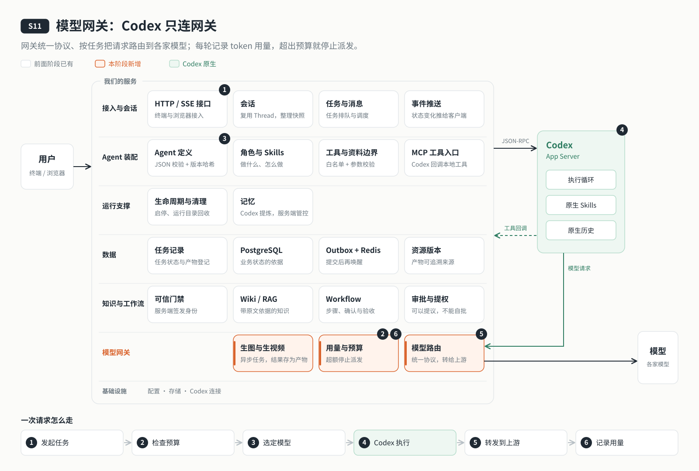

# s18: 副本与故障接管 — 主节点坏了有人接手，丢多少说得清

[导论](../introduction.md) → [s00](../s00-sdk-quickstart/) → [s01](../s01-single-turn/) → [s02](../s02-multi-turn/) → [s03](../s03-service/) → [s04](../s04-events-messages/) → [s05](../s05-agent-assembly/) → [s06](../s06-tools/) → [s07](../s07-memory/) → [s08](../s08-data-layer/) → [s09](../s09-knowledge-layer/) → [s10](../s10-skill-workflow/) → [s11](../s11-model-gateway/) → [s12](../s12-deploy/) → [s13](../s13-auth/README.md) → [s14](../s14-isolation/README.md) → [s15](../s15-hub/README.md) → [s16](../s16-coordination/README.md) → [s17](../s17-sharding/README.md) → `s18` → [app](../../app/)

> *"主节点坏了有人接手，丢多少说得清"* — 在轮次边界把用户目录异步复制到副本；主节点的租约过期后，已追平的副本接手；最后一次复制之后的内容，如实标为丢失。
>
> **对应六个问题**：③ 之前聊过什么？ ⑥ 谁说了算？

---



## 要回答的问题

上一章把用户分到了不同的节点，每台机器都在干活。代价是：每个用户的数据只在一台机器的磁盘上。这台机器坏了，它那一片的用户就只能干等。

这一章让别的节点能接手。要回答：

- 数据要提前复制到哪里？什么时候复制，才不会拷到写了一半的文件？
- 复制总会慢一步。主节点突然坏掉时，最后那一点没来得及复制的内容怎么办？怎么告诉用户？
- 谁来决定由谁接手？接手的节点数据不全，能不能上？
- 坏掉的旧主节点恢复以后，会不会和新主节点抢着写？

本章只加一个单元：**副本**。s17 的分片与路由、s16 的租约与任期、s14 的用户隔离、s15 的 Hub 权限都原样沿用。

## 核心概念

### 每个分片一主一从，环形放置

每个分片除了主节点，再放一个**副本**（从节点），三个节点环形错开：

| 分片 | 主节点 | 副本 |
|---|---|---|
| 0 | node-a | node-b |
| 1 | node-b | node-c |
| 2 | node-c | node-a |

每个节点既是一个分片的主，又是另一个分片的副本。任何一台坏了，它负责的分片都有另一台可以接手。

### 只在轮次边界复制

Codex 执行一轮的时候，会不断修改 CODEX_HOME 里的状态库、会话记录和工具产物。这时去拷贝，拿到的可能是一半新一半旧的文件：目录读得到，不代表它是一份一致的会话。所以只在**轮次边界**复制：用户的一轮结束，而且他的所有会话都没有执行中的轮次。

### 先拍快照，再慢慢发

复制分两步：

1. **边界快照**：短暂暂停这个用户的新轮次，把他的 CODEX_HOME 和工作目录打包成一份本地快照，记下这时完成到第几个任务，然后**立即放行**。
2. **异步发送**：把快照慢慢发给副本。发送期间用户照常对话；发送期间又有新的一轮结束，当前这次发完以后再复制一次。

暂停只持续到本地打包完成，网络再慢，用户也不会被卡住。一轮结束后等 5 秒再复制，把连续的几轮合并成一次；另外每 60 秒检查一次空闲用户，内容没变就跳过。

### 复制位点：副本上一定有的内容

副本收齐 home 和工作目录两部分、确认无误以后，主节点才在数据库里记下**复制位点**：这个用户复制到了第几个任务，用的是哪一次快照。位点说的是"副本上一定有的内容"，接管时就用它划线。

`/cluster` 会按分片显示副本落后几轮、最早没复制的那一轮等了多久；超过 5 分钟标为"副本落后"。主节点照常服务，只是提醒你：这时接管，会丢得更多。

### 故障接管：租约过期，已追平的副本接手

主节点的租约过期（s16），control 先确认它的副本在线、所有用户都有基线、没有正在进行的传输，然后在数据库事务里把副本设为新的主，分片的 epoch 加一，再发布到 etcd。各节点经 Watch 更新路由，新主完成恢复后开始服务。副本数据不全，就宁可让这个分片暂时不可用，也不接管。

### 尾部丢失：明确接受，如实告诉用户

最后一次复制之后完成的内容，在新主上看不到。这叫**尾部丢失**。本章明确接受它，但必须说清楚丢了什么：

| 接管时的情况 | 接管后 |
|---|---|
| 会话在最后一次复制之前就有了，只是最后几轮没复制 | 会话照样能续聊；没复制的那几轮标为"副本缺失"，并在会话里提示用户核对 |
| 会话是最后一次复制之后才新建的，副本上根本没有它 | 访问返回 409 `REPLICA_MISSING`，提示新建会话；它排队的任务转为待核对 |
| 正在执行的轮次 | 按 s08 记为待核对，不自动重跑 |
| 排队中的任务（会话在副本上存在） | 保留，由新主接着派发 |

任务记录一直留在 PostgreSQL 里，丢的只是副本上的文件。丢失的窗口就是"最后一次复制之后"：5 秒去抖、长轮次、网络慢都会让它变大，这不是零丢失的承诺。

### 旧主回来：先当副本，追平了才能当主

epoch 加一以后，旧主写的每一行业务数据都带着旧 epoch，数据库直接拒绝（SH001），醒来的旧主写不进去。它发现自己不再是主，就停掉这个分片的用户进程，其他分片照常服务。

旧主恢复后以**副本**身份重新加入：新主把这个分片所有用户全量推给它，全部追平才标为就绪。系统不会自动切回；需要时，管理员用 `cluster promote` 手动切换，目标副本必须已经追平，切换前会暂停分片、等轮次结束、做最后一次同步。

## 分工：Codex 做什么，我们做什么

| Codex 做什么 | 我们做什么 |
|---|---|
| 在主节点上照常执行，历史写进用户的 CODEX_HOME | 轮次边界的快照、异步发送与复制位点 |
| 在新主上从复制过来的 CODEX_HOME 恢复会话 | 租约过期后确认副本可用、推进 epoch、发布新归属 |
| | 尾部丢失按会话粒度标记，并如实告诉用户 |
| | 旧主以副本回归、全量追平；手动切换 |

节点只拿自己的数据库角色、etcd 账号、节点密钥和网关访问密钥；各家模型的密钥仍只在网关。各部件的职责划分见 [设计说明](docs/design.md#部件职责)。

## 跑起来看看

```bash
cd stages/s18-replication
npm ci
npm test
npm run lesson -- list
npm run lesson -- replication-boundary
npm run lesson -- replication-lag
npm run lesson -- replication-recovery
npm run lesson -- replication-fence
```

单机 Docker 三节点沿用部署脚本。先复制 `.env.example` 为 `.env`，填模型网关、数据库、Redis、etcd 和三个节点的独立凭据，运行 `bash deploy/configure.sh` 生成配置。单机模拟不设置 `AGENT_REPLICATION_RATE_LIMIT`。完整远程安装入口：

```bash
DEPLOY_HOST=example.com bash deploy/remote.sh check
DEPLOY_HOST=example.com bash deploy/remote.sh init-env
DEPLOY_HOST=example.com bash deploy/remote.sh deploy
DEPLOY_HOST=example.com bash deploy/remote.sh auth-init
DEPLOY_HOST=example.com bash deploy/remote.sh user -- add bob
DEPLOY_HOST=example.com bash deploy/remote.sh tunnel
npm run login
npm run cluster -- status
```

入口 `127.0.0.1:4336`，内部节点 `4340–4342`，数据库 `agent_s18`，Compose 项目和 systemd 单元 `codex-harness-s18`，固定部署路径 `APP_DIR=/opt/s18-replication`。基础镜像 digest 沿用原值。先让 bob 完成两轮，等待 `/cluster` 对应用户落后为 0、分片 ready=true，再测试：

```bash
# 先查 bob 实际所在主节点，下例假设是 node-a / 分片 0。
docker compose kill node-a
# 观察租约消失、新主 node-b、epoch+1；原有已复制历史可以续聊。
docker compose up -d node-a
# node-a 以 replica 回归；等全部用户追平后 ready=true。
npm run cluster -- promote 0

# 假死：恢复后旧 epoch 写入不得生效。
docker compose pause node-a
sleep 15
docker compose unpause node-a

# 分区：先记下容器 ID，断开后检查另外两个分片仍能服务。
node_id=$(docker compose ps -q node-a)
docker network disconnect codex-harness-s18_default "$node_id"
# 恢复网络
docker network connect --alias node-a codex-harness-s18_default "$node_id"
```

外部验收（全部只用专用测试库，不能连接生产库）：

```bash
npm run test:data                 # 本机 initdb / pg_ctl / redis-server；包含真实 PG 接管测试
npm run test:runtimes:uid         # Linux root:1000，真实 PG+Redis，原生 Codex、模拟模型
npm run test:replication:etcd      # 全新 PG 测试库 + 真实认证 etcd
npm run test:ports                # 允许绑定本机端口时执行
```

外部测试对环境的要求（只给最小 capability、专用测试库与测试 etcd）见 [设计说明](docs/design.md#外部测试的环境要求)。

运行之后多了这些：每个分片在数据库里多了副本节点和"副本已追平"标记，每个用户一条复制位点；三个节点的磁盘上，各自保存着自己作为副本的那个分片的用户目录。

## 两台服务器

控制机 `control.example.com` 运行 PG、Redis、etcd、gateway、Caddy、node-a、node-c；第二台 `worker.example.com` 只运行 node-b。仍保留三个分片的环形布局。第二台默认 700m、`AGENT_RUNTIME_LIMIT=2`，可在 `.remote.env` 调整为 1–4。

网络路径：远程 node-b → 本机 SSH `-L` 回环端口 → 控制机 `remote-access` 回环端口 → Docker 内基础服务。node-b 访问 node-a/c，通过本机 4340/4342 隧道。控制机节点访问 `host.docker.internal:4341` → bridge 网关 relay → 控制机回环 14341 → SSH `-R` → 第二台回环 4341。所有对宿主发布的基础服务端口都绑定 127.0.0.1；bridge relay 必须显式设置 `RELAY_BIND`；绑定 Docker 网桥网关地址，是为了让 compose 网络内的节点访问宿主回环反向隧道。该入口仅在 compose 网络内可达，不绑定宿主公网接口；同网桥其他容器也可连接，因此应用层仍需节点密钥与有效操作单。容器内的 remote-access 显式绑定 0.0.0.0，仅通过宿主回环发布端口。

两台机器的具体部署步骤见 [设计说明](docs/design.md#两台服务器的部署步骤)。

### 跨地域实测：同一份代码为什么在跨洋时变慢

本章的教学实测把第二台放在美东、控制机在北京：往返 217 ms，隧道带宽约 3 Mbit/s。故障接管本身成立：停掉北京的主节点，15 秒内美东节点接手，复制过去的历史完整，续聊能接上之前的内容。但很多按"同一内网"设定的时限被逐个突破，因为第二台的每条 SQL、每次 etcd 调用都要跨洋一个来回（单次约 0.45 秒），恢复一个会话要几十次这样的往返。

| 环节 | 同机默认 | 跨洋实测 | 第二台取值 |
|---|---|---|---|
| 复制发送 | 不限速 | 无限速时同一 SSH 连接上 `/health` 首字节延迟 11.6 秒，超过租约 TTL | `AGENT_REPLICATION_RATE_LIMIT=262144`（链路约 70%） |
| PG 建连 | 3 秒 | 1.4–2.8 秒，拥堵时 27 秒 | `AGENT_DATABASE_CONNECT_TIMEOUT_MS=15000` |
| PG 事务内空闲 | 15 秒 | 每条语句等一个来回，长事务被断开（25P03） | `AGENT_DATABASE_IDLE_TX_TIMEOUT_MS=60000` |
| PG 连接池 | 6 | 长事务占满连接池，节点常驻 7–9 条连接 | `AGENT_DATABASE_POOL_MAX=16` |
| etcd 单次调用 | 3 秒 | 0.45–1.2 秒，拥堵时超时 | `AGENT_ETCD_RPC_TIMEOUT_MS=10000` |
| Redis 建连与命令 | 2 秒 | 启动激活失败 | `AGENT_REDIS_TIMEOUT_MS=10000` |
| 请求预算（转发方与接收方共用） | 30 秒 | 恢复会话 31 秒、发消息 39 秒 | `AGENT_REQUEST_TIMEOUT_MS=120000`（控制机也要设） |

调完这些，跨洋节点能工作，但每一步都慢；从美东回传北京的全量追平也会长时间停滞。结论是：**节点与 PG、etcd、Redis 必须在同一地域、同一内网**（往返不到 1 毫秒），跨洋两台只用来演示"不共享磁盘的两台机器之间接管"。真正的跨地域容灾要在每个地域各有一套控制面，再做地域之间的复制，不在本教程范围。

排查中还补了两处对单机同样成立的修正：连接池已满时排队超时只让当次请求返回 503 `DATABASE_BUSY`，不再当作数据库断连去自我隔离（否则一阵高负载就会引发一次故障接管）；节点自我隔离时日志写出原因，数据库断连附带错误类别（只记错误码或固定前缀，不含连接信息）。

## 关键代码

`server/modules/replication/control.mjs`：

```javascript
export const ring = id => ({ primary: `node-${'abc'[Number(id)]}`, replica: `node-${'abc'[(Number(id)+1)%3]}`, epoch: 1 });
```

`server/modules/replication/worker.mjs`：

```javascript
export const DEBOUNCE_MS = 5000;
export const IDLE_SYNC_MS = 60000;
```

`server/modules/replication/store.mjs`：

```javascript
export const MISSING_MESSAGE = '该轮结果在故障接管时丢失，请核对';
export const MISSING_SESSION_MESSAGE = '会话在故障接管中丢失，原会话无法恢复，请新建会话；任务记录已标记待核对';
export const LAG_MS = 5 * 60 * 1000;
```

完整时序和状态约束见 [docs/design.md](docs/design.md)。

## 限制

- PostgreSQL、Redis、etcd 和模型网关仍是单点；副本只解决节点磁盘，不等于整个服务高可用。每个分片只有一个副本，也没有自动再平衡。
- 成员身份只认节点名，不核对磁盘是哪一次复制的结果：把旧磁盘挂回同名节点，它会被当作现任节点接着服务（两台实测换回单机时，测试账号在第二台上跑的最后一轮就因此丢失）。换盘、恢复备份前，必须先核对复制位点，或者让它以副本身份全量追平。
- 旧主从假死醒来到被隔离之间，已经发出的模型和工具调用撤不回；数据库写入会被 SH001 挡住，副作用只落在它本地已经不作数的磁盘上。
- 每次复制都打包整个用户目录，目录越大越占磁盘、网络和暂存空间；单个用户目录超过上限会一直复制失败，分片显示副本落后、不能接管。

完整说明见 [设计说明](docs/design.md#限制的完整说明)。

## 小结

- 每个分片一主一从，环形放置；只在轮次边界复制，避免拷到写了一半的文件。
- 先拍本地快照、立即放行，再异步发送；复制位点记下"副本上一定有的内容"。
- 主节点的租约过期后，已追平的副本接手，epoch 加一，醒来的旧主写不进去。
- 最后一次复制之后的内容会丢：按会话粒度标出来，如实告诉用户，任务记录永远保留。
- 旧主先当副本，追平了才能被手动切回。

到这里，六个问题里的"③ 之前聊过什么"一路从 Thread 历史（s02）、服务端恢复（s03）、原生记忆（s07）、部署持久化（s12）、按用户隔离（s14）、跟着用户分片（s17），走到了"主节点坏了还能从副本接着聊"；"⑥ 谁说了算"也从服务端开关走到了多台机器之间的租约、任期和 epoch。

## 下一章

下一章：无。这是主线最后一章。回到 [app](../../app/) 查看完整项目、Web 工作台与互动课程。

如果要把它真正推向生产，还可以继续：三节点 etcd 和高可用的 PostgreSQL，把文件放进独立的对象存储，把整包复制换成增量复制；再根据真实的恢复时间、目录规模和能接受的丢失窗口，定下服务目标。如果节点要跨地域部署，每个地域应当有自己的一套控制面（见上文「跨地域实测」）。
