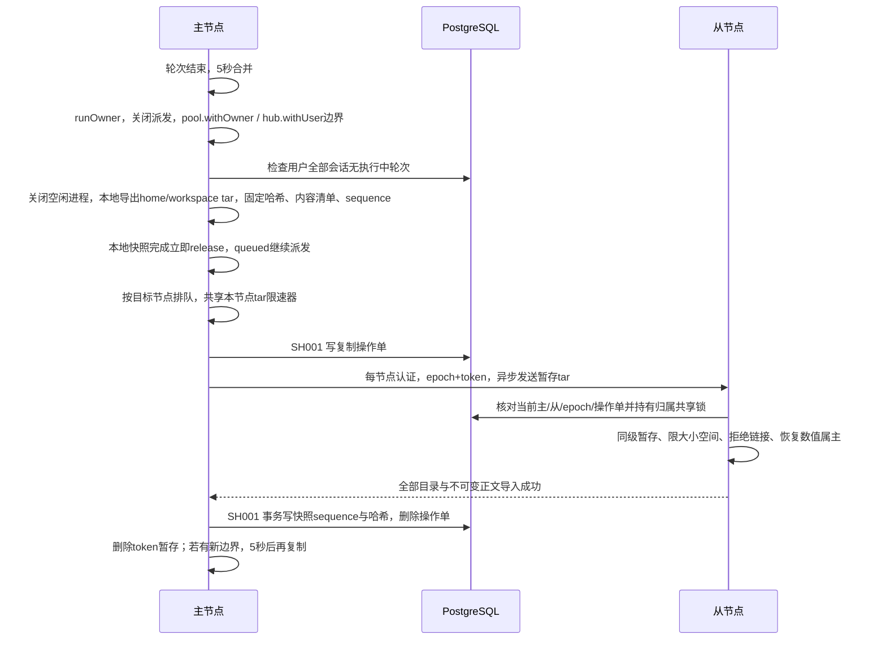
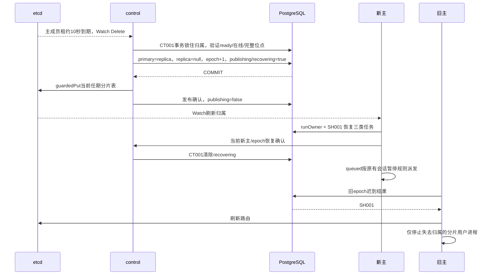

# 副本与故障接管设计

本章只增加 replication 单元。每用户 uid 与原生运行环境仍由 runtimes 管理；hub、知识库授权、迁移操作单、每节点认证、CT001 和 SH001 的职责不变。

## 复制边界与提交

边界快照（暂停新轮次只到本地快照完成）→ 异步发送。快照路径为 `.runs/replication-spool/<userId>/<token>/{home,workspace}.tar`，服务进程属主，目录 0700、文件 0600。导出和哈希、附属不可变内容清单都在 quiesce 内完成；发送只读暂存 tar 与固定内容清单，发布不要求后续轮次新增的文件。位点永远写快照时的 boundary.sequence 与哈希，replicated_at 也取 PG 边界时间，避免把发送期间新建的会话误认为已复制。成功、失败或服务关闭都删除本 token；关闭会中止发送并等待清理，启动时删除上次异常退出的遗留暂存。

每个目标节点一个串行发送队列；队列等待发生在 release 之后，不同目标允许并行。节点内共用 `AGENT_REPLICATION_RATE_LIMIT` 限速器，单位字节/秒，默认 0 不限速，只接受非负安全整数，非法值启动失败。限速仅作用于 tar；每次 socket 写出分块后重置 30 秒进度计时，持续有进展的发送无总时长上限。coordinated HTTP listener 对复制 tree 接收也使用 30 秒无活动超时，其他请求保留 30 秒预算与 10 秒请求头超时。publish/settle/content 保持原超时。

sync/schedule 遇到该用户复制进行中时合并为一个脏标记；无论本次成功或失败，finally 删除 pending 后按 DEBOUNCE_MS（5 秒）重调度，不依赖 60 秒 sweep。

目录 hash 忽略 mtime/atime 和 CODEX_HOME 顶层 tmp；包括相对路径、文件内容、数值属主和权限。home hash/export 用用户 uid，workspace 用服务 0:1000。tar 导入安全路径全部复用 transfer；非 tmp 链接、硬链接、设备文件均拒绝，清除特殊权限位。同级暂存避免跨挂载 EXDEV。附属正文按 PG 用户归属清单和摘要验证。导入事务与分片切换互斥；位点之前不认为一对目录已经可接管。失败保留操作单，以 unavailable 取代提升半份文件。

60 秒 sweep 只检查当前主节点的用户。失败不让主服务隔离；/cluster 同时展示操作单、复制错误和每用户落后。落后轮数计未复制 completed 任务，秒数从其中最早完成时间起算；已同步空闲用户为 0。超过 300 秒标记 replica_lagging，/ready 保持正常健康结果并增加 degraded。

## 控制事务与恢复

PG 是归属权威，etcd 是可 Watch 的发布面。`publishing` 在 PG 提交之后、etcd 成功之后才解除；etcd 失败由 control 对账重发。不回退 epoch。业务派发同时核对 PG primary/epoch 和缓存，不能只看缓存是否认为自己是主。

恢复以 `replication_positions.epoch = 新epoch-1` 的位点为边界。completed 尾部改 replica_missing，原记录、任务 ID 与 error 提示保留；starting/running/steering 改 unconfirmed 并暂停对应会话；queued 仅补 outbox，不改变状态。相同会话有 unconfirmed 时必须人工核对后继续。恢复可重复执行，不重跑结果不明任务。

原主回归使用 previous_primary，成为 replica，ready=false。当前新主为该分片所有已命名用户建立本 epoch 位点后由 control 验证并设置 ready；新用户尚无基线也会阻止提升。手动 promote 先持久化 paused，等待执行中任务，再完整同步和同样的切换流程；失败保留暂停，重试同一命令。最后同步先等待已有发送结束，再获取暂停后的新快照，不能直接复用暂停前的复制结果。没有自动切回或再平衡。

## 接口与文件

- `POST /cluster/promote {shardId}`：admin，转发后由 control 再鉴权。
- `PUT /internal/replication/tree|content`：每节点密钥 + 当前主/从/epoch + PG 操作单；无用户冒名参数。
- `POST /internal/replication/ready|recovered`：control 核对调用节点和当前 epoch，再在 CT001 事务内确认。
- `POST /internal/replication/sync`：只接受当前 control，PG 分片必须已暂停。
- `replication_positions` 与 `replication_transfers`：SH001 行保护，不使用 control 任期代替用户归属。
- 路由广告地址由 AGENT_NODE_ADDRESS 配置。两机部署只通过 SSH 转发基础服务和节点端口，第二台只拿自身最小凭据。

## 验证与已知边界

离线测试调用生产 worker、control、store、guardedPut 和 RouteCache，不使用总是 JSON.stringify 的假序列化。真实 PG 测试验证触发器拒写、位点和丢失标记。认证 etcd 测试释放续约后等待租约自然过期，验证 ≤15 秒切换和未追平拒绝。Linux uid 测试使用三个完整实例和独立目录，以模拟模型检查真实原生历史中两轮回复。

控制面单点、全量 tar 成本、有限磁盘空间和异步尾部丢失是明确限制。跨地域实测 20 MB / 约 3 Mbit/s ≈ 1 分钟一次，RTT 217 ms；同一 SSH 连接拥塞时 /health 首字节曾延迟 11.6 秒，etcd TTL 为 10 秒。两台部署的控制机 `.env` 和远程生成环境均设 `AGENT_REPLICATION_RATE_LIMIT=262144`，原则是不超过实测带宽约 70%，给续约和请求转发留余量；限速延长发送时间，但不延长用户暂停到网络发送结束。单机模拟不设置该变量。运行中的目录不做在线 SQLite 备份；为一致性在边界关闭空闲用户进程，下一次对话会重新启动。对象存储和增量复制属于生产化方向。
