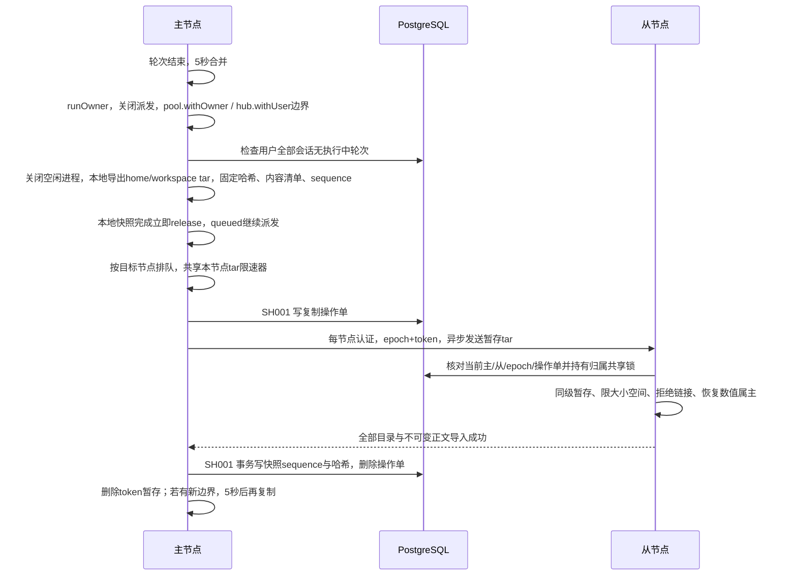
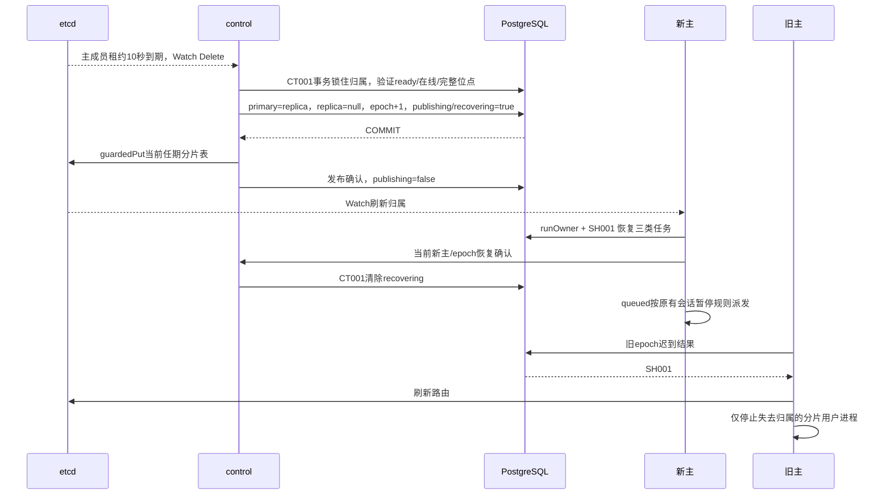

# 副本与故障接管设计

本章只增加 replication 单元。每用户 uid 与原生运行环境仍由 runtimes 管理；hub、知识库授权、迁移操作单、每节点认证、CT001 和 SH001 的职责不变。

## 设计原理

每个分片增加一个环形放置的副本，使主节点不可用时有另一份用户目录可供接管。执行中的 Codex 会持续改写状态与产物，因此复制只能发生在该用户所有会话都没有执行中轮次的边界，不能把可读取的目录直接当作一致快照。

复制先短暂停派新轮次，将 CODEX_HOME 和工作目录打包为本地快照，完成后立即放行，再异步发送给副本。副本收齐并确认两部分内容后才记录复制位点，位点标明副本确定具备的内容；网络发送期间新增的轮次留待后续复制。

主节点租约过期后，control 检查副本在线、用户基线完整且没有在途传输，再推进 epoch、发布新归属并由新主恢复。位点之后的已完成内容可能丢失，必须标记副本缺失；执行不确定的轮次仍待核对，不自动重跑，副本上存在会话的排队任务由新主继续派发。

旧主恢复后先作为副本全量追平，不能自动切回。旧 epoch 的业务写入由数据库拒绝，节点仅停止失去归属的分片；手动切换也要求副本已追平，并在暂停、等轮次结束和最后同步之后进行。

## 架构改进

在 s17 的分片、路由与手动迁移之上，本章新增 replication，负责轮次边界快照、异步发送、复制位点、故障接管与尾部丢失标记。Codex 仍在主节点执行，并在新主从复制来的 CODEX_HOME 恢复会话；服务负责推进 epoch、发布归属、旧主作为副本回归与手动切换。

### 接口与文件

- `POST /cluster/promote {shardId}`：admin，转发后由 control 再鉴权。
- `PUT /internal/replication/tree|content`：每节点密钥 + 当前主/从/epoch + PG 操作单；无用户冒名参数。
- `POST /internal/replication/ready|recovered`：control 核对调用节点和当前 epoch，再在 CT001 事务内确认。
- `POST /internal/replication/sync`：只接受当前 control，PG 分片必须已暂停。
- `replication_positions` 与 `replication_transfers`：SH001 行保护，不使用 control 任期代替用户归属。
- 路由广告地址由 AGENT_NODE_ADDRESS 配置。两机部署只通过 SSH 转发基础服务和节点端口，第二台只拿自身最小凭据。

## 技术实现流程

### 复制边界与提交



边界快照（暂停新轮次只到本地快照完成）→ 异步发送。快照路径为 `.runs/replication-spool/<userId>/<token>/{home,workspace}.tar`，服务进程属主，目录 0700、文件 0600。导出和哈希、附属不可变内容清单都在 quiesce 内完成；发送只读暂存 tar 与固定内容清单，发布不要求后续轮次新增的文件。位点永远写快照时的 boundary.sequence 与哈希，replicated_at 也取 PG 边界时间，避免把发送期间新建的会话误认为已复制。成功、失败或服务关闭都删除本 token；关闭会中止发送并等待清理，启动时删除上次异常退出的遗留暂存。

每个目标节点一个串行发送队列；队列等待发生在 release 之后，不同目标允许并行。节点内共用 `AGENT_REPLICATION_RATE_LIMIT` 限速器，单位字节/秒，默认 0 不限速，只接受非负安全整数，非法值启动失败。限速仅作用于 tar；每次 socket 写出分块后重置 30 秒进度计时，持续有进展的发送无总时长上限。coordinated HTTP listener 对复制 tree 接收也使用 30 秒无活动超时，其他请求保留 30 秒预算与 10 秒请求头超时。publish/settle/content 保持原超时。

sync/schedule 遇到该用户复制进行中时合并为一个脏标记；无论本次成功或失败，finally 删除 pending 后按 DEBOUNCE_MS（5 秒）重调度，不依赖 60 秒 sweep。

目录 hash 忽略 mtime/atime 和 CODEX_HOME 顶层 tmp；包括相对路径、文件内容、数值属主和权限。home hash/export 用用户 uid，workspace 用服务 0:1000。tar 导入安全路径全部复用 transfer；非 tmp 链接、硬链接、设备文件均拒绝，清除特殊权限位。同级暂存避免跨挂载 EXDEV。附属正文按 PG 用户归属清单和摘要验证。导入事务与分片切换互斥；位点之前不认为一对目录已经可接管。失败保留操作单，以 unavailable 取代提升半份文件。

60 秒 sweep 只检查当前主节点的用户。失败不让主服务隔离；/cluster 同时展示操作单、复制错误和每用户落后。落后轮数计未复制 completed 任务，秒数从其中最早完成时间起算；已同步空闲用户为 0。超过 300 秒标记 replica_lagging，/ready 保持正常健康结果并增加 degraded。

### 控制事务与恢复



PG 是归属权威，etcd 是可 Watch 的发布面。`publishing` 在 PG 提交之后、etcd 成功之后才解除；etcd 失败由 control 对账重发。不回退 epoch。业务派发同时核对 PG primary/epoch 和缓存，不能只看缓存是否认为自己是主。

恢复以 `replication_positions.epoch = 新epoch-1` 的位点为边界。completed 尾部改 replica_missing，原记录、任务 ID 与 error 提示保留；starting/running/steering 改 unconfirmed 并暂停对应会话；queued 仅补 outbox，不改变状态。相同会话有 unconfirmed 时必须人工核对后继续。恢复可重复执行，不重跑结果不明任务。

原主回归使用 previous_primary，成为 replica，ready=false。当前新主为该分片所有已命名用户建立本 epoch 位点后由 control 验证并设置 ready；新用户尚无基线也会阻止提升。手动 promote 先持久化 paused，等待执行中任务，再完整同步和同样的切换流程；失败保留暂停，重试同一命令。最后同步先等待已有发送结束，再获取暂停后的新快照，不能直接复用暂停前的复制结果。没有自动切回或再平衡。

## 核心代码

以下摘录与本章 README「关键代码」逐行一致，展示一主一从的环形放置、复制去抖与空闲检查间隔，以及故障接管的丢失提示和副本落后阈值。

```javascript
export const ring = id => ({ primary: `node-${'abc'[Number(id)]}`, replica: `node-${'abc'[(Number(id)+1)%3]}`, epoch: 1 });
```

```javascript
export const DEBOUNCE_MS = 5000;
export const IDLE_SYNC_MS = 60000;
```

```javascript
export const MISSING_MESSAGE = '该轮结果在故障接管时丢失，请核对';
export const MISSING_SESSION_MESSAGE = '会话在故障接管中丢失，原会话无法恢复，请新建会话；任务记录已标记待核对';
export const LAG_MS = 5 * 60 * 1000;
```

## 验证

在本章目录运行以下命令；外部验收只连接专用测试库，环境要求见 [外部测试的环境要求](#外部测试的环境要求)。

```bash
npm test                       # 离线测试
npm run test:data              # 真实临时 PostgreSQL / Redis，包含接管测试
npm run test:runtimes:uid      # Linux root:1000、真实 PG/Redis、原生 Codex 与模拟模型
npm run test:replication:etcd   # 全新 PG 测试库与真实认证 etcd
npm run test:ports             # 需要允许绑定本机端口
```

部署后的停机、假死、分区与旧主回归观察沿用 README「跑起来看看」；通过 `npm run cluster -- status` 核对复制位点、落后和归属，再按该节检查已复制历史能否续聊。

离线测试调用生产 worker、control、store、guardedPut 和 RouteCache，不使用总是 JSON.stringify 的假序列化。真实 PG 测试验证触发器拒写、位点和丢失标记。认证 etcd 测试释放续约后等待租约自然过期，验证 ≤15 秒切换和未追平拒绝。Linux uid 测试使用三个完整实例和独立目录，以模拟模型检查真实原生历史中两轮回复。

## 限制说明

控制面单点、全量 tar 成本、有限磁盘空间和异步尾部丢失是明确限制。跨地域实测 20 MB / 约 3 Mbit/s ≈ 1 分钟一次，RTT 217 ms；同一 SSH 连接拥塞时 /health 首字节曾延迟 11.6 秒，etcd TTL 为 10 秒。两台部署的控制机 `.env` 和远程生成环境均设 `AGENT_REPLICATION_RATE_LIMIT=262144`，原则是不超过实测带宽约 70%，给续约和请求转发留余量；限速延长发送时间，但不延长用户暂停到网络发送结束。单机模拟不设置该变量。运行中的目录不做在线 SQLite 备份；为一致性在边界关闭空闲用户进程，下一次对话会重新启动。对象存储和增量复制属于生产化方向。

更多边界见 [关键数值与实现细节](#关键数值与实现细节) 中的 [限制的完整说明](#限制的完整说明)。

## 机制实验

在本章目录运行 `npm run lesson -- list` 查看实验，按以下命令执行离线断言。依赖与验证边界见 [实验说明](../lessons/README.md)。

| 命令 | 验证内容 |
| --- | --- |
| `npm run lesson -- strategies` | 槽策略与范围策略 |
| `npm run lesson -- stale-route` | revision 落后与一次重试 |
| `npm run lesson -- shard-fence` | SH001 与节点隔离 |
| `npm run lesson -- move` | 暂停、拷贝、切换、恢复 |
| `npm run lesson -- replication-boundary` | 检查 Node 测试断言与阶段顺序。；生产 worker 在无执行轮次后合并同用户请求，只有成功传输后写位点；内容 hash 相同跳过。 |
| `npm run lesson -- replication-lag` | 检查 Node 测试断言与阶段顺序。；从最早未复制 completed 轮次计时；零尾部是零秒，超过300秒才告警。 |
| `npm run lesson -- replication-recovery` | 检查 Node 测试断言与阶段顺序。；复制位点之外的已完成任务标记 replica_missing；执行中 unconfirmed，queued由新主首次派发。 |
| `npm run lesson -- replication-fence` | 检查 Node 测试断言与阶段顺序。；生产 shardFailure 刷新后调用 stopShard，不隔离仍持有其他分片的节点。 |

## 关键数值与实现细节

章节 README 只讲概念；复制、接管与恢复的完整机制、部署步骤与外部测试集中在这里。

| 分片 | 初始主节点 | 初始从节点 |
|---|---|---|
| 0 | node-a | node-b |
| 1 | node-b | node-c |
| 2 | node-c | node-a |

etcd 的 `/codex/shards/<id>` 保存 `{ primary, replica, epoch }`，PG `shard_owners` 保存同一归属和 `replica_ready`。用户仍经 64 个哈希槽映射到三个分片；范围策略、用户例外表和手动迁移操作单保留。磁盘是三份独立目录。

**边界快照 → 异步发送。** 用户一轮结束后等待 5 秒，同用户连续请求合并。暂停新轮次，等待已经进入边界的请求，检查该用户全部会话无 `starting/running/steering`，关闭该用户空闲 Codex 进程。复用 transfer 的导出身份、1 GiB 上限和拒绝链接等校验，把 CODEX_HOME、workspace 导出到 `.runs/replication-spool/<userId>/<token>/{home,workspace}.tar`，同时确定内容哈希、附属内容文件清单和边界 sequence。暂存目录 0700、文件 0600，属主为服务进程。**暂停新轮次只到本地快照完成**，随后立即 release，再排队异步发送暂存文件；成功、失败、正常关闭都删除本 token，启动时清理异常退出的遗留暂存。后台调用显式 `runOwner`；会话边界继续通过 `pool.withOwner`、hub `withUser`。

为什么只在轮次边界复制？运行中的 Codex 正在修改 SQLite、JSONL 和工具产物；目录能被读取，不表示它是一个一致的会话快照。本地快照期间的新任务留在 PG/Redis 排队，快照完成即可派发，网络发送不再暂停该用户。发送期间有新边界时记脏标记，本次复制无论成功或失败，结束后都再等 5 秒调度一次，不等 60 秒兜底。一个用户的其他会话仍在执行时，本轮不复制。

每个目标节点同一时刻只发送一个用户，不同目标可并行；所有目标的 tar 发送共享本节点 `AGENT_REPLICATION_RATE_LIMIT`（字节/秒，非负整数，默认 0 不限速，非法值启动失败）。发送每写出一个分块重置 30 秒进度计时，连续 30 秒无字节进展才中止，没有整体 30 秒上限；接收 tree 同样按无活动超时，publish/settle/content 等小请求保留原超时。

从节点逐次核对调用方节点密钥、PG 当前主节点、replica、epoch 和复制操作单。两个目录与附属内容全部暂存并校验后才成对发布；两个目录的 rename 连续执行，任一失败则回滚已发布目录。发布使用快照时确定的内容清单，主节点随后以 SH001 保护写入快照时的 sequence 与哈希到 `replication_positions(user_id, shard_id, epoch, last_task_sequence, replicated_at)`。`replicated_at` 也取快照边界时间，避免把发送期间新建的会话误判为已经复制。未完成传输操作单会阻止提升，避免提升半份目录。旧目录保留到 PG 位点提交成功后才删除；提交失败恢复旧副本。本地操作记录与 PG 提交 token 用于重试或重启时核对，未完成操作禁止哈希短路。

**空闲兜底与延迟。** 每 60 秒检查空闲用户；以用户 uid 计算 CODEX_HOME 内容哈希，workspace 以服务身份计算，排除顶层 `tmp/`，内容、属主和权限未改变且位点一致则跳过。`/cluster` 按分片、用户显示未复制的已完成轮次数量和最早未复制轮次的等待秒数。空闲且已同步的用户不会因长时间未说话被误报。任何用户等待超过 300 秒，分片标记 `replica_lagging`；复制错误和未追平也显示副本落后。`/ready` 仍为 200，附 `degraded.replica_lagging`，主节点继续服务。

**故障接管。** 成员 TTL 固定 10 秒，客户端约 TTL/3 续约。control Watch 到主成员键消失，确认副本在线、`replica_ready=true`、所有用户有当前 epoch 的基线位点且没有未完成复制，再在 `cluster_term` 事务中推进归属：主改为原从、从设 null、epoch+1、ready=false。PG 提交后才 guardedPut etcd。发布失败时 `publishing=true`，新旧节点都不能派发；control 对账补发。新主完成恢复后才清除 `recovering`。

| 故障时的任务 | 接管后 | 是否自动重跑 |
|---|---|---|
| 已发给 Codex、仍在执行 | `unconfirmed`，会话暂停，待核对 | 否 |
| `completed` 且 sequence 大于最后复制位点 | `replica_missing`；保留 PG 任务，提示「该轮结果在故障接管时丢失，请核对」 | 否 |
| `queued`，且会话创建于最后成功复制之前 | 保留 queued，由新主 outbox 唤醒 | 是正常首次派发；同会话有待核对任务时先核对并继续 |

会话创建于最后一次成功复制之后（副本没有该会话 rollout），或整个用户 home 缺失时，持久标记整会话丢失。读、恢复、发消息均返回 `409 REPLICA_MISSING`，不调用 Codex 恢复；列表带 `replicaMissing:true`。这类会话的 queued 任务转为 `needs-review`，原因是会话在故障接管中丢失。新建会话可正常使用。

会话创建于复制之前、只是尾部已完成任务超过位点时，保留副本上的 rollout 前缀，允许恢复续聊；只把超出位点的 completed 任务标为 `replica_missing`，会话快照带 `missingTurns`（taskId、turnId、message）。该会话 queued 任务保持 queued，由新主派发；执行中任务仍按 s08 转 unconfirmed。原生恢复报错仅在整会话丢失条件成立时映射为 REPLICA_MISSING。升级须运行迁移，包括 `020-replica-missing.sql` 和 `021-replication-error.sql`。

PG 复制位点提交成功后删除本次替换的旧目录；私有 home 由用户 uid 清空，服务再删除外层目录，清理失败只记日志。迁移仍默认保留 `.before-move-*` 供恢复；清理逻辑不扫描或删除历史遗留目录。

接受的丢失窗口是**最后一次复制之后**。5 秒是合并等待时间，不是数据零丢失承诺；长轮次、网络故障和复制耗时都会扩大窗口。`replica_ready` 表示已建立完整基线，并不代表与正在服务的主节点逐字节同步。

**epoch 隔离与回归。** epoch 增加后，旧主的业务写入和复制位点写入由 PG 返回 SH001。旧主刷新缓存，发现自己不是主，只停止该分片用户的进程；它仍可服务其他分片。成员租约失效的整个节点仍沿用原有隔离与 rejoin 流程。旧主重新加入，control 将其设为从节点、ready=false；新主全量推送该分片全部用户，全部成功后 ready=true。不会自动切回。

**手动切换。** `npm run cluster -- promote 0` 需要 admin，任意入口转交当前 control。要求 ready=true；PG 持久化暂停分片 → 等待执行中轮次结束 → 最后一次全量同步 → PG 切换 → etcd 发布 → 新主恢复派发。复制失败会保留暂停，可以修复原因后重试同一命令；禁止人工回滚 epoch。

### 部件职责

| 部件 | 负责什么 |
|---|---|
| `replication/worker.mjs` | 轮次边界、5 秒去抖、60 秒兜底、失败记录 |
| `replication/store.mjs` | 位点、落后统计、三类任务恢复 |
| `replication/control.mjs` | 环形放置、CT001 切换、发布对账、旧主回归 |
| `replication/index.mjs` | 生产运行环境、认证传输、显式用户身份与恢复 |
| 原 sharding / transfer | SH001、Watch 缓存、每节点密钥、路由和安全 tar |

uid 隔离、hub 双侧授权、跨分片只读请求携带用户令牌、任期 CT001、分片 SH001、迁移操作单均继续执行。节点只持有自己的 SQL 角色、etcd 凭据、节点密钥及网关访问密钥；服务商密钥留在 gateway。

### 外部测试的环境要求

uid 测试设置 `DATA_TEST_DATABASE_URL`、`DATA_TEST_REDIS_URL`，只给 CHOWN/FOWNER/SETUID/SETGID，不能给 DAC_OVERRIDE。新增三节点 uid 用例会创建并删除专用临时数据库；三实例共用它，各自独立目录。etcd 用例设置 `ETCD_TEST_ENDPOINT` 和 `ETCD_TEST_NODE_A_PASSWORD`、`ETCD_TEST_NODE_B_PASSWORD`、`ETCD_TEST_NODE_C_PASSWORD`，用 node-a/b/c 认证，验证真实租约自然过期而非主动删除。etcd 前缀 `/codex/` 必须属于独立测试实例。

### Docker 中的外部测试

下面创建独立 `codex-s18-accept` 项目和两个测试数据库，不连接正在服务的项目。测试镜像先通过 `docker compose build node-a` 构建；测试环境的 `.env` 只需教学凭据。另选子网避免与三节点演示网络冲突。

```bash
export REMOTE_BRIDGE_SUBNET=172.29.19.0/24 REMOTE_BRIDGE_GATEWAY=172.29.19.1
accept() { docker compose -p codex-s18-accept -f compose.yaml -f deploy/acceptance.compose.yaml --profile acceptance "$@"; }
accept up -d postgres redis etcd
accept run --rm --no-deps etcd-init
accept up -d --wait postgres redis etcd
accept exec -T postgres createdb -U agent agent_s18_test
accept exec -T postgres createdb -U agent agent_s18_etcd_test
accept run --rm uid-tests node --test tests/replication-pg.integration.mjs
accept run --rm uid-tests
accept run --rm etcd-tests
# 保留失败日志；完成核对后仅删除这个一次性项目。
accept down -v
unset REMOTE_BRIDGE_SUBNET REMOTE_BRIDGE_GATEWAY
```

### 两台服务器的部署步骤

1. 两台 Linux 都装 Docker Compose（支持 `!override`），代码都放在 `/opt/s18-replication`。先设置控制机 `.env`，额外加入：

```dotenv
COMPOSE_FILE=compose.yaml:deploy/two-host.compose.yaml
COMPOSE_PROFILES=remote-access
AGENT_NODE_ADDRESS_B=http://host.docker.internal:4341
AGENT_REPLICATION_RATE_LIMIT=262144
AGENT_REQUEST_TIMEOUT_MS=120000
NODE_B_UPSTREAM=host.docker.internal:4341
```

控制机 `.env` 还要加入 `AGENT_REQUEST_TIMEOUT_MS=120000`；第二台需要的放宽值由 `deploy/remote-env.mjs` 生成，原因见下文「跨地域实测」。

2. 控制机首次初始化使用以下步骤。两台模式不要调用会显式启动本地 node-b 的 `server-setup.sh` / `remote.sh deploy`；也不要同时启动第二个 node-b。

```bash
cd /opt/s18-replication
docker compose build node-a
bash deploy/configure.sh
docker compose up -d etcd
docker compose run --rm --no-deps -T etcd-init
docker compose up -d --wait etcd postgres redis gateway
docker compose run --rm --no-deps --user 0 -T -v "$PWD/.env:$PWD/.env:ro" node-a node scripts/cluster-migrate.mjs
docker compose run --rm --no-deps -T node-a npm run -s agent:init
cp nodes/node-a/.data/identity.json nodes/node-c/.data/identity.json
docker compose run --rm --no-deps -v "$PWD/.env:$PWD/.env:ro" node-a node scripts/maintenance.mjs accounts init
docker compose up -d node-a node-c caddy remote-access remote-node-link
bash deploy/enable-service.sh
# 只导出 node-b 最小凭据，绝不复制控制机整个 .env。
umask 077
node deploy/remote-env.mjs > .remote.env
scp .remote.env worker.example.com:/opt/s18-replication/.remote.env
scp nodes/node-a/.data/identity.json worker.example.com:/opt/s18-replication/.remote-identity.json
# 无密钥的启用模型提供方清单；在第二台先 mkdir -p 对应目录。
ssh worker.example.com 'mkdir -p /opt/s18-replication/nodes/node-b/.data/gateway'
scp .data/gateway/enabled-providers.json worker.example.com:/opt/s18-replication/nodes/node-b/.data/gateway/
```

3. 第二台准备独立 SSH 密钥 `/var/lib/codex-tunnel/.ssh/s18-tunnel`，在控制机创建专用系统用户 `codex-tunnel`（shell 为 `/usr/sbin/nologin`），核对控制机 host key 后写入 known_hosts。无需开启 `GatewayPorts`：反向监听只需控制机回环。先生成并打印限制公钥行供控制机管理员粘贴到该账号的 `authorized_keys`：

```bash
SSH_KEY=/var/lib/codex-tunnel/.ssh/s18-tunnel bash deploy/remote-node.sh --authorized-key
# 输出形如 restrict,port-forwarding,permitopen="127.0.0.1:12379",permitopen=...,permitlisten="127.0.0.1:14341",command="/bin/false" ssh-ed25519 ...
```

该账号只允许隧道，不提供交互 shell；`permitopen` 限定基础服务及其他节点目的端口，`permitlisten` 限定反向回环监听。安装脚本也会打印同一行。随后运行：

```bash
cd /opt/s18-replication
CONTROL_HOST=control.example.com SSH_USER=codex-tunnel bash deploy/remote-node.sh
systemctl status codex-harness-s18-tunnel codex-harness-s18-remote
```

脚本在第二台创建无 shell 的本地 `codex-tunnel` 系统用户，并以该身份运行 systemd 自动重连 SSH 隧道（密钥和已核验的 known_hosts 须让该用户可读）。另安装一个节点容器，不部署第二份控制面。`NODE_ID`、`NODE_PORT`、`REVERSE_PORT`、`CONTROL_HOST`、`SSH_USER`、`SSH_KEY` 可配置；更换远程角色时需相应调整控制机禁用的本地节点、relay 端口、广告地址和 Caddy upstream，不能保留两个同名成员。脚本按 NODE_ID 转发另外两个节点端口；控制机 relay 和 two-host override 也应对应调整。更换子网时同时设置 `REMOTE_BRIDGE_SUBNET` 和 `REMOTE_BRIDGE_GATEWAY`。

4. `/cluster` 确认三成员和副本 ready。让 bob 在分片 0 完成两轮，等复制为零落后后在控制机停 node-a；node-b 应接管。恢复 node-a 后观察全量追平，再用 admin promote 验证手动切换。备份/恢复时同时停第二台节点与隧道相关业务；原单机备份脚本不包含第二台磁盘，应分别备份并核对同一业务时点，不能把旧磁盘直接挂到新 epoch。

### 限制的完整说明

PG、Redis、etcd 和 gateway 仍是控制面单点；副本不等于整个服务高可用。没有自动再平衡，每分片只配置一个副本；从节点离线、未建好基线、存在未完成传输时不接管，分片 unavailable 并记录原因。

成员身份只认节点名，不核对磁盘是哪一次复制的结果：把旧磁盘挂回同名节点时，它会被当作现任节点接着服务（两台实测换回单机时，测试账号在第二台上跑的最后一轮因此丢失）。换盘、恢复备份前必须先核对复制位点，或者让该节点以副本身份全量追平。

旧主假死醒来到被隔离之间，已发出的 Codex 轮次可能继续调用模型与工具。PG 写入由 SH001 阻止，副作用只落在旧主本地、已非权威的磁盘；epoch 隔离不能撤销已经发出的模型或工具调用。

每轮边界全量 tar，以及每 60 秒空闲检查的快照与目录哈希，都会读取整个目录，大目录会占磁盘 IO、网络与暂存空间。跨地域实测单用户 20 MB / 约 3 Mbit/s ≈ 1 分钟一次；限速为 262144 字节/秒时发送更久，但用户只在本地快照期间暂停。限速按本节点所有 tar 发送合计，建议不超过实测链路带宽约 70%，为 etcd 续约与请求转发留余量。单次上限默认 1 GiB，可通过 `AGENT_TRANSFER_MAX_BYTES` 下调；接收端检查两倍上限的可用空间。单用户目录超过上限会持续复制失败，`/cluster` 显示 `replica_lagging` 和「目录过大」原因，该分片不可视为 ready、不可接管；需先减少目录体积再重试。迁移保留的旧目录、升级前的复制旧目录或清理失败残留，需停服核对后人工归档清理。副本是可核对的异步历史窗口，不提供零丢失或自动重跑保证。
